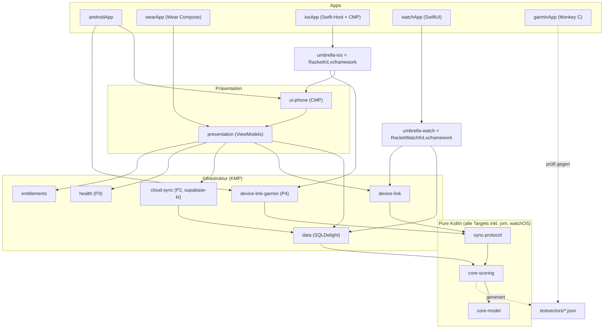
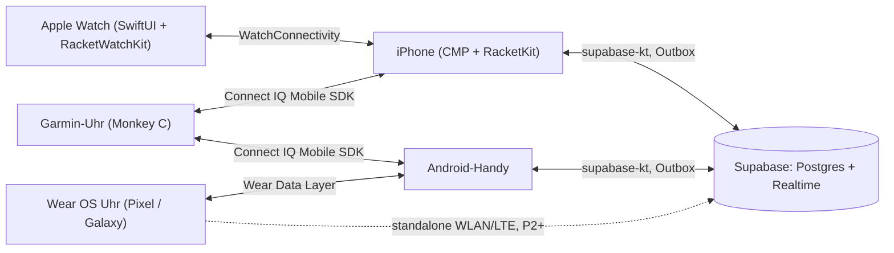
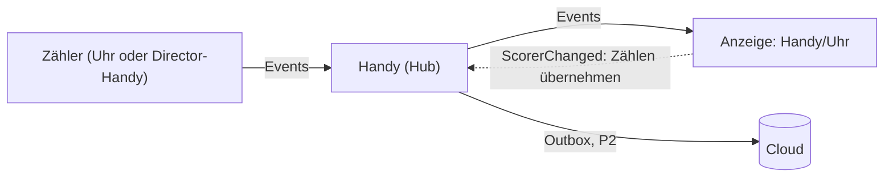
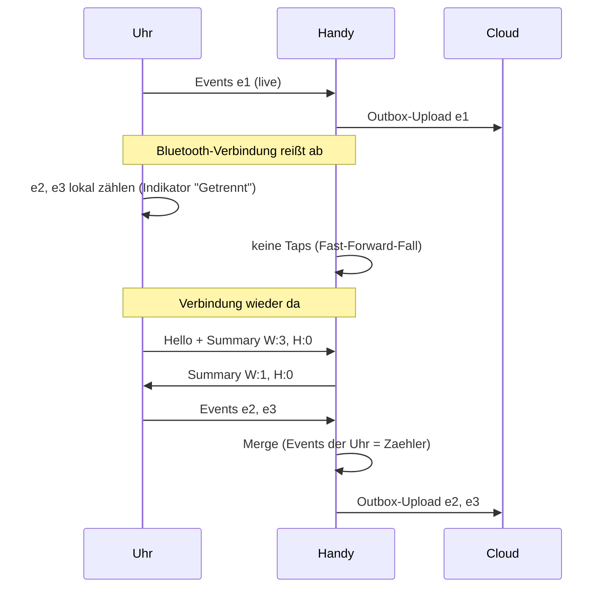
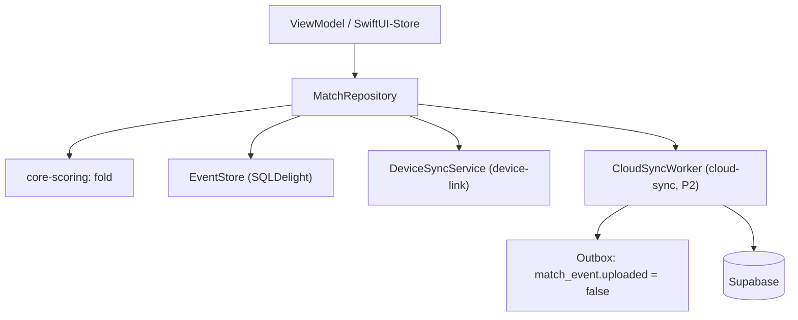

# RacketOne – Architektur (Planungsdokument 01)

> Status: Entwurf v1 · Stand: 14.10.2026 · Rolle: Software-Architektur
> Geltungsbereich: Client-Architektur (Handy, Uhren, Sync, CI/CD, Tests). Das Supabase-Backend (Schema, RLS, Edge Functions) wird im separaten Backend-Dokument detailliert; hier wird nur die Client-Seite und der Vertrag zum Backend festgelegt.

---

## 0. Entscheidungen auf einen Blick

| # | Frage | Entscheidung | Kurzbegründung |
|---|---|---|---|
| E1 | Kotlin-Version | **Kotlin 2.4.20** (auf 2.4.21 heben, sobald SKIE es offiziell unterstützt) | Aktuelle Sprachlinie 2.4; SKIE 0.10.15 ist explizit für 2.4.20 freigegeben |
| E2 | Phone-UI iOS | **Compose Multiplatform auch auf iOS** (kein SwiftUI fürs Handy) | Entwicklung auf Windows: CMP-UI lässt sich auf Android/Desktop lokal bauen und testen, SwiftUI nur blind über CI. CMP iOS ist seit 1.8.0 stable |
| E3 | Swift-Interop | **SKIE** (nicht Swift Export) | Swift Export ist erst Alpha (Kotlin 2.4.0); SKIE ist produktiv erprobt (Flows, suspend, sealed) |
| E4 | Apple Watch | **SwiftUI** + schlankes KMP-XCFramework `RacketWatchKit` (nur Engine, Protokoll, lokaler Store) | Kein CMP für watchOS; Framework klein halten |
| E5 | Wear OS UI | **Compose for Wear OS (Material 3)**, Logik aus `shared` | Offizieller Weg, Kotlin-nativ |
| E6 | Scoring-Engine | **Event Sourcing**, `state = fold(events)`, Undo = Kompensations-Event, pure Kotlin, Integer-only | Deterministisch, merge-fähig, portierbar nach Monkey C |
| E7 | Uhr↔Handy-Konflikte | **Single-Scorer** (ersetzt „Merge statt Autorität“, 2026-10-15): pro Match zählt genau ein Gerät (Standard: Uhr des Spielers, alternativ Director-Handy), alle anderen zeigen an; Übergabe per `ScorerChanged` (§4.4) | Keine Forks, eindeutige Eingabe; Event-Log + deterministische Ordnung bleiben |
| E8 | Topologie | **Stern**: Handy = Hub/Gateway (nicht Autorität). Wear OS darf zusätzlich direkt in die Cloud | Apple Watch und Garmin haben keinen sinnvollen eigenen Cloud-Zugang |
| E9 | Lokale DB | **SQLDelight 2.4.x** (System-SQLite auf Apple) | Klein auf watchOS, SQL-first, kein KSP |
| E10 | Cloud-Sync | **Outbox + idempotenter Upsert** unveränderlicher Events; LWW nur für veränderliche Stammdaten | Events können nicht kollidieren; die Zählerrolle (Single-Scorer, §4.4) regelt, wessen Eingaben wirken |
| E11 | DI | **Koin 4.2.x** in den Apps; Watch-Framework ohne DI-Framework | Leichtgewichtig, keine Codegen-Abhängigkeit |
| E12 | CI/CD | **GitHub Actions** für alles (ubuntu für Android/Wear/Garmin/Tests, macOS für iOS/watchOS) + **fastlane match** + App-Store-Connect-API-Key; **Codemagic** als Plan B | Eine Pipeline, versioniert im Repo; Codemagic nur falls macOS-Kosten/Signing hakt |
| E13 | Xcode-Projekt | **XcodeGen** (`project.yml`), `.xcodeproj` wird nur in CI generiert | Auf Windows editierbar, keine Merge-Konflikte im pbxproj |
| E14 | Garmin-Parität | Monkey-C-Port der Engine + **JSON-Testvektoren** aus der Kotlin-Engine (Golden Files) | Einzige verlässliche Paritätsprüfung zwischen zwei Implementierungen |
| E15 | Uhr-Laufzeit im Match | Schon in P1 **Workout-Session** (watchOS `HKWorkoutSession`, Wear OS Health Services `ExerciseClient` + Ongoing Activity) | Sonst fällt die App beim Handgelenk-Senken zurück aufs Zifferblatt; P3 nutzt dieselbe Session für Puls/Kalorien |

---

## 1. Technologie-Stand (Recherche Oktober 2026)

| Komponente | Empfohlene Version | Stand / Hinweis | Quelle |
|---|---|---|---|
| Kotlin | **2.4.20** (07.09.2026); neueste: 2.4.21 (08.10.2026) | 2.5.0 geplant für Dezember 2026. K1 wird seit 2.4.0 nicht mehr unterstützt | [kotlinlang.org/docs/releases](https://kotlinlang.org/docs/releases.html) |
| Kotlin Multiplatform – watchOS | `watchosArm64` (Tier 2), `watchosSimulatorArm64` (Tier 2), `watchosDeviceArm64` (**Tier 3**) | `watchosX64` deprecated seit 2.3.20, `watchosArm32` deprecated seit 2.4.20 (Entfernung in 2.5.0). Default-Minimum watchOS 8.0 seit 2.4.0 | [Native target support](https://kotlinlang.org/docs/native-target-support.html), [What's new 2.4.0](https://kotlinlang.org/docs/whatsnew24.html), [What's new 2.4.20](https://kotlinlang.org/docs/whatsnew2420.html) |
| Apple-Anforderung watchOS | arm64-Slice zusätzlich zu arm64_32 Pflicht für Uploads ab ca. 28.04.2026, watchOS-26-SDK | Series 9/10/Ultra 2 laufen arm64, ältere arm64_32 → **beide Slices nötig** (Sekundärquellen, bei Apple verifizieren) | [heise](https://heise.de/-10451081), [stora.sh](https://stora.sh/blog/2026-04-26-watchos-wear-os-64-bit-deadline-2026-guide) |
| Compose Multiplatform | **1.12.1** (22.09.2026) | iOS stable seit 1.8.0 (Mai 2025); 1.13.0-alpha02 benötigt Kotlin ≥ 2.4.0 | [CMP Releases](https://github.com/JetBrains/compose-multiplatform/releases), [Kompatibilität](https://kotlinlang.org/docs/multiplatform/compose-compatibility-and-versioning.html), [CMP 1.8.0 Blog](https://blog.jetbrains.com/kotlin/2025/05/compose-multiplatform-1-8-0-released-compose-multiplatform-for-ios-is-stable-and-production-ready/) |
| SKIE | **0.10.15** (25.09.2026) | Explizit Kotlin 2.4.20 | [SKIE Releases](https://github.com/touchlab/SKIE/releases) |
| Swift Export | Alpha seit Kotlin 2.4.0 (Juni 2026) | suspend→async, Flow→AsyncSequence; 2.4.20: sealed-Typen, Vererbung. „Breaking changes expected“ | [What's new 2.4.0](https://kotlinlang.org/docs/whatsnew24.html), [What's new 2.4.20](https://kotlinlang.org/docs/whatsnew2420.html) |
| Android Gradle Plugin | **9.4.0** (Sep. 2026), Gradle **9.6.0** | KMP-Libraries über `com.android.kotlin.multiplatform.library` | [AGP Release Notes](https://developer.android.com/build/releases/gradle-plugin) |
| supabase-kt | **3.8.0** (26.08.2026); 3.9.0-beta-1 (12.10.2026) | Targets inkl. iOS; watchOS laut Doku vorhanden, wird hier aber nicht genutzt | [supabase-kt Releases](https://github.com/supabase-community/supabase-kt/releases) |
| SQLDelight | **2.4.1** (06.10.2026) | watchOS-Runtime seit 2.0; `watchosDeviceArm64` beim native-driver per Spike prüfen | [SQLDelight Releases](https://github.com/sqldelight/sqldelight/releases) |
| Room KMP (Alternative) | 2.8.5 (09.09.2026) | watchOS/tvOS seit 2.8.0 – verworfen zugunsten SQLDelight (siehe §5) | [Room Releases](https://developer.android.com/jetpack/androidx/releases/room) |
| Ktor | **3.6.0** (16.09.2026) | Engines: OkHttp (Android), Darwin (iOS) | [Ktor Releases](https://github.com/ktorio/ktor/releases) |
| Koin | **4.2.2** (15.06.2026) | | [Koin Releases](https://github.com/InsertKoinIO/koin/releases) |
| kotlinx-datetime | **0.8.0** (Mai 2026) | `Instant`/`Clock` liegen jetzt in `kotlin.time` (stdlib) | [kotlinx-datetime Releases](https://github.com/Kotlin/kotlinx-datetime/releases) |
| kotlinx-coroutines | **1.11.0** (Mai 2026) | Artefakt `-watchosdevicearm64` vorhanden | [Releases](https://github.com/Kotlin/kotlinx.coroutines/releases), [Maven Central](https://repo1.maven.org/maven2/org/jetbrains/kotlinx/) |
| kotlinx-serialization | **1.11.0** (Apr. 2026); 1.12.0-RC | Artefakt `-watchosdevicearm64` vorhanden | [Releases](https://github.com/Kotlin/kotlinx.serialization/releases) |
| Wear Compose | **1.7.1** (07.10.2026); Material 3 separat versioniert | `compose-material` ist durch `compose-material3` abgelöst | [Wear Compose Releases](https://developer.android.com/jetpack/androidx/releases/wear-compose) |
| Connect IQ SDK | **9.2.0** (Juni 2026) | CI über `connect-iq-sdk-manager-cli` (Community-Tool) | [Garmin CIQ Overview](https://developer.garmin.com/connect-iq/overview/), [sdk-manager-cli](https://github.com/lindell/connect-iq-sdk-manager-cli) |

Hinweis: GitHub-Release-Seiten zeigen teils kein Jahr; das Jahr wurde aus der Release-Reihenfolge abgeleitet. Alle Versionen werden zentral in `gradle/libs.versions.toml` gepinnt; Updates über Renovate (gruppiert: „kotlin+skie+compose“ nur gemeinsam).

---

## 2. Monorepo-Struktur

### 2.1 Ordnerbaum

```
racketone/
├─ settings.gradle.kts
├─ gradle/libs.versions.toml          # einzige Quelle für Versionen
├─ build-logic/                       # Gradle Convention Plugins (kmp-library, android-app, compose, test)
├─ shared/
│  ├─ core-model/                     # IDs (UUIDv7), Sport, Spieler, Team, Lineup, Side – pure Kotlin
│  ├─ core-scoring/                   # Events, RuleSets (Tennis/Padel/Pickleball), Reducer, Undo, Zählerrolle – pure Kotlin
│  ├─ sync-protocol/                  # Wire-DTOs, Codec (JSON), Anti-Entropy (Versionsvektor), SyncSession-Logik
│  ├─ device-link/                    # Transport Uhr<->Handy: commonMain-Interface, androidMain (Wear Data Layer), appleMain (WatchConnectivity)
│  ├─ device-link-garmin/             # P4: Connect IQ Mobile SDK (Android direkt, iOS via Swift-Glue)
│  ├─ data/                           # SQLDelight-DB, EventStore, MatchRepository, Outbox, Settings
│  ├─ cloud-sync/                     # P2: supabase-kt (Auth, Postgrest, Realtime), CloudSyncWorker
│  ├─ health/                         # P3: expect/actual-Interfaces für Puls/Schritte/Kalorien
│  ├─ entitlements/                   # Freemium-Vorbereitung: Entitlement-Interface, Feature-Gates (Stub "alles frei")
│  ├─ presentation/                   # KMP-ViewModels + UI-State (Phone + Wear teilen Logik)
│  ├─ ui-phone/                       # Compose-Multiplatform-Screens (Android + iOS + Desktop-Preview)
│  ├─ umbrella-ios/                   # XCFramework "RacketKit" (iOS-App): presentation, ui-phone, data, cloud-sync, device-link
│  └─ umbrella-watch/                 # XCFramework "RacketWatchKit" (watchOS): core-scoring, sync-protocol, data(lokal), device-link
├─ androidApp/                        # Android-Phone-App (Activity, Koin-Setup, WorkManager)
├─ wearApp/                           # Wear-OS-App (Compose for Wear OS, Tiles/Complication später)
├─ iosApp/                            # Swift-Host-App: ComposeUIViewController, App-Lifecycle, später HealthKit/StoreKit
│  ├─ project.yml                     # XcodeGen: iOS-Target + eingebettetes watchOS-Target
│  └─ fastlane/                       # Fastfile, Matchfile, Appfile
├─ watchApp/                          # SwiftUI-watchOS-App (Swift-Quellen; Target in iosApp/project.yml)
├─ garminApp/                         # Monkey C: manifest.xml, monkey.jungle, source/, resources/, test/
├─ testvectors/                       # Generierte JSON-Golden-Files (versioniert, CI prüft Drift)
├─ backend/supabase/                  # Migrations, Seeds, Edge Functions (Backend-Agent)
├─ docs/
└─ .github/workflows/
```

### 2.2 Modulabhängigkeiten



### 2.3 Regeln für Module

- **`core-model`, `core-scoring`, `sync-protocol`**: nur `kotlin-stdlib` + `kotlinx-serialization-core` (Annotationen). Keine Coroutines, kein I/O, keine Plattform-APIs, kein `Clock.System` (Zeit wird als Parameter übergeben). Targets: `jvm`, `androidTarget`, `iosArm64`, `iosSimulatorArm64`, `watchosArm64`, `watchosDeviceArm64`, `watchosSimulatorArm64`.
- **`jvm()`-Target in allen shared-Modulen**: Unit-Tests laufen auf Windows in Sekunden; Testvektor-Generator läuft auf JVM.
- **`umbrella-watch` enthält nichts von Ktor, supabase-kt, Compose oder Koin** – Größenbudget für das watchOS-Framework (Ziel < 8 MB pro Slice, im Spike messen).
- **`ui-phone`** hat zusätzlich ein `jvm("desktop")`-Target nur für Previews und Compose Hot Reload auf Windows – kein Desktop-Produkt.
- **Wear-App und Phone-App haben dieselbe `applicationId` und denselben Signierschlüssel** (Pflicht für die Wear Data Layer API).

---

## 3. Scoring-Engine (`core-scoring`)

### 3.1 Grundprinzip

- Ein Match ist ein **append-only Event-Log**. Der Zustand wird nie gespeichert, sondern berechnet: `state = fold(order(effective(events)), initial(config), ruleSet::apply)`.
- **Undo ist ein Event** (`Undo(target)`), kein Löschen. Redo = `Undo` auf ein `Undo`.
- **Determinismus**: gleiche Event-Menge → auf jedem Gerät exakt gleicher Zustand. Keine Floats, kein Zufall, keine Systemzeit, keine Hash-Map-Iterationsreihenfolge in der Logik. Nur Ints/Enums → 1:1 nach Monkey C portierbar.
- Performance: Ein Match hat realistisch < 500 Events; vollständiges Re-Fold kostet Mikrosekunden. Optional Snapshot-Cache (Zustand + Head) für Garmin.

### 3.2 Event-Modell (Planungsskizze, kein finaler Code)

```kotlin
data class ScoreEvent(
    val id: EventId,            // UUIDv7 (zeitsortierbar, global eindeutig)
    val matchId: MatchId,
    val deviceId: DeviceId,     // stabile Installations-ID je Gerät
    val deviceSeq: Long,        // 1..n je (matchId, deviceId) – lückenlos, Basis für Anti-Entropy
    val lamport: Long,          // max(lokal, zuletzt gesehen) + 1
    val wallClockMs: Long,      // nur Anzeige/Statistik, NIE für die Ordnung
    val parentId: EventId?,     // Log-Kopf, den das Gerät beim Tap gesehen hat (Doppel-Tap-Erkennung)
    val payload: EventPayload,
)

sealed interface EventPayload {
    data class MatchCreated(val config: MatchConfig, val lineup: Lineup, val firstServer: PlayerRef)
    data class PointWon(val side: Side, val detail: PointDetail? = null) // detail: Ass, Doppelfehler, Winner … (P3)
    data class Undo(val target: EventId)
    data class ContinueDecision(val anotherSet: Boolean)                // Antwort auf "Noch ein Satz?"
    data class Correction(val kind: CorrectionKind)                     // Aufschläger/Seite manuell korrigieren
    data class MatchEnded(val reason: EndReason)                        // regulär, Aufgabe, abgebrochen
}
```

**Ordnung**: Sortierschlüssel `(lamport, deviceId, id)` – total, deterministisch, auf allen Geräten gleich.

**Effektive Events**: Rückwärts über das geordnete Log; ein Event ist wirksam, wenn es von keinem *wirksamen* `Undo` referenziert wird. Undo auf ein bereits rückgängig gemachtes Event ist ein No-op (idempotent).

**UI-Undo**: Der Undo-Button erzeugt `Undo(target = letztes wirksam angewendetes PointWon/ContinueDecision/Correction/MatchEnded)` – das Ziel ist eine konkrete Event-ID, daher auch bei parallelen Taps eindeutig. Ignorierte Events sind nie UI-Undo-Ziel; maßgeblich ist [02 §7.3](02-scoring-regeln.md#73-effektive-events-und-fold-normativ).

### 3.3 Regelwerke (`RuleSet`)

```kotlin
interface RuleSet {
    fun initial(config: MatchConfig, lineup: Lineup, firstServer: PlayerRef): MatchState
    fun apply(state: MatchState, payload: EventPayload): MatchState   // pure
}
```

| Sport | Konfigurierbar in `MatchConfig` |
|---|---|
| Tennis | Best-of-1/3/5 oder „Freies Spiel“, Games pro Satz (6/4), Tiebreak bei 6:6 (bis 7), Match-Tiebreak (bis 10) statt Entscheidungssatz, No-Ad, Einzel/Doppel |
| Padel | wie Tennis (Doppel) + Einstand-Modus: **Advantage / Golden Point / Star Point** (FIP 2026: max. zwei Vorteile, dann entscheidender Punkt – [FIP](https://www.padelfip.com/2025/12/premier-padel-and-international-padel-federation-unveil-2026-qatar-airways-premier-padel-tour-calendar-and-innovative-new-star-point-system-launched)) |
| Pickleball | Side-Out- oder Rally-Scoring, Spiel auf 11/15/21 mit 2 Vorsprung, Doppel mit Aufschläger 1/2 und „0-0-2“-Start, Best-of-1/3 |

`MatchState` enthält: Punktestand (Punkte/Games/Sätze bzw. Pickleball-Spielstand), Aufschläger + Seite, Seitenwechsel-Hinweis, Satz-/Matchhistorie, `pending: PendingQuestion?`, `conflicts`, `isFinished`.

### 3.4 „Noch ein Satz?“

- Format **„Freies Spiel“** (Default für Hobby): Nach jedem Satzende setzt der Reducer `pending = AskAnotherSet`. Alle Geräte zeigen die Abfrage (Uhr: Vollbild mit zwei großen Buttons, Auto-Default „Ja“ nach 10 s ist **nicht** vorgesehen, um Fehleingaben zu vermeiden). Antwort = `ContinueDecision(true|false)`; `false` beendet das Match.
- **Feste Formate** (Best-of-3 etc.): Abfrage erst nach Match-Ende („Noch ein Satz in gleicher Besetzung?“). „Ja“ erzeugt ein **neues, verknüpftes Match** (`previousMatchId`) mit gleicher Lineup – so bleiben Statistiken sauber.
- Konkurrierende Antworten: erste wirksame in Log-Ordnung gilt; weitere identische sind No-ops, abweichende erzeugen einen Konflikt-Hinweis (siehe §4.4).

### 3.5 Warum Event Sourcing (statt Zustands-Sync)

- Undo beliebig tief, auch geräteübergreifend, ohne Sonderlogik.
- Geräte-Sync wird zum Mengen-Abgleich (CRDT-artig) – keine Zustands-Konflikte; wer zählt, regelt die Zählerrolle (§4.4).
- Statistik (P3) ergibt sich aus dem Log (Punktverläufe, Breakbälle, Momentum).
- Paritätstests mit Garmin: Events rein, Zustand raus – ideal für Testvektoren.

---

## 4. Geräte-Sync Uhr ↔ Handy (ein Zähler, alle zeigen an)

### 4.1 Topologie



- **Ein Zähler, sonst Anzeige (Single-Scorer, 2026-10-15):** Pro Match zählt genau ein Gerät – Standard die Uhr des Spielers, alternativ ein Handy im Director-Modus (eine externe Person zählt). Alle anderen Geräte zeigen nur an. „Zählen übernehmen“ (mit Bestätigung in der UI) überträgt die Rolle (§4.4). Ab P2 kann der Zähler ein anderer Nutzer sein; Zuschauer-Accounts sehen nur zu.
- **Handy = Hub und Cloud-Gateway.** Jedes Gerät hält das vollständige Event-Log des aktiven Matches und berechnet den Zustand selbst; Events fließen vom Zähler über das Handy zu allen Anzeigen.


- Plattformgrenze: **iPhone ↔ Wear OS gibt es nicht** (Wear OS 3+ koppelt nicht mit iPhones). Gemischte Kombinationen synchronisieren nur über die Cloud (P2).

### 4.2 Entscheidung: Merge statt Handy-Autorität (ersetzt)

> **Ersetzt durch Single-Scorer (Produktentscheidung 2026-10-15, 02 §7.5, §12.1 K13).** Gleichwertiges Zählen auf mehreren Geräten erzeugte Forks, deren Erkennung aus dem Log nicht eindeutig ist und deren Auflösung die Nutzer belastet. Der folgende Abschnitt bleibt als Begründungshistorie stehen.

| Kriterium | Handy als Autorität (Sequencer) | **Merge (gewählt)** |
|---|---|---|
| Uhr zählt ohne Verbindung | nur „vorläufig“, Rückweisung möglich | voll gleichwertig |
| Komplexität | Ack/Reject-Protokoll, UI für abgelehnte Punkte | Ordnung + Fork-Regeln, rein in `core-scoring` testbar |
| Latenz Uhr-Tap → Anzeige | Roundtrip oder optimistisch + Rollback | sofort lokal |
| Garmin (Nachrichten mit Sekunden Latenz) | schlecht | gut |

Begründung: Die Anforderung „Uhr und Handy gleichwertig“ plus häufige Verbindungsabbrüche (Handy in der Tasche am Netzpfosten, Bluetooth-Reichweite) sprechen klar für Merge. Der Merge-Algorithmus ist reine Kotlin-Logik und vollständig per Property-Tests absicherbar.

### 4.3 Protokoll (`sync-protocol`)

Nachrichten (JSON via kotlinx-serialization, Feld `v` = Protokollversion):

| Nachricht | Inhalt | Zweck |
|---|---|---|
| `Hello` | deviceId, Protokollversion, aktive matchIds | Verbindungsaufbau, Versionsprüfung |
| `Summary` | matchId → Versionsvektor `{deviceId: maxDeviceSeq}` | Anti-Entropy: „was habe ich?“ |
| `Events` | Liste `ScoreEvent` | Live-Push einzelner Taps und Nachlieferung |
| `MatchMetaMessage` | Match-Kopf (Lineup, Config) + Favoriten-Lineups | Uhr kann Match starten/fortsetzen |

Regeln:
1. **Live**: Jeder lokale Tap → Event speichern → sofort `Events([e])` an alle erreichbaren Peers.
2. **Empfang ist idempotent**: Primärschlüssel `id`, Eindeutigkeit `(deviceId, deviceSeq)`; Duplikate werden ignoriert. Lamport-Uhr wird auf `max(lokal, empfangen)` gehoben.
3. **Anti-Entropy bei jedem (Wieder-)Verbinden und alle 30 s während eines aktiven Matches**: `Summary` austauschen, fehlende `deviceSeq`-Bereiche nachsenden. Damit ist Zustellung garantiert, unabhängig von der Zuverlässigkeit des Transports.
4. Hub-Weiterleitung: Das Handy leitet Events zwischen Uhr(en) und Cloud weiter (z. B. Garmin + iPhone + Cloud-Zuschauer).

**Protokollversionen (Ergänzung 2026-10-15, W2-A):** Jede Nachricht trägt `v`, `Hello` zusätzlich `minV` (älteste lesbare Version). Zwei Geräte sind kompatibel, wenn sich ihre Bereiche `[minV, v]` überlappen (`ProtocolVersion.negotiate`); sonst meldet jedes die Gegenstelle als `PEER_TOO_OLD` bzw. `PEER_TOO_NEW`, beide tauschen außer `Hello` nichts mehr aus, und die App zeigt „Bitte Uhr/Handy aktualisieren“ (`SyncStatus.versionMismatch`, Port `LiveMatchPort.updateRequired`). `Hello` wird unabhängig von `v` gelesen, damit auch das ältere Gerät den Unterschied erkennt.

| Version | Stand | Inhalt | `minV` |
|---|---|---|---|
| 1 | W1 | Events bis Single-Scorer | 1 |
| 2 | W2-A | zusätzlich `ServerChosen`, `nextSetKind = TIEBREAK_7 \| MATCH_TIEBREAK_10`, `PointDetail` ohne `kind` (02 §7) | **2** |
| 3 | W3-S (PlayerAssigned, Personenverzeichnis) – W3-M ergänzt | zusätzlich `PlayerAssigned`, `createdBy`, Platzhalter-Kennzeichnung und kleines Personenverzeichnis in `MatchMetaMessage` | **3** |

**Aktuell: `CURRENT = MIN_SUPPORTED = 3`.** Version 2 versteht `PlayerAssigned` nicht; deshalb sind auch 2 und 3
bewusst inkompatibel. Die Versionsprüfung und der Aktualisierungshinweis bleiben unverändert. Gespeicherte alte Logs
werden weiterhin gelesen, ohne Genesis oder Score umzuschreiben.

Begründung `minV = 2` (historisch): Event-Inhalte lassen sich nicht in eine ältere Version „herunterschreiben“. Ein Gerät mit Version 1 würde Nachrichten mit den neuen Inhalten verwerfen und die übrigen übernehmen – ein halb-synchroner Zustand mit falschem Spielstand, den die Anti-Entropie nie auflöst. Deshalb sind 1 und 2 bewusst inkompatibel; Uhr und Handy müssen gemeinsam aktualisiert werden. Alte Logs (gespeicherte Events) bleiben lesbar, die Engine faltet sie unverändert.

### 4.4 Single-Scorer: Zähler, Anzeige und Übergabe

Normativ in 02 §7.5. Kurzfassung:

| Fall | Regel |
|---|---|
| **Matchbeginn** | `MatchCreated.scorerDeviceId` = gewählter Zähler (Standard: Uhr des Spielers; Director-Modus: ein Handy). Fehlt das Feld, zählt das Gerät der Genesis. |
| **Eingaben von Anzeige-Geräten** | Die Session erzeugt dort keine Zähl-Events. Kommen trotzdem welche an (alte App, Race), sind sie unwirksam: `ignoredEvents` + `rejectedByRole`. |
| **Zählen übernehmen** | Jedes Gerät darf `ScorerChanged(eigene deviceId)` erzeugen (UI mit Bestätigung; P1: eigene Geräte, ab P2 prüft die Cloud). Gilt ab seiner Position in der Ordnung `(lamport, deviceId, id)`. |
| **Gleichzeitige Übernahmen** | Die in der Ordnung letzte Übernahme gilt für alle späteren Positionen – deterministisch auf allen Geräten. |
| **Altzähler offline** | Zählt der bisherige Zähler ohne Verbindung weiter, sind seine nach der Übernahme geordneten Events unwirksam. Die UI meldet sie („Zählen wurde übernommen – N Eingaben nicht übernommen“). |
| **Undo** | Der Zähler darf jedes wirksame Event rückgängig machen, auch Punkte des Vorgängers. Undo auf `ScorerChanged` ist ungültig (Rückgabe = erneutes Übernehmen). |
| **Doppel-Tap** | bleibt nur als Schutz innerhalb eines Geräts (gleicher Kopf, gleiche Seite, ≤ 5 s → absorbiert). |

Ein Fork-Dialog entfällt: Weil nur ein Gerät zählt, gibt es keine konkurrierenden Zweige. Synchronisation (Anti-Entropie, §4.3) bleibt nötig, damit alle Anzeigen und der nächste Zähler das vollständige Log haben.

### 4.5 Ablauf bei Verbindungsabriss



- UI-Indikator auf beiden Geräten: verbunden / getrennt (zählt lokal) / Konflikt.
- Kein Timeout, keine Blockade: Sync holt nach, sobald irgendein Kanal verfügbar ist.

### 4.6 Plattform-Transporte (`device-link`)

**Apple (WatchConnectivity)** – implementiert in **Kotlin `appleMain`** über die Kotlin/Native-Plattformbindings (`platform.WatchConnectivity`), damit iPhone- und Watch-Seite denselben Code nutzen und möglichst wenig Swift „blind“ auf Windows geschrieben wird. Fallback: dünner Swift-Adapter, falls Delegate-Interop Probleme macht (Spike S3).
- `sendMessage(_:replyHandler:)` / `sendMessageData` für Live-Events, wenn `isReachable` (beide Apps aktiv).
- `transferUserInfo` als garantierte, geordnete Warteschlange, wenn nicht erreichbar.
- `updateApplicationContext` für „aktuelles Match + Favoriten-Lineups“ (nur letzter Stand zählt).
- Anti-Entropy (§4.3) beim `activationDidComplete` und bei `sessionReachabilityDidChange`.

**Wear OS (Data Layer, `play-services-wearable`)** – Kotlin `androidMain`, von `androidApp` und `wearApp` gemeinsam genutzt.
- `MessageClient` für Live-Events (setzt verbundene Nodes voraus).
- `DataClient` (`/match/{id}/meta`, `/favorites`) für persistenten Kontext; zuverlässige Nachlieferung über Anti-Entropy, nicht über große DataItems.
- `CapabilityClient` zur Erkennung, ob die Gegenseite die App installiert hat.
- Standalone: Wear-App ist als standalone markiert; mit WLAN/LTE synchronisiert sie in P2 direkt via supabase-kt mit der Cloud (Google empfiehlt Netzwerk-Sync für Standalone-Apps – [Data Layer Overview](https://developer.android.com/training/wearables/data/overview)).

**Garmin (Connect IQ Mobile SDK, P4)**
- Uhr: `Communications.transmit` / `registerForPhoneAppMessages`; Handy: Mobile SDK (`sendMessage`, `registerForAppEvents`). Android läuft über die Garmin-Connect-App; iOS-SDK als Framework ([Mobile SDK for iOS](https://developer.garmin.com/connect-iq/core-topics/mobile-sdk-for-ios)).
- Kompaktes Nachrichtenformat (Arrays statt Maps, Event = `[seq, lamport, parentSeqRef, type, side]`), da Nachrichten klein und Latenzen im Sekundenbereich sind. Gleiche Regeln (Single-Scorer, §4.4).

### 4.7 Kann die Uhr standalone zählen?

**Ja, auf allen drei Uhr-Plattformen.** Engine und Event-Store laufen lokal. Ein Match kann auf der Uhr gestartet werden („Quick Start“ mit zuletzt synchronisierten Favoriten-Lineups oder „Ich vs. Gegner“). Synchronisation erfolgt später über das Handy (Apple Watch, Garmin) bzw. direkt oder übers Handy (Wear OS). Die Apple Watch spricht bis einschließlich P3 **nicht** direkt mit Supabase (Framework-Größe, Auth-Komplexität); Neubewertung nach P3.

### 4.8 Laufzeit auf der Uhr während des Matches

- **watchOS**: `HKWorkoutSession` (Aktivitätstyp Tennis/Pickleball; Padel-Mapping klären) hält die App beim Handgelenk-Senken aktiv. Benötigt HealthKit-Berechtigung bereits in P1.
- **Wear OS**: Health Services `ExerciseClient` + Foreground Service + Ongoing Activity.
- **Garmin**: `ActivityRecording`-Session (Racket-Sport + Sub-Sport prüfen).
- P3 liest aus derselben Session Puls, Kalorien, Schritte.

---

## 5. Offline-First-Datenschicht und Cloud-Sync

### 5.1 Lokale Datenbank: SQLDelight

Begründung gegenüber Room KMP: SQLDelight nutzt auf Apple die System-SQLite (kleineres watchOS-Binary, Room bringt typischerweise einen gebündelten Treiber mit), braucht kein KSP, und SQL-first passt zum Event-Log mit eigenen Indizes. Room KMP (2.8+, watchOS-fähig) bleibt Fallback.

Tabellen (lokal, alle Geräte):

| Tabelle | Inhalt |
|---|---|
| `match` | id, sport, config_json, lineup_json, status, created_at, previous_match_id, owner_profile_id, updated_at, sync_state |
| `match_event` | id (PK), match_id, device_id, device_seq, lamport, wall_clock_ms, parent_id, type, payload_json, **uploaded** (bool) – UNIQUE(match_id, device_id, device_seq) |
| `match_summary` | abgeleiteter Cache (Endstand, Sieger, Dauer) für Listen – jederzeit aus Events neu berechenbar |
| `player`, `lineup_favorite` | lokale Spieler / Favoriten (P1 ohne Account) |
| `sync_cursor` | Pull-Cursor je Stream (P2) |
| `outbox_meta` | ausstehende Änderungen an veränderlichen Entitäten (P2) |

Fallback Apple Watch: Falls der SQLDelight-native-driver kein `watchosDeviceArm64` liefert (Spike S1), implementiert `umbrella-watch` den `EventStore` als JSON-Lines-Datei pro Match (Events sind klein, append-only) hinter demselben Interface.

### 5.2 Repository-Layer



- **Lokale DB ist Single Source of Truth.** UI beobachtet nur `Flow<MatchState>` aus dem Repository; Netzwerk schreibt ausschließlich in die DB.
- `MatchRepository.recordPoint(side)` = Event erzeugen (Lamport, Seq, parentId) → in einer Transaktion speichern → an Peers pushen → Outbox markiert.

### 5.3 Cloud-Sync (P2) – Vertrag zum Backend

- **Push**: Batch-Upload aller `match_event` mit `uploaded = false` via `upsert ... on conflict (id) do nothing` → idempotent, Retry-sicher. Erfolgreich → `uploaded = true`. Auslöser: Event-Insert (debounced 2 s), App-Start, Netzwerk-Wechsel; Android via WorkManager, iOS via `BGTaskScheduler` + Vordergrund.
- **Pull**: je sichtbarem Match bzw. je Nutzer über einen monotonen Server-Cursor (`server_seq bigserial`), nicht über Zeitstempel. Supabase Realtime (Postgres Changes) nur für **live laufende Matches** (Zuschauer/Mitspieler) – sonst Polling bei App-Start.
- **Konflikte**:
  - Events: unveränderlich → keine Konflikte; Rollen (Zähler) gelten wie §4.4 (Cloud ist nur ein weiterer Peer).
  - Veränderliche Daten (Profil, Matchname, Notizen, Freundschaften): **Last-Writer-Wins pro Feld** mit serverseitigem `updated_at` (Trigger); Freundschaften sind serverautoritativ (Einladung/Annahme).
- **Identität**: P1 erzeugt eine lokale `profile_id` (UUIDv7). P2: Supabase **anonymous sign-in** beim ersten Sync, später Verknüpfung mit E-Mail/Apple/Google → lokale Daten werden ohne Migration übernommen (`owner_profile_id` = Auth-User). Details liefert das Backend-Dokument.
- **Statistik-Ableitungen** (P3) werden clientseitig aus Events berechnet; ein serverseitiger Aggregat-Job ist optional (Backend-Entscheidung).

### 5.4 Freemium-Vorbereitung

`entitlements`-Modul mit `EntitlementProvider` (P1: alles frei). Gates nur an Feature-Grenzen (z. B. Statistik-Tiefe, Health-Auswertung, Anzahl gespeicherter Matches). Kauf-Integration später (z. B. RevenueCat KMP oder StoreKit/Play Billing direkt) – hier nicht entschieden.

### 5.5 Lokalisierung (DE/EN)

Phone: Compose-Multiplatform-Resources (`values/`, `values-de/`); Wear: Android-Ressourcen; watchOS: String Catalog (`.xcstrings`); Garmin: `resources-deu/strings.xml`. Master-Schlüssel in einer Quelldatei (`i18n/strings.yaml`) mit Gradle-Task, der alle vier Formate erzeugt – verhindert Drift.

---

## 6. UI-Entscheidung iOS: Compose Multiplatform vs. SwiftUI

**Empfehlung: Compose Multiplatform für die iPhone-App.**

Gründe:
1. **Windows-Entwicklung**: SwiftUI kann auf Windows weder kompiliert noch in Previews gesehen werden – jede Iteration bräuchte einen CI-Lauf auf macOS (~15–25 min). CMP-Screens laufen lokal auf Android-Emulator und Desktop (Hot Reload); iOS wird nur noch per CI/TestFlight verifiziert.
2. **Ein UI-Code für Android und iOS**, inklusive Scoring-Screen, Match-Setup, Historie.
3. **Reife**: CMP für iOS ist seit 1.8.0 (Mai 2025) stable; aktuelle Linie 1.12.x behebt laufend iOS-Detailprobleme.

Bekannte Kosten: Look & Feel ist nicht 1:1 nativ (iOS-26-„Liquid Glass“); Abmilderung: Navigation-Shell oder einzelne Elemente später per SwiftUI-/UIKit-Interop (JetBrains dokumentiert genau diesen Migrationspfad). Systemintegration (HealthKit, StoreKit, Live Activities, Widgets) in Swift im `iosApp`-Host.

Apple Watch bleibt **SwiftUI** (kein CMP für watchOS). Um blind geschriebenen Swift-Code zu minimieren: Watch-UI besteht aus maximal 4 Screens (Start/Quick-Start, Zählen, „Noch ein Satz?“/Konflikt, Zusammenfassung); sämtliche Logik und der Transport stecken im Kotlin-Framework.

---

## 7. CI/CD

### 7.1 Workflows (GitHub Actions)

| Workflow | Runner | Trigger | Inhalt |
|---|---|---|---|
| `shared.yml` | ubuntu-latest | jeder Push/PR | `./gradlew check` (jvm + Android-Unit-Tests), detekt/ktlint, **Testvektor-Drift-Check** (generieren, `git diff --exit-code testvectors/`) |
| `android.yml` | ubuntu-latest | PR + main | Phone- und Wear-App bauen (AAB), Unit-/Robolectric-/Screenshot-Tests; nightly: Emulator-Tests (Phone + Wear) mit KVM; main/Tag: Upload Play **Internal Testing** (fastlane `supply` oder Gradle Play Publisher) |
| `apple.yml` | macos (aktuelles Image mit Xcode 26.x) | main, Tags, manuell; Pfadfilter `shared/**`, `iosApp/**`, `watchApp/**` | Kotlin-Tests für iOS/watchOS-Targets, XCFrameworks bauen, `xcodegen generate`, fastlane `match` (readonly) → `build_app` → `upload_to_testflight` (Watch-App ist im iOS-Bundle eingebettet → ein Upload) |
| `apple-signing-bootstrap.yml` | macos | nur manuell | einmalig `match appstore/development` erzeugen (ohne eigenen Mac) |
| `garmin.yml` | ubuntu-latest | PR auf `garminApp/**`, `testvectors/**` | `connect-iq-sdk-manager` (Lizenz-Hash, Login via Secrets, SDK 9.2.x, Geräte laut Manifest), `monkeyc` Build mit Developer-Key aus Secret, Unit-Tests im Simulator unter `xvfb-run`, `.iq`-Artefakt |

Caching: Gradle (`gradle/actions/setup-gradle`), `~/.konan`, SwiftPM, Connect-IQ-SDK-Verzeichnis.

### 7.2 Signing ohne eigenen Mac

- Apple Developer Program (99 USD/Jahr) nötig. Bundle IDs, App Group, HealthKit-Capability im Developer-Portal (Browser auf Windows) oder per fastlane `produce`.
- **App Store Connect API Key** (`.p8`, Key-ID, Issuer-ID als GitHub Secrets, Base64) – kein 2FA-Problem in CI.
- **fastlane match** mit privatem Git-Repo als verschlüsseltem Zertifikatsspeicher (`MATCH_PASSWORD`, Deploy-Key). Zertifikate werden auf dem macOS-Runner erzeugt (Bootstrap-Workflow), danach `readonly: true`.
- Profile für zwei Bundle IDs: `app.racketone.ios` und `app.racketone.ios.watchkitapp` (Namen vorläufig).
- Android: Upload-Key als Base64-Secret, Play App Signing aktiv; **ein Schlüssel für Phone und Wear** (Data-Layer-Pflicht).

### 7.3 Kosten macOS-Minuten

- GitHub: Standard-macOS-Runner **0,062 USD/min**; Free-Plan enthält 2.000 Minuten/Monat für private Repos, **öffentliche Repos sind für Standard-Runner kostenlos** ([GitHub Billing](https://docs.github.com/en/billing/concepts/product-billing/github-actions), [Runner Pricing](https://docs.github.com/en/billing/reference/actions-runner-pricing)). Ob macOS-Minuten das Freikontingent mit Multiplikator belasten, ist in der aktuellen Doku nicht mehr ausgewiesen → beim ersten Monat im Billing prüfen; Planung rechnet konservativ mit Bezahlminuten.
- Schätzung: ein Apple-Lauf (K/N-Link beider Frameworks + Xcode-Archive) ~20–30 min ≈ **1,25–1,90 USD**. Bei ~40 Läufen/Monat (nur main/Tags/manuell) ≈ **50–75 USD/Monat**; mit Cache eher am unteren Ende.
- **Codemagic (Plan B)**: 500 freie macOS-M2-Minuten/Monat für Einzelkonten, danach 0,095 USD/min (M2) ([Codemagic Pricing](https://docs.codemagic.io/billing/pricing.md)); Vorteil: automatisches Code-Signing-Management. Wechsel lohnt, wenn das GitHub-Budget überschritten wird oder match-Signing Probleme macht – Fastfile ist portabel.
- Kostenhebel: Repo öffentlich machen (macOS gratis) – Produktentscheidung des Nutzers.

### 7.4 Verteilung

iOS + watchOS: TestFlight (interne Tester sofort). Android + Wear: Play Console Internal Testing (Wear-Formfaktor-Track). Garmin: Sideload `.prg` über USB/Simulator; Store-Upload erst ab P4-Ende.

---

## 8. Testing-Strategie

| Ebene | Werkzeug | Läuft wo | Inhalt |
|---|---|---|---|
| Engine-Unit | `kotlin.test` in `commonTest` | lokal (jvm), CI alle Targets | Regel-Tabellen je Sport (Tiebreak, Star Point, Pickleball Side-Out, Seitenwechsel, Aufschlagrotation) |
| Engine-Property | Kotest Property | jvm | Invarianten: Undo(Punkt) ≡ ohne Punkt; Abgleich kommutativ/assoziativ/idempotent; Eingaben von Nicht-Zählern wirkungslos; beliebige Zustellreihenfolge → gleicher Zustand; Spielstand nie negativ |
| Sync-Simulation | eigenes In-Memory-Netz | jvm | 2–3 virtuelle Geräte, zufällige Partitionen/Verzögerungen/Duplikate → Konvergenz; Zählerübergabe (online/offline/gleichzeitig), alle Zustellreihenfolgen kleiner Szenarien |
| Golden Testvektoren | Generator in `core-scoring` (jvmTest-Task) | CI | siehe 8.1 |
| Daten | SQLDelight JVM-Treiber | jvm | Migrationen (`verifyMigrations`), Outbox-Verhalten |
| Phone-UI | CMP `runComposeUiTest` + Screenshot-Tests (Roborazzi) | jvm/Android | Scoring-Screen-Zustände, DE/EN, große Schrift |
| Wear-UI | Compose-UI-Tests, Wear-Emulator | CI nightly | runde/eckige Displays |
| iOS/watchOS | XCUITest-Smoke (App startet, Punkt zählen, Undo) | macOS-CI, sparsam | Screenshots als Artefakt (Ersatz für fehlende lokale Sicht) |
| Garmin | Connect-IQ-Unit-Tests `(:test)` | Simulator unter xvfb | gesamte Testvektor-Suite |
| Gerätetests | manueller Testplan | real | Uhr↔Handy-Sync mit Funkloch (Flugmodus/Reichweite), Akku über 90 min, Sonnenlicht-Lesbarkeit, Handschuh/Schweiß-Taps |

### 8.1 Testvektoren (Garmin-Parität)

- Format `testvectors/<sport>/<name>.json`: `{ "schema": 1, "config": {...}, "lineup": {...}, "events": [...], "expect": [ {"afterEvent": n, "state": {...}} ] }` – `state` in einer kanonischen, plattformneutralen Form (nur Ints/Strings/Enums als Strings).
- Quellen: alle handgeschriebenen Regel-Tests werden automatisch als Vektor exportiert, plus ~200 zufallsgenerierte Matches (fester Seed) pro Sport, inkl. Undo-Ketten und gemergter Multi-Geräte-Logs.
- Kotlin prüft die Vektoren ebenfalls (Round-Trip); CI schlägt bei Drift fehl. Engine-Änderung ⇒ Vektoren neu ⇒ Garmin-Tests rot, bis Monkey C nachgezogen ist.
- Garmin lädt Vektoren als `jsonData`-Ressourcen in einem eigenen Test-Build (in Häppchen, wegen Speichergrenzen).
- Optional später dieselben Vektoren in Swift-Tests nutzen, falls auf der Watch je Logik in Swift landet.

---

## 9. Phasen-Mapping

| Phase | Module / Arbeit |
|---|---|
| P1 | `core-*`, `sync-protocol`, `device-link` (Wear + Apple), `data`, `presentation`, `ui-phone`, `androidApp`, `wearApp`, `iosApp`, `watchApp`, CI (shared/android/apple), Testvektoren ab Tag 1 |
| P2 | `cloud-sync`, Auth (anonym → verknüpft), Freunde, Realtime für Live-Matches, Wear-Standalone-Cloud-Sync |
| P3 | `health`, Statistik-Screens, `PointDetail`-Erfassung, Health-Daten aus Workout-Sessions |
| P4 | `garminApp`, `device-link-garmin`, `garmin.yml` |

**Spikes vor P1-Start** (je ≤ 2 Tage):
- **S1** watchOS-Build: `RacketWatchKit` mit `watchosArm64` + `watchosDeviceArm64` + Simulator, SQLDelight-native-driver, SKIE; App-Store-Connect-Upload-Validierung (arm64-Slice); Framework-Größe messen.
- **S2** CI-Pipeline end-to-end: leere iOS+Watch-App via XcodeGen → match → TestFlight, nur von Windows aus.
- **S3** WatchConnectivity in Kotlin `appleMain` (Delegate-Interop) vs. Swift-Adapter.
- **S4** CMP-iOS-Scoring-Screen: Tap-Latenz, Haptik, Textgrößen, Dark Mode auf echtem iPhone.

---

## 10. Risiken

| Risiko | Wirkung | Gegenmaßnahme |
|---|---|---|
| `watchosDeviceArm64` ist nur Tier 3, Apple verlangt aber arm64-Slice | Watch-App nicht hochladbar oder Laufzeitfehler auf Series 9+ | Spike S1; Abhängigkeiten im Watch-Framework minimal (coroutines/serialization/datetime haben das Artefakt); Fallback JSON-Store |
| Größe/Startzeit des KMP-Frameworks auf watchOS | Speicher, Kaltstart | Separates `umbrella-watch` ohne Ktor/Compose/Koin; Release-Build mit Dead-Code-Elimination; Größe als CI-Metrik |
| SKIE hinkt Kotlin-Patches hinterher | Kotlin-Updates blockiert | Kotlin+SKIE+CMP nur gemeinsam heben; Swift-API bewusst klein halten (Facade), Swift Export bei Beta neu bewerten |
| CMP auf iOS wirkt „nicht nativ“ (Liquid Glass, Gesten) | UX-Kritik | Interop für Navigation-Shell, früher Test auf echtem iPhone (S4) |
| Swift-Code auf Windows nicht kompilierbar | lange Feedback-Schleifen | Minimaler Swift-Anteil, XcodeGen, CI-Screenshots, SwiftLint im CI |
| macOS-CI-Kosten | Budget | Pfadfilter, nur main/Tags, Caching, Codemagic-Freiminuten, ggf. öffentliches Repo |
| Garmin-Speicherlimits (je Gerät, teils nur ~128 KB für Watch-Apps auf älteren Modellen) | Absturz/OOM | Mindest-API-Level festlegen (nur neuere Geräte), Integer-Arrays statt Objekten, nur aktives Match im RAM, Log-Kompaktierung (Snapshot + Rest-Events) |
| Garmin-Simulator in Linux-CI (xvfb) / Login-Pflicht des SDK-Managers | Flaky CI | Community-CLI pinnen, Garmin-Account-Secrets, notfalls Garmin-Tests nur manuell + Vektoren |
| Monkey-C-Port weicht ab | falscher Spielstand auf Garmin | Testvektoren als harte CI-Schranke |
| Doppelzählung bei parallelem Zählen | falscher Spielstand | Single-Scorer (nur ein Gerät zählt, §4.4), Dedup-Regel innerhalb eines Geräts, Sync-Simulationstests |
| Wear OS ↔ iPhone nicht koppelbar | Nutzer mit iPhone + Wear-Uhr | Nur Cloud-Sync (P2) und Wear-Standalone; in Store-Texten klar kommunizieren |
| Workout-Session schon in P1 | HealthKit-Review, Berechtigungsdialog | Klar begründeter Usage-Text; ohne Berechtigung Fallback „Bildschirm aktiv halten“-Hinweis |

---

## 11. Offene Fragen an den Nutzer

1. **Apple Watch zum Testen?** Genannt sind iPhone, Pixel Watch und Galaxy Watch – ohne echte Apple Watch ist die watchOS-App in P1 nur im CI-Simulator prüfbar (keine lokale Simulator-Option auf Windows). Ist eine Apple Watch verfügbar oder soll Apple Watch nach hinten rücken?
2. **Android-Handy vorhanden?** Pixel Watch und Galaxy Watch lassen sich nur mit einem Android-Handy einrichten; der Wear↔Handy-Sync ist nur damit testbar.
3. **Repo öffentlich oder privat?** Entscheidet über macOS-CI-Kosten (öffentlich = kostenlos).
4. **Default-Format „Freies Spiel“** mit „Noch ein Satz?“ nach jedem Satz – passt das, oder soll die Abfrage nur bei Match-Ende kommen?
5. **HealthKit/Health Services schon in P1** (nur als Laufzeit-Anker) akzeptabel?
6. **Garmin-Zielgeräte**: Welche Modelle/Mindest-API-Level (bestimmt Speicherbudget)?
7. **Bundle-/Package-Namen und Domain** (z. B. `app.racketone`) festlegen, bevor Signing eingerichtet wird.
