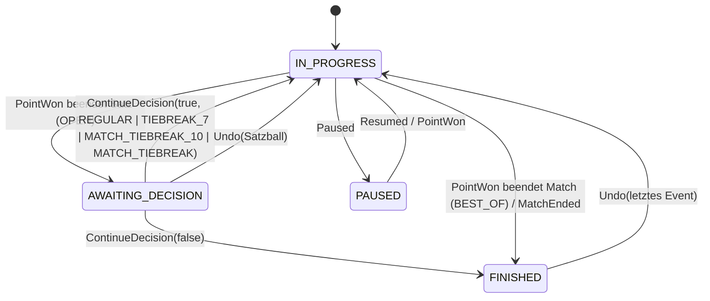

# 02 – Scoring-Regeln & Engine-Spezifikation

Stand: 2026-10-15 · Status: Entwurf v1.0 zur Abstimmung · Spec-Version für Testvektoren: `schema: 1`, `formatVersion: 1`

Bezug: [00 Grundsatzentscheidungen](00-entscheidungen.md) · [01 Architektur §3 Scoring-Engine](01-architektur.md) · [04 UX](04-ux-design.md) · [Testvektoren](testvectors/README.md)

> **Ergänzung 2026-10-14 – Badminton und Tischtennis:** neu sind §2.4, §2.5, §3.4, §4.4, §4.5, §5.1.1, §6.8, §6.9, §7.4, §8.4 sowie zusätzliche Zeilen in §0, §1, §6.7, §9–§12. Wo bestehende Festlegungen für Tennis/Padel/Pickleball verallgemeinert werden mussten, steht **„(Verallgemeinerung B/TT)“**. Für Tennis, Padel und Pickleball ändert sich dadurch nichts. Alle bestehenden Testvektoren bleiben gültig. **Review-Runde 1 (2026-10-15):** `nextGameFirstServer` und `midGameEndChange` sind an die Sportart gebunden. Sportfremde Felder werden weggelassen, nicht auf `null` gesetzt. Bei B/TT gibt es am Satzende nur dann einen Seitenwechsel, wenn ein weiterer Satz folgt. Die Nutzerentscheidungen U11, U14 und U15 sind eingetragen. **Review-Runde 2 (2026-10-15):** Die Satzende-Regel für Seitenwechsel gilt jetzt für **alle** Sportarten (§6.3, §6.4, §6.6, §6.7, §6.8.1, §8.3): nach Matchende nie, am Satzende nur, wenn ein weiterer Satz folgt. TV-PB-001 Checkpoint 19 ist angepasst.

> **Ergänzung 2026-10-15 – Bedienung & Statistik (Feldtest):** neu sind §6.5.5 (Aufschlägerwahl im Doppel, Event `ServerChosen`), „Punkt einer Seite abziehen“ (§7.3), Aufschlag-Info je Punkt (`PointDetail.serve`, §7.2), Games pro Satz 1–6 mit Tiebreak bei n:n (§5.1), die Presets „Nur Tiebreak“ (§4.1/§4.2), Tiebreak-Sätze im Satzende-Dialog (`nextSetKind = TIEBREAK_7 | MATCH_TIEBREAK_10`, §5.2), der Zustandsschlüssel `serverChoice` (§8), `meta.serveStats` (§10) und die Aufschlag-Kennzahlen (§11). Entscheidungen K14–K20 in §12.1. `formatVersion` bleibt 1, das `MatchFormat`-Schema (§3.2) ist unverändert; alle bisherigen Testvektoren bleiben gültig. Neue Vektoren: TV-TEN-005…010, TV-PAD-004/005.

> **Normativ:** „MUSS“, „DARF NICHT“ und „SOLL“ sind verbindlich für die Kotlin-Engine (`core-scoring`) und den Garmin-Port (Monkey C). Was in diesem Dokument nicht festgelegt ist, gilt als nicht spezifiziert. Ein Entwickler muss es dann klären und darf es nicht selbst erfinden. Im Konfliktfall gelten die Testvektoren in `docs/testvectors/` (später die generierten Golden Files in `testvectors/`).

---

## 0. Begriffe

| Begriff | Bedeutung in diesem Dokument |
|---|---|
| **Side** `A` / `B` | Die zwei Parteien eines Matches (Einzelspieler oder Doppel-Team). Alle Events und Zustände referenzieren `A`/`B` (wie `Side` in 01-architektur). |
| **Punkt / Rally** | Ein ausgespielter Ballwechsel. Das einzige Zähl-Event ist `PointWon(side)` = „Side hat den Ballwechsel gewonnen“. Beim Pickleball-Side-Out-Scoring führt ein gewonnener Ballwechsel nicht immer zu einem Punkt. |
| **Spiel (Game)** | Tennis/Padel: Einheit aus Punkten (0-15-30-40). Ein **Tiebreak** ist ebenfalls ein Spiel (`gameKind = TIEBREAK`). |
| **Satz (Set)** | Tennis/Padel: Einheit aus Spielen. **Pickleball: Ein „Game“ bis 11/15/21 wird in der Engine als Satz modelliert** (`setKind = PB_GAME`). Die UI zeigt dafür „Spiel“/„Game“ an. |
| **Match-Tiebreak** | Ein Tiebreak (meist bis 10), der den Entscheidungssatz ersetzt. In der Engine ist er ein Satz mit `setKind = MATCH_TIEBREAK`. |
| **Aufschlagseite (court)** | `RIGHT` = rechte Hälfte aus Sicht des Aufschlägers (Einstandsseite / „deuce court“), `LEFT` = linke Hälfte (Vorteilsseite / „ad court“). |
| **Ende (end)** | Platzhälfte `END_1` / `END_2`. Die Start-Ende wird im Lineup festgelegt, danach bestimmt die Engine die Seitenwechsel. |
| **Rally-Satz** (B/TT) | Badminton-„Game“ (deutsch: **Satz**) und Tischtennis-**Satz** sind Einheiten aus Rally-Punkten. In der Engine sind sie ein Satz mit `setKind = RALLY_GAME`, der genau ein Spiel mit `gameKind = RALLY_GAME` enthält. Die UI zeigt „Satz“ (EN: Badminton „game“, Tischtennis „game“). Konfiguriert wird er über `config.rally` (§3.1). |
| **Aufschlagfeld** (Badminton) | `RIGHT`/`LEFT` = rechtes/linkes Aufschlagfeld aus Sicht des Aufschlägers. Der Rückschläger steht diagonal gegenüber, also ebenfalls in **seinem** rechten bzw. linken Feld. |
| **Aufschlagrecht / Aufschlagwechsel** (B/TT) | Die aufschlagende Side wechselt. Badminton: wenn die Rückschlagseite den Ballwechsel gewinnt. Tischtennis: nach festen Punktzahlen, unabhängig vom Gewinner. Effekt `SIDE_OUT` (§8.3). |

---

## 1. Quellen (abgerufen am 2026-10-14)

| # | Quelle | Stand | Verwendung |
|---|---|---|---|
| Q1 | ITF, *Rules of Tennis 2026* (PDF) – <https://www.itftennis.com/media/7221/2026-rules-of-tennis-english.pdf> | 2026 | Regeln 5, 6, 7, 9, 10, 14, 15, 17, 27, 29; Appendix VI „Alternative Procedures and Scoring Methods“ |
| Q2 | FIP, *Rules of Padel* („Review of application 01.01.2026“) – <https://www.padelfip.com/wp-content/uploads/2025/12/FIP_Rules-of-Padel.pdf> (ES: <https://www.padelfip.com/wp-content/uploads/2025/12/FIP_Reglas-del-Padel.pdf>) | 01.01.2026 | Rule 1 (Option 1 Advantage, **Option 2 Star Point**, Option 3 Golden Point), Tie-Break, Alternative Score Methods, Rule 2.11, Rule 5, Rule 6, Rule 8 |
| Q3 | Padel Addict, „What is the Star Point …“ (18.12.2025) – <https://www.padeladdict.com/en/what-is-the-star-point-this-is-premier-padels-new-scoring-system/> | 12/2025 | Einführung Star Point bei Premier Padel 2026 (ab Riyadh P1) |
| Q4 | FIP, „FIP Promises: publicado el reglamento en vigor a partir de 2026“ – <https://www.padelfip.com/es/2025/12/fip-promises-publicado-el-reglamento-en-vigor-a-partir-de-2026-principales-novedades/> | 12/2025 | Star Point auf FIP Promises World/Continental Tour |
| Q5 | USA Padel, *2026 Competition Structure Guide* (30.06.2026) – <https://padelusa.org/wp-content/uploads/2026/06/2026-COMPETITION-STRUCTURE-GUIDE-JUN-30-2026.pdf> | 06/2026 | Star Point ersetzt Golden Point in USPA-sanktionierten Turnieren (laut Suchauszug, Volltext nicht geprüft) |
| Q6 | USA Pickleball, *2026 Official Rulebook*. Offizielle Seite: <https://usapickleball.org/what-is-pickleball/official-rules/>. Geprüfter Volltext: identische Kopie bei Pickleball Canada, <https://pickleballcanada.org/wp-content/uploads/2026/03/2026-Official-Rulebook-EN.pdf> | gültig ab 01.01.2026 | Regeln 4.A/B, 5.A/B/C, 6.B, 14.A (Rally Scoring, provisorisch), 15.C, 21.B, 21.F, 23.A |
| Q7 | Selkirk, „2026 USA Pickleball Rulebook Changes“ – <https://www.selkirk.com/blogs/pickleball-education/2026-usa-pickleball-rulebook-changes-key-updates-for-the-new-year> | 2026 | Sekundärquelle: Rally Scoring 2026, Wegfall des „Freeze“ |
| Q8 | tennis.com, „All Grand Slams to use 10-point tiebreaker at 6-6 in final set“ – <https://www.tennis.com/news/articles/all-grand-slams-to-use-10-point-tiebreaker-in-final-set> | 2022 | Hintergrund; heute als ITF Appendix VI Nr. 5 regulär zulässig |
| Q9 | NFHS/IHSA, *2024-25 NFHS US Tennis* (Folien) – <https://ihsa.org/Portals/0/2024-25_NFHS_US_Tennis_PowerPoint_Slides_Wide_Format.pdf> | 2024/25 | Pro-Set bis 8, Tiebreak bei 8:8 (**keine ITF-Regel**, US-Konvention) |
| Q10 | BWF Statutes, Section 4.1 *Laws of Badminton*, „In Force 29/05/2023, Version 2.1“ (PDF-Kopie) – <https://cob.org/wp-content/uploads/Section-4.1-Laws-of-Badminton-29-May-2023-V2.1.pdf>. Offizieller Ort: <https://corporate.bwfbadminton.com/statutes/> | gültig bis 03.01.2027 (laut Q11 in der Fassung 2025) | Laws 7, 8, 10, 11, 12, 16.2 (3×21) |
| Q11 | *The LAWS of Badminton* („effective 4JAN2027 – until then the 2025 Laws apply“, „adopted by BWF on 25APR2026“) – <https://www.worldbadminton.com/rules/> | ab 04.01.2027 | Laws 7.1–7.6 (3×15), 8.1.3 (Wechsel bei 8), 10, 11, 12, 16.2.1 (Pause bei 8) |
| Q12 | BWF Statutes, Section 4.1.4 *Alternative Laws of Badminton* – **V2.0, „In Force: 04 January 2027“** (Kopie: <https://ghanabadminton.org/wp-content/uploads/Section-4.1.4-Alternative-Laws-of-Badminton-04-January-2027-V2.0.pdf>) und **V1.0, aktuell** (Kopie: <https://www.badmintonpanam.org/wp-content/uploads/2023/01/1.4-Alternative-Laws-of-Badminton-V1.0.pdf>) | V1.0 bis 03.01.2027, V2.0 ab 04.01.2027 | Alternativsysteme 1×21, 3×15 bzw. 3×21, 5×11 |
| Q13 | BWF, „BWF Members Approve 3×15 Scoring System“ (25.04.2026) – <https://bwfbadminton.com/news-single/2026/04/25/bwf-members-approve-3x15-scoring-system> · „Key Changes Under the 3×15 Scoring System“ (26.04.2026) – <https://bwfbadminton.com/news-single/2026/04/26/key-changes-under-the-3x15-scoring-system> · USA Badminton, „BWF Approves 3×15 Scoring System“ – <https://usabadminton.org/bwf-approves-3x15-scoring-system/> · Badminton Europe – <https://badmintoneurope.com/w/new-scoring-system-3-x-15> | 04/2026 | Beschluss der 87. AGM (Horsens), Inkrafttreten 04.01.2027, 3×21 bleibt Alternative für nationale Wettbewerbe |
| Q14 | ITTF, *Laws of Table Tennis* aus den ITTF Statutes 2026, wiedergegeben in Table Tennis England, „The Laws of Table Tennis 2026-27“ (Issue 1, 07/2026) – <https://www.tabletennisengland.co.uk/content/uploads/2026/07/Laws-of-Table-Tennis-2026-27.pdf>. Offiziell: ITTF Handbook/Statutes, <https://documents.ittf.sport/> | 2026 | Laws 2.10–2.15 |
| Q15 | Wikipedia, „Table tennis“ (Abschnitt Scoring) – <https://en.wikipedia.org/wiki/Table_tennis> · All About Table Tennis, „Rules of Table Tennis“ – <https://www.allabouttabletennis.com/rules-of-table-tennis.html> | – | Hintergrund: 21-Punkte-System bis 2001 (Aufschlagwechsel alle 5 Punkte, ab 20:20 jeder Punkt) |

**Quellenlage:** Q1, Q2 und Q6 wurden im Volltext ausgewertet (PDF → Text), die Regelnummern unten beziehen sich darauf. Q3–Q5 und Q7–Q9 sind Sekundärquellen und dienen nur für Geltungsbereich und Hintergrund. **Ergänzung B/TT:** Q10, Q12 (beide Fassungen) und Q14 wurden im Volltext ausgewertet. Q11 wurde als HTML-Volltext gelesen. Die BWF-Seiten in Q13 blockieren den automatischen Abruf, ihr Inhalt ist über die USA-Badminton-Seite und Suchauszüge belegt. Die Fassung 2025 der Laws (bis 03.01.2027) lag nicht im Volltext vor. Geprüft wurde die Fassung 2023 V2.1 (Q10). Alle Sekundärquellen nennen für 2025/2026 dieselben Werte (21, 20:20, 29:29, Wechsel und Pause bei 11). Q15 ist Sekundärquelle.

---

## 2. Regelrecherche (Kurzfassung mit Regelnummern)

### 2.1 Tennis (ITF Rules of Tennis 2026, Q1)

| Thema | Regel | Inhalt |
|---|---|---|
| Standardspiel | R5a | 0 („Love“), 15, 30, 40, Spiel; bei 3:3 Punkten „Deuce“ (Einstand), danach Vorteil; Gewinn mit 2 Punkten in Folge nach Einstand. Ansage: Aufschläger zuerst. |
| Tiebreak-Spiel | R5b | Zählung 0, 1, 2 … Gewinn mit 7 Punkten **und** 2 Punkten Vorsprung, sonst weiter. Der Spieler, der an der Reihe ist, schlägt den 1. Punkt auf, danach je 2 Punkte im Wechsel (im Doppel geht die Rotation innerhalb des Teams weiter). Wer im Tiebreak zuerst aufgeschlagen hat, ist im 1. Spiel des Folgesatzes **Rückschläger**. |
| Satz | R6 | „Advantage Set“: 6 Spiele mit 2 Vorsprung, ohne Tiebreak. „Tie-break Set“: 6 Spiele mit 2 Vorsprung, bei 6:6 Tiebreak. Ob der letzte Satz Tiebreak- oder Vorteilssatz ist, muss vorab feststehen. |
| Match | R7 | Best of 3 oder Best of 5 Sätze. |
| Wahl | R9 | Losentscheid: Aufschlag/Rückschlag oder Seite. |
| Seitenwechsel | R10 | Nach dem 1., 3. und jedem weiteren ungeraden Spiel eines Satzes. Am Satzende nur, wenn die Spielsumme des Satzes ungerade ist, sonst nach dem 1. Spiel des nächsten Satzes. Im Tiebreak alle 6 Punkte. |
| Aufschlagfolge | R14 | Nach jedem Standardspiel wechselt der Aufschlag. Doppel: Das Team, das das 1. Spiel eines Satzes aufschlägt, bestimmt seinen Aufschläger, der Gegner vor Spiel 2 ebenso. Danach gilt die Rotation A1-B1-A2-B2 bis Satzende. |
| Rückschlagfolge | R15 | Doppel: Jedes Team legt zu Satzbeginn fest, wer den 1. Punkt eines Spiels returniert. Danach wechselt es punktweise, für den ganzen Satz. |
| Aufschlagseite | R17 | Im Standardspiel abwechselnd, Beginn **rechts**. Im Tiebreak ebenfalls abwechselnd, 1. Punkt rechts. |
| Fehlerkorrektur | R27 | Bereits gespielte Punkte zählen. Falsche Seite/Hälfte wird sofort korrigiert. Aufschlag außer der Reihe: sofort korrigieren, war das Spiel schon beendet, bleibt die geänderte Reihenfolge (27c). Im Tiebreak: nach gerader Punktzahl sofort korrigieren, nach ungerader bleibt sie (27d). Falsche Rückschlagfolge im Doppel bleibt bis Spielende (27e). Irrtümlicher Tiebreak bzw. Nicht-Tiebreak: 27f/g/h. |
| Kontinuität | R29 | 25 s zwischen Punkten, 90 s beim Seitenwechsel, **kein** Pause-Seitenwechsel nach dem 1. Spiel eines Satzes und im Tiebreak, 120 s Satzpause. |
| **No-Ad** | App. VI | Bei 40:40 entscheidender Punkt. Rückschläger wählt die Seite, im Doppel darf das Rückschlagteam die Positionen nicht tauschen. Mixed: Gleichgeschlechtlicher Spieler zum Aufschläger returniert. |
| **Short Sets** | App. VI 1 | Satz bis 4 Spiele mit 2 Vorsprung, Tiebreak bei 4:4. Alternativ (nach Wahl des Veranstalters) schon bei 3:3. |
| **Short-Set-Tiebreak (5)** | App. VI 2 | Nur zusammen mit Short Sets: bis 5 Punkte, bei 4:4 entscheidender Punkt. Aufschlagfolge legt der Veranstalter fest. Seitenwechsel nur einmal, nach den ersten 4 Punkten. |
| **Match-Tiebreak (7)** | App. VI 3 | Ersetzt bei 1:1 (bzw. 2:2) Sätzen den Entscheidungssatz, bis 7 mit 2 Vorsprung. |
| **Match-Tiebreak (10)** | App. VI 4 | Wie Nr. 3, bis 10 mit 2 Vorsprung. Die Aufschlagfolge läuft weiter. Im Doppel darf die teaminterne Reihenfolge wie zu Satzbeginn neu gewählt werden. 120 s Pause vorher. |
| **Final-Set-Tiebreak (10)** | App. VI 5 | Im Entscheidungssatz bei 6:6 Tiebreak bis 10 mit 2 Vorsprung (Grand-Slam-Format, Q8). |
| **Alternativer Seitenwechsel im Tiebreak** | App. VI | Nach dem 1. Punkt, danach alle 4 Punkte. |
| No-Let | App. VI | Netzaufschlag ist im Spiel. Für die Zählung irrelevant, nur Info. |
| Pro-Set (8/10) | – | **Nicht in den ITF-Regeln.** US-Konvention (Q9): bis 8 Spiele mit 2 Vorsprung, Tiebreak (7) bei 8:8. Als konfigurierbarer Satz abbildbar. |

**Beläge:** Die ITF klassifiziert Plätze nach Tempo (Court Pace Rating, Kategorie 1 langsam bis 5 schnell) und empfiehlt Balltypen je Kategorie (Q1, Appendix I/II). Die **Zählregeln hängen nicht vom Belag ab**, siehe Abschnitt 10.

### 2.2 Padel (FIP Rules of Padel, Review 01.01.2026, Q2)

| Thema | Regel | Inhalt |
|---|---|---|
| Spiel – Option 1 **Advantage** | R1 Opt. 1 | Wie Tennis: Einstand, Vorteil, unbegrenzt. |
| Spiel – Option 2 **Star Point** | R1 Opt. 2 | Bei 40:40 „Deuce 1“, dann „Advantage 1“. Bei Verlust des Vorteils „Deuce 2“, dann „Advantage 2“. Bei erneutem Verlust „Deuce 3“: Es folgt der entscheidende **Star Point**. Das Rückschlagpaar wählt die Seite und darf die Positionen nicht tauschen. Mixed: Gleichgeschlechtlicher Spieler zum Aufschläger returniert. → **maximal 2 Vorteile**. |
| Spiel – Option 3 **Golden Point** | R1 Opt. 3 | Bei 40:40 entscheidender Punkt. Seitenwahl, Positionen und Mixed-Regel wie beim Star Point. |
| **Was 2026 gilt** | Q2–Q5 | Das FIP-Regelwerk lässt alle drei Optionen zu, der Veranstalter wählt. **Star Point** gilt 2026 bei Premier Padel (ab Riyadh P1), auf der FIP Promises World/Continental Tour und laut Q5 auch bei USA Padel. Im Amateurbereich sind Golden Point und Advantage weiter verbreitet. → Die App bietet alle drei an, mit Preset-Default „Star Point“ für das Pro-Format. |
| Satz | R1 Opt. 1.2 | 6 Spiele mit 2 Vorsprung, bei 6:6 Tiebreak. |
| Match | R1 Opt. 1.3/1.4 | Best of 3. Optional (vorab festgelegt) dritter Satz ohne Tiebreak (Vorteilssatz). |
| Tiebreak | Tie-Break 1–5 | Bis 7 mit 2 Vorsprung. Beginnt mit dem Spieler, der an der Reihe ist: 1 Aufschlag von rechts, danach je 2 Punkte pro Team. Gewinner des Satzes 7:6. Den Folgesatz eröffnet das Paar, das im Tiebreak **nicht** begonnen hat. |
| Alternativen | Alt. Score 1a–c | (a) Mini-Satz bis 4 (2 Vorsprung, Tiebreak bei 4:4). (b) Match-Tiebreak bis 7 statt 3. Satz. (c) **Super-Tiebreak bis 10** statt 3. Satz. |
| Seitenwechsel | R5 | Nach dem 1., 3. und jedem ungeraden Spiel des Satzes, im Tiebreak alle 6 Punkte. Ein vergessener Wechsel wird sofort korrigiert, Punkte zählen. |
| Aufschlag | R6.5, 6.8, 6.9 | 1. Punkt jedes Spiels von rechts, dann abwechselnd. Die Aufschlagreihenfolge im Team gilt für den ganzen Satz. Aufschlag außer der Reihe: sofort korrigieren, war das Spiel beendet, bleibt die Reihenfolge bis Satzende. |
| Rückschlag | R8.2–8.4 | Das Rückschlagpaar legt im 1. Spiel des Satzes fest, wer den 1. Aufschlag jedes Spiels returniert, fest für den Satz. Eine falsche Reihenfolge bleibt bis Spiel- bzw. Tiebreak-Ende bestehen. |
| Unterbrechung | R2.11 | Nach Regen/Licht/Unfall gibt es Einspielzeit gestaffelt (≤ 5 min: keine, 5–20 min: 1 min, > 20 min: 3 min). Für die Zählung irrelevant. |

### 2.3 Pickleball (USA Pickleball Official Rulebook 2026, Q6)

| Thema | Regel | Inhalt |
|---|---|---|
| Standard-Scoring (**Side-Out**) | 4.A | Punkte gibt es nur, wenn die **aufschlagende** Seite den Ballwechsel gewinnt. |
| Sieg im Spiel | 4.B, 15.C | Typisch bis 11 mit 2 Vorsprung. Turnieroptionen: Best of 3 bis 11, Best of 5 bis 11, ein Spiel bis 15 oder 21, ein Spiel bis 11 (nur Round Robin ab 6 Teams). Alle mit 2 Vorsprung, **außer Team-Play: Sieg mit 1 Punkt erlaubt**. |
| Einzel | 5.A | Gerader oder null Score des Aufschlägers: Aufschlag von rechts, ungerader Score: von links. Er schlägt bis zum Verlust eines Ballwechsels auf, dann Side Out. |
| Doppel – zwei Aufschläger | 5.B, 5.B.2, 5.B.5/6 | Beide Spieler eines Teams schlagen auf, bevor Side Out ist. **Ausnahme Spielbeginn:** Der Startaufschläger gilt als „zweiter Aufschläger“, deshalb ist nach seinem ersten verlorenen Ballwechsel sofort Side Out. Nach jedem Side Out beginnt der Spieler, der nach dem Team-Score **rechts** steht, als Aufschläger 1. |
| Doppel – Positionen | 5.B.3 | Der Startaufschläger eines Teams steht bei geradem/null Team-Score rechts, bei ungeradem links. Sein Partner entsprechend umgekehrt. |
| Ansage | 6.B.1/6.B.2 | Einzel: „Aufschläger-Score – Rückschläger-Score“, Start „0-0“. Doppel: drei Zahlen „Aufschlag-Score – Rückschlag-Score – Aufschläger-Nr.“, Start **„0-0-2“**. |
| Falscher Spieler/Position | 5.C | Kann vor dem Aufschlag erfragt werden. Wird ein Fehler erst nach dem Ballwechsel erkannt, **zählt das Ergebnis** (5.C.2). |
| **Rally Scoring** (provisorisch) | 14.A | Jeder Ballwechsel gibt einen Punkt (14.A.2). Ansage mit zwei Zahlen (14.A.3). Im Doppel nur **ein** Aufschläger je Aufschlagrecht (14.A.5). Nach Side Out schlägt der nach Team-Score rechts stehende Spieler auf (14.A.4). |
| **Rally Scoring 2026 – kein „Freeze“ mehr** | 14.A.2, Q7 | Bis 2025 konnte der Spielpunkt in Rally-Formaten nur beim eigenen Aufschlag gewonnen werden. 2026 zählt jeder Ballwechsel, auch der spielentscheidende Punkt der Rückschlagseite. Die Engine unterstützt das alte Verhalten optional (`gameWinningPointOnServeOnly`). |
| Rally-Formate (Turnier) | 15.C.2 | Ein Spiel bzw. Best of 3/5 bis 11, 15 oder 21. Bei schlechtem Wetter auch bis 7 mit Seitenwechsel bei 4. **Nicht erlaubt** in Double-Elimination-Doppel, bei 2026-Golden-Ticket-Events und den 2026 National Championships. |
| Seitenwechsel im Spiel | 21.B.1–3 | **Nur** in Einzelspiel-Matches und im entscheidenden Spiel: bei 11 Punkten, wenn die erste Seite 6 erreicht, bei 15 → 8, bei 21 → 11. Der Aufschläger bleibt (21.B.4). Ein vergessener Wechsel wird nachgeholt, ohne Auswirkung auf den Score (21.B.7). |
| Zwischen Spielen | 21.F.2/3 | Seitenwechsel **und** Wechsel des ersten Aufschlags. Teams dürfen ihren Startaufschläger neu wählen. |
| Aufgabe | 23.A.4 | Abgeschlossene Spiele bleiben. Im laufenden Spiel wird der Ist-Score des Aufgebenden notiert, der Gegner erhält die zum Sieg nötigen Punkte. Nicht gespielte Spiele werden 11-0 / 15-0 / 21-0 gewertet. |

### 2.4 Badminton (BWF Laws of Badminton, Q10–Q13)

**Stand Oktober 2026 – das 3×15-System ist beschlossen:** Die 87. BWF-Hauptversammlung hat am **25.04.2026** in Horsens (DK) das 3×15-System mit der nötigen Zweidrittelmehrheit angenommen. Es gilt **ab Montag, 04.01.2027** als Standard (Q11, Q13). Bis zum 03.01.2027 gelten die Laws in der Fassung 2025, also 3×21 (Q10, Q11). Ab 2027 bleibt **3×21 ein zugelassenes Alternativsystem** (Q12 V2.0), das Verbände, Vereine und Ligen für nationale Wettbewerbe wählen dürfen (Q13). Ein früherer Vorschlag (5×11) war 2021 gescheitert. → Die App bietet **beide Systeme als Presets** an (§4.4).

| Thema | Regel | Inhalt |
|---|---|---|
| Match | 7.1 | Best of 3 Sätze („games“), sofern nicht anders vereinbart (Statutes 4.1.3 Handicap, 4.1.4 Alternativen). |
| Rally Point | 7.3 | Jeder Ballwechsel bringt der gewinnenden Seite einen Punkt, egal wer aufschlägt. |
| **Satz 3×21** (bis 03.01.2027, danach Alternative) | 7.2, 7.4, 7.5 (Q10) | Bis 21. Bei **20:20** gewinnt, wer zuerst 2 Punkte Vorsprung hat. Bei **29:29** entscheidet der 30. Punkt (**Deckel 30**). |
| **Satz 3×15** (ab 04.01.2027) | 7.2, 7.4, 7.5 (Q11) | Bis 15. Bei **14:14** gewinnt, wer zuerst 2 Punkte Vorsprung hat. Bei **20:20** entscheidet der 21. Punkt (**Deckel 21**). |
| Aufschlag im Folgesatz | 7.6, 11.6 | Der **Satzsieger** schlägt im nächsten Satz zuerst auf. Doppel: Jeder Spieler des Siegerpaares darf aufschlagen, jeder des Verliererpaares darf annehmen. |
| Seitenwechsel | 8.1 | Nach Satz 1, nach Satz 2 (wenn ein 3. Satz folgt) und im 3. Satz, sobald eine Seite zuerst **11** (3×21) bzw. **8** (3×15, 8.1.3 neu) Punkte hat. Ein vergessener Wechsel wird nachgeholt, der Stand bleibt (8.2). |
| Einzel: Aufschlagfeld | 10.1 | Aufschlag und Annahme aus dem **rechten** Feld, wenn der **Aufschläger** 0 oder eine gerade Punktzahl im Satz hat, sonst aus dem **linken**. |
| Einzel: Punkt und Aufschlag | 10.3 | Gewinnt der Aufschläger, punktet er und schlägt aus dem anderen Feld erneut auf. Gewinnt der Rückschläger, punktet er und wird Aufschläger. |
| Doppel: Felder | 11.1 | Die aufschlagende Seite schlägt bei 0/geradem **Team-Score** von rechts auf, bei ungeradem von links (11.1.1/2). Auf der Rückschlagseite bleibt, wer zuletzt aufschlug, in diesem Feld, der Partner im anderen (11.1.3). Rückschläger ist, wer diagonal gegenüber steht (11.1.4). **Die Spieler wechseln ihr Feld nur, wenn ihre Seite bei eigenem Aufschlag punktet** (11.1.5). |
| Doppel: Punkt und Aufschlag | 11.3 | Gewinnt die aufschlagende Seite, punktet sie und derselbe Aufschläger schlägt aus dem anderen Feld auf. Gewinnt die Rückschlagseite, punktet sie und wird aufschlagende Seite, **ohne Feldwechsel**. Aufschläger ist dann, wer im Feld zum neuen Score steht. Es gibt **keinen „zweiten Aufschläger“** wie beim Pickleball-Side-Out. |
| Doppel: Aufschlagfolge | 11.4, 11.5 | Erstaufschläger (von rechts) → Partner des Erst-Rückschlägers → Partner des Erstaufschlägers → Erst-Rückschläger → Erstaufschläger … Niemand schlägt oder nimmt außer der Reihe an oder zweimal hintereinander. |
| Aufschlagfeldfehler | 12 | Aufschlag/Annahme außer der Reihe oder aus dem falschen Feld: korrigieren, **der Stand bleibt**. |
| Pausen | 16.2 | Bis 60 s, wenn der **führende** Score 11 (3×21) bzw. 8 (3×15, 16.2.1 neu) erreicht, in jedem Satz. Bis 120 s zwischen den Sätzen. Nur UI-Hinweis. |
| Alternativsysteme | Statutes 4.1.4 (Q12) | Nach Vereinbarung: **(1) ein Satz bis 21**, Seitenwechsel bei 11. **(2) bis 03.01.2027 (V1.0): Best of 3 bis 15** (14:14 → 2 Vorsprung, 20:20 → 21. Punkt, Wechsel und Pause bei 8). **Ab 04.01.2027 (V2.0): Best of 3 bis 21** (20:20 → 2 Vorsprung, 29:29 → 30. Punkt, Wechsel bei 11). **(3) Best of 5 bis 11**: Seitenwechsel nach den Sätzen 1–4 und im 5. Satz bei 6, 60-s-Pause nur im 5. Satz bei 6. Laut Wortlaut („first scores 11 points“) ohne Verlängerung. |
| Unklarheiten in Q12 V2.0 | – | (a) Für Alternative 2 (3×21) nennt V2.0 die 60-s-Pause „when the leading score reaches 8 points“. Das ist vermutlich ein Redaktionsfehler (erwartet: 11). (b) Für Alternative 1 (1×21) ändert V2.0 nur den Seitenwechsel, damit gälten wörtlich die neuen Basisregeln 7.4/7.5 (14:14, 20:20 → 21. Punkt). → Das Preset nimmt die klassische Verlängerung bis 30 an, siehe §12 U12. |
| Nicht unterstützt | Statutes 4.1.3 | Handicap-Spiele (Startvorgaben, andere Wechsel- und Pausenregeln) und AirBadminton (eigenes Regelwerk). |
| Freizeit | – | Üblich sind ein Satz bis 21 oder 15 und Doppel/Mixed nach denselben Regeln. Ein eigenes Regelwerk gibt es nicht. |

### 2.5 Tischtennis (ITTF Laws of Table Tennis 2026, Q14)

| Thema | Regel | Inhalt |
|---|---|---|
| Punkt | 2.10 | Jeder Ballwechsel, der kein „Let“ ist, ergibt einen Punkt (Rally Point). |
| Satz | 2.11.1 | Gewonnen hat, wer zuerst **11** Punkte erreicht. Bei **10:10** gewinnt, wer zuerst 2 Punkte Vorsprung hat. **Kein Deckel.** |
| Match | 2.12.1 | „Best of any odd number of games“. Üblich sind Best of 5 (Ligen und Mannschaftsspiele, deutsch „3 Gewinnsätze“), Best of 7 (internationale Einzel-Hauptfelder) und Best of 3 (Freizeit, manche Team-Formate). Das ist Konvention, die Laws legen es nicht fest. |
| Wahl | 2.13.1, 2.13.2 | Per Los wird Aufschlag, Rückschlag oder Seite gewählt. Der andere hat die verbleibende Wahl. |
| Aufschlagwechsel | 2.13.3 | Nach je **2 Punkten** wird der Rückschläger Aufschläger, **unabhängig davon, wer punktet**. Ab **10:10** (oder unter der Wechselmethode) schlägt jeder nur noch **1 Punkt** auf, die Reihenfolge bleibt. |
| Doppel: Wahl | 2.13.4 | In jedem Satz wählt das Aufschlagpaar, wer aufschlägt. Im 1. Satz wählt das Rückschlagpaar, wer zuerst annimmt. In späteren Sätzen ist Erst-Rückschläger, **wer dem Erstaufschläger im vorigen Satz aufgeschlagen hat**. |
| Doppel: Wechsel | 2.13.5 | Bei jedem Aufschlagwechsel wird der bisherige Rückschläger Aufschläger und der Partner des bisherigen Aufschlägers Rückschläger. → Zyklus A1→B1, B1→A2, A2→B2, B2→A1. |
| Folgesatz, Entscheidungssatz Doppel | 2.13.6 | Wer in einem Satz zuerst aufschlug, nimmt im nächsten Satz zuerst an. **Im letztmöglichen Satz eines Doppels wechselt das Paar, das als Nächstes annimmt, seine Rückschlagreihenfolge, sobald ein Paar 5 Punkte hat.** |
| Seiten | 2.13.7 | Seitenwechsel nach jedem Satz. Im letztmöglichen Satz zusätzlich, sobald ein Spieler bzw. Paar zuerst **5** Punkte hat. |
| Fehler in der Reihenfolge | 2.14 | Aufschlag/Annahme außer der Reihe oder falsche Seite: sofort korrigieren, und zwar nach der **zu Matchbeginn festgelegten Folge**. Im Doppel gilt die im laufenden Satz gewählte Aufschlagreihenfolge. **Alle bisherigen Punkte zählen.** |
| Wechselmethode (Expedite) | 2.15 | Sie greift nach 10 min Spielzeit in einem Satz, aber nicht, wenn schon mindestens 18 Punkte gespielt sind, oder auf Wunsch beider Seiten. Dann schlägt jeder abwechselnd 1 Punkt auf. Schafft das Rückschlagpaar 13 korrekte Rückschläge, punktet der Rückschläger. Die Methode gilt bis Matchende, die Reihenfolge bleibt. **Nur Hinweis, in v1 nicht modelliert** (§9.19). |
| Pausen, Time-out | ITTF-Wettkampfbestimmungen Kap. 3 | Bis 1 min zwischen den Sätzen, 1 Time-out je Match (nicht im Volltext geprüft). Ohne Zählwirkung. |
| **Freizeit „bis 21“** (alte Zählweise bis 31.08.2001) | Q15 | Satz bis 21 mit 2 Punkten Vorsprung, Aufschlagwechsel alle **5** Punkte, ab **20:20** nach jedem Punkt. Seit 01.09.2001 gilt der Satz bis 11. Seitenwechsel bzw. Rückschlagwechsel im Entscheidungssatz nach alter Regel bei **10** (nicht aus Primärquelle belegt, §12 U18). |

---

## 3. Konfigurationsmodell `MatchFormat`

`MatchFormat` ist Teil von `MatchCreated(config, lineup)` (01-architektur §3.2) und während eines Matches **unveränderlich**. Alle Werte sind Ints, Enums (als Strings) oder `null`, keine Floats.

### 3.1 Felder

| Pfad | Typ | Werte | Default | Sport | Bedeutung |
|---|---|---|---|---|---|
| `formatVersion` | int | `1` | 1 | alle | Schema-Version. |
| `presetId` | string? | siehe §4 | null | alle | Nur zur Anzeige und Statistik, **nicht** regelrelevant. |
| `sport` | enum | `TENNIS`, `PADEL`, `PICKLEBALL`, `BADMINTON`, `TABLE_TENNIS` | – | alle | `BADMINTON`, `TABLE_TENNIS` neu (Verallgemeinerung B/TT). Kürzel in der Spalte „Sport“: B = Badminton, TT = Tischtennis. |
| `discipline` | enum | `SINGLES`, `DOUBLES` | Padel: `DOUBLES` | alle | Padel-Einzel ist nicht FIP-offiziell, aber erlaubt. |
| `match.mode` | enum | `BEST_OF`, `OPEN` | `BEST_OF` | alle | Siehe §5. |
| `match.bestOf` | int | `1`, `3`, `5`, `7` | 3 (PB: 1, TT: **keiner**) | alle | Nur bei `BEST_OF`. Gewinnsätze = (bestOf+1)/2. `7` nur für `TABLE_TENNIS` (Verallgemeinerung B/TT, Validierung 9). Tischtennis: Der Wizard verlangt eine aktive Auswahl (§5.1.1, U14 entschieden). |
| `game.deuceMode` | enum | `ADVANTAGE`, `DECIDING_POINT`, `STAR_POINT` | `ADVANTAGE` | T, P | `DECIDING_POINT` = No-Ad (Tennis) bzw. Golden Point (Padel). |
| `game.maxAdvantages` | int | ≥ 1 | 2 | T, P | Nur bei `STAR_POINT`. Anzahl erlaubter Vorteile vor dem Entscheidungspunkt (FIP 2026: 2). |
| `set.gamesToWin` | int | 1…12 | 6 | T, P | „Games pro Satz“. Ein Satz ist gewonnen mit ≥ gamesToWin und 2 Spielen Vorsprung oder durch den Tiebreak. Der Wizard bietet 1–6 (sowie 8 und 10) an, jeweils mit `tiebreakAt = gamesToWin` (§5.1, K17). |
| `set.tiebreakAt` | int? | `null` oder ≥ gamesToWin−1 | = gamesToWin | T, P | Spielstand n:n, bei dem der Tiebreak beginnt. `null` = Vorteilssatz ohne Tiebreak. |
| `set.tiebreak.pointsToWin` | int | ≥ 1 | 7 | T, P | |
| `set.tiebreak.winBy` | int | `1`, `2` | 2 | T, P | `1` nur für den Short-Set-Tiebreak bis 5: Bei 4:4 entscheidet der nächste Punkt den Satz (kein `decidingPoint`-Flag, §6.2). |
| `set.tiebreak.endChange.first` | int | ≥ 1 | 6 | T, P | Seitenwechsel nach der Punktsumme `first` … |
| `set.tiebreak.endChange.every` | int? | ≥ 1 / null | 6 | T, P | … und danach alle `every` Punkte. Fehlt das Feld, MUSS Default 6 gelten; explizites `null` MUSS Wechsel nur einmal bei `first` vorsehen (sofern der Tiebreak weiterläuft, §6.2) (Klarstellung 2026-10-15). Gilt für alle `endChange`-Objekte. ITF-Alternative: `{first:1, every:4}`. Short-Set-TB: `{first:4, every:null}`. |
| `decidingSet` | object? | `null` / Satz-Objekt / Match-Tiebreak-Objekt | null | T, P | Abweichendes Format für den **Entscheidungssatz** bei `BEST_OF` (beide Seiten haben Gewinnsätze−1). `null` = wie `set`. |
| `decidingSet.kind` | enum | `REGULAR`, `MATCH_TIEBREAK` | `REGULAR` | T, P | `REGULAR` mit eigenen `gamesToWin`/`tiebreakAt`/`tiebreak` (z. B. Final-Set-Tiebreak bis 10 oder Vorteilssatz). `MATCH_TIEBREAK` mit `pointsToWin`, `winBy`, `endChange`. |
| `matchTiebreak` | object? | Match-Tiebreak-Objekt | null | T, P | Nur für `OPEN`: Format für `ContinueDecision(nextSetKind = MATCH_TIEBREAK)` (ältere Wire-Form). Die Dialog-Optionen „Tiebreak bis 7“ und „Champions-Tiebreak bis 10“ (`TIEBREAK_7`, `MATCH_TIEBREAK_10`) gelten unabhängig von diesem Feld für Tennis/Padel immer (§5.2, K18). |
| `pickleball.scoring` | enum | `SIDE_OUT`, `RALLY` | `SIDE_OUT` | PB | |
| `pickleball.pointsToWin` | int | 11, 15, 21 (frei ≥ 1; 7 = Wetter-Format) | 11 | PB | „Punkte pro Spiel“. |
| `pickleball.winBy` | int | `1`, `2` | 2 | PB | `1` nur Team-Play (15.C). |
| `pickleball.pointCap` | int? | > pointsToWin / null | null | PB | Freizeit-Option „Deckel“ (z. B. bis 15 bei Spiel bis 11): Wer den Cap erreicht, gewinnt. **Keine USAP-Regel.** |
| `pickleball.firstServiceTurnSingleServer` | bool | | true | PB | „0-0-2“-Regel (5.B). Nur bei Doppel + `SIDE_OUT` wirksam. |
| `pickleball.midGameEndChange` | enum | `DECIDING_GAME_ONLY`, `EVERY_GAME`, `NEVER` | `DECIDING_GAME_ONLY` | PB | USAP 21.B: nur im Einzelspiel-Match bzw. im Entscheidungsspiel. Im `OPEN`-Modus gibt es kein Entscheidungsspiel, dort wirkt nur `EVERY_GAME`. |
| `pickleball.midGameEndChangeAt` | int? | ≥ 1 / null | null | PB | `null` = ⌈pointsToWin/2⌉ → 11→6, 15→8, 21→11, 7→4. |
| `pickleball.gameWinningPointOnServeOnly` | bool | | false | PB | Nur `RALLY`: Regel bis 2025 („Freeze“). Gewinnt die Rückschlagseite den Ballwechsel, der ihr das Spiel brächte, gibt es Side Out **ohne** Punkt. 2026 aufgehoben. |
| `rally.pointsToWin` | int | B: 15, 21, 11 · TT: 11, 21 (frei ≥ 1) | B: 15 · TT: 11 | B, TT | „Punkte pro Satz“ |
| `rally.winBy` | int | `1`, `2` | 2 | B, TT | Vorsprung. `1` nur Badminton 5×11 (Q12 Alt. 3) |
| `rally.cap` | int? | > pointsToWin / null | B 21er: 30 · B 15er: 21 · TT: null | B, TT | **Deckel**: Wer `cap` erreicht, gewinnt den Satz (BWF 7.5: 29:29 → 30 bzw. 20:20 → 21). Gleiche Semantik wie `pickleball.pointCap`. |
| `rally.serveRotation` | enum | `WINNER_SERVES`, `EVERY_N_POINTS` | B: `WINNER_SERVES` · TT: `EVERY_N_POINTS` | B, TT | `WINNER_SERVES`: Wer den Ballwechsel gewinnt, schlägt den nächsten auf (BWF 10.3/11.3). `EVERY_N_POINTS`: Die aufschlagende Side wechselt nach je `serveEvery` Punkten, ab dem Verlängerungsstand nach je `serveEveryAtDeuce` Punkten (ITTF 2.13.3). In v1 ist das Wert-Paar an die Sportart gebunden (Validierung 7). |
| `rally.serveEvery` | int? | ≥ 1 / null | TT: 2 (21er: 5) | TT | Nur `EVERY_N_POINTS` |
| `rally.serveEveryAtDeuce` | int? | ≥ 1 / null | TT: 1 | TT | Nur `EVERY_N_POINTS`. Gilt, sobald beide `pointsToWin − 1` haben (10:10 bzw. 20:20). |
| `rally.nextGameFirstServer` | enum | `GAME_WINNER`, `PREVIOUS_FIRST_RECEIVER` | **durch die Sportart festgelegt:** B: `GAME_WINNER` · TT: `PREVIOUS_FIRST_RECEIVER` | B, TT | Wer den nächsten Satz eröffnet: der Satzsieger (BWF 7.6) bzw. die Side, die im Vorsatz zuerst annahm (ITTF 2.13.6). Ein anderer Wert ist ungültig (Validierung 7, Schema). Das Feld steht nur zur Selbstbeschreibung im JSON und für den Garmin-Port. |
| `rally.midGameEndChange` | enum | `DECIDING_GAME_ONLY`, `EVERY_GAME`, `NEVER` | `DECIDING_GAME_ONLY` (B/TT: **fest**) | B, TT | Einmaliger Seitenwechsel im Satz. Semantik wie `pickleball.midGameEndChange`. **B/TT: nur `DECIDING_GAME_ONLY` zulässig** (Validierung 7, Nutzerentscheidung U15): Wechsel nur im letzten Satz eines Best-of, im `OPEN`-Modus nie. |
| `rally.midGameEndChangeAt` | int? | ≥ 1 / null | B 21er: 11 · B 15er: 8 · B 11er: 6 · TT: 5 (21er: 10) | B, TT | Seitenwechsel, sobald **eine** Side diese Punktzahl erreicht. `null` = ⌈pointsToWin/2⌉ (wie PB). **Für TT ist der Wert ausdrücklich zu setzen** (5 ≠ ⌈11/2⌉). |
| `rally.receiverSwapAtMidGameEndChange` | bool | | TT-Doppel: true, sonst false | TT | Beim Seitenwechsel in der Satzmitte tauscht das Paar, das als Nächstes annimmt, seine Rückschlagreihenfolge (ITTF 2.13.6). Wirkt nur bei `DOUBLES`. |
| `rally.intervalAt` | int? | ≥ 1 / null | B 21er: 11 · B 15er: 8 · sonst null | B | **Nur UI-Hinweis, keine Regelwirkung:** „Pause bis 60 s“, sobald der führende Score diesen Wert erreicht, in jedem Satz (BWF 16.2.1). |

**Semantische Validierung (MUSS beim Erstellen geprüft werden, Fehler = Format ungültig):**

1. `sport = PICKLEBALL` ⇒ `pickleball` gesetzt, `game`/`set`/`decidingSet`/`matchTiebreak`/`rally` **fehlen**. `sport ∈ {TENNIS, PADEL}` ⇒ `game` und `set` gesetzt, `pickleball` und `rally` **fehlen**. `sport ∈ {BADMINTON, TABLE_TENNIS}` ⇒ `rally` gesetzt, `game`/`set`/`decidingSet`/`matchTiebreak`/`pickleball` **fehlen**. Sportfremde Felder werden **weggelassen**, ein explizites `null` ist ungültig (das Schema in §3.2 erzwingt es). (Verallgemeinerung B/TT: Bisher hieß es „Sonst ⇒ `game` und `set`“ und für Pickleball „fehlen bzw. sind null“. Kein bestehender Vektor ist betroffen.)
2. `tiebreakAt = null` oder `tiebreakAt ≥ gamesToWin − 1`. Werte darüber sind erlaubt, z. B. Tiebreak erst bei 12:12.
3. `match.mode = OPEN` ⇒ `decidingSet` wird ignoriert (soll null sein).
4. `winBy = 1` im Tiebreak nur zusammen mit `pointsToWin ≤ 7` (Short-Set-Tiebreak). Das ist eine Plausibilitätsregel, die UI warnt nur.
5. `rally.cap ≠ null` ⇒ `rally.cap > rally.pointsToWin`.
6. `rally.serveRotation = EVERY_N_POINTS` ⇒ `serveEvery ≥ 1`, `serveEveryAtDeuce ≥ 1`, `winBy = 2`, `cap = null` und `2·(pointsToWin − 1) mod serveEvery = 0` (sonst ist der Wechselpunkt in §6.9.2 nicht eindeutig). `WINNER_SERVES` ⇒ `serveEvery` und `serveEveryAtDeuce` sind null.
7. Die Sportart legt fest (v1, im Schema erzwungen): `BADMINTON` ⇒ `serveRotation = WINNER_SERVES`, `nextGameFirstServer = GAME_WINNER` (BWF 7.6), `midGameEndChange = DECIDING_GAME_ONLY`. `TABLE_TENNIS` ⇒ `serveRotation = EVERY_N_POINTS`, `nextGameFirstServer = PREVIOUS_FIRST_RECEIVER` (ITTF 2.13.6), `midGameEndChange = DECIDING_GAME_ONLY`. Das Doppel-Aufstellungsmodell (§6.8.3 bzw. §6.9.3) hängt ebenfalls an der Sportart.
8. `receiverSwapAtMidGameEndChange = true` nur bei `TABLE_TENNIS`, sonst ungültig.
9. `match.bestOf = 7` nur bei `TABLE_TENNIS`, sonst ungültig.

### 3.2 JSON-Schema (draft 2020-12)

```json
{
  "$schema": "https://json-schema.org/draft/2020-12/schema",
  "$id": "https://advantly.eu/schemas/match-format-1.json",
  "title": "MatchFormat",
  "type": "object",
  "required": ["formatVersion", "sport", "discipline", "match"],
  "properties": {
    "formatVersion": { "const": 1 },
    "presetId": { "type": ["string", "null"] },
    "sport": { "enum": ["TENNIS", "PADEL", "PICKLEBALL", "BADMINTON", "TABLE_TENNIS"] },
    "discipline": { "enum": ["SINGLES", "DOUBLES"] },
    "match": {
      "type": "object",
      "required": ["mode"],
      "properties": {
        "mode": { "enum": ["BEST_OF", "OPEN"] },
        "bestOf": { "enum": [1, 3, 5, 7] }
      },
      "if": { "properties": { "mode": { "const": "BEST_OF" } } },
      "then": { "required": ["bestOf"] }
    },
    "game": {
      "type": "object",
      "required": ["deuceMode"],
      "properties": {
        "deuceMode": { "enum": ["ADVANTAGE", "DECIDING_POINT", "STAR_POINT"] },
        "maxAdvantages": { "type": "integer", "minimum": 1, "default": 2 }
      }
    },
    "set": { "$ref": "#/$defs/regularSet" },
    "decidingSet": {
      "oneOf": [ { "type": "null" }, { "$ref": "#/$defs/regularSet" }, { "$ref": "#/$defs/matchTiebreak" } ]
    },
    "matchTiebreak": { "oneOf": [ { "type": "null" }, { "$ref": "#/$defs/matchTiebreak" } ] },
    "pickleball": { "$ref": "#/$defs/pickleball" },
    "rally": { "$ref": "#/$defs/rally" }
  },
  "allOf": [
    { "if": { "properties": { "sport": { "const": "PICKLEBALL" } } },
      "then": { "required": ["pickleball"],
                "not": { "anyOf": [ { "required": ["game"] }, { "required": ["set"] }, { "required": ["decidingSet"] }, { "required": ["matchTiebreak"] }, { "required": ["rally"] } ] },
                "properties": { "match": { "properties": { "bestOf": { "enum": [1, 3, 5] } } } } } },
    { "if": { "properties": { "sport": { "enum": ["TENNIS", "PADEL"] } } },
      "then": { "required": ["game", "set"],
                "not": { "anyOf": [ { "required": ["pickleball"] }, { "required": ["rally"] } ] },
                "properties": { "match": { "properties": { "bestOf": { "enum": [1, 3, 5] } } } } } },
    { "if": { "properties": { "sport": { "enum": ["BADMINTON", "TABLE_TENNIS"] } } },
      "then": { "required": ["rally"],
                "not": { "anyOf": [ { "required": ["game"] }, { "required": ["set"] }, { "required": ["decidingSet"] }, { "required": ["matchTiebreak"] }, { "required": ["pickleball"] } ] } } },
    { "if": { "properties": { "sport": { "const": "BADMINTON" } } },
      "then": { "properties": {
                  "match": { "properties": { "bestOf": { "enum": [1, 3, 5] } } },
                  "rally": { "properties": { "serveRotation": { "const": "WINNER_SERVES" }, "nextGameFirstServer": { "const": "GAME_WINNER" },
                                             "midGameEndChange": { "const": "DECIDING_GAME_ONLY" }, "receiverSwapAtMidGameEndChange": { "const": false } } } } } },
    { "if": { "properties": { "sport": { "const": "TABLE_TENNIS" } } },
      "then": { "properties": {
                  "rally": { "properties": { "serveRotation": { "const": "EVERY_N_POINTS" }, "nextGameFirstServer": { "const": "PREVIOUS_FIRST_RECEIVER" },
                                             "midGameEndChange": { "const": "DECIDING_GAME_ONLY" } } } } } }
  ],
  "$defs": {
    "endChange": {
      "type": "object",
      "required": ["first"],
      "properties": {
        "first": { "type": "integer", "minimum": 1 },
        "every": { "type": ["integer", "null"], "minimum": 1, "default": 6 }
      }
    },
    "tiebreak": {
      "type": "object",
      "required": ["pointsToWin", "winBy", "endChange"],
      "properties": {
        "pointsToWin": { "type": "integer", "minimum": 1 },
        "winBy": { "enum": [1, 2] },
        "endChange": { "$ref": "#/$defs/endChange" }
      }
    },
    "regularSet": {
      "type": "object",
      "required": ["gamesToWin", "tiebreakAt"],
      "properties": {
        "kind": { "const": "REGULAR" },
        "gamesToWin": { "type": "integer", "minimum": 1, "maximum": 12 },
        "tiebreakAt": { "type": ["integer", "null"], "minimum": 0 },
        "tiebreak": { "$ref": "#/$defs/tiebreak" }
      }
    },
    "matchTiebreak": {
      "allOf": [ { "$ref": "#/$defs/tiebreak" } ],
      "required": ["kind"],
      "properties": { "kind": { "const": "MATCH_TIEBREAK" } }
    },
    "pickleball": {
      "type": "object",
      "required": ["scoring", "pointsToWin", "winBy"],
      "properties": {
        "scoring": { "enum": ["SIDE_OUT", "RALLY"] },
        "pointsToWin": { "type": "integer", "minimum": 1 },
        "winBy": { "enum": [1, 2] },
        "pointCap": { "type": ["integer", "null"] },
        "firstServiceTurnSingleServer": { "type": "boolean", "default": true },
        "midGameEndChange": { "enum": ["DECIDING_GAME_ONLY", "EVERY_GAME", "NEVER"], "default": "DECIDING_GAME_ONLY" },
        "midGameEndChangeAt": { "type": ["integer", "null"] },
        "gameWinningPointOnServeOnly": { "type": "boolean", "default": false }
      }
    },
    "rally": {
      "type": "object",
      "required": ["pointsToWin", "winBy", "cap", "serveRotation", "nextGameFirstServer", "midGameEndChange"],
      "properties": {
        "pointsToWin": { "type": "integer", "minimum": 1 },
        "winBy": { "enum": [1, 2] },
        "cap": { "type": ["integer", "null"], "minimum": 2 },
        "serveRotation": { "enum": ["WINNER_SERVES", "EVERY_N_POINTS"] },
        "serveEvery": { "type": ["integer", "null"], "minimum": 1 },
        "serveEveryAtDeuce": { "type": ["integer", "null"], "minimum": 1 },
        "nextGameFirstServer": { "enum": ["GAME_WINNER", "PREVIOUS_FIRST_RECEIVER"] },
        "midGameEndChange": { "enum": ["DECIDING_GAME_ONLY", "EVERY_GAME", "NEVER"], "default": "DECIDING_GAME_ONLY" },
        "midGameEndChangeAt": { "type": ["integer", "null"], "minimum": 1 },
        "receiverSwapAtMidGameEndChange": { "type": "boolean", "default": false },
        "intervalAt": { "type": ["integer", "null"], "minimum": 1 }
      },
      "if": { "properties": { "serveRotation": { "const": "EVERY_N_POINTS" } } },
      "then": { "required": ["serveEvery", "serveEveryAtDeuce"] }
    }
  }
}
```

**Ergänzung 2026-10-15:** Das Schema bleibt unverändert. „Nur Tiebreak“ ist `match = {BEST_OF, 1}` mit `decidingSet.kind = MATCH_TIEBREAK` (bei Best of 1 ist der einzige Satz der Entscheidungssatz, §6.3); „Games pro Satz“ 1–6 liegt im bisherigen Wertebereich von `gamesToWin` (K16, K17).

Das bisherige `if/then/else` für `pickleball` vs. `game`/`set` ist durch das `allOf` ersetzt (Verallgemeinerung B/TT). Neu erzwingt es auch, dass sportfremde Felder fehlen, `bestOf = 7` nur bei Tischtennis vorkommt und die sportgebundenen `rally`-Werte stimmen (Validierung 1, 7, 8 (Badminton), 9). Alle bestehenden Testvektoren bleiben gültig. Die Regeln 5, 6 und 8 (Tischtennis) prüft die Engine semantisch.

### 3.3 Lineup (Besetzung und Start)

| Feld | Typ | Bedeutung |
|---|---|---|
| `A`, `B` | string[1..2] | Spieler-IDs je Side. **Die Reihenfolge ist die Aufschlagreihenfolge des Teams** (Tennis/Padel: Index 0 schlägt das erste Aufschlagspiel des Teams im Satz auf. Pickleball: Index 0 = Startaufschläger, steht bei geradem Score rechts). |
| `firstServer` | string | Spieler, der das Match eröffnet. Daraus folgt die aufschlagende Side. Steht er nicht an Index 0 seines Teams, wird das Team-Array umgedreht. |
| `receiveRight` | {A?: id, B?: id} | Tennis/Padel-Doppel: Wer auf der rechten Seite (Einstandsseite) returniert. Default MUSS Index 0 des übergebenen Lineup-Arrays sein, vor dessen Umdrehen durch den Erstaufschläger (Klarstellung 2026-10-15). Nur für die Anzeige `serve.receiver`. |
| `startEnds` | {A: `END_1`/`END_2`} | Startende von A. B steht auf dem anderen Ende. Default `END_1`. |

Metadaten ohne Regelwirkung (Belag, Halle, Ort, Mixed-Kennzeichen) stehen in `MatchCreated.meta` (§10), **nicht** im `MatchFormat`.

**Lineup bei Badminton und Tischtennis (Ergänzung B/TT):**

| Sport | Bedeutung der Array-Reihenfolge `A`/`B` | `receiveRight` |
|---|---|---|
| Badminton Doppel | **Startaufstellung jedes Satzes:** Index 0 steht bei Satzbeginn im **rechten**, Index 1 im linken Feld, auf beiden Seiten. Damit ist auf der aufschlagenden Seite Index 0 der Erstaufschläger, auf der Rückschlagseite Index 0 der Erst-Rückschläger. | wird ignoriert |
| Tischtennis Doppel | Index 0 der aufschlagenden Side = **Erstaufschläger** des Satzes. Im 1. Satz ist Index 0 der Rückschlagseite der **Erst-Rückschläger** (2.13.4). Ab Satz 2 ergibt sich der Erst-Rückschläger aus der Regel (§6.9.3). | wird ignoriert |
| Einzel (beide) | ein Spieler je Side | wird ignoriert |

`firstServer` und das Umdrehen des Team-Arrays gelten wie oben. Änderungen gibt es nur über `Correction(SERVING_ORDER)` vor dem ersten Ballwechsel eines Satzes (§7.4).

### 3.4 Gemeinsames Rally-Modell und Pickleball (Empfehlung, keine Änderung)

`config.rally` ist bewusst so geschnitten, dass es auch **Pickleball-Rally-Scoring** beschreiben könnte. Die Feldnamen `midGameEndChange`/`midGameEndChangeAt` sind von `pickleball` übernommen:

| Pickleball (`pickleball.*`) | Entspricht in `rally.*` | Unterschied |
|---|---|---|
| `scoring = RALLY` | `serveRotation = WINNER_SERVES` | – |
| `pointsToWin`, `winBy` | `pointsToWin`, `winBy` | – |
| `pointCap` | `cap` | – |
| `midGameEndChange`, `midGameEndChangeAt` | gleichnamig | – |
| Wechsel des ersten Aufschlags zwischen Spielen (21.F.2) | `nextGameFirstServer = PREVIOUS_FIRST_RECEIVER` | – |
| Doppel-Positionen nach **Team-Score-Parität** (5.B.3): Auch das Rückschlagteam tauscht, wenn es punktet. | – | Badminton tauscht **nur das aufschlagende Paar nach eigenem Aufschlagpunkt** (BWF 11.1.5). Ein vereinheitlichtes Modell braucht ein Feld `positionModel: SCORE_PARITY \| SWAP_ON_SERVE_WIN`. |
| `scoring = SIDE_OUT`, `firstServiceTurnSingleServer`, `gameWinningPointOnServeOnly` | – | Kein Gegenstück, das bleibt Pickleball-spezifisch. |
| `setKind = PB_GAME`, 3-Zahlen-Ansage | `setKind = RALLY_GAME` | Unterschiedliche Exportform |

**Empfehlung:** In `formatVersion 1` bleibt `pickleball` unverändert. **Kotlin-intern** sollen Pickleball-Rally, Badminton und Tischtennis aber dieselbe Klasse „Rally-Satz“ nutzen (Punkt → Satzende → Seitenwechsel in der Mitte → Folgesatz) und sich nur in einer kleinen Strategie für Aufschläger und Positionen unterscheiden. Das spart vor allem im Monkey-C-Port Code und Speicher. Eine echte Vereinheitlichung des JSON (`pickleball.scoring = RALLY` → `rally` + `positionModel`) lohnt sich erst mit `formatVersion 2` und einer Migration von TV-PB-001. Entscheidung vor dem Garmin-Port (P4), siehe §12 U20.

---

## 4. Presets

Presets sind benannte, vollständig ausgefüllte `MatchFormat`-Objekte. Der Wizard startet mit einem Preset und überschreibt nur die gewählten Felder (§5.1). Kürzel in der Tabelle: TB7 = `{pointsToWin:7, winBy:2, endChange:{first:6, every:6}}`, MTB10 = `{kind:MATCH_TIEBREAK, pointsToWin:10, winBy:2, endChange:{first:6, every:6}}`, MTB7 = `{kind:MATCH_TIEBREAK, pointsToWin:7, winBy:2, endChange:{first:6, every:6}}`. In Klammern gesetzte `set`-Werte sind Pflichtfelder ohne Wirkung (das Match besteht nur aus dem Entscheidungssatz).

### 4.1 Tennis

| presetId | Anzeige | discipline | match | deuceMode | set | decidingSet | Quelle |
|---|---|---|---|---|---|---|---|
| `TENNIS_SINGLES_BO3` | Tennis Standard Best of 3 | SINGLES | BEST_OF 3 | ADVANTAGE | 6, TB@6, TB7 | null | R5–R7 |
| `TENNIS_SINGLES_BO5_FS10` | Best of 5, Final-Set-Tiebreak bis 10 | SINGLES | BEST_OF 5 | ADVANTAGE | 6, TB@6, TB7 | REGULAR 6, TB@6, TB bis 10 | App. VI 5 |
| `TENNIS_BO3_MTB10` | Best of 3, Match-Tiebreak statt 3. Satz | SINGLES/DOUBLES | BEST_OF 3 | ADVANTAGE | 6, TB@6, TB7 | MTB10 | App. VI 4 |
| `TENNIS_DOUBLES_MTB10` | Tennis Doppel Match-Tiebreak (No-Ad) | DOUBLES | BEST_OF 3 | DECIDING_POINT | 6, TB@6, TB7 | MTB10 | App. VI (No-Ad + MTB10), übliches Tour-Doppelformat |
| `TENNIS_BO3_ADV_FINAL` | Best of 3, Vorteilssatz am Ende | SINGLES/DOUBLES | BEST_OF 3 | ADVANTAGE | 6, TB@6, TB7 | REGULAR 6, `tiebreakAt:null` | R6a |
| `TENNIS_SHORT_SETS` | Kurzsätze bis 4 | SINGLES/DOUBLES | BEST_OF 3 | ADVANTAGE | 4, TB@4, TB7 | MTB10 | App. VI 1 |
| `TENNIS_SHORT_SETS_3ALL` | Kurzsätze, Tiebreak bei 3:3 bis 5 | SINGLES/DOUBLES | BEST_OF 3 | DECIDING_POINT | 4, TB@3, `{5, winBy 1, endChange {first 4, every null}}` | null | App. VI 1+2 |
| `TENNIS_PRO_SET_8` | Pro-Satz bis 8 | SINGLES/DOUBLES | BEST_OF 1 | ADVANTAGE | 8, TB@8, TB7 | null | US-Konvention (Q9) |
| `TENNIS_PRO_SET_10` | Pro-Satz bis 10 | SINGLES/DOUBLES | BEST_OF 1 | ADVANTAGE | 10, TB@10, TB7 | null | Konvention (prüfen, §12) |
| `TENNIS_ONE_SET` | Ein Satz | SINGLES/DOUBLES | BEST_OF 1 | ADVANTAGE | 6, TB@6, TB7 | null | R6b |
| `TENNIS_MATCH_TB_ONLY` | Nur Match-Tiebreak bis 10 | SINGLES/DOUBLES | BEST_OF 1 | ADVANTAGE | (6, TB@6, TB7) | MTB10 | App. VI 4. Bei Best of 1 ist der 1. Satz bereits der Entscheidungssatz. |
| `TENNIS_TIEBREAK_ONLY_7` | Nur Tiebreak (bis 7) | SINGLES/DOUBLES | BEST_OF 1 | ADVANTAGE | (6, TB@6, TB7) | MTB7 | App. VI 3; neu 2026-10-15 (K16) |
| `TENNIS_TIEBREAK_ONLY_10` | Nur Champions-Tiebreak (bis 10) | SINGLES/DOUBLES | BEST_OF 1 | ADVANTAGE | (6, TB@6, TB7) | MTB10 | App. VI 4; wie `TENNIS_MATCH_TB_ONLY` (bleibt für ältere Matches), neu 2026-10-15 |
| `TENNIS_OPEN` | Freies Spiel (Satz für Satz) | SINGLES/DOUBLES | OPEN | ADVANTAGE | 6, TB@6, TB7 | – | `matchTiebreak` = MTB10 (Option im Dialog) |

**Preset-Erkennung (Review 2026-10-15):** `presetId` ist nur Anzeige/Statistik. Erkannt wird eindeutig: Eine vorhandene `presetId`, deren Preset genau das Format beschreibt, bleibt; sonst gilt das erste exakt passende Preset ohne Aliase; sonst `null` (benutzerdefiniert). `TENNIS_MATCH_TB_ONLY` ist ein Alias von `TENNIS_TIEBREAK_ONLY_10` (gleiches Format, ältere Matches behalten ihre ID). Ändert der Wizard ein Preset-Format (z. B. Games pro Satz), wird die `presetId` neu bestimmt.

### 4.2 Padel (immer `discipline: DOUBLES`)

| presetId | Anzeige | match | deuceMode | set | decidingSet | Quelle |
|---|---|---|---|---|---|---|
| `PADEL_PREMIER_2026` | Padel Premier (Star Point) | BEST_OF 3 | STAR_POINT (max 2) | 6, TB@6, TB7 | null | Q2 Opt. 2, Q3 |
| `PADEL_GOLDEN_BO3` | Padel Golden Point | BEST_OF 3 | DECIDING_POINT | 6, TB@6, TB7 | null | Q2 Opt. 3 |
| `PADEL_GOLDEN_STB` | Padel Golden Point + Super-Tiebreak | BEST_OF 3 | DECIDING_POINT | 6, TB@6, TB7 | MTB10 | Q2 Alt. 1c |
| `PADEL_ADVANTAGE_BO3` | Padel klassisch (Vorteil) | BEST_OF 3 | ADVANTAGE | 6, TB@6, TB7 | null | Q2 Opt. 1 |
| `PADEL_ADV_FINAL_NO_TB` | Padel, 3. Satz ohne Tiebreak | BEST_OF 3 | ADVANTAGE | 6, TB@6, TB7 | REGULAR 6, `tiebreakAt:null` | Q2 Opt. 1.4 |
| `PADEL_MINI_SETS` | Padel Mini-Sätze bis 4 | BEST_OF 3 | DECIDING_POINT | 4, TB@4, TB7 | MTB10 | Q2 Alt. 1a |
| `PADEL_OPEN` | Padel Freies Spiel | OPEN | STAR_POINT | 6, TB@6, TB7 | – | `matchTiebreak` = MTB10 |
| `PADEL_TIEBREAK_ONLY_7` | Padel Nur Tiebreak (bis 7) | BEST_OF 1 | DECIDING_POINT | (6, TB@6, TB7) | MTB7 | Q2 Alt. 1b als ganzes Match; neu 2026-10-15 |
| `PADEL_TIEBREAK_ONLY_10` | Padel Nur Super-Tiebreak (bis 10) | BEST_OF 1 | DECIDING_POINT | (6, TB@6, TB7) | MTB10 | Q2 Alt. 1c als ganzes Match; neu 2026-10-15 |

### 4.3 Pickleball

| presetId | Anzeige | discipline | match | scoring | pointsToWin | winBy | midGameEndChange | Quelle |
|---|---|---|---|---|---|---|---|---|
| `PICKLEBALL_DOUBLES_11_SIDEOUT` | Pickleball Doppel bis 11 (Side-Out) | DOUBLES | BEST_OF 1 | SIDE_OUT | 11 | 2 | DECIDING_GAME_ONLY (→ bei 6) | 4.A, 15.C.1.d, 21.B.1 |
| `PICKLEBALL_DOUBLES_BO3_11` | Doppel Best of 3 bis 11 | DOUBLES | BEST_OF 3 | SIDE_OUT | 11 | 2 | DECIDING_GAME_ONLY | 15.C.1.a |
| `PICKLEBALL_DOUBLES_15` | Doppel ein Spiel bis 15 | DOUBLES | BEST_OF 1 | SIDE_OUT | 15 | 2 | DECIDING_GAME_ONLY (→ 8) | 15.C.1.c |
| `PICKLEBALL_DOUBLES_21` | Doppel ein Spiel bis 21 | DOUBLES | BEST_OF 1 | SIDE_OUT | 21 | 2 | DECIDING_GAME_ONLY (→ 11) | 15.C.1.c |
| `PICKLEBALL_SINGLES_11_SIDEOUT` | Einzel bis 11 | SINGLES | BEST_OF 1 | SIDE_OUT | 11 | 2 | DECIDING_GAME_ONLY | 5.A |
| `PICKLEBALL_SINGLES_BO3_11` | Einzel Best of 3 bis 11 | SINGLES | BEST_OF 3 | SIDE_OUT | 11 | 2 | DECIDING_GAME_ONLY | 15.C.1.a |
| `PICKLEBALL_DOUBLES_RALLY_21` | Doppel Rally bis 21 | DOUBLES | BEST_OF 1 | RALLY | 21 | 2 | DECIDING_GAME_ONLY (→ 11) | 14.A, 15.C.2.a |
| `PICKLEBALL_RALLY_BO3_15` | Rally Best of 3 bis 15 | SINGLES/DOUBLES | BEST_OF 3 | RALLY | 15 | 2 | DECIDING_GAME_ONLY | 15.C.2.b |
| `PICKLEBALL_RALLY_7_WEATHER` | Rally bis 7 (Wetter) | SINGLES/DOUBLES | BEST_OF 1 | RALLY | 7 | 2 | DECIDING_GAME_ONLY (→ 4) | 15.C.2.d |
| `PICKLEBALL_TEAM_WIN_BY_1` | Team-Play, Sieg mit 1 | DOUBLES | BEST_OF 1 | SIDE_OUT | 11 | 1 | DECIDING_GAME_ONLY | 15.C |
| `PICKLEBALL_OPEN` | Freies Spiel (Spiel für Spiel) | DOUBLES | OPEN | SIDE_OUT | 11 | 2 | EVERY_GAME (Freizeit-Default, §12) | – |

### 4.4 Badminton

Alle Badminton-Presets haben `serveRotation = WINNER_SERVES`, `serveEvery = serveEveryAtDeuce = null`, `nextGameFirstServer = GAME_WINNER` und `receiverSwapAtMidGameEndChange = false`. Kürzel: **R21** = `{pointsToWin 21, winBy 2, cap 30, midGameEndChangeAt 11, intervalAt 11}`, **R15** = `{pointsToWin 15, winBy 2, cap 21, midGameEndChangeAt 8, intervalAt 8}`.

| presetId | Anzeige | discipline | match | rally | midGameEndChange | Quelle |
|---|---|---|---|---|---|---|
| `BADMINTON_SINGLES_BO3_15` | Badminton Einzel 3×15 (BWF ab 2027) | SINGLES | BEST_OF 3 | R15 | DECIDING_GAME_ONLY (→ 8) | Q11 Laws 7, 8.1.3, 16.2.1 |
| `BADMINTON_DOUBLES_BO3_15` | Badminton Doppel 3×15 (BWF ab 2027) | DOUBLES | BEST_OF 3 | R15 | DECIDING_GAME_ONLY (→ 8) | Q11, Law 11 |
| `BADMINTON_SINGLES_BO3_21` | Badminton Einzel 3×21 (klassisch) | SINGLES | BEST_OF 3 | R21 | DECIDING_GAME_ONLY (→ 11) | Q10 Laws 7, 8 (bis 03.01.2027) · Q12 V2.0 Alt. 2 (ab 04.01.2027) |
| `BADMINTON_DOUBLES_BO3_21` | Badminton Doppel 3×21 (klassisch) | DOUBLES | BEST_OF 3 | R21 | DECIDING_GAME_ONLY (→ 11) | Q10 Law 11 · Q12 V2.0 Alt. 2 |
| `BADMINTON_1GAME_21` | Ein Satz bis 21 | SINGLES/DOUBLES | BEST_OF 1 | R21 | DECIDING_GAME_ONLY (→ 11; bei Best of 1 ist der Satz der Entscheidungssatz) | Q12 Alt. 1 (Deckel 30 angenommen, §12 U12) |
| `BADMINTON_1GAME_15` | Ein Satz bis 15 (Freizeit) | SINGLES/DOUBLES | BEST_OF 1 | R15 | DECIDING_GAME_ONLY (→ 8) | Freizeit, analog 3×15 (keine BWF-Alternative) |
| `BADMINTON_BO5_11` | Best of 5 bis 11 | SINGLES/DOUBLES | BEST_OF 5 | `{11, winBy 1, cap null, midGameEndChangeAt 6, intervalAt null}` | DECIDING_GAME_ONLY (→ 6 im 5. Satz) | Q12 Alt. 3 (Pause nur im 5. Satz bei 6 → nur Hinweistext, §12 U17) |
| `BADMINTON_OPEN` | Badminton Freies Spiel (Satz für Satz) | SINGLES/DOUBLES | OPEN | R15 bzw. R21 (nach Datum, siehe unten) | DECIDING_GAME_ONLY (wirkt in OPEN nie, U15) | – |

**Default (U11, entschieden 2026-10-14):** Der Wizard wählt den Default nach dem **lokalen Datum der Match-Erstellung** (Gerätezeit). **Bis einschließlich 03.01.2027** gilt 3×21 (`BADMINTON_SINGLES_BO3_21` bzw. `…_DOUBLES_BO3_21`, R21). **Ab 04.01.2027** gilt automatisch 3×15 (`…_BO3_15`, R15). Beide Systeme bleiben immer wählbar („Punkte pro Satz: 15 / 21“). Das Datum entscheidet nur über die Vorauswahl. Die Engine sieht ausschließlich das fertige `MatchFormat` in `MatchCreated`, der Fold bleibt deterministisch.

### 4.5 Tischtennis

Alle Tischtennis-Presets haben `serveRotation = EVERY_N_POINTS`, `winBy = 2`, `cap = null`, `nextGameFirstServer = PREVIOUS_FIRST_RECEIVER`, `midGameEndChange = DECIDING_GAME_ONLY`, `intervalAt = null` und `receiverSwapAtMidGameEndChange = (discipline == DOUBLES)`. Kürzel: **T11** = `{pointsToWin 11, serveEvery 2, serveEveryAtDeuce 1, midGameEndChangeAt 5}`, **T21** = `{pointsToWin 21, serveEvery 5, serveEveryAtDeuce 1, midGameEndChangeAt 10}`.

| presetId | Anzeige | discipline | match | rally | Quelle |
|---|---|---|---|---|---|
| `TABLE_TENNIS_SINGLES_BO5` | Tischtennis Einzel, 3 Gewinnsätze | SINGLES | BEST_OF 5 | T11 | ITTF 2.11–2.13, Ligaformat |
| `TABLE_TENNIS_SINGLES_BO7` | Tischtennis Einzel, 4 Gewinnsätze | SINGLES | BEST_OF 7 | T11 | ITTF 2.12.1, internationale Einzel |
| `TABLE_TENNIS_SINGLES_BO3` | Tischtennis Einzel, 2 Gewinnsätze | SINGLES | BEST_OF 3 | T11 | ITTF 2.12.1, Freizeit |
| `TABLE_TENNIS_DOUBLES_BO5` | Tischtennis Doppel, 3 Gewinnsätze | DOUBLES | BEST_OF 5 | T11 | ITTF 2.13.4–2.13.6 |
| `TABLE_TENNIS_DOUBLES_BO3` | Tischtennis Doppel, 2 Gewinnsätze | DOUBLES | BEST_OF 3 | T11 | Freizeit (TV-TT-002) |
| `TABLE_TENNIS_LEISURE_21` | Tischtennis bis 21 (alte Zählweise) | SINGLES/DOUBLES | BEST_OF 3 | T21 | Q15, alte Regel bis 2001. Wechsel bei 10 nicht aus Primärquelle belegt (§12 U18) |
| `TABLE_TENNIS_OPEN` | Tischtennis Freies Spiel (Satz für Satz) | SINGLES/DOUBLES | OPEN | T11 | – (kein Wechsel bei 5 im Modus Offen, U15) |

**Kein Default-Preset (U14, entschieden 2026-10-14):** Für Tischtennis gibt der Wizard **keine Satzanzahl vor**, der Nutzer wählt aktiv Best of 3, 5, 7 oder Offen (§5.1.1). Das Preset ergibt sich aus Disziplin, Satzanzahl und Punkten.

---

## 5. Match-Erstellung und Satzende-Modi

### 5.1 Wizard → `MatchFormat`

| Wizard-Schritt | Tennis | Padel | Pickleball | Feld |
|---|---|---|---|---|
| 1 Sportart | | | | `sport` → Default-Preset `TENNIS_SINGLES_BO3` / `PADEL_PREMIER_2026` / `PICKLEBALL_DOUBLES_11_SIDEOUT` |
| 2 Belag (nur Tennis) | Sand/Hart/Rasen/… + Halle/Draußen | – | – | `meta.surface`, `meta.environment` (§10) |
| 3 Mitspieler/Gegner | 1 oder 2 je Seite | immer 2 | 1 oder 2 | `discipline`, `lineup.A/B`. Danach Erstaufschläger (Default: Ich) und Startende. |
| 4 „Satzanzahl“ | 1 / 3 / 5 / **Offen** | 1 / 3 / Offen | „Spiele“: 1 / 3 / 5 / Offen | `match.mode`, `match.bestOf` |
| 5 „Games pro Satz“ | 1 / 2 / 3 / 4 / 5 / **6** / 8 / 10 · „Nur Tiebreak“ (bis 7) · „Nur Champions-Tiebreak“ (bis 10) | 1–5 / **6** · „Nur Tiebreak“ (bis 7) · „Nur Super-Tiebreak“ (bis 10) | „Punkte pro Spiel“: **11** / 15 / 21 | `set.gamesToWin` (und `set.tiebreakAt = gamesToWin`) bzw. Preset `*_TIEBREAK_ONLY_7/10` bzw. `pickleball.pointsToWin` |
| „Erweitert“ (optional, eingeklappt) | Einstand: Vorteil/No-Ad · Entscheidungssatz: normal / Match-TB 10 / Vorteilssatz / TB bis 10 bei 6:6 · Tiebreak bei n:n | Einstand: Star Point/Golden Point/Vorteil · 3. Satz: normal / Super-TB / ohne TB | Scoring: Side-Out/Rally · Sieg mit 2/1 · Seitenwechsel | übrige Felder |
| Start | | | | `MatchCreated(config, lineup, meta)` |

Abhängige Defaults: Wählt der Nutzer „Games pro Satz = 4“, setzt der Wizard `tiebreakAt = 4`. Wählt er bei Tennis-Doppel „Match-Tiebreak“, schlägt er zusätzlich No-Ad vor, ohne es zu erzwingen.

**Games pro Satz n = 1…6 (K17, Entscheidung 2026-10-15):** Für **alle** n ≥ 1 gilt `tiebreakAt = n`: Ein Satz ist mit n Spielen und 2 Vorsprung gewonnen, bei n:n folgt der Tiebreak (Satz n+1:n). Sonderfälle: **n = 1** → 1:0 ist noch kein Satz, 2:0 gewinnt ihn, bei 1:1 Tiebreak (2:1). **n = 2** → 2:0, 3:1 oder Tiebreak bei 2:2. **n = 3** → 3:0, 3:1, 4:2 oder Tiebreak bei 3:3. Ein regulärer Entscheidungssatz wird mitgezogen (`gamesToWin = n`, `tiebreakAt = n`, ein Vorteilssatz bleibt ohne Tiebreak), ein Match-Tiebreak bleibt. Kotlin: `Presets.withGamesPerSet(format, n)`. Ein Satz nur aus einem Tiebreak ist weiterhin über `gamesToWin = 1, tiebreakAt = 0` möglich, wird aber nicht angeboten („Nur Tiebreak“ ist das bessere Modell). Prüffälle: TV-TEN-007 (n = 1), TV-TEN-008 (n = 3).

**Nur Tiebreak (K16):** Die Presets `TENNIS_TIEBREAK_ONLY_7/10` und `PADEL_TIEBREAK_ONLY_7/10` bestehen aus einem einzigen Match-Tiebreak (bis 7 bzw. 10, 2 Vorsprung, Aufschlagfolge 1-2-2 nach §6.5.2, Seitenwechsel alle 6 Punkte). Sie sind als Best of 1 mit `decidingSet = MATCH_TIEBREAK` modelliert – kein neues Format-Feld, damit auch Geräte mit älterem App-Stand solche Matches falten können. Protokoll wie Match-Tiebreak: `sets = [{kind: MATCH_TIEBREAK, games: {Sieger:1}, tiebreak: {…}}]`, Anzeige „[7:5]“. Prüffälle: TV-TEN-009, TV-PAD-005.

#### 5.1.1 Wizard für Badminton und Tischtennis

Beide Sportarten haben **keinen Belag-Schritt**, die Zählregeln hängen nicht vom Boden ab (§10). Die Modi `BEST_OF`/`OPEN` gelten wie in §5.2. Im Deutschen heißt die Einheit in beiden Sportarten **„Satz“** (Badminton-„Game“). Gezählt wird in reinen Zahlen.

| Wizard-Schritt | Badminton | Tischtennis | Feld |
|---|---|---|---|
| 1 Sportart | Default-Preset nach Erstellungsdatum: bis 03.01.2027 `BADMINTON_SINGLES_BO3_21`, ab 04.01.2027 `BADMINTON_SINGLES_BO3_15` (§4.4) | **kein** Default-Preset, es ergibt sich erst aus Schritt 3–5 (§4.5) | `sport` |
| 2 Umgebung (statt Belag) | optional „Halle/Draußen“, Default Halle | entfällt | `meta.environment` (§10) |
| 3 Mitspieler/Gegner | 1 oder 2 je Seite. Bei Doppel: Mixed-Schalter. Danach Erstaufschläger, **Startaufstellung** (wer rechts steht, auf beiden Seiten) und Startende. | 1 oder 2 je Seite. Bei Doppel: Erstaufschläger **und Erst-Rückschläger**, dann Startende. | `discipline`, `lineup` (§3.3) |
| 4 „Sätze“ | „Best of“ 1 / **3** / Offen (5 nur zusammen mit 11 Punkten) | Best of 3 / 5 / 7 / Offen, **ohne Vorauswahl: Pflichtauswahl**, „Weiter“ erst danach aktiv. Anzeige z. B. „Best of 5 (3 Gewinnsätze)“ | `match.mode`, `match.bestOf` |
| 5 „Punkte pro Satz“ | 15 / 21, vorausgewählt nach Datum (§4.4). 11 nur unter „Erweitert“ | **11** / 21 („alte Zählweise“) | `rally.pointsToWin` + abhängige Felder (unten) |
| „Erweitert“ (eingeklappt) | Anzeige von Verlängerung, Deckel und Seitenwechsel im letzten Satz (nur lesend, nicht abschaltbar, U15) | Anzeige von Aufschlagwechsel und Seitenwechsel bei 5 im letzten Satz (nur lesend) | übrige `rally`-Felder |
| Start | | | `MatchCreated(config, lineup, meta)` |

Nach Matchende im Modus `BEST_OF` fragt die App wie bei allen Sportarten „Noch eins in gleicher Besetzung?“. „Ja“ erzeugt ein verknüpftes Folge-Match (§5.2). Im Modus Offen kommt die Frage „Noch ein Satz?“ nach **jedem** Satz (`ASK_ANOTHER_SET`).

Abhängige Defaults bei „Punkte pro Satz“:

| Sport, Punkte | `winBy` | `cap` | `serveEvery`/`AtDeuce` | `midGameEndChangeAt` | `intervalAt` |
|---|---|---|---|---|---|
| Badminton 21 | 2 | 30 | – | 11 | 11 |
| Badminton 15 | 2 | 21 | – | 8 | 8 |
| Badminton 11 (nur Best of 5) | 1 | null | – | 6 | null |
| Tischtennis 11 | 2 | null | 2 / 1 | 5 | null |
| Tischtennis 21 | 2 | null | 5 / 1 | 10 | null |

### 5.2 Zwei Modi für „Noch ein Satz?“

| | **`BEST_OF` (fest)** | **`OPEN` (offen, Satz für Satz)** |
|---|---|---|
| Matchende | automatisch, sobald eine Side (bestOf+1)/2 Sätze hat | nur durch `ContinueDecision(anotherSet=false)` (oder `MatchEnded`) |
| Dialog nach Satzende | **keiner**, der nächste Satz startet automatisch | **immer**: Status `AWAITING_DECISION`, `pending = ASK_ANOTHER_SET` |
| Entscheidungssatz-Regel (`decidingSet`) | ja | nein. Stattdessen bietet der Dialog bei Tennis/Padel „Tiebreak bis 7“ und „Champions-Tiebreak bis 10“ an (K18). |
| `MATCH_POINT`-Flag | ja | **nie** (das Ende ist nicht durch den Score bestimmt) |
| Sieger | wer die Gewinnsätze erreicht | mehr gewonnene Sätze. Gleichstand → `result.reason = DRAW`, `winner = null` |
| Nach Matchende | App fragt „Noch ein Satz in gleicher Besetzung?“. „Ja“ erzeugt ein **neues, verknüpftes Match** (`previousMatchId`, gleiche Lineup und Satzformat, `mode = OPEN`). Den Erstaufschläger liefert `state.continuation` (siehe unten). Das ergänzt ein Best-of (z. B. 3. Satz nach 2:0) ohne die Wertung zu verfälschen (wie 01-architektur §3.4). | Match ist beendet |

`state.continuation` (MUSS bei `AWAITING_DECISION` und bei `FINISHED` mit `reason = COMPLETED` gesetzt sein, sonst `null`): `{side, player}` = wer den nächsten Satz eröffnen würde (Regel §6.5.3). Bei `reason ∈ {RETIRED, WALKOVER, ABANDONED, STOPPED, DRAW}` MUSS das Feld `null` sein (Klarstellung 2026-10-15). Bei Pickleball zusätzlich der Startaufschläger. Badminton/Tischtennis: nach `rally.nextGameFirstServer` (§6.8.1), `player` = Index 0 der Side. Die handgeschriebenen Testvektoren prüfen das Feld noch nicht; die generierten Golden-Vektoren enthalten es.

**Satzende-Dialog „Noch ein Satz?“ (OPEN, Ergänzung 2026-10-15, K18):** Tennis/Padel bieten **normaler Satz** (`nextSetKind = REGULAR`), **Tiebreak bis 7** (`TIEBREAK_7`, Format MTB7), **Champions-Tiebreak bis 10** (`MATCH_TIEBREAK_10`, Format MTB10) und **beenden** (`ContinueDecision(false)`). Pickleball, Badminton und Tischtennis bieten nur normaler Satz / beenden; `TIEBREAK_7`, `MATCH_TIEBREAK_10` und `MATCH_TIEBREAK` sind dort ungültig (`ignoredEvents`). `MATCH_TIEBREAK` bleibt die gültige ältere Wire-Form (Format aus `config.matchTiebreak`, nur wenn gesetzt). Entspricht der gewählte Tiebreak genau `config.matchTiebreak`, SOLL der Erzeuger `MATCH_TIEBREAK` schreiben (gleiche Wirkung, auch für Geräte mit älterem Stand faltbar). Ein Tiebreak-Satz ist ein Satz mit `setKind = MATCH_TIEBREAK`: Er zählt als gewonnener Satz, wird als `{kind: MATCH_TIEBREAK, games: {Sieger: 1, Verlierer: 0}, tiebreak: {A, B}}` protokolliert (Anzeige „[7:5]“ bzw. „[10:8]“, die Punktzahl unterscheidet beide), eröffnet wird er nach §6.5.3, den Folgesatz eröffnet `other(tbFirst)`, und er setzt als ein Spiel (ungerade Summe) den Seitenwechsel für den Start des nächsten Satzes vor (§6.7). Prüffall: TV-TEN-010.

Ablauf im Satzende-Dialog (OPEN):



---

## 6. Regel-Algorithmen (normativ)

Notation: `p[X]` = Rohpunkte von Side X im laufenden Spiel bzw. Tiebreak bzw. Pickleball-Spiel. `g[X]` = Spiele im laufenden Satz. `other(X)` = Gegenseite. Ganzzahlarithmetik, `/` = ganzzahlige Division.

### 6.1 Standardspiel (Tennis/Padel, `gameKind = STANDARD`)

```
maxAdv = ADVANTAGE: ∞ | DECIDING_POINT: 0 | STAR_POINT: game.maxAdvantages
deuceNo(p) = (p[A] == p[B] && p[A] >= 3) ? p[A] - 2 : 0          // 1 = erster Einstand
isDecidingPoint = deuceNo > 0 && deuceNo > maxAdv                  // vor dem Punkt ausgewertet

on PointWon(X):
  wasDeciding = isDecidingPoint
  p[X] += 1
  if (p[X] >= 4 && p[X] - p[other(X)] >= 2) || wasDeciding: gameWon(X)
```

Prüffälle: Golden Point: 3:3 → Entscheidungspunkt → 4:3 gewinnt. Star Point: 3:3 (Einstand 1) → 4:3 (Vorteil 1) → 4:4 (Einstand 2) → 4:5 (Vorteil 2) → 5:5 (Einstand 3 = Star Point) → 6:5 gewinnt. Vorteil: Das Spiel endet nur mit 2 Punkten Abstand.

### 6.2 Tiebreak und Match-Tiebreak

`decidingPoint` und `RECEIVER_CHOICE` für Tennis/Padel DÜRFEN nur in Standardspielen gelten. Im Tiebreak und Match-Tiebreak MUSS `decidingPoint = false` sein, auch im Short-Set-Tiebreak bei 4:4 mit `winBy = 1`; die Aufschlagseite bleibt rechts/links nach Punktparität (§6.5.4) (Klarstellung 2026-10-15).

```
cfg = set.tiebreak | decidingSet (MATCH_TIEBREAK) | matchTiebreak
on PointWon(X):
  p[X] += 1;  k = p[A] + p[B]
  if p[X] >= cfg.pointsToWin && p[X] - p[other(X)] >= cfg.winBy: tiebreakWon(X); return
  if k == cfg.endChange.first || (cfg.endChange.every != null && k > first && (k - first) % every == 0): changeEnds()
```

Ein Seitenwechsel innerhalb des Tiebreaks erfolgt **nur, wenn der Tiebreak danach weitergeht**. Endet er z. B. 7:5 (12 Punkte), gilt stattdessen die Satzende-Regel aus §6.7. Ein Tiebreak zählt für den Satzstand als ein gewonnenes Spiel (7:6). Ein Match-Tiebreak wird als Satz mit `games {Sieger:1, Verlierer:0}` und `tiebreak {A:x, B:y}` protokolliert (Anzeige „[10:8]“).

### 6.3 Satz (Tennis/Padel)

```
sf = isDecidingSet ? (decidingSet ?? set) : set
isDecidingSet = mode == BEST_OF && setsWon[A] == setsWon[B] == setsToWin - 1

gameWon(X):                                       // Standardspiel oder Tiebreak
  g[X] += 1
  setEnds = gameKind == TIEBREAK || (g[X] >= sf.gamesToWin && g[X] - g[other(X)] >= 2)
  if odd(g[A] + g[B]):
    if setEnds: pendingEndChange = true           // §6.7: erst beim Start des nächsten Satzes
    else:       changeEnds()
  if setEnds: setWon(X)
  else if sf.tiebreakAt != null && g[A] == g[B] == sf.tiebreakAt: startTiebreak()
  else: startStandardGame()
```

Ein Satz mit `decidingSet.kind = MATCH_TIEBREAK` besteht nur aus diesem einen Tiebreak. Er zählt als ein Spiel (1:0), sein Ende setzt also `pendingEndChange = true`.

### 6.4 Match

```
setWon(X):
  append sets[] record; setsWon[X] += 1
  BEST_OF: if setsWon[X] == (bestOf+1)/2 → FINISHED(winner X, COMPLETED)   // pendingEndChange verfällt: kein Wechsel
           else startSet(REGULAR or decidingSet)
  OPEN:    → AWAITING_DECISION (pending ASK_ANOTHER_SET)                    // pendingEndChange bleibt bis zur Antwort

startSet(...):                                    // automatisch (BEST_OF) oder durch ContinueDecision(true) (OPEN)
  if pendingEndChange: changeEnds(); pendingEndChange = false               // §6.7, gilt für alle Sportarten
```

`ContinueDecision(false)` und `MatchEnded` lassen `pendingEndChange` verfallen, die Seiten bleiben, wie sie sind. Undo stellt den Merker über den Fold wieder her.

### 6.5 Aufschlag (Tennis/Padel)

#### 6.5.1 Standardspiele

- Pro Side gibt es die Teamreihenfolge `order[X]` (Lineup-Array) und den Zähler `serveIdx[X]` = Anzahl der Aufschlagspiele von X im laufenden Satz.
- Aufschläger eines Standardspiels: Side `S`, Spieler `order[S][serveIdx[S] mod len]`. Nach dem Spiel gilt `serveIdx[S] += 1` und `S = other(S)`.
- Im Einzel ist `len = 1`. Im Doppel entsteht so die Rotation A1-B1-A2-B2 (R14, FIP 6.8).

#### 6.5.2 Tiebreak / Match-Tiebreak

Punktindex `k = p[A] + p[B]` **vor** dem Punkt (0-basiert). Slot `s = (k + 1) / 2` ergibt die Folge 0,1,1,2,2,3,3,…

```
tbFirst = Side, die an der Reihe ist (beim Satz-Tiebreak: other(Side, die das letzte Spiel aufschlug))
side(k) = (s even) ? tbFirst : other(tbFirst)
m      = (s even) ? s/2 : (s-1)/2                       // wievielter Aufschlag-Slot dieser Side
player(k) = order[side][(serveIdx[side] + m) mod len]
```

Damit schlägt der Spieler, der an der Reihe ist, einen Punkt auf, danach je zwei Punkte im Wechsel. Im Doppel läuft die Teamrotation weiter (R5b, FIP Tie-Break 3). Beim Match-Tiebreak gilt `serveIdx = 0`, `tbFirst` nach §6.5.3.

#### 6.5.3 Erster Aufschläger eines neuen Satzes

| Letztes Spiel des Vorsatzes | Neuer Satz wird eröffnet von |
|---|---|
| Standardspiel | `other(Side, die das letzte Spiel aufschlug)` |
| Tiebreak (auch Match-Tiebreak) | `other(tbFirst)` (R5b, FIP Tie-Break 5) |

Teamintern: `serveIdx` wird auf 0 gesetzt, `order[X]` bleibt aus dem Vorsatz erhalten. Eine neue Wahl erfolgt per `Correction(SERVING_ORDER)` (§7), solange die Side im neuen Satz noch nicht aufgeschlagen hat (R14, FIP 6.8, App. VI Note zum Match-Tiebreak). Im Doppel bietet die App dafür ab 2026-10-15 die Aufschlägerwahl aus §6.5.5 an (`ServerChosen`, Fenster in `serverChoice`); `Correction(SERVING_ORDER)` bleibt gültig.

#### 6.5.4 Aufschlagseite und Rückschläger

| gameKind | `serve.court` |
|---|---|
| STANDARD, kein Entscheidungspunkt | `RIGHT`, wenn `(p[A]+p[B])` gerade ist, sonst `LEFT` (R17, FIP 6.5) |
| STANDARD, `decidingPoint = true` | `RECEIVER_CHOICE` (No-Ad/Golden/Star: Rückschläger wählt), `receiver = null` |
| TIEBREAK / MATCH_TIEBREAK | `RIGHT`, wenn `k` gerade ist, sonst `LEFT` |

Rückschläger (`serve.receiver`): Einzel = Gegner. Doppel = Spieler der Rückschlagseite auf der Seite `court` laut `lineup.receiveRight`. Eine Änderung erfolgt per `Correction(RECEIVE_POSITIONS)`. Hinweis Mixed (No-Ad/Golden/Star): Der gleichgeschlechtliche Spieler returniert den Entscheidungspunkt. Das ist nur ein UI-Hinweis, die Engine kennt kein Geschlecht.

#### 6.5.5 Aufschlägerwahl im Doppel (Tennis/Padel, Entscheidung 2026-10-15, K15)

Grundlage: ITF R14 („Das Team, das das 1. Spiel eines Satzes aufschlägt, bestimmt seinen Aufschläger, der Gegner vor Spiel 2 ebenso“), FIP 6.8. Die Wahl ist ein eigenes Event `ServerChosen(set, side, player)` (§7) und legt die teaminterne Reihenfolge `order[side] = [player, partner]` mit `serveIdx[side] = 0` für den laufenden Satz fest. Danach gilt die Rotation aus §6.5.1/§6.5.2 bis Satzende.

| Fenster (`serverChoice.game`) | offen, solange … | wählbar | Wirkung |
|---|---|---|---|
| **1** „Game 1“ | im laufenden Satz noch kein Ballwechsel gespielt ist (`rallies = 0`) | jeder der **vier** Spieler | Gehört `player` nicht zur Side, die nach Regel eröffnen würde, eröffnet seine Side den Satz (Standardspiel: `S = side`; Satz, der mit einem Tiebreak beginnt, z. B. „Nur Tiebreak“ oder Tiebreak-Satz: `tbFirst = side`). Freizeitregel: Abweichung vom ITF-Wechsel über Sätze hinweg ist erlaubt. |
| **2** „Game 2“ | ein Ballwechsel gespielt ist und die Side des nächsten Ballwechsels im Satz noch nicht aufgeschlagen hat | die zwei Spieler dieser Side | nur `order[side]` |

```
on ServerChosen(set, side, player):
  gültig nur bei Tennis/Padel, DOUBLES, laufendem Satz, status ∈ {IN_PROGRESS, PAUSED},
         set == current.setIndex, side(player) == side
  if rallies == 0:                                   // Fenster 1
     if side != serveSide(): (gameKind == STANDARD ? S : tbFirst) = side
     openingChoice = player
  else if servedInSet[side]: ungültig               // Team hat im Satz schon aufgeschlagen
  else: secondChoice = player                        // Fenster 2 (die Wahl darf auch schon während Game 1 kommen)
  order[side] = [player, partner(player)]; serveIdx[side] = 0
```

- **Nicht blockierend:** Wird ohne Wahl gezählt, schließt sich das Fenster mit dem nächsten Ballwechsel; es gilt die bisherige Reihenfolge (Lineup bzw. Vorsatz). Zu jedem Satzbeginn öffnet sich Fenster 1 neu (`set` schützt vor veralteten Wahlen nach Undo/Merge).
- **Letzte gilt:** Mehrere gültige Wahlen im selben Fenster überschreiben sich. `ServerChosen` ist **kein** UI-Undo-Ziel (§7.3); Ändern = neu wählen, solange das Fenster offen ist.
- **Wahl und Korrekturen (Review-Runde 1, 2026-10-15):** Eine Wahl gilt nur, solange der gewählte Spieler tatsächlich der nächste Aufschläger seines Teams ist. Ändert eine wirksame `Correction(SERVER)` oder `Correction(SERVING_ORDER)` das, ist die Wahl aufgehoben (`chosen = null`, Wahl wieder erwartet); eine erneute Wahl desselben Spielers ist dann ein neues, wirksames Event. Invariante: `serverChoice.chosen ∈ {null, serve.player}`. Prüffall: TV-PAD-006.
- Im Tiebreak-Satz („Nur Tiebreak“, Tiebreak-Sätze aus §5.2) entspricht Fenster 1 dem ersten Punkt und Fenster 2 dem ersten Aufschlag des anderen Teams (Punkt 2) – im Einklang mit ITF App. VI 4 („wie zu Satzbeginn neu wählen“).
- Damit ist jedem Punkt und jedem Spiel ein Aufschläger zugeordnet (`serve.player` vor dem Punkt) – Grundlage der Statistik je Spieler (§11).
- **Andere Sportarten (nur Dokumentation, keine Änderung):** Badminton (BWF 11.6) und Tischtennis (ITTF 2.13.4) haben eigene Regeln zur Wahl; sie bleiben bei `Correction(SERVING_ORDER)` vor dem ersten Ballwechsel eines Satzes (§7.4). Pickleball wählt den Startaufschläger je Spiel ebenfalls über `Correction(SERVING_ORDER)` (21.F.3). `ServerChosen` ist dort und im Einzel ungültig (`ignoredEvents`), `serverChoice` ist immer `null`.

Prüffälle: TV-PAD-004 (Game 1 mit Wechsel des eröffnenden Teams, Game 2, ungültige Wahl, Rotation), TV-PAD-005 (im Tiebreak-Satz).

### 6.6 Pickleball

Zustand je Spiel: `p[A], p[B]`, Aufschlagseite `S`, Aufschläger-Spieler, `serverNumber ∈ {1, 2, null}`, Startaufschläger `start[X] = order[X][0]`.

```
rightPlayer(X) = (len(order[X]) == 1) ? order[X][0]
               : (p[X] even ? start[X] : partner(start[X]))          // 5.B.3
court(server)  = Einzel: p[S] even ? RIGHT : LEFT                    // 5.A.1
                 Doppel: server == rightPlayer(S) ? RIGHT : LEFT
receiver       = Spieler der Rückschlagseite auf derselben Seite (diagonal)

startGame(firstSide):
  p = 0:0; S = firstSide; server = rightPlayer(S)
  serverNumber = (DOUBLES && SIDE_OUT) ? (firstServiceTurnSingleServer ? 2 : 1) : null

on PointWon(X) [SIDE_OUT]:
  if X == S: p[X] += 1                                            // Punkt; derselbe Aufschläger wechselt die Seite
  else if DOUBLES && serverNumber == 1: serverNumber = 2; server = partner(server)   // SECOND_SERVER
  else: S = X; server = rightPlayer(X); serverNumber = DOUBLES ? 1 : null           // SIDE_OUT

on PointWon(X) [RALLY]:
  if !(gameWinningPointOnServeOnly && X != S && wouldWin(X)): p[X] += 1
  if X != S: S = X; server = rightPlayer(X)                          // SIDE_OUT (nach Punktvergabe!)

nach jedem Punkt:
  if (p[X] >= pointsToWin && p[X] - p[other] >= winBy) || (pointCap && p[X] >= pointCap): gameWon(X)
  else if midChangeApplies && !midChangeDone && max(p[A], p[B]) >= midAt: changeEnds(); midChangeDone = true

gameWon(X): pendingEndChange = true (21.F.2, angewendet erst beim Start des nächsten Spiels, §6.4/§6.7); setWon(X) [§6.4]; nächstes Spiel: startGame(other(firstSide des Vorspiels))
midChangeApplies = EVERY_GAME || (DECIDING_GAME_ONLY && mode == BEST_OF && (bestOf == 1 || isDecidingSet))
```

Ansage `scoreCall`: Doppel + SIDE_OUT = `"{p[S]}-{p[other(S)]}-{serverNumber}"`, sonst `"{p[S]}-{p[other(S)]}"`.

Hinweise: Beim Second Server bleibt die Position unverändert. Er schlägt von der Seite auf, auf der er laut Score-Parität steht. Beim Rally Scoring wechseln die Positionen des Rückschlagteams, wenn es punktet, denn die Positionen hängen am Team-Score (5.B.3).

### 6.7 Seitenwechsel (`ends`)

| Sport | Regel | Pause-Hinweis (nur UI, Tennis R29) |
|---|---|---|
| Tennis/Padel | nach jedem Spiel, nach dem `g[A]+g[B]` des **laufenden Satzes** ungerade ist (inkl. Tiebreak als Spiel). Ist es das letzte Spiel des Satzes, gilt die Satzende-Regel unten: Wechsel nur, wenn ein weiterer Satz folgt. Das deckt R10 vollständig ab. | Nach Spiel 1 eines Satzes: Wechsel **ohne** Pause. Sonst 90 s. Satzende: 120 s Satzpause. |
| Tennis/Padel Tiebreak | laut `endChange` (Standard alle 6 Punkte), nur wenn der Tiebreak weitergeht | Wechsel ohne Pause |
| Pickleball | nach jedem Spiel, **auf das ein weiteres folgt** (21.F.2), und einmal im Spiel bei `midAt` (21.B) | 21.B.5: max. 1 min; zwischen Spielen max. 2 min |
| Badminton | nach jedem Satz, **auf den ein weiterer folgt** (BWF 8.1.1/8.1.2), und im letzten Satz eines Best-of einmal, sobald eine Side `midAt` erreicht (8.1.3: 11 bei 3×21, 8 bei 3×15) | 16.2.1: bis 60 s, sobald der führende Score `rally.intervalAt` erreicht (jeder Satz). 16.2.2: bis 120 s zwischen den Sätzen |
| Tischtennis | nach jedem Satz, **auf den ein weiterer folgt**, und im letztmöglichen Satz einmal bei 5 (ITTF 2.13.7). Im Doppel tauscht dabei das nächste Rückschlagpaar seine Reihenfolge (2.13.6, §6.9.3) | bis 1 min zwischen den Sätzen (Wettkampfbestimmungen) |

**Satzende-Regel (normativ, alle Sportarten; Review-Runde 2, 2026-10-15):** Ein Seitenwechsel, der durch das **Ende eines Satzes bzw. Spiels** fällig wird, wird nicht sofort angewendet. Gemeint sind: Tennis/Padel bei ungerader Spielsumme (auch Match-Tiebreak = 1 Spiel), Pickleball nach jedem Spiel, Badminton/Tischtennis nach jedem Satz. Die Engine merkt ihn als `pendingEndChange` vor und wendet ihn erst beim **Start des nächsten Satzes** an (§6.4 `startSet`):

- `BEST_OF` ohne Matchende: sofort im selben Event. Die Effekte enthalten `CHANGE_ENDS` und `SET_STARTED`.
- `OPEN`: erst mit `ContinueDecision(anotherSet = true)`, Effekte `CHANGE_ENDS` und `SET_STARTED`. Bei `AWAITING_DECISION` stehen die Seiten noch wie beim Satzball.
- **Nach Matchende gibt es in keiner Sportart einen Seitenwechsel und keinen `CHANGE_ENDS`-Effekt.** Das gilt für das reguläre Ende (`BEST_OF`), für `ContinueDecision(false)` und für `MatchEnded`.

Wechsel **innerhalb** eines Satzes bleiben unverändert sofort wirksam: Tennis/Padel nach ungeraden Spielen und im Tiebreak, Pickleball, Badminton und Tischtennis in der Spielmitte. Grundlage: ITF R10 (Satzende nur, wenn weitergespielt wird), FIP R5, USAP 21.F.2 („between games“), BWF 8.1.2 („if there is to be a third game“), ITTF 2.13.7 („in the next game“). Prüffälle: TV-TEN-001 (Satzende 7:6, Wechsel beim Start von Satz 2), TV-PB-001, TV-BAD-003 und TV-TT-002 (jeweils kein Wechsel am Matchende). Dies ersetzt die frühere Festlegung „Seitenwechsel auch nach dem letzten Punkt eines Matches“.

### 6.8 Rally-Satz: gemeinsamer Rahmen und Badminton

#### 6.8.1 Gemeinsamer Rahmen (Badminton und Tischtennis)

Zustand je Satz: `p[A], p[B]`, `gameFirst` (Side, die den Satz eröffnet), `midDone`, dazu der sportspezifische Aufschlagzustand (§6.8.2, §6.8.3, §6.9). `r = config.rally`.

```
startRallySet(F):                                        // F = eröffnende Side
  p = 0:0; gameFirst = F; midDone = false; sportStart(F)  // §6.8.2/6.8.3 bzw. §6.9.3

on PointWon(X):
  before = serveSide()
  p[X] += 1                                              // Rally Point: jeder Ballwechsel zählt (BWF 7.3, ITTF 2.10)
  sportStep(X)                                           // Aufschlagzustand fortschreiben (nur Badminton)
  if (p[X] >= r.pointsToWin && p[X] - p[other(X)] >= r.winBy) || (r.cap != null && p[X] >= r.cap):
      rallySetWon(X); return
  if midApplies && !midDone && max(p[A], p[B]) >= midAt:
      changeEnds(); midDone = true
      if DOUBLES && r.receiverSwapAtMidGameEndChange: swapReceivingPair()     // nur TT, §6.9.3
  if serveSide() != before: effect SIDE_OUT              // nur solange der Satz weiterläuft

rallySetWon(X):
  sets += {kind: RALLY_GAME, games: null, tiebreak: null, points: {A: p[A], B: p[B]}, winner: X}
  pendingEndChange = true                                // BWF 8.1.1/8.1.2, ITTF 2.13.7: Wechsel nur, wenn ein weiterer Satz folgt (§6.7)
  setWon(X) [§6.4]                                       // Matchende (kein Wechsel), AWAITING_DECISION oder nächster Satz

nächster Satz (BEST_OF sofort, OPEN bei ContinueDecision(true); startSet wendet pendingEndChange an, §6.4):
  startRallySet(sport == BADMINTON ? X : other(gameFirst))   // BWF 7.6 Satzsieger / ITTF 2.13.6 bisheriger Erst-Rückschläger
                                                         // = r.nextGameFirstServer (durch die Sportart festgelegt, Validierung 7)

midAt      = r.midGameEndChangeAt ?? ⌈r.pointsToWin / 2⌉
midApplies = EVERY_GAME || (DECIDING_GAME_ONLY && mode == BEST_OF && isDecidingSet)   // wie §6.6; Best of 1 ⇒ Entscheidungssatz
```

- **Satzende vor Seitenwechsel:** Ein Punkt, der den Satz beendet, löst keinen Wechsel in der Mitte aus. Bei allen Presets gilt `midAt < pointsToWin`, deshalb tritt der Fall nicht auf.
- **Deckel:** Bei `p[A] = p[B] = cap − 1` entscheidet der nächste Punkt (BWF 7.5). Die Engine braucht dafür keine Sonderlogik, `current.decidingPoint` zeigt es an (§8).
- **`ContinueDecision(nextSetKind = MATCH_TIEBREAK)`** ist bei Badminton/Tischtennis immer ungültig (`matchTiebreak` fehlt). Es gilt die Regel aus §7.
- **Ansage `scoreCall`:** `"{p[S]}-{p[other(S)]}"`, Score des Aufschlägers zuerst (Schiedsrichter-Konvention bei BWF und ITTF). Beispiel: Badminton 3:1, B schlägt auf → `"1-3"`.

#### 6.8.2 Badminton Einzel

```
sportStart(F):  S = F
serveSide()  = S
court        = p[S] even ? RIGHT : LEFT                  // 10.1.1/10.1.2: Score des AUFSCHLÄGERS
server       = order[S][0];  receiver = order[other(S)][0]
sportStep(X):  if X != S: S = X                          // 10.3.2; bei X == S schlägt er aus dem anderen Feld auf (10.3.1)
```

`positions` = `{X: {RIGHT: order[X][0], LEFT: null}}` (wie Pickleball-Einzel). Die tatsächliche Seite ergibt sich aus `serve.court`.

#### 6.8.3 Badminton Doppel

```
sportStart(F):  S = F; pos[X] = {RIGHT: order[X][0], LEFT: order[X][1]} für X ∈ {A, B}   // Startaufstellung (§3.3)
serveSide()  = S
court        = p[S] even ? RIGHT : LEFT                  // 11.1.1/11.1.2: TEAM-Score der aufschlagenden Seite
server       = pos[S][court]                             // 11.1.6
receiver     = pos[other(S)][court]                      // 11.1.4: diagonal = gleiches Feld aus eigener Sicht
sportStep(X):
  if X == S: swap(pos[S].RIGHT, pos[S].LEFT)             // 11.3.1: derselbe Aufschläger, anderes Feld; Partner tauscht mit
  else:      S = X                                       // 11.3.2 + 11.1.5: Aufschlagrecht wechselt, NIEMAND wechselt das Feld
```

Daraus folgt ohne weitere Regel die Folge aus Law 11.4: Erstaufschläger → Partner des Erst-Rückschlägers → Partner des Erstaufschlägers → Erst-Rückschläger → Erstaufschläger (Prüffall TV-BAD-002, Checkpoints 1–6). Es gibt **keinen zweiten Aufschläger** und kein `serverNumber` (`null`). Bei jedem Satzbeginn gilt wieder die Startaufstellung aus `order` (Default: Lineup-Reihenfolge). Die Spieler dürfen laut 11.6 frei wählen, also ändert die UI die Aufstellung per `Correction(SERVING_ORDER)` vor dem ersten Ballwechsel (§7.4). Ein Hinweis „Aufstellung ändern?“ erscheint zu Satzbeginn, analog U2.

### 6.9 Tischtennis

#### 6.9.1 Punkt, Satz, Match

Wie §6.8.1 mit `cap = null` und `winBy = 2` (ITTF 2.11.1). Das Match ist Best of `bestOf` (2.12.1). Der nächste Satz wird **normativ** von `other(gameFirst)` eröffnet (ITTF 2.13.6), unabhängig vom Satzsieger. `rally.nextGameFirstServer` ist für Tischtennis fest `PREVIOUS_FIRST_RECEIVER` (Validierung 7, Schema). Es gibt kein `sportStep`, der Aufschlag hängt nur von der Punktsumme ab.

#### 6.9.2 Aufschlagwechsel

```
k     = p[A] + p[B]                                      // gespielte Punkte im Satz = Index des nächsten Ballwechsels
n     = r.serveEvery (2);  m = r.serveEveryAtDeuce (1)
d     = 2 · (r.pointsToWin − 1)                          // 20 bei Satz bis 11, 40 bei Satz bis 21
slot  = k < d ? k / n : d / n + (k − d) / m              // Nummer der Aufschlagfolge im Satz (0-basiert)
serveSide()      = slot even ? gameFirst : other(gameFirst)
servesRemaining  = k < d ? n − (k mod n) : m − ((k − d) mod m)    // 2 oder 1 (Anzeige „2. Aufschlag“)
Einzel: server = order[serveSide][0]; receiver = order[other(serveSide)][0]
```

`k ≥ d` ist bei laufendem Satz gleichbedeutend mit „beide haben mindestens `pointsToWin − 1`“ (10:10), denn bei `winBy = 2` wäre z. B. 11:9 schon beendet. Die Rotation hängt **nicht** davon ab, wer punktet (2.13.3), und auch nicht vom Seitenwechsel. Prüffall: TV-TT-001.

#### 6.9.3 Tischtennis Doppel

Die vier Spieler bilden einen **Zyklus** `c[0..3]`. Aufschläger und Rückschläger der Aufschlagfolge `slot`:

```
server   = c[slot mod 4];  receiver = c[(slot + 1) mod 4]          // 2.13.5: Rückschläger wird Aufschläger,
                                                                   //         Partner des Aufschlägers wird Rückschläger
Satz 1:   c = [order[S][0], order[R][0], order[S][1], order[R][1]]  // S = gameFirst, R = other(S); 2.13.4
Satz n≥2: x = order[S][0]                                           // Aufschlagpaar wählt (Default Index 0)
          y = Vorgänger von x im Zyklus c' am Ende des Vorsatzes    // „wer ihm im Vorsatz aufschlug“ (2.13.4)
          c = [x, y, partner(x), partner(y)]

swapReceivingPair():                                               // Entscheidungssatz, sobald ein Paar 5 hat (2.13.6)
  s = slot(k) nach dem auslösenden Punkt
  tausche c[(s + 1) mod 4] und c[(s + 3) mod 4]                    // = die beiden Spieler des Paares, das als Nächstes annimmt
```

- Gerade Indizes von `c` gehören immer zu `gameFirst`, ungerade zur anderen Side. Deshalb passt `serveSide()` aus §6.9.2 zu `c`.
- Beispiel Satz 1 mit `c = [A1, B1, A2, B2]`: A1→B1, B1→A2, A2→B2, B2→A1. Satz 2 (B eröffnet, x = B1, der Vorgänger von B1 ist A1): `c = [B1, A1, B2, A2]`. Satz 3 (A eröffnet, x = A1, Vorgänger B1): `c = [A1, B1, A2, B2]`.
- Wechsel im Entscheidungssatz: Schlägt bei 5:2 gerade B2 auf A1 auf (`s = 3`), wird `c[0]` mit `c[2]` getauscht. B2 schlägt danach auf **A2** auf, und die Folge läuft mit dem neuen Zyklus weiter (TV-TT-002, Checkpoint 29). Undo des 5. Punktes nimmt Seitenwechsel und Tausch zurück, weil der Fold neu rechnet.
- Der Zyklus am Satzende ist nur für den Folgesatz relevant. Nach einem Entscheidungssatz gibt es keinen Folgesatz, im `OPEN`-Modus gibt es keinen Tausch. Deshalb verändert der Tausch nie einen späteren Satz.
- `serve.court = null`: Im Tischtennis-Doppel wird immer von der rechten Hälfte diagonal aufgeschlagen, ein Feldwechsel ist nicht anzuzeigen. `positions = null`.
- **Wechselmethode (2.15)** ist nicht modelliert (§9.19).

---

## 7. Event-Typen

**Rollenregel (Single-Scorer, §7.5):** `PointWon`, `Undo`, `ContinueDecision`, `Correction`, `Paused`, `Resumed`, `MatchEnded`, `PointDetailSet` und `ServerChosen` wirken nur, wenn ihr `deviceId` der an ihrer Position gültige Zähler ist; sonst stehen sie in `ignoredEvents` und `rejectedByRole`.

Hülle und Ordnung sind in 01-architektur §3.2 festgelegt (`id`, `deviceId`, `lamport`, `wallClockMs`, `parentId`, Ordnung `(lamport, deviceId, id)`). Diese Spezifikation definiert die **Payloads** und ihre Wirkung. Die mit „neu“ markierten Payloads ergänzen 01-architektur.

| Payload | Felder | Wirkung | Gültig wenn (sonst → `ignoredEvents`) | UI-Undo-Ziel |
|---|---|---|---|---|
| `MatchCreated` | `config: MatchFormat`, `lineup`, `meta`, `scorerDeviceId?` (neu) | Genesis, erstes Event im Log; legt den Zähler fest (§7.5). Fehlt `scorerDeviceId`, zählt das Gerät der Genesis (`deviceId`). | genau einmal | nein |
| `PointWon` | `side: A\|B`, `detail?: PointDetail` | Ballwechsel gewonnen (§6) | `status ∈ {IN_PROGRESS, PAUSED}`. Bei `PAUSED` wird implizit `Resumed` ausgeführt. | **ja** |
| `Undo` | `target: EventId` | Ziel-Event wird unwirksam | Ziel steht in der deterministischen Ordnung vor dem Undo; späteres Ziel oder Selbstreferenz → ignoriert (§7.3). Unbekanntes oder bereits unwirksames Ziel ist ein No-op. | (Redo = Undo auf Undo) |
| `ContinueDecision` | `anotherSet: bool`, `nextSetKind?: REGULAR\|MATCH_TIEBREAK\|TIEBREAK_7\|MATCH_TIEBREAK_10` (Default `REGULAR`) | Antwort auf „Noch ein Satz?“ (§5.2) | `status = AWAITING_DECISION`. `MATCH_TIEBREAK` nur, wenn `config.matchTiebreak ≠ null`; `TIEBREAK_7`/`MATCH_TIEBREAK_10` (neu 2026-10-15) nur Tennis/Padel. | **ja** |
| `Correction` | `kind` + Felder, siehe 7.1 | Aufschläger/Reihenfolge/Positionen korrigieren | siehe 7.1 | **ja** |
| `MatchEnded` | `reason: RETIRED\|WALKOVER\|ABANDONED\|STOPPED` (`STOPPED` neu 2026-10-15, Protokoll 3), `side?` (die aufgebende bzw. nicht angetretene Side) | Match endet vorzeitig; Sieger und Grund siehe §9.2, §9.8, §9.9, §9.27 | `status ≠ FINISHED`. `WALKOVER` nur ohne wirksames `PointWon`. `side` ist Pflicht bei `RETIRED`/`WALKOVER`; bei `ABANDONED` und `STOPPED` ohne Bedeutung. | **ja** |
| `Paused` (neu) | – | Unterbrechung (Regen, Verletzung, Licht) | `status = IN_PROGRESS` | nein |
| `Resumed` (neu) | – | Fortsetzung | `status = PAUSED` | nein |
| `ScorerChanged` (neu) | `scorerDeviceId` | „Zählen übernehmen“: ab seiner Position in der Ordnung zählt `scorerDeviceId` (§7.5) | immer; unterliegt selbst keiner Rollenprüfung | nein (Undo darauf ist ungültig, Rückgabe = erneutes `ScorerChanged`) |
| `PointDetailSet` (neu, P3) | `target: EventId` (ein `PointWon`), `detail: PointDetail?` | Detail nachträglich setzen/ändern (`null` = löschen), das letzte gültige gilt. Ohne Wirkung auf den Score. | Ziel ist ein wirksames `PointWon`; trägt `detail.serve` eine Aufschlag-Info, nur Tennis/Padel, und `DOUBLE_FAULT` nur, wenn das Ziel an die Rückschlagseite ging (Ergänzung 2026-10-15, K19) | nein (eigenes Undo per Event-ID möglich) |
| `ServerChosen` (neu 2026-10-15) | `set: int` (Satzindex), `side`, `player` | Aufschlägerwahl im Doppel, legt `order[side]` für den Satz fest (§6.5.5) | Tennis/Padel-Doppel, laufender Satz mit Index `set`, `status ∈ {IN_PROGRESS, PAUSED}`, `player` gehört zu `side`, Fenster nach §6.5.5 | nein (neu wählen) |

### 7.1 `Correction`-Varianten

| `kind` | Felder | Wirkung | Gültig wenn |
|---|---|---|---|
| `INITIAL_SERVER` | `player` | **Rückwirkend:** Die Engine faltet das gesamte Log neu, als hätte `lineup.firstServer = player` von Anfang an gegolten. Punkte bleiben, Aufschläger-Zuordnung, Seiten und Statistik ändern sich. Bei mehreren gilt das letzte wirksame. | jederzeit. Die UI bietet es nur im 1. Spiel an (siehe §9.4). |
| `SERVER` | `player`, `serverNumber?` (PB) | **Ab jetzt:** Aufschläger des laufenden Spiels bzw. Punktes = `player` (wechselt ggf. die Side). Tennis/Padel: `serveIdx[side]` wird so gesetzt, dass `order[side][serveIdx mod len] == player`. Danach geht die Rotation von dort weiter (R27c, FIP 6.9). Im Tiebreak wird der Rotationsanker auf den aktuellen Punktindex gelegt, der 1-2-2-Rhythmus bleibt an `k` gebunden. Pickleball: `S`, `server`, `serverNumber` (Default 1) werden gesetzt. | `status ∈ {IN_PROGRESS, PAUSED}`, `player` gehört zum Lineup |
| `SERVING_ORDER` | `side`, `players[]` (Permutation) | Neue Teamreihenfolge `order[side]`. Pickleball: `players[0]` = neuer Startaufschläger (21.F.3). | Tennis/Padel: Die Side hat im laufenden Satz noch kein Aufschlagspiel begonnen. Pickleball: Im laufenden Spiel wurde noch kein Ballwechsel gespielt. |
| `RECEIVE_POSITIONS` | `side`, `rightPlayer` | Neue Rückschlagposition (nur Anzeige von `receiver`). Ohne gespielten Punkt im laufenden Spiel MUSS sie sofort wirken, sonst ab dem nächsten Spiel (Klarstellung 2026-10-15). | Tennis/Padel-Doppel, nicht `FINISHED`; `rightPlayer` gehört zur Side. Bei `AWAITING_DECISION` wird sie für das nächste Spiel vorgemerkt. |

### 7.2 `PointDetail` (optional, P3)

| Feld | Werte | Konsistenzregel (bei Verstoß: Detail wird für Statistik verworfen, Score unberührt) |
|---|---|---|
| `kind` | `ACE`, `SERVICE_WINNER`, `DOUBLE_FAULT`, `WINNER`, `FORCED_ERROR`, `UNFORCED_ERROR`, `SERVICE_FAULT` (PB) | `ACE`/`SERVICE_WINNER` ⇒ `side` = aufschlagende Side. `DOUBLE_FAULT` (T/P) ⇒ `side` = Rückschlagseite. `WINNER` ⇒ `by` gehört zu `side`. `*_ERROR` ⇒ `by` gehört zu `other(side)`. **Badminton/TT** (Verallgemeinerung B/TT): `SERVICE_FAULT` ist auch dort erlaubt (Aufschlagfehler ⇒ `side` = Rückschlagseite). `DOUBLE_FAULT` und `secondServe` sind ungültig, weil es nur einen Aufschlagversuch gibt. |
| `by` | Spieler-ID? | Verursacher. Optional, bei ACE/DF ist es der Aufschläger. |
| `secondServe` | bool? | Punkt wurde mit dem 2. Aufschlag gespielt (Tennis/Padel). Ältere Form, ab 2026-10-15 durch `serve` abgelöst (bleibt lesbar). |
| `serve` (neu 2026-10-15) | `FIRST_SERVE_IN`, `SECOND_SERVE_IN`, `DOUBLE_FAULT`, fehlt = unbekannt | Aufschlag-Info (nur Tennis/Padel, K19). Erfasst unmittelbar nach dem Punkt über `PointDetailSet` (Aufschlag-Leiste), jederzeit überschreibbar (letztes gilt). `DOUBLE_FAULT` nur für einen Punkt der Rückschlagseite – ein `PointDetailSet`, das dagegen verstößt, ist ungültig (`ignoredEvents`); steht es schon im `PointWon`, verwirft nur die Statistik die Angabe. Für die Statistik gilt die wirksame Aufschlag-Info: `serve`, sonst abgeleitet aus `kind = DOUBLE_FAULT` bzw. `secondServe` (Vorrangregel unten). |

**Vorrangregel (Review-Runde 1, 2026-10-15):** Ist `serve` gesetzt, gilt es für Fold und Statistik gleichermaßen; widersprechende ältere Angaben (`kind`, `secondServe`) werden für die Aufschlag-Info ignoriert. Ein Erzeuger SOLL beim Setzen bereinigen: `DOUBLE_FAULT` setzt `kind = DOUBLE_FAULT` und entfernt `by` (eine Kategorie wie `WINNER` ist dann falsch), eine andere Aufschlag-Info entfernt ein `kind = DOUBLE_FAULT`, `secondServe` entfällt (Kotlin: `PointDetailRules.withServe`).

`kind` ist seit 2026-10-15 **optional**: Ein Detail darf nur eine Aufschlag-Info tragen (`{"serve":"FIRST_SERVE_IN"}`). Alte Logs enthalten `kind` immer und bleiben gültig. Ob die App die Aufschlag-Leiste anbietet, steuert `meta.serveStats` (§10); ohne Fold-Wirkung.

### 7.3 Effektive Events und Fold (normativ)

1. Ordnen nach `(lamport, deviceId, id)` (01-architektur). Bitgleiche Wiederholungen derselben Event-ID MÜSSEN als Duplikate entfernt werden (No-op). „Bitgleich“ bedeutet hier strukturelle Gleichheit sämtlicher Event-Felder: `id`, `matchId`, `deviceId`, `deviceSeq`, `lamport`, `wallClockMs`, `parentId` und `payload` (einschließlich aller Payload-Felder), entsprechend der Kotlin-`data class`-Gleichheit; die serialisierte Bytefolge ist nicht maßgeblich. Bei abweichenden Kopien derselben ID MÜSSEN alle Kopien vom Fold ausgeschlossen werden; ihre ID MUSS je einmal in `state.ignoredEvents` und `EngineState.rejectedEvents` stehen. Die aktuelle Engine verwendet bei gleichen Ordnungsschlüsseln zusätzlich `toString()` als Tie-Break für die Ablage abweichender Kopien. Dieser plattformabhängige Tie-Break ist **nicht normativ** und betrifft nur verworfene Kopien, die nicht gefaltet werden. Eine abweichende Kopie der Genesis-ID (`MatchCreated`) MUSS das vollständige Log ungültig machen; `replay`/`fold` und die inkrementelle Anwendung mit gespeicherter Genesis werfen `IllegalArgumentException` (Klarstellung 2026-10-15).
1a. **Rollenprüfung (§7.5):** Vor der Wirksamkeit wird vorwärts der jeweils gültige Zähler bestimmt. Rollenwidrige Steuer-/Zähl-Events sind unwirksam: Sie gehen nicht in den Fold ein, wirken nicht als Undo, sind keine Doppel-Tap- oder Widerspruchspartner und stehen in Fold-Reihenfolge in `ignoredEvents` und `rejectedByRole` (Effekt `IGNORED`). Ein Undo auf ein rollenwidriges Event ist ein No-op.
2. **Wirksamkeit:** Das Log wird rückwärts durchlaufen. Ein Event ist unwirksam, wenn ein *wirksames* `Undo` auf seine `id` zeigt. Ein Undo DARF nur auf Events wirken, die in der deterministischen Ordnung vor ihm stehen. Zeigt ein **wirksames** Undo auf ein späteres Event oder sich selbst, MUSS seine ID in `ignoredEvents` stehen. Ist das ungültige Undo selbst durch ein späteres wirksames Undo unwirksam, DARF seine ID deshalb NICHT in `ignoredEvents` stehen. Ein Undo auf ein `ScorerChanged` ist ungültig und MUSS in `ignoredEvents` stehen (die Rolle wird nur durch ein neues `ScorerChanged` zurückgegeben). Ein unbekanntes Ziel bleibt ein No-op; das gilt auch für die Genesis-ID, da die Genesis nicht im zu analysierenden Event-Log enthalten ist. Zurückgewiesene ID-Kollisionen DÜRFEN kein Undo auslösen. `Undo`-Events selbst gehen nicht in den Score-Fold ein (Klarstellung 2026-10-15).
3. Der Fold startet mit `initial(config, lineup')`, wobei `lineup'` die rückwirkende `Correction(INITIAL_SERVER)` berücksichtigt. Danach werden die wirksamen Events in Ordnung angewendet.
4. Ein wirksames Event, dessen Vorbedingung (Tabelle §7) nicht erfüllt ist, wird **übersprungen**. Seine `id` wird an `state.ignoredEvents` angehängt. Das ist kein Fehler: Die Situation kann nach Merges oder Undo mitten im Log entstehen. Die UI DARF solche Events nicht erzeugen.
5. `effects` beschreibt die Folgen des letzten im Fold berücksichtigten Events: bei wirksamem, nicht ungültigem `Undo` = `["UNDONE"]` (auch beim No-op), bei übersprungenem Event = `["IGNORED"]`, bei leerem Log = `[]`. Durch Undo unwirksame Events verändern die Effekte nicht. Gültige `PointDetailSet`, gültige `Correction(INITIAL_SERVER)` und absorbierte Doppel-Taps MÜSSEN `effects = []` liefern (Klarstellung 2026-10-15). Ebenso ein gültiges `ServerChosen` (Ergänzung 2026-10-15). `ScorerChanged` liefert `effects = ["SCORER_CHANGED"]`.
6. Doppel-Tap-Erkennung und Ermittlung der Widerspruchspaare (01-architektur §4.4) MÜSSEN **vor** dem Fold auf dem geordneten Log erfolgen; nur zurückgewiesene IDs werden aus den Kandidaten entfernt. Auch durch Undo unwirksame Events MÜSSEN als Partner berücksichtigt werden. `PointWon` mit gleichem, nicht-null `parentId`, gleicher Side und einem absoluten `wallClockMs`-Abstand **≤ 5000 ms (inklusive)** gelten als Doppel-Tap: Der in der Ordnung erste, nicht selbst absorbierte Tap gilt als Partner; spätere passende Taps MÜSSEN absorbiert werden, auch wenn dieser Partner durch Undo unwirksam ist. Events mit `parentId = null` DÜRFEN NICHT absorbiert werden und bilden keine Widerspruchspaare. Widerspruchspaare entstehen bei gleichem, nicht-null `parentId` und verschiedenen Sides, ohne Zeitfenster. Erst nach diesen Erkennungen MÜSSEN die Paare anhand von Undo-Wirksamkeit und Absorption in aktiv und aufgelöst eingeteilt werden. Absorbierte Taps DÜRFEN NICHT in `ignoredEvents` stehen. `EngineState.conflicts` MUSS nur aktive Widerspruchspaare enthalten (kein Partner durch Undo unwirksam oder absorbiert); aufgelöste Paare MÜSSEN in `resolvedConflicts` stehen. Diese Einteilung erfolgt in der Log-Analyse vor der Prüfung der Fold-Vorbedingungen (Klarstellung 2026-10-15).

**Punkt einer Seite abziehen (Ergänzung 2026-10-15, K14):** „Letzten Punkt von Wir/Gegner abziehen“ erzeugt `Undo(target)` auf das in Fold-Reihenfolge **letzte wirksam angewendete `PointWon(side)`, das `side` einen Punkt brachte** (Effekt `POINT`; bei Pickleball-Side-Out zählt ein gewonnener Ballwechsel ohne Punkt nicht). Das gilt auch, wenn danach schon Punkte der Gegenseite, ein Satzende oder ein neuer Satz gezählt wurden – der Fold rechnet alles danach neu (z. B. zählen Punkte eines schon begonnenen Satzes wieder im Vorsatz, eine danach liegende `ContinueDecision` bzw. `ServerChosen` wird übersprungen). Gibt es keinen solchen Punkt, entsteht kein Event. Nur der Zähler (§7.5). Kotlin: `ScoringEngine.lastEffectivePointOf(state, side)`. **Redo:** Das erzeugte `Undo` wird wie ein UI-Undo auf den gerätelokalen Redo-Stapel gelegt; Redo = `Undo` auf dieses Undo stellt den Punkt wieder her. Das UI-Undo selbst bleibt unverändert (es zielt nie auf `Undo`-Events). Prüffall: TV-TEN-005.

**UI-Undo** (Taste/Wischgeste) MUSS `Undo(target)` auf das letzte wirksam angewendete Event vom Typ `PointWon`, `ContinueDecision`, `Correction` oder `MatchEnded` erzeugen. Ignorierte Events DÜRFEN nie UI-Undo-Ziel sein. Für die Zieltypen hat dieser Abschnitt Vorrang vor 01 §3.2 (Klarstellung 2026-10-15). Mehrfaches Drücken geht schrittweise zurück, auch über Spiel-, Satz- und Matchgrenzen.

**Batch-Anwendung:** Der Sync-Layer SOLL nachgelieferte Events gemeinsam mit `ScoringEngine.applyAll(state, events)` übergeben. Der Batch wird gemeinsam eingeordnet und höchstens einmal neu gefaltet; einzelne außer der Ordnung gelieferte `apply`-Aufrufe können wiederholtes Neu-Falten und quadratische Kosten verursachen. Das Ergebnis MUSS dem Fold über `state.events + events` entsprechen (Klarstellung 2026-10-15).

### 7.4 `Correction` bei Badminton und Tischtennis (Ergänzung B/TT)

Die Event-Typen bleiben gleich, nur die Wirkung ist sportspezifisch. Grundsatz beider Regelwerke: Fehler in Reihenfolge oder Feld werden korrigiert, **der Stand bleibt** (BWF 12.2, ITTF 2.14.3).

| `kind` | Badminton | Tischtennis | Gültig wenn |
|---|---|---|---|
| `INITIAL_SERVER` | wie §7.1 (rückwirkend) | wie §7.1 (rückwirkend) | wie §7.1 |
| `SERVER` (`player`, neu optional `receiver`) | `S = side(player)`. Doppel: steht `player` nicht im Feld `court(p[S])`, wird `pos[S]` getauscht. Ab dann gilt §6.8.3. | `gameFirst` wird so gesetzt, dass `serveSide() = side(player)`. Doppel: neuer Zyklus mit `c[slot mod 4] = player` und `c[(slot+1) mod 4] = receiver`. Ohne `receiver` bleibt der bisherige Rückschläger, falls er zur Gegenseite gehört, sonst `order[other][0]`. Die übrigen zwei Plätze bekommen die Partner. | `status ∈ {IN_PROGRESS, PAUSED}` |
| `SERVING_ORDER` (`side`, `players[]`) | Neue Startaufstellung `order[side]` (Index 0 = bei Satzbeginn rechts), wird sofort auf `pos[side]` angewendet | Aufschlagseite: `players[0]` = Erstaufschläger. Rückschlagseite **nur im 1. Satz**: `players[0]` = Erst-Rückschläger. Ab Satz 2 ist die Rückschlagfolge durch 2.13.4 festgelegt, das Event wird übersprungen (`ignoredEvents`). Der Zyklus wird nach §6.9.3 neu gebildet. | Im laufenden Satz wurde noch kein Ballwechsel gespielt |
| `RECEIVE_POSITIONS` (`side`, `rightPlayer`) | Doppel: `rightPlayer` steht ab sofort im rechten Feld (`pos[side]` ggf. tauschen), Law 12 | nicht anwendbar → übersprungen (stattdessen `SERVER` mit `receiver`) | Badminton-Doppel, `status ∈ {IN_PROGRESS, PAUSED}` |

### 7.5 Single-Scorer: Zähler und Übergabe (normativ, Entscheidung 2026-10-15)

Pro Match zählt genau **ein Gerät** (der Zähler). Standard ist die Uhr des Spielers; alternativ zählt ein Handy im Director-Modus (eine externe Person). Alle anderen Geräte zeigen nur an. Die Regel ist eine reine Funktion der Event-Menge, alle Geräte kommen zum selben Ergebnis.

1. **Startzähler:** `MatchCreated.scorerDeviceId`, fehlt es, das `deviceId` der Genesis. Ohne Genesis (Testvektoren, `fold(config, lineup, events)`) ist der Startzähler ein Parameter; Testvektoren tragen dafür das optionale Feld `scorer`. Fehlt auch dieser, gibt es **keinen** Startzähler: Bis zum ersten `ScorerChanged` wirken die Events aller Geräte (Kompatibilität mit den Vektoren vor dieser Entscheidung).
2. **Übergabe:** `ScorerChanged(scorerDeviceId)` darf von jedem Gerät kommen (P1: eigene Geräte, ab P2 prüft die Cloud die Berechtigung). Es wirkt ab seiner Position in der deterministischen Ordnung. Bei mehreren gilt für jede Position das in der Ordnung letzte vorangehende. Gleichzeitige Übernahmen entscheidet damit die Ordnung `(lamport, deviceId, id)`.
3. **Rollenprüfung:** Ein Steuer-/Zähl-Event (`PointWon`, `Undo`, `ContinueDecision`, `Correction`, `Paused`, `Resumed`, `MatchEnded`, `PointDetailSet`, `ServerChosen`) ist nur wirksam, wenn sein `deviceId` der an seiner Position gültige Zähler ist (§7.3 Schritt 1a). Sonst steht seine ID in `ignoredEvents` und `rejectedByRole`.
4. **Offline-Altzähler:** Zählt der bisherige Zähler ohne Verbindung weiter, sind seine Events, die in der Ordnung **nach** dem `ScorerChanged` stehen, unwirksam. Die UI meldet sie über `rejectedByRole` („Zählen wurde übernommen – N Eingaben nicht übernommen“). Events, die davor geordnet sind, zählen weiter.
5. **Undo und Übergabe:** Der neue Zähler darf auch Events des vorherigen Zählers rückgängig machen (das UI-Undo-Ziel ist geräteunabhängig). Undo auf `ScorerChanged` ist ungültig (§7.3 Schritt 2).
6. **Doppel-Taps** (§7.3 Schritt 6) bleiben als Schutz innerhalb eines Geräts erhalten; Partner sind nur rollenkonforme Events.

Testvektoren: TV-TEN-003 (Übergabe mitten im Satz), TV-TEN-004 (Altzähler offline), TV-PAD-003 (Director-Handy).

---

## 8. Zustandsmodell (kanonische Form)

Diese Form gilt für die Testvektoren und den Garmin-Abgleich. Interne Datenstrukturen dürfen abweichen, der Export MUSS genau so aussehen. Schlüssel immer vorhanden, `null` explizit.

| Feld | Typ | Inhalt |
|---|---|---|
| `status` | enum | `IN_PROGRESS`, `PAUSED`, `AWAITING_DECISION`, `FINISHED` |
| `pending` | enum? | `ASK_ANOTHER_SET` bei `AWAITING_DECISION`, sonst `null` |
| `result` | object? | `{winner: A\|B\|null, reason: COMPLETED\|DRAW\|RETIRED\|WALKOVER\|ABANDONED\|STOPPED}`, solange nicht beendet `null` |
| `setsWon` | {A,B} | Gewonnene Sätze (Pickleball: gewonnene Spiele) |
| `sets` | array | Abgeschlossene Sätze: `{kind: REGULAR\|MATCH_TIEBREAK\|PB_GAME\|RALLY_GAME, games: {A,B}\|null, tiebreak: {A,B}\|null, points: {A,B}\|null, winner}`. `RALLY_GAME` (B/TT): `games = tiebreak = null`, `points` = Endstand (Verallgemeinerung B/TT) |
| `current` | object? | Laufender Satz/Spiel, `null` bei `AWAITING_DECISION` und bei `FINISHED/COMPLETED`. Bei `RETIRED/WALKOVER/ABANDONED/STOPPED` **eingefroren** (letzter Stand). |
| `current.setIndex` | int | 0-basiert = Anzahl abgeschlossener Sätze |
| `current.setKind` | enum | `REGULAR`, `MATCH_TIEBREAK`, `PB_GAME`, `RALLY_GAME` (B/TT, Verallgemeinerung B/TT) |
| `current.gameKind` | enum | `STANDARD`, `TIEBREAK`, `MATCH_TIEBREAK`, `RALLY_GAME` (PB, B, TT) |
| `current.games` | {A,B}? | Spiele im Satz (PB, B, TT: `null`) |
| `current.points` | {A,B} | Rohpunkte (Standardspiel: Anzahl gewonnener Punkte, z. B. 5:5 beim Star Point) |
| `current.display` | {A,B} strings | siehe 8.1 |
| `current.callout` | enum? | `DEUCE`, `ADVANTAGE_SERVER`, `ADVANTAGE_RECEIVER`, `DECIDING_POINT`, `STAR_POINT`, sonst `null`. **B/TT** (Verallgemeinerung B/TT): `DECIDING_POINT`, wenn `decidingPoint = true`. Sonst `DEUCE` („Verlängerung“), wenn `p[A] = p[B] ≥ pointsToWin − 1` und `winBy = 2`. Sonst `null`. PB: immer `null`. |
| `current.deuceCount` | int? | Standardspiel: `max(0, min(p[A], p[B]) − 2)` = Nummer des erreichten Einstands (Star Point: „Einstand 1/2/3“). Tiebreak: 0. PB, B, TT: `null`. |
| `current.decidingPoint` | bool? | Standardspiel: Golden/No-Ad/Star Point. Tiebreak/Match-Tiebreak: immer `false`, auch Short-Set-Tiebreak (§6.2, Klarstellung 2026-10-15). PB: `null`. **B/TT:** `p[A] = p[B]` und (`cap ≠ null` und `p[A] = cap − 1`, also 29:29 bzw. 20:20) oder (`winBy = 1` und `p[A] = pointsToWin − 1`). Für TT ist das immer `false`. |
| `serve` | object? | `{side, player, court: RIGHT\|LEFT\|RECEIVER_CHOICE\|null, serverNumber: 1\|2\|null, receiver: id\|null, servesRemaining: int\|null}`. `null`, wenn `current = null` oder eingefroren. **Verallgemeinerung B/TT:** `court = null` bei Tischtennis. Neuer Schlüssel `servesRemaining` = verbleibende Aufschläge der laufenden Aufschlagfolge inklusive des nächsten (TT: 2 oder 1), bei allen anderen Sportarten `null`. Der Schlüssel ist additiv, bestehende Vektoren prüfen ihn nicht. |
| `scoreCall` | string? | Tennis/Padel: `"{display[S]}-{display[R]}"` (Aufschläger zuerst, z. B. `"AD-40"`, `"6-5"`). PB siehe §6.6. B/TT: `"{p[S]}-{p[R]}"` (§6.8.1). |
| `positions` | object? | Pickleball **und Badminton** (Verallgemeinerung B/TT): `{A: {RIGHT, LEFT}, B: {RIGHT, LEFT}}` (Einzel: `LEFT = null`), sonst `null`. Badminton-Doppel: aktuelle Felder laut §6.8.3. |
| `ends` | {A,B} | `END_1`/`END_2` |
| `statusFlags` | array | siehe 8.2 |
| `effects` | array | siehe 8.3 |
| `ignoredEvents` | array | IDs übersprungener Events in Fold-Reihenfolge |
| `continuation` | object? | §5.2 (in Testvektoren schema 1 noch nicht geprüft) |
| `scorerDeviceId` | string? | Zähler am Ende des Logs (§7.5); `null` nur ohne Startzähler und ohne `ScorerChanged` |
| `rejectedByRole` | array | IDs rollenwidriger Steuer-/Zähl-Events in Fold-Reihenfolge (§7.5); jede steht auch in `ignoredEvents` |
| `serverChoice` (neu 2026-10-15) | object? | Offene Aufschlägerwahl im Doppel (§6.5.5): `{game: 1\|2, side, players: [id…], chosen: id\|null}`. `game = 1`: `side` = nach aktuellem Stand eröffnende Side, `players` = erst deren Spieler (aktuelle Reihenfolge), dann die des anderen Teams. `game = 2`: `side` = Team, das als Nächstes erstmals aufschlägt, `players` = seine zwei Spieler. `chosen` = in diesem Fenster gewählter Spieler, solange er tatsächlich der nächste Aufschläger ist (sonst `null`, §6.5.5); „Wahl erwartet“ ⇔ `chosen = null`. Sonst (Einzel, andere Sportarten, kein laufender Satz, `AWAITING_DECISION`, `FINISHED`, eingefroren) `null`. Additiv: bestehende Vektoren prüfen ihn nicht. |

Zusätzlich liefert `ScoringEngine.replay`/`apply`/`applyAll` die folgenden Log-Hinweise in **`EngineState`**, neben dessen Feld `state: MatchState`. Sie sind keine zusätzlichen Schlüssel des kanonischen `MatchState`-Exports (Klarstellung 2026-10-15):

| Feld in `EngineState` | Kotlin-Typ | Inhalt |
|---|---|---|
| `rejectedEvents` | `List<EventId>` | IDs mit abweichenden Kopien, je einmal in Log-Ordnung. Keine Kopie wird gefaltet; die IDs stehen auch in `state.ignoredEvents`. |
| `conflicts` | `List<TapConflict>` | Aktive Widerspruchspaare in Log-Ordnung, nach §7.3 Schritt 6. |
| `resolvedConflicts` | `List<TapConflict>` | Frühere Widerspruchspaare, von denen mindestens ein Partner durch Undo unwirksam oder absorbiert ist. `TapConflict(first: EventId, second: EventId)` referenziert die beiden Punkt-Events. |

### 8.1 Punktanzeige

| Situation (Standardspiel) | `display` | `callout` |
|---|---|---|
| Rohpunkte 0/1/2/3 (solange nicht beide ≥ 3) | `"0"`, `"15"`, `"30"`, `"40"` | null |
| beide ≥ 3, gleich, kein Entscheidungspunkt | `"40"`/`"40"` | `DEUCE` |
| beide ≥ 3, gleich, Entscheidungspunkt | `"40"`/`"40"` | `DECIDING_POINT` (Advantage/No-Ad/Golden) bzw. `STAR_POINT` (deuceMode STAR_POINT) |
| beide ≥ 3, Differenz 1 | Führender `"AD"`, anderer `"40"` | `ADVANTAGE_SERVER` / `ADVANTAGE_RECEIVER` |
| Tiebreak / Match-Tiebreak / Pickleball | Dezimalzahl der Rohpunkte | null |
| Badminton / Tischtennis | Dezimalzahl der Rohpunkte, z. B. `"29"` | `DEUCE` / `DECIDING_POINT` / null (§8, `current.callout`) |

Die Engine liefert `"0"`, nicht „Love“. Lokalisierte Texte („Einstand“, „Vorteil Aufschläger“, „Golden Point“, „Star Point“, „Einstand 2“) erzeugt die UI aus `callout` und `deuceCount`.

### 8.2 `statusFlags` (Spielball, Breakball, Satzball, Matchball)

Normative Definition per **Was-wäre-wenn**: Für jede Side X (Reihenfolge A, dann B) wird bei `status ∈ {IN_PROGRESS, PAUSED}` ein hypothetisches `PointWon(X)` auf eine Kopie angewendet.

| Ergebnis der Simulation | `level` |
|---|---|
| Match endet mit Sieger X (nur `BEST_OF`) | `MATCH_POINT` |
| sonst: laufender Satz endet mit Sieger X | `SET_POINT` (bei Pickleball = Spielball des Pickleball-Games, bei Badminton/TT = Satzball) |
| sonst: laufendes Standardspiel endet mit Sieger X | `GAME_POINT` |
| sonst | kein Flag für X |

Weitere Felder je Flag:

- `breakPoint` = `sport ∈ {TENNIS, PADEL} && gameKind == STANDARD && X ≠ aufschlagende Side` (Verallgemeinerung B/TT: bisher `sport ≠ PICKLEBALL`, für T/P/PB gleichwertig; B/TT haben nie `breakPoint = true`). Ein Satzball als Rückschläger hat `level = SET_POINT, breakPoint = true`.
- `count` = `p[X] − p[other(X)]`, wenn `p[X] > p[other(X)]`, sonst `1` (Entscheidungspunkt). Das entspricht der üblichen Ansage, z. B. 0:40 → „3 Breakbälle“, Pickleball 10-1 → 9.
- Beim Entscheidungspunkt (Golden/Star/No-Ad) haben **beide** Sides ein Flag.
- Pickleball Side-Out: Die Rückschlagseite kann nicht punkten und bekommt daher nie ein Flag (die Simulation liefert keinen Punkt).
- Badminton/TT: Da jeder Ballwechsel zählt, hat auch die Rückschlagseite Flags (z. B. TT 10:9 mit Aufschlag des Gegners). Beim Deckel (29:29 bzw. 20:20) haben **beide** Sides ein Flag mit `count = 1`. Satzbälle zählen wie im Pickleball nach Vorsprung: Badminton 20:15 → „5 Satzbälle“, TT 10:0 → „10 Satzbälle“.

Watch-Anzeige (Hinweis-Pill, 04-ux): `callout ∈ {DECIDING_POINT, STAR_POINT}` hat Vorrang („Golden Point“/„Star Point“), dann das höchste `level` der eigenen bzw. der Gegner-Side: Matchball > Satzball > Breakball (GAME_POINT + breakPoint) > Spielball. Bei `count > 1` lautet der Text „3 Satzbälle“.

### 8.3 `effects` (Übergänge durch das letzte Event, für Haptik und Toasts)

Kanonische Reihenfolge (die Liste ist danach sortiert und ohne Duplikate):
`RESUMED, POINT, SECOND_SERVER, SIDE_OUT, GAME_WON, SET_WON, MATCH_WON, MATCH_DRAWN, MATCH_ENDED, CHANGE_ENDS, RECEIVE_ORDER_SWAPPED, TIEBREAK_STARTED, SET_STARTED, ASK_ANOTHER_SET, PAUSED, UNDONE, IGNORED, SCORER_CHANGED`
(`RECEIVE_ORDER_SWAPPED` neu, Verallgemeinerung B/TT)

| Effekt | Auslöser |
|---|---|
| `POINT` | Tennis/Padel/B/TT: jedes `PointWon`. PB: Punkt wurde vergeben. |
| `SECOND_SERVER` / `SIDE_OUT` | PB: Aufschlagwechsel innerhalb des Teams / zur anderen Side. Wenn der Ballwechsel das Pickleball-Spiel beendet, DARF kein `SIDE_OUT` gemeldet werden, auch bei gewinnendem Rückschlagpunkt im Rally-Scoring (Klarstellung 2026-10-15). B/TT: `SIDE_OUT` = aufschlagende Side hat gewechselt und der Satz läuft weiter (nicht beim Satzende), `SECOND_SERVER` kommt nicht vor. |
| `GAME_WON` | Tennis/Padel: Spiel oder Tiebreak gewonnen (nicht bei PB) |
| `SET_WON` | Satz / Match-Tiebreak / Pickleball-Spiel gewonnen |
| `MATCH_WON` / `MATCH_DRAWN` | reguläres Matchende / OPEN mit Gleichstand |
| `MATCH_ENDED` | `MatchEnded` angewendet |
| `CHANGE_ENDS` | `ends` hat sich geändert. Nie nach Matchende, am Satzende erst mit dem Start des nächsten Satzes (§6.7) |
| `RECEIVE_ORDER_SWAPPED` | TT-Doppel: Das nächste Rückschlagpaar hat im Entscheidungssatz seine Reihenfolge getauscht (§6.9.3) |
| `TIEBREAK_STARTED` | Satz-Tiebreak beginnt |
| `SET_STARTED` | neuer Satz begonnen (automatisch bei BEST_OF oder durch `ContinueDecision(true)`) |
| `ASK_ANOTHER_SET` | OPEN: Satzende-Frage |
| `PAUSED` / `RESUMED` | Unterbrechung |
| `UNDONE` / `IGNORED` | §7.3 |
| `SCORER_CHANGED` | `ScorerChanged`: ein anderes Gerät zählt ab jetzt (§7.5) |

### 8.4 Anzeige Badminton und Tischtennis (Watch und Handy)

Alles lässt sich aus der kanonischen Form ableiten, die Engine liefert keine eigenen Anzeigetexte.

| Element | Badminton | Tischtennis | Quelle im Zustand |
|---|---|---|---|
| Spielstand | reine Zahlen je Side, groß; darunter die Satzstände (z. B. „21:19 · 18:21“) | wie Badminton (z. B. „11:9 · 13:11“) | `current.display`, `sets[].points`, `setsWon` |
| Aufschlag-Indikator | Federball-Symbol an der aufschlagenden Side plus **„R“/„L“** (Aufschlagfeld). Doppel: „A2 → B1“ (Aufschläger → Rückschläger) und kleine Feldskizze aus `positions` | Ball-Symbol an der aufschlagenden Side plus **zwei bzw. ein Punkt** für die verbleibenden Aufschläge. Doppel: „A2 → B1“ | `serve.side`, `serve.court`, `serve.player`, `serve.receiver`, `servesRemaining`, `positions` |
| Hinweis-Pill (Vorrang von oben) | „Entscheidungspunkt“ (29:29 bzw. 20:20) › Matchball › Satzball › „Verlängerung“ | Matchball › Satzball › „Verlängerung · Aufschlagwechsel jeder Punkt“ | `callout`, `statusFlags` (Text „3 Satzbälle“ bei `count > 1`) |
| Toast/Haptik | „Seitenwechsel“ (`CHANGE_ENDS`), „Aufschlagwechsel“ (`SIDE_OUT`, optional), „Pause bis 60 s“, wenn `max(p) = intervalAt` neu erreicht wird | „Seitenwechsel“, im Doppel-Entscheidungssatz zusätzlich „Rückschlagreihenfolge wechseln“ (`RECEIVE_ORDER_SWAPPED`), „Aufschlagwechsel“ (`SIDE_OUT`) | `effects`, `current.points` |
| Ansage (optional, Sprachausgabe) | `scoreCall`, z. B. „1-3“ | `scoreCall` | `scoreCall` |

Begriffe: DE „Satz“, „Satzball“, „Matchball“, „Verlängerung“ in beiden Sportarten. EN in beiden Sportarten „game“, „game point“, „match point“, „deuce“ (umgangssprachlich, die Laws kennen keinen eigenen Begriff).

---

## 9. Edge Cases

| # | Fall | Festlegung |
|---|---|---|
| 9.1 | **Undo über Spiel-/Satz-/Matchgrenzen** | Das ergibt sich aus dem Fold, es gibt keine Sonderlogik. Undo des Satzballs stellt Spielstand, Aufschläger und Seiten wieder her. Auf `AWAITING_DECISION` folgt wieder `IN_PROGRESS` mit den Flags. Undo nach `ContinueDecision` führt zurück zu `AWAITING_DECISION`, ein weiteres Undo entfernt den Satzball. Undo nach `FINISHED` öffnet das Match wieder. Existiert bereits ein verknüpftes Folgematch (§5.2), warnt die UI. Testvektoren TV-PAD-002, TV-TEN-002. |
| 9.2 | **Aufgabe** | `MatchEnded(RETIRED, side)`, Sieger = Gegenseite, `current` eingefroren. Anzeige Tennis/Padel z. B. „6:4 2:1 (30:0) Aufg.“. Pickleball-Ergebnismeldung laut 23.A.4: Der Ist-Score des Aufgebenden bleibt, der Gegner bekommt den Siegscore (z. B. 11-7), nicht gespielte Spiele 11-0. Das berechnet nur der Export, der Engine-Zustand bleibt der Ist-Stand. Undo der Aufgabe ist möglich. |
| 9.3 | **Unterbrechung** | `Paused`/`Resumed` haben keine Score-Wirkung. Ein `PointWon` während `PAUSED` setzt automatisch fort, damit ein vergessenes „Weiter“ das Zählen nicht blockiert. Die Pausenzeit wird aus `wallClockMs` von der Nettospielzeit abgezogen. Mehrtägige Matches sind dasselbe Match. Nach langer Pause (> 20 min) SOLL die UI einen Hinweis zur Prüfung von Aufschläger und Seite zeigen. Watch: 05-watches-health §Pausen. |
| 9.4 | **Falscher Aufschläger** | (a) Im 1. Spiel bemerkt → UI bietet „Ab Beginn korrigieren“ = `Correction(INITIAL_SERVER)` an. Die Punkte bleiben, die Statistik wird korrekt zugeordnet. (b) Später bemerkt → „Ab jetzt korrigieren“ = `Correction(SERVER)`, bereits gespielte Punkte bleiben (R27c/d, FIP 6.9, PB 5.C.2). (c) Falsche Reihenfolge im Doppel-Team zu Satzbeginn → `Correction(SERVING_ORDER)`. (d) Falscher Rückschläger → `Correction(RECEIVE_POSITIONS)`, ohne gespielten Punkt sofort, sonst ab dem nächsten Spiel (§7.1, Klarstellung 2026-10-15). (e) Pickleball falscher Startaufschläger → `Correction(SERVING_ORDER)` vor dem ersten Ballwechsel, sonst `Correction(SERVER)`. |
| 9.5 | **Satzende-Dialog** | Nur im `OPEN`-Modus (§5.2). Antworten von mehreren Geräten: Die erste wirksame gilt, weitere werden übersprungen (`ignoredEvents`) und die UI zeigt einen Konflikthinweis (01-architektur §3.4). Punkte während des Dialogs werden übersprungen (TV-TEN-002). Uhr: Vollbild mit zwei großen Buttons, kein Auto-Default. Optionaler dritter Button „Match-Tiebreak“, wenn `matchTiebreak ≠ null`. |
| 9.6 | **Punkt für falsche Side** | Undo und neu eingeben, keine eigene Korrektur-Art. |
| 9.7 | **Formatfehler (z. B. Tiebreak vergessen, R27f–h)** | v1: keine Formatänderung während des Matches. Workaround: Undo bis vor das betroffene Spiel. Kandidat für später: `Correction(FORMAT)`. |
| 9.8 | **Walkover** | `MatchEnded(WALKOVER, side)` nur ohne wirksames `PointWon`. Sonst wird das Event übersprungen und die UI bietet `RETIRED` an. |
| 9.9 | **Abbruch** | `MatchEnded(ABANDONED)`, `winner = null`, `current` eingefroren. Zählt in der Statistik als „ohne Wertung“: Das Match bleibt im Verlauf mit seinem Stand („Abgebrochen“), geht aber **nicht** in Siege, Bilanz, Wochen- und Langzeitstatistik ein und kann gelöscht werden (F21). Alle anderen Gründe (auch `STOPPED`, `DRAW`) werten. |
| 9.10 | **Gleichstand im OPEN-Modus** | `ContinueDecision(false)` bei gleich vielen Sätzen ergibt `reason = DRAW`. |
| 9.11 | **Entscheidungspunkt im Mixed** | Engine: `court = RECEIVER_CHOICE`, `receiver = null`. UI-Hinweis „Gleichgeschlechtlicher Spieler returniert“ nur, wenn `meta.mixed = true`. |
| 9.12 | **Seitenwechsel vergessen** | Für den Score irrelevant (R27b, FIP 5.3, PB 21.B.7). Die Engine-Seiten sind die Soll-Seiten, eine Korrektur gibt es nicht. |
| 9.13 | **Pickleball-Timeouts, Ballwechsel (Tennis)** | Nicht modelliert, weil ohne Score-Wirkung. Pickleball-Timeouts können später als Info-Event folgen. |
| 9.14 | **Pickleball Rally vor 2026 („Freeze“)** | Über `gameWinningPointOnServeOnly = true`. Kein Preset, nur unter „Erweitert“. |
| 9.15 | **Badminton-Deckel (29:29 bzw. 20:20)** | `callout = DECIDING_POINT`, `decidingPoint = true`, beide Sides haben Satz- bzw. Matchball mit `count = 1`. Der Satz endet 30:29 bzw. 21:20 (TV-BAD-001, TV-BAD-003). |
| 9.16 | **Badminton: falscher Aufschläger oder falsches Feld (Law 12)** | Der Stand bleibt. Falscher Aufschläger: `Correction(SERVER)`. Falsche Aufstellung im Doppel: `Correction(RECEIVE_POSITIONS)` für die betroffene Side, sofort wirksam (§7.4). Zu Satzbeginn: `Correction(SERVING_ORDER)`. |
| 9.17 | **Badminton/TT: Seitenwechsel in der Satzmitte vergessen** | Für den Score irrelevant (BWF 8.2, ITTF 2.14.2). Die Engine-Seiten sind die Soll-Seiten. |
| 9.18 | **TT: Aufschlag/Annahme außer der Reihe (2.14.1)** | Die Engine berechnet die Soll-Folge immer aus Satzbeginn und Punktsumme. Hat der Nutzer den Erstaufschläger falsch erfasst: `Correction(INITIAL_SERVER)` (rückwirkend) bzw. `Correction(SERVER, receiver)` ab jetzt. Alle Punkte zählen (2.14.3). |
| 9.19 | **TT-Wechselmethode (Expedite, 2.15)** | **Nicht modelliert in v1.** In Freizeit und Liga ist sie selten. Unter der Wechselmethode schlägt jeder abwechselnd **1** Punkt auf, bis Matchende. Die Engine zeigt dann einen falschen Aufschläger. Workaround: `Correction(SERVER)` je Wechsel. Kandidat für später: Event `ExpediteStarted` und `servesRemaining = 1` bis Matchende (§12 U16). Die 13-Rückschläge-Regel zählt die App nicht. |
| 9.20 | **TT-Doppel: Undo über den Wechsel bei 5** | Der Fold nimmt Seitenwechsel und Rückschlagtausch zusammen zurück. Erreicht danach die andere Seite zuerst 5, tauscht das dann nächste Rückschlagpaar (TV-TT-002). |
| 9.21 | **B/TT im `OPEN`-Modus** | Es gibt keinen Entscheidungssatz, daher nie einen Seitenwechsel in der Satzmitte und keinen TT-Rückschlagtausch (U15 entschieden). Satzende → `ASK_ANOTHER_SET` wie bei Tennis. Der Seitenwechsel am Satzende kommt erst mit `ContinueDecision(true)` (§6.7). |
| 9.22 | **B/TT Aufgabe** | Wie 9.2, `current` wird eingefroren. Exportanzeige z. B. „21:15 · 9:4 Aufg.“. |
| 9.23 | **Badminton-Handicap, AirBadminton, TT-Time-outs** | Nicht modelliert. Time-outs haben keine Zählwirkung. |
| 9.24 | **Punkt einer Seite abziehen nach Satzende** (2026-10-15) | Erlaubt (§7.3, K14). Ist der letzte Punkt der Seite ein Satz- oder Matchball, öffnet der Fold den Satz bzw. das Match wieder; schon gezählte Punkte danach zählen im wiedereröffneten Satz, eine Satzende-Antwort oder Aufschlägerwahl für den Folgesatz wird übersprungen. Existiert ein Folgematch (§5.2), warnt die UI wie bei 9.1. |
| 9.25 | **Aufschlägerwahl vergessen** (2026-10-15) | Kein Blocker: Mit dem nächsten Ballwechsel schließt sich das Fenster, es gilt die bisherige Reihenfolge. Später bemerkt: `Correction(SERVER)` ab jetzt (§9.4 b). |
| 9.26 | **Aufschlag-Info zu einem später abgezogenen Punkt** (2026-10-15) | Das `PointDetailSet` wird übersprungen, weil sein Ziel unwirksam ist (TV-TEN-006). Redo des Punktes macht es wieder gültig. |
| 9.27 | **Beenden, wie es steht** (F21, 2026-10-15) | `MatchEnded(STOPPED)`: Das Match endet mit dem aktuellen Stand und **wertet** (anders als `ABANDONED`). `result.reason = STOPPED`, `current` eingefroren, `continuation = null`, Effekt `MATCH_ENDED`, `side` ohne Bedeutung. **Sieger** (normativ, reine Funktion des Zustands vor dem Event): (1) mehr gewonnene Sätze (`setsWon`; Pickleball: Spiele); bei Gleichstand (2) – nur bei laufendem Satz und nur Tennis/Padel – mehr Spiele im laufenden Satz (`current.games`); bei Gleichstand (3) – nur bei laufendem Satz – mehr Rohpunkte im laufenden Spiel bzw. Satz (`current.points`; im Tiebreak die Tiebreak-Punkte, bei Pickleball/Badminton/Tischtennis die Satzpunkte); sonst `winner = null`. Bei `AWAITING_DECISION` (kein laufender Satz) zählen nur die Sätze. Undo des Beendens ist möglich (UI-Undo-Ziel). Die Handy-App erzeugt bei `AWAITING_DECISION` statt `STOPPED` die reguläre Antwort `ContinueDecision(false)`. Beispiele: Tennis 1:0 Sätze, 0:2 Spiele → A; 1:1 Spiele, 0:15 → B; 15:15 → kein Sieger; Badminton 11:10 → A. Prüffälle: TV-TEN-011, Regel-Szenario `stopped-as-it-stands`, `StopRulesTest` (alle fünf Sportarten). |

---

## 10. Beläge und Match-Metadaten

**Beeinflussen Beläge die Regeln? Nein.** Weder ITF noch FIP noch USAP machen die Zählweise vom Belag abhängig. Die ITF ordnet Belägen nur ein Platztempo (Court Pace Rating, Kategorie 1–5) und empfohlene Balltypen zu (Q1, Appendix I/II). Der Belag ist also reine Metadaten, aber wichtig für die Statistik (Bilanz und Kennzahlen je Belag, Head-to-Head je Belag).

`MatchCreated.meta`:

| Feld | Werte | Hinweis |
|---|---|---|
| `surface` | `CLAY` (Sand/Ziegelmehl), `HARD` (Hartplatz/Acryl), `GRASS` (Naturrasen), `ARTIFICIAL_GRASS` (Kunstrasen, i. d. R. sandverfüllt; Standard bei Padel), `CARPET` (Teppich, meist Halle), `GRANULAR` (Granulat/Allwetter), `WOOD` (Hallenboden, v. a. Pickleball), `OTHER`, `null` | Tennis: im Wizard abgefragt. Padel/Pickleball: optional. |
| `environment` | `INDOOR`, `OUTDOOR`, `null` | Schalter „Halle/Draußen“ (04-ux). **Getrennt** vom Belag, da „Halle“ kein Belag ist (z. B. Teppich in der Halle, Sand in der Traglufthalle). |
| `courtPace` | 1–5, `null` | optional, ITF-Kategorie, für Fortgeschrittene |
| `mixed` | bool | Mixed-Doppel: steuert nur UI-Hinweise (9.11) |
| `venue` | string? | Freitext |
| `serveStats` | bool, Default `true` | „Aufschlag-Statistik erfassen“ (Ergänzung 2026-10-15): Die App bietet nach jedem Punkt die Aufschlag-Leiste an (nur Tennis/Padel, §7.2). Fehlt das Feld, gilt `true`; der Default wird nicht serialisiert. Keine Regelwirkung (nicht im Fold). |
| `watchWorkout` | bool, Default `true` | „Workout auf meiner Uhr mitlaufen lassen“ (04 §3.1, Ergänzung 2026-10-15): Die Uhr des Besitzers startet beim Match eine Workout-Session, unabhängig davon, wer zählt. Fehlt das Feld (ältere Daten/Geräte), gilt `true`; der Default wird nicht serialisiert. Keine Regelwirkung. |

Abweichung zum Backend-Entwurf (03, `surface ... 'indoor_hard','indoor_other'`): Empfehlung `surface` + `environment` getrennt, siehe §12.

**Badminton und Tischtennis (Ergänzung B/TT):** BWF und ITTF machen die Zählweise ebenfalls nicht vom Boden abhängig. Der Wizard fragt keinen Belag ab, `surface` bleibt `null` (optional `WOOD`/`OTHER` für Statistik-Fans, nur unter „Erweitert“). Badminton fragt optional `environment` ab (Default `INDOOR`; draußen = Freizeit, Wind). Tischtennis braucht kein `environment`. `mixed` gilt im Badminton-Doppel nur als Kennzeichen, eine Regelwirkung gibt es nicht.

---

## 11. Statistik

### 11.1 Nur aus Punkt-Events ableitbar (immer verfügbar)

Basis: Die Engine liefert zu jedem wirksamen `PointWon` den Zustand **vor** dem Punkt (Aufschläger, Side, gameKind, statusFlags, callout) und danach (effects). Zusätzlich gibt es `wallClockMs`.

| Kennzahl | Definition |
|---|---|
| Punkte gewonnen (gesamt, %) | Anzahl `PointWon(X)` / alle |
| Aufschlagpunkte gewonnen | Punkte von X, bei denen X aufschlägt. Im Doppel auch je Spieler (`serve.player`). |
| Returnpunkte gewonnen | Punkte von X, bei denen X zurückschlägt |
| Aufschlagspiele gewonnen (Hold-%) | Standardspiele mit Aufschläger X, die X gewinnt |
| Breaks (Break-%) | Standardspiele, die X als Rückschläger gewinnt |
| Breakbälle erspielt / verwertet | Punkte, vor denen X ein Flag mit `breakPoint = true` hat (jede Chance zählt einzeln, Tour-Konvention) / davon gewonnen |
| Breakbälle abgewehrt | Aus Sicht des Aufschlägers: Breakbälle des Gegners, die der Aufschläger gewinnt |
| Satz-/Matchbälle erspielt, verwertet, abgewehrt | analog mit `level = SET_POINT` / `MATCH_POINT` |
| Entscheidungspunkte (Golden/Star/No-Ad) | Punkte mit `decidingPoint = true`: gespielt / gewonnen, je als Aufschläger und Rückschläger |
| Einstandsspiele | Spiele, in denen `deuceCount ≥ 1` erreicht wurde, gewonnen/verloren. Star Point: Verteilung nach Einstand 1/2/3. |
| Tiebreaks | gespielt / gewonnen. **Mini-Breaks** = Tiebreak-Punkte, die X als Rückschläger gewinnt. |
| Längste Punkteserie | maximale Folge aufeinanderfolgender `PointWon(X)` (auch über Spielgrenzen) |
| Längste Spielserie | maximale Folge gewonnener Spiele (Tennis/Padel) |
| Momentum-Verlauf | Kurve `d(n) = Σ (+1 für A, −1 für B)` über Punkt n. Zusätzlich gleitendes Fenster der letzten 8 Punkte (`m(n) ∈ [−8, 8]`) für die „Welle“. Markiert werden Spiel-, Satz- und Break-Ereignisse. |
| Führungswechsel, größte Führung, Comeback | im Satz nach Spielen (Tennis/Padel) bzw. Punkten (PB). Comeback = größter Rückstand, nach dem der Satz noch gewonnen wurde. |
| Punkte unter Druck | Gewinnquote bei Punkten, bei denen X mit einem Flag des Gegners konfrontiert ist |
| Pickleball: Side-Out-Quote | Anteil der Ballwechsel als Rückschlagseite, die X gewinnt (= Aufschlag zurückgeholt) |
| Pickleball: Punkte pro Aufschlagrecht | Punkte von X je Aufschlagperiode (Side-Out-Scoring), getrennt nach Aufschläger 1 und 2 |
| Pickleball Rally: Punkte bei Aufschlag / Rückschlag | wie Tennis |
| Zeiten | Netto-Matchdauer (ohne `Paused`), Satzdauer, Ø Zeit zwischen Punkten (Näherung für Ballwechsel plus Pause, Ausreißer > 120 s verwerfen), längstes Spiel |
| Belag/Format-Aggregation | alles oben je `meta.surface`, `environment`, `presetId` |
| **B/TT: Punkte bei eigenem / gegnerischem Aufschlag** | Gewinnquote je Rolle, im Doppel auch je Spieler (`serve.player`, `serve.receiver`). Im TT eine der wichtigsten Kennzahlen („Aufschlagpunkte“). |
| **TT: Punkte je Aufschlagfolge** | Punkte von X aus den 2er-Folgen des eigenen Aufschlags: Verteilung 0/1/2 je Folge, „2 von 2“-Quote |
| **Badminton: Aufschlag zurückgeholt** | Anteil der Ballwechsel als Rückschlagseite, die X gewinnt (wie Pickleball-Side-Out-Quote) |
| **Badminton: längste Aufschlagserie** | Meiste Punkte am Stück mit eigenem Aufschlag (Rally Point: Wer punktet, schlägt weiter auf) |
| **B/TT: Verlängerungen und Deckel** | Sätze mit `callout = DEUCE` gespielt/gewonnen, Sätze mit `decidingPoint = true` (29:29 bzw. 20:20) gespielt/gewonnen. TT: Gewinnquote der Punkte ab 10:10 |
| **B/TT: Satz- und Matchbälle** | erspielt, verwertet, abgewehrt (wie Tennis, §11.1). „Satzbälle in Folge abgewehrt“ (z. B. 10:5 → 10:10) |
| **B/TT: Satzverlauf** | Führungswechsel, größte Führung, Comeback nach Punkten (wie PB). Badminton: Stand bei der Pause (11 bzw. 8) gegen Satzergebnis |
| **Aufschläger je Punkt/Spiel** (2026-10-15) | `serve.player` vor dem Punkt; im Doppel nach Aufschlägerwahl (§6.5.5) bzw. Rotation. Aufschlagpunkte und Aufschlagspiele (Standardspiele mit `GAME_WON`, zugeordnet dem Aufschläger des letzten Punktes) je Team **und je Spieler** |

### 11.2 Optionale erweiterte Eingaben (`PointDetail`)

| Eingabe | Abgeleitete Kennzahlen | Erfassbar auf der Uhr ohne Störung des Zählflusses? |
|---|---|---|
| **Aufschlag-Info** (`serve`, 2026-10-15) | Je Team und je Spieler, nur über Punkte mit erfasster Info: **1.-Aufschlag-Quote** = `FIRST_SERVE_IN` / erfasste Aufschlagpunkte; **Punkte nach 1. Aufschlag** = gewonnen / `FIRST_SERVE_IN`; **Punkte nach 2. Aufschlag** = gewonnen / (`SECOND_SERVE_IN` + `DOUBLE_FAULT`, Tour-Konvention); **Doppelfehler** = Anzahl `DOUBLE_FAULT`. Ohne erfasste Info: Anzeige „—“ (Quote ohne Nenner) | **Handy: ja** – Aufschlag-Leiste nach jedem Punkt (ein Tap, optional). Uhr: erst mit eigenem UI-Paket |
| **Ass** | Asse, Ass-Quote | **Ja.** Long-Press auf die Hälfte der aufschlagenden Side wird als Punkt + `ACE` gezählt. |
| **Doppelfehler** | DF, DF-Quote | **Ja.** Long-Press auf die Hälfte der Rückschlagseite wird als Punkt + `DOUBLE_FAULT` gezählt. Die Geste bedeutet je nach Aufschlagseite genau eines von beiden, deshalb gibt es kein Menü. |
| 2. Aufschlag | 1.-Aufschlag-Quote, Punkte nach 1./2. Aufschlag | **Eingeschränkt.** Ein Tap vor dem Punkt („2. Aufschlag“) ist ein zusätzlicher Schritt pro Fehlaufschlag, nur als Opt-in. Empfehlung: Handy oder Nicht-Spieler als Zähler. |
| Winner / Unforced Error / Forced Error | Winner/UE-Bilanz | **Nein** (live). Das braucht Spieler- und Kategorieauswahl. Nur am Handy, als Zuschauer-Zähler oder nachträglich per `PointDetailSet`. |
| Pickleball `SERVICE_FAULT` | Aufschlagfehler-Quote | Optional per Long-Press auf die Rückschlagseite (analog Doppelfehler) |
| Badminton/TT `ACE` / `SERVICE_FAULT` | Direkte Aufschlagpunkte, Aufschlagfehler-Quote (TT: wichtig, Badminton: selten) | Wie Pickleball: Long-Press auf die Hälfte der aufschlagenden Side = `ACE`, auf die Rückschlagseite = `SERVICE_FAULT` |

**Empfehlung:** Auf der Uhr gilt immer nur 1 Tap = 1 Punkt. Als Opt-in kommen Ass und Doppelfehler per Long-Press dazu (eine Geste, eindeutig, mit eigener Haptik). Alles Weitere gibt es nur am Handy oder nachträglich. Die Kennzahlen aus §11.1 kommen ohne jede Zusatzeingabe aus.

---

## 12. Offene Regel-Entscheidungen (für den Nutzer)

### 12.1 Entschiedene Engine-Klarstellungen

Alle folgenden Auslegungen sind **entschieden** und gegen die implementierte Engine geprüft (Klarstellung 2026-10-15). Die normativen Details stehen in den genannten Abschnitten.

| # | Entscheidung | Abschnitt |
|---|---|---|
| K1 | Tennis/Padel: `decidingPoint` und `RECEIVER_CHOICE` nur im Standardspiel, auch Short-Set-Tiebreak immer `false` | §6.2, §6.5.4, §8 |
| K2 | Rückschlagpositionen ohne gespielten Punkt sofort korrigieren, sonst ab dem nächsten Spiel | §7.1, §9.4 |
| K3 | Default `receiveRight` = Index 0 des ursprünglichen Lineup-Arrays | §3.3 |
| K4 | Pickleball: kein `SIDE_OUT` am Spielende | §8.3 |
| K5 | Gültige Details, initiale Aufschlägerkorrektur und absorbierte Taps: `effects = []`; absorbierte Taps nicht ignoriert | §7.3 |
| K6 | `continuation` MUSS bei `RETIRED`, `WALKOVER`, `ABANDONED`, `STOPPED`, `DRAW` `null` sein; bei `AWAITING_DECISION` und `FINISHED/COMPLETED` gesetzt | §5.2 |
| K7 | Undo nur auf frühere Events; spätere Ziele/Selbstreferenz ignorieren; ignorierte Events nie UI-Undo-Ziel | §7.3 |
| K8 | `endChange.every` fehlt → 6; explizites `null` → nur einmal | §3.1 |
| K9 | UI-Undo umfasst `Correction` und `MatchEnded`; 02 §7.3 hat Vorrang vor 01 §3.2 | §7.3 |
| K10 | Nur bitgleiche ID-Wiederholungen sind No-ops; abweichende Kopien zurückweisen, Genesis-Kollision macht Log ungültig | §7.3, §8 |
| K11 | Aktive Konflikte in `conflicts`, aufgelöste in `resolvedConflicts` (`EngineState`) | §7.3, §8 |
| K12 | Nachgelieferte Events als Batch an `ScoringEngine.applyAll` übergeben | §7.3 |
| K13 | **Single-Scorer (Produktentscheidung 2026-10-15):** pro Match zählt genau ein Gerät; `MatchCreated.scorerDeviceId`, Übergabe per `ScorerChanged`, rollenwidrige Events → `ignoredEvents` + `rejectedByRole`; ersetzt das gleichwertige Zählen aller Geräte (01 §4.2) | §7, §7.5, §8 |
| K14 | **Punkt einer Seite abziehen (Feldtest 2026-10-15):** `Undo` auf das letzte wirksame `PointWon(side)` mit Punkt, auch über Satzgrenzen; Redo über den Redo-Stapel; nur Zähler | §7.3, §9.24 |
| K15 | **Aufschlägerwahl im Doppel (Feldtest 2026-10-15):** eigenes Event `ServerChosen(set, side, player)`; Game 1 aus allen vier (Wechsel des eröffnenden Teams möglich), Game 2 das andere Team; nicht blockierend, letzte gilt, kein UI-Undo-Ziel; eine Korrektur, die den Gewählten ablöst, hebt die Wahl auf (Review-Runde 1); Zustand `serverChoice`; Badminton/TT/PB unverändert (`Correction(SERVING_ORDER)`) | §6.5.5, §7, §8 |
| K16 | **Nur Tiebreak (Feldtest 2026-10-15):** Presets `*_TIEBREAK_ONLY_7/10` als Best of 1 mit `decidingSet = MATCH_TIEBREAK` statt eines neuen `match.mode` – Schema und `formatVersion` unverändert, ältere Geräte können solche Matches falten | §4.1, §4.2, §5.1 |
| K17 | **Games pro Satz 1–6 (Feldtest 2026-10-15):** `tiebreakAt = gamesToWin` für alle n ≥ 1 (Tiebreak bei n:n, Satz n+1:n); n = 1: 2:0 oder 2:1 nach Tiebreak | §3.1, §5.1 |
| K18 | **Tiebreak-Sätze im Satzende-Dialog (Feldtest 2026-10-15):** `nextSetKind` um `TIEBREAK_7` und `MATCH_TIEBREAK_10` erweitert (Tennis/Padel, unabhängig von `config.matchTiebreak`); `MATCH_TIEBREAK` bleibt gültige Wire-Form und wird bevorzugt geschrieben, wenn sie dasselbe Format bedeutet; Protokoll als `MATCH_TIEBREAK`-Satz | §5.2, §7 |
| K19 | **Aufschlag-Info je Punkt (Feldtest 2026-10-15):** `PointDetail.serve`, `kind` optional; `PointDetailSet` mit Aufschlag-Info nur Tennis/Padel, `DOUBLE_FAULT` nur bei Punkt der Rückschlagseite, sonst `ignoredEvents`; letztes gilt; `serve` hat Vorrang vor `kind`/`secondServe` in Fold und Statistik, Erzeuger bereinigen (Review-Runde 1); Option `meta.serveStats` ohne Fold-Wirkung | §7, §7.2, §10 |
| K20 | **Aufschlag-Statistik (Feldtest 2026-10-15):** Aufschläger je Punkt/Spiel, 1.-Aufschlag-Quote, Punkte nach 1./2. Aufschlag (2. inkl. Doppelfehler), Doppelfehler – je Team und Spieler, nur aus Events; ohne Erfassung „—“ | §11 |
| K21 | **Beenden/Abbrechen (Feldtest 2026-10-15, F21):** neuer Endgrund `STOPPED` („Ergebnis gilt, wie es steht“, Sieger nach Sätzen → Spielen → Punkten, Gleichstand ohne Sieger); `ABANDONED` bleibt „ohne Wertung“ und geht nicht in Siege/Statistik ein. Neuer Enum-Wert → Protokollversion 3 (01 §4.3) | §7, §9.9, §9.27 |

### 12.2 Nutzerentscheidungen

| # | Frage | Vorschlag |
|---|---|---|
| U1 | Padel-Default: Star Point (Pro 2026) oder Golden Point (Amateur-Realität)? | Wizard-Default **Golden Point** für Freizeit. Star Point als Preset „Padel Premier“. |
| U2 | Doppel: Bleibt die teaminterne Aufschlagreihenfolge über Sätze hinweg gleich (Default), oder wird zu jedem Satzbeginn gefragt? | **Entschieden (2026-10-15, K15):** Zu Beginn von Game 1 und Game 2 jedes Satzes wird gefragt (`serverChoice`), ohne das Zählen zu blockieren; übersprungen = bisherige Reihenfolge. |
| U3 | Best-of: „Noch ein Satz?“ nach Matchende als **neues, verknüpftes Match** (01-architektur) oder als Zusatzsatz im selben Match? | Neues verknüpftes Match (saubere Wertung). |
| U4 | Pickleball im Freizeit-/OPEN-Modus: Seitenwechsel bei 6 in **jedem** Spiel oder nie? | `EVERY_GAME` als Freizeit-Default. Turnierpresets laut 21.B. |
| U5 | Breakball-Zählung `count` = Punktvorsprung (übliche Ansage) statt „echter“ Chancen bei Golden Point (0:40 ergibt dort eigentlich 4 Chancen)? | Punktvorsprung (wie hier spezifiziert). |
| U6 | Pro-Satz bis 10: Tiebreak bei 10:10 oder 9:9? Nicht ITF-geregelt. | 10:10, frei änderbar. |
| U7 | Belag: `surface` + `environment` getrennt (dieses Dokument, 04-ux) oder kombiniert (`indoor_hard`, 03-backend)? | Getrennt, das Backend passt die Constraint an. |
| U8 | Golden-Point-/No-Ad-Hinweis im Mixed („gleichgeschlechtlich returniert“) anzeigen? Dafür braucht es `meta.mixed`. | Ja, nur wenn `mixed = true`. |
| U9 | Pickleball „Point Cap“ (Freizeit) und Sieg mit 1 Punkt: im Wizard sichtbar oder nur unter „Erweitert“? | Nur unter „Erweitert“. |
| U10 | Sollen Ass/Doppelfehler per Long-Press auf der Uhr in P1 kommen oder erst P3? | P3 (Event-Feld ist ab P1 im Schema vorhanden). |
| U11 | Badminton-Default: 3×15 oder 3×21? | **Entschieden (2026-10-14):** 3×21 bis einschließlich 03.01.2027, ab 04.01.2027 automatisch 3×15. Stichtag ist das lokale Datum der Match-Erstellung, beide Systeme sind immer wählbar (§4.4, §5.1.1). |
| U12 | Badminton „ein Satz bis 21“ ab 2027: Laut Wortlaut von Q12 V2.0 gälten die neuen Basisregeln (Deckel bei 20:20 → 21). Gemeint ist vermutlich weiter 20:20 → 2 Vorsprung, Deckel 30. | Deckel 30 (wie bisher). Bei einer BWF-Klarstellung anpassen. |
| U13 | Badminton-Doppel: Startaufstellung jedes Satzes = Lineup-Reihenfolge (Default) oder die Felder vom Ende des Vorsatzes übernehmen? | Lineup-Reihenfolge plus Hinweis „Aufstellung ändern?“ zu Satzbeginn (wie U2). |
| U14 | Tischtennis-Default für die Satzanzahl? | **Entschieden (2026-10-14):** kein Default. Der Wizard verlangt eine aktive Auswahl (Best of 3/5/7 oder Offen). Nach Matchende (`BEST_OF`) kommt „Noch eins in gleicher Besetzung?“ (verknüpftes Folge-Match), im Modus Offen die Frage nach jedem Satz (§5.1.1). |
| U15 | Seitenwechsel in der Satzmitte bei B/TT? | **Entschieden (2026-10-14):** nur im letzten Satz eines Best-of (TT bei 5, Badminton bei 11 bzw. 8), im Modus Offen nie. `midGameEndChange` ist für B/TT fest `DECIDING_GAME_ONLY` (Validierung 7), es gibt keine Option unter „Erweitert“. |
| U16 | TT-Wechselmethode (Expedite) modellieren? | Nein in v1 (§9.19). Später ein Event `ExpediteStarted`, falls Liga-Nutzer es wünschen. |
| U17 | Badminton 5×11: wörtlich ohne Verlängerung (11:10 gewinnt)? | Ja, wie Q12 (`winBy 1`). Nur unter „Erweitert“, nicht im Standard-Wizard. |
| U18 | Tischtennis „bis 21“: Seitenwechsel und Doppel-Rückschlagtausch im Entscheidungssatz bei 10? Das ist nicht aus einer Primärquelle belegt (alte ITTF-Regeln vor 2001). | 10 übernehmen, als „alte Zählweise (Freizeit)“ gekennzeichnet. |
| U19 | Badminton-Pausenhinweis bei 11 bzw. 8 (60 s) auf der Uhr mit Haptik? | Ja, dezent (eine kurze Vibration, Toast „Pause bis 60 s“), abschaltbar. |
| U20 | Pickleball-Rally in das gemeinsame `rally`-Modell überführen (§3.4)? | Kotlin-intern ja (eine Rally-Satz-Klasse). JSON-Vereinheitlichung erst mit `formatVersion 2`, Entscheidung vor P4 (Garmin). |
