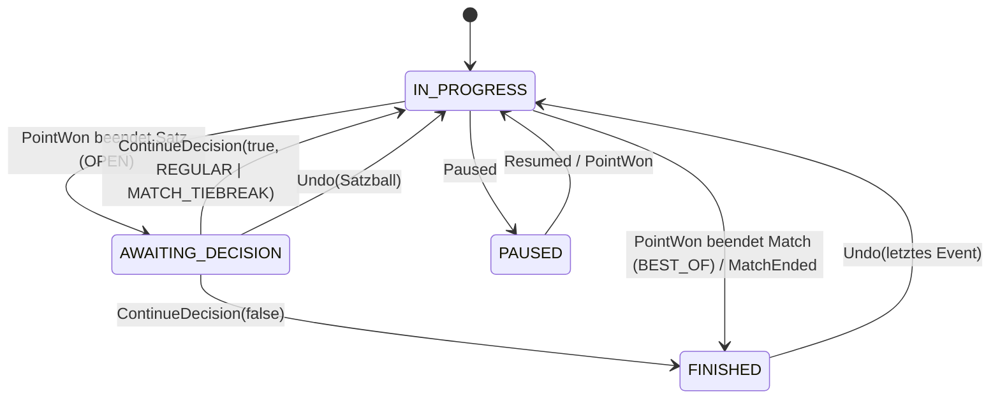

# 02 – Scoring-Regeln & Engine-Spezifikation

Stand: 2026-10-14 · Status: Entwurf v1.0 zur Abstimmung · Spec-Version für Testvektoren: `schema: 1`, `formatVersion: 1`

Bezug: [00 Grundsatzentscheidungen](00-entscheidungen.md) · [01 Architektur §3 Scoring-Engine](01-architektur.md) · [04 UX](04-ux-design.md) · [Testvektoren](testvectors/README.md)

> **Normativ:** „MUSS“, „DARF NICHT“ und „SOLL“ sind verbindlich für die Kotlin-Engine (`core-scoring`) und den Garmin-Port (Monkey C). Was in diesem Dokument nicht festgelegt ist, gilt als nicht spezifiziert. Ein Entwickler muss es dann klären und darf es nicht selbst erfinden. Im Konfliktfall gelten die Testvektoren in `docs/testvectors/` (später die generierten Golden Files in `testvectors/`).

---

## 0. Begriffe

| Begriff | Bedeutung in diesem Dokument |
|---|---|
| **Side** `A` / `B` | Die zwei Parteien eines Matches (Einzelspieler oder Doppel-Team). Alle Events und Zustände referenzieren `A`/`B` (wie `Side` in 01-architektur). |
| **Punkt / Rally** | Ein ausgespielter Ballwechsel. Das einzige Zähl-Event ist `PointWon(side)` = „Side hat den Ballwechsel gewonnen“. Beim Pickleball-Side-Out-Scoring führt ein gewonnener Ballwechsel nicht immer zu einem Punkt. |
| **Spiel (Game)** | Tennis/Padel: Einheit aus Punkten (0-15-30-40). Ein **Tiebreak** ist ebenfalls ein Spiel (`gameKind = TIEBREAK`). |
| **Satz (Set)** | Tennis/Padel: Einheit aus Spielen. **Pickleball: Ein „Game“ bis 11/15/21 wird in der Engine als Satz modelliert** (`setKind = PB_GAME`). Die UI zeigt dafür „Spiel“/„Game“ an. |
| **Match-Tiebreak** | Ein Tiebreak (meist bis 10), der den Entscheidungssatz ersetzt. In der Engine ist er ein Satz mit `setKind = MATCH_TIEBREAK`. |
| **Aufschlagseite (court)** | `RIGHT` = rechte Hälfte aus Sicht des Aufschlägers (Einstandsseite / „deuce court“), `LEFT` = linke Hälfte (Vorteilsseite / „ad court“). |
| **Ende (end)** | Platzhälfte `END_1` / `END_2`. Die Start-Ende wird im Lineup festgelegt, danach bestimmt die Engine die Seitenwechsel. |

---

## 1. Quellen (abgerufen am 2026-10-14)

| # | Quelle | Stand | Verwendung |
|---|---|---|---|
| Q1 | ITF, *Rules of Tennis 2026* (PDF) – <https://www.itftennis.com/media/7221/2026-rules-of-tennis-english.pdf> | 2026 | Regeln 5, 6, 7, 9, 10, 14, 15, 17, 27, 29; Appendix VI „Alternative Procedures and Scoring Methods“ |
| Q2 | FIP, *Rules of Padel* („Review of application 01.01.2026“) – <https://www.padelfip.com/wp-content/uploads/2025/12/FIP_Rules-of-Padel.pdf> (ES: <https://www.padelfip.com/wp-content/uploads/2025/12/FIP_Reglas-del-Padel.pdf>) | 01.01.2026 | Rule 1 (Option 1 Advantage, **Option 2 Star Point**, Option 3 Golden Point), Tie-Break, Alternative Score Methods, Rule 2.11, Rule 5, Rule 6, Rule 8 |
| Q3 | Padel Addict, „What is the Star Point …“ (18.12.2025) – <https://www.padeladdict.com/en/what-is-the-star-point-this-is-premier-padels-new-scoring-system/> | 12/2025 | Einführung Star Point bei Premier Padel 2026 (ab Riyadh P1) |
| Q4 | FIP, „FIP Promises: publicado el reglamento en vigor a partir de 2026“ – <https://www.padelfip.com/es/2025/12/fip-promises-publicado-el-reglamento-en-vigor-a-partir-de-2026-principales-novedades/> | 12/2025 | Star Point auf FIP Promises World/Continental Tour |
| Q5 | USA Padel, *2026 Competition Structure Guide* (30.06.2026) – <https://padelusa.org/wp-content/uploads/2026/06/2026-COMPETITION-STRUCTURE-GUIDE-JUN-30-2026.pdf> | 06/2026 | Star Point ersetzt Golden Point in USPA-sanktionierten Turnieren (laut Suchauszug, Volltext nicht geprüft) |
| Q6 | USA Pickleball, *2026 Official Rulebook*. Offizielle Seite: <https://usapickleball.org/what-is-pickleball/official-rules/>. Geprüfter Volltext: identische Kopie bei Pickleball Canada, <https://pickleballcanada.org/wp-content/uploads/2026/03/2026-Official-Rulebook-EN.pdf> | gültig ab 01.01.2026 | Regeln 4.A/B, 5.A/B/C, 6.B, 14.A (Rally Scoring, provisorisch), 15.C, 21.B, 21.F, 23.A |
| Q7 | Selkirk, „2026 USA Pickleball Rulebook Changes“ – <https://www.selkirk.com/blogs/pickleball-education/2026-usa-pickleball-rulebook-changes-key-updates-for-the-new-year> | 2026 | Sekundärquelle: Rally Scoring 2026, Wegfall des „Freeze“ |
| Q8 | tennis.com, „All Grand Slams to use 10-point tiebreaker at 6-6 in final set“ – <https://www.tennis.com/news/articles/all-grand-slams-to-use-10-point-tiebreaker-in-final-set> | 2022 | Hintergrund; heute als ITF Appendix VI Nr. 5 regulär zulässig |
| Q9 | NFHS/IHSA, *2024-25 NFHS US Tennis* (Folien) – <https://ihsa.org/Portals/0/2024-25_NFHS_US_Tennis_PowerPoint_Slides_Wide_Format.pdf> | 2024/25 | Pro-Set bis 8, Tiebreak bei 8:8 (**keine ITF-Regel**, US-Konvention) |

**Quellenlage:** Q1, Q2 und Q6 wurden im Volltext ausgewertet (PDF → Text), die Regelnummern unten beziehen sich darauf. Q3–Q5 und Q7–Q9 sind Sekundärquellen und dienen nur für Geltungsbereich und Hintergrund.

---

## 2. Regelrecherche (Kurzfassung mit Regelnummern)

### 2.1 Tennis (ITF Rules of Tennis 2026, Q1)

| Thema | Regel | Inhalt |
|---|---|---|
| Standardspiel | R5a | 0 („Love“), 15, 30, 40, Spiel; bei 3:3 Punkten „Deuce“ (Einstand), danach Vorteil; Gewinn mit 2 Punkten in Folge nach Einstand. Ansage: Aufschläger zuerst. |
| Tiebreak-Spiel | R5b | Zählung 0, 1, 2 … Gewinn mit 7 Punkten **und** 2 Punkten Vorsprung, sonst weiter. Der Spieler, der an der Reihe ist, schlägt den 1. Punkt auf, danach je 2 Punkte im Wechsel (im Doppel geht die Rotation innerhalb des Teams weiter). Wer im Tiebreak zuerst aufgeschlagen hat, ist im 1. Spiel des Folgesatzes **Rückschläger**. |
| Satz | R6 | „Advantage Set“: 6 Spiele mit 2 Vorsprung, ohne Tiebreak. „Tie-break Set“: 6 Spiele mit 2 Vorsprung, bei 6:6 Tiebreak. Ob der letzte Satz Tiebreak- oder Vorteilssatz ist, muss vorab feststehen. |
| Match | R7 | Best of 3 oder Best of 5 Sätze. |
| Wahl | R9 | Losentscheid: Aufschlag/Rückschlag oder Seite. |
| Seitenwechsel | R10 | Nach dem 1., 3. und jedem weiteren ungeraden Spiel eines Satzes. Am Satzende nur, wenn die Spielsumme des Satzes ungerade ist, sonst nach dem 1. Spiel des nächsten Satzes. Im Tiebreak alle 6 Punkte. |
| Aufschlagfolge | R14 | Nach jedem Standardspiel wechselt der Aufschlag. Doppel: Das Team, das das 1. Spiel eines Satzes aufschlägt, bestimmt seinen Aufschläger, der Gegner vor Spiel 2 ebenso. Danach gilt die Rotation A1-B1-A2-B2 bis Satzende. |
| Rückschlagfolge | R15 | Doppel: Jedes Team legt zu Satzbeginn fest, wer den 1. Punkt eines Spiels returniert. Danach wechselt es punktweise, für den ganzen Satz. |
| Aufschlagseite | R17 | Im Standardspiel abwechselnd, Beginn **rechts**. Im Tiebreak ebenfalls abwechselnd, 1. Punkt rechts. |
| Fehlerkorrektur | R27 | Bereits gespielte Punkte zählen. Falsche Seite/Hälfte wird sofort korrigiert. Aufschlag außer der Reihe: sofort korrigieren, war das Spiel schon beendet, bleibt die geänderte Reihenfolge (27c). Im Tiebreak: nach gerader Punktzahl sofort korrigieren, nach ungerader bleibt sie (27d). Falsche Rückschlagfolge im Doppel bleibt bis Spielende (27e). Irrtümlicher Tiebreak bzw. Nicht-Tiebreak: 27f/g/h. |
| Kontinuität | R29 | 25 s zwischen Punkten, 90 s beim Seitenwechsel, **kein** Pause-Seitenwechsel nach dem 1. Spiel eines Satzes und im Tiebreak, 120 s Satzpause. |
| **No-Ad** | App. VI | Bei 40:40 entscheidender Punkt. Rückschläger wählt die Seite, im Doppel darf das Rückschlagteam die Positionen nicht tauschen. Mixed: Gleichgeschlechtlicher Spieler zum Aufschläger returniert. |
| **Short Sets** | App. VI 1 | Satz bis 4 Spiele mit 2 Vorsprung, Tiebreak bei 4:4. Alternativ (nach Wahl des Veranstalters) schon bei 3:3. |
| **Short-Set-Tiebreak (5)** | App. VI 2 | Nur zusammen mit Short Sets: bis 5 Punkte, bei 4:4 entscheidender Punkt. Aufschlagfolge legt der Veranstalter fest. Seitenwechsel nur einmal, nach den ersten 4 Punkten. |
| **Match-Tiebreak (7)** | App. VI 3 | Ersetzt bei 1:1 (bzw. 2:2) Sätzen den Entscheidungssatz, bis 7 mit 2 Vorsprung. |
| **Match-Tiebreak (10)** | App. VI 4 | Wie Nr. 3, bis 10 mit 2 Vorsprung. Die Aufschlagfolge läuft weiter. Im Doppel darf die teaminterne Reihenfolge wie zu Satzbeginn neu gewählt werden. 120 s Pause vorher. |
| **Final-Set-Tiebreak (10)** | App. VI 5 | Im Entscheidungssatz bei 6:6 Tiebreak bis 10 mit 2 Vorsprung (Grand-Slam-Format, Q8). |
| **Alternativer Seitenwechsel im Tiebreak** | App. VI | Nach dem 1. Punkt, danach alle 4 Punkte. |
| No-Let | App. VI | Netzaufschlag ist im Spiel. Für die Zählung irrelevant, nur Info. |
| Pro-Set (8/10) | – | **Nicht in den ITF-Regeln.** US-Konvention (Q9): bis 8 Spiele mit 2 Vorsprung, Tiebreak (7) bei 8:8. Als konfigurierbarer Satz abbildbar. |

**Beläge:** Die ITF klassifiziert Plätze nach Tempo (Court Pace Rating, Kategorie 1 langsam bis 5 schnell) und empfiehlt Balltypen je Kategorie (Q1, Appendix I/II). Die **Zählregeln hängen nicht vom Belag ab**, siehe Abschnitt 10.

### 2.2 Padel (FIP Rules of Padel, Review 01.01.2026, Q2)

| Thema | Regel | Inhalt |
|---|---|---|
| Spiel – Option 1 **Advantage** | R1 Opt. 1 | Wie Tennis: Einstand, Vorteil, unbegrenzt. |
| Spiel – Option 2 **Star Point** | R1 Opt. 2 | Bei 40:40 „Deuce 1“, dann „Advantage 1“. Bei Verlust des Vorteils „Deuce 2“, dann „Advantage 2“. Bei erneutem Verlust „Deuce 3“: Es folgt der entscheidende **Star Point**. Das Rückschlagpaar wählt die Seite und darf die Positionen nicht tauschen. Mixed: Gleichgeschlechtlicher Spieler zum Aufschläger returniert. → **maximal 2 Vorteile**. |
| Spiel – Option 3 **Golden Point** | R1 Opt. 3 | Bei 40:40 entscheidender Punkt. Seitenwahl, Positionen und Mixed-Regel wie beim Star Point. |
| **Was 2026 gilt** | Q2–Q5 | Das FIP-Regelwerk lässt alle drei Optionen zu, der Veranstalter wählt. **Star Point** gilt 2026 bei Premier Padel (ab Riyadh P1), auf der FIP Promises World/Continental Tour und laut Q5 auch bei USA Padel. Im Amateurbereich sind Golden Point und Advantage weiter verbreitet. → Die App bietet alle drei an, mit Preset-Default „Star Point“ für das Pro-Format. |
| Satz | R1 Opt. 1.2 | 6 Spiele mit 2 Vorsprung, bei 6:6 Tiebreak. |
| Match | R1 Opt. 1.3/1.4 | Best of 3. Optional (vorab festgelegt) dritter Satz ohne Tiebreak (Vorteilssatz). |
| Tiebreak | Tie-Break 1–5 | Bis 7 mit 2 Vorsprung. Beginnt mit dem Spieler, der an der Reihe ist: 1 Aufschlag von rechts, danach je 2 Punkte pro Team. Gewinner des Satzes 7:6. Den Folgesatz eröffnet das Paar, das im Tiebreak **nicht** begonnen hat. |
| Alternativen | Alt. Score 1a–c | (a) Mini-Satz bis 4 (2 Vorsprung, Tiebreak bei 4:4). (b) Match-Tiebreak bis 7 statt 3. Satz. (c) **Super-Tiebreak bis 10** statt 3. Satz. |
| Seitenwechsel | R5 | Nach dem 1., 3. und jedem ungeraden Spiel des Satzes, im Tiebreak alle 6 Punkte. Ein vergessener Wechsel wird sofort korrigiert, Punkte zählen. |
| Aufschlag | R6.5, 6.8, 6.9 | 1. Punkt jedes Spiels von rechts, dann abwechselnd. Die Aufschlagreihenfolge im Team gilt für den ganzen Satz. Aufschlag außer der Reihe: sofort korrigieren, war das Spiel beendet, bleibt die Reihenfolge bis Satzende. |
| Rückschlag | R8.2–8.4 | Das Rückschlagpaar legt im 1. Spiel des Satzes fest, wer den 1. Aufschlag jedes Spiels returniert, fest für den Satz. Eine falsche Reihenfolge bleibt bis Spiel- bzw. Tiebreak-Ende bestehen. |
| Unterbrechung | R2.11 | Nach Regen/Licht/Unfall gibt es Einspielzeit gestaffelt (≤ 5 min: keine, 5–20 min: 1 min, > 20 min: 3 min). Für die Zählung irrelevant. |

### 2.3 Pickleball (USA Pickleball Official Rulebook 2026, Q6)

| Thema | Regel | Inhalt |
|---|---|---|
| Standard-Scoring (**Side-Out**) | 4.A | Punkte gibt es nur, wenn die **aufschlagende** Seite den Ballwechsel gewinnt. |
| Sieg im Spiel | 4.B, 15.C | Typisch bis 11 mit 2 Vorsprung. Turnieroptionen: Best of 3 bis 11, Best of 5 bis 11, ein Spiel bis 15 oder 21, ein Spiel bis 11 (nur Round Robin ab 6 Teams). Alle mit 2 Vorsprung, **außer Team-Play: Sieg mit 1 Punkt erlaubt**. |
| Einzel | 5.A | Gerader oder null Score des Aufschlägers: Aufschlag von rechts, ungerader Score: von links. Er schlägt bis zum Verlust eines Ballwechsels auf, dann Side Out. |
| Doppel – zwei Aufschläger | 5.B, 5.B.2, 5.B.5/6 | Beide Spieler eines Teams schlagen auf, bevor Side Out ist. **Ausnahme Spielbeginn:** Der Startaufschläger gilt als „zweiter Aufschläger“, deshalb ist nach seinem ersten verlorenen Ballwechsel sofort Side Out. Nach jedem Side Out beginnt der Spieler, der nach dem Team-Score **rechts** steht, als Aufschläger 1. |
| Doppel – Positionen | 5.B.3 | Der Startaufschläger eines Teams steht bei geradem/null Team-Score rechts, bei ungeradem links. Sein Partner entsprechend umgekehrt. |
| Ansage | 6.B.1/6.B.2 | Einzel: „Aufschläger-Score – Rückschläger-Score“, Start „0-0“. Doppel: drei Zahlen „Aufschlag-Score – Rückschlag-Score – Aufschläger-Nr.“, Start **„0-0-2“**. |
| Falscher Spieler/Position | 5.C | Kann vor dem Aufschlag erfragt werden. Wird ein Fehler erst nach dem Ballwechsel erkannt, **zählt das Ergebnis** (5.C.2). |
| **Rally Scoring** (provisorisch) | 14.A | Jeder Ballwechsel gibt einen Punkt (14.A.2). Ansage mit zwei Zahlen (14.A.3). Im Doppel nur **ein** Aufschläger je Aufschlagrecht (14.A.5). Nach Side Out schlägt der nach Team-Score rechts stehende Spieler auf (14.A.4). |
| **Rally Scoring 2026 – kein „Freeze“ mehr** | 14.A.2, Q7 | Bis 2025 konnte der Spielpunkt in Rally-Formaten nur beim eigenen Aufschlag gewonnen werden. 2026 zählt jeder Ballwechsel, auch der spielentscheidende Punkt der Rückschlagseite. Die Engine unterstützt das alte Verhalten optional (`gameWinningPointOnServeOnly`). |
| Rally-Formate (Turnier) | 15.C.2 | Ein Spiel bzw. Best of 3/5 bis 11, 15 oder 21. Bei schlechtem Wetter auch bis 7 mit Seitenwechsel bei 4. **Nicht erlaubt** in Double-Elimination-Doppel, bei 2026-Golden-Ticket-Events und den 2026 National Championships. |
| Seitenwechsel im Spiel | 21.B.1–3 | **Nur** in Einzelspiel-Matches und im entscheidenden Spiel: bei 11 Punkten, wenn die erste Seite 6 erreicht, bei 15 → 8, bei 21 → 11. Der Aufschläger bleibt (21.B.4). Ein vergessener Wechsel wird nachgeholt, ohne Auswirkung auf den Score (21.B.7). |
| Zwischen Spielen | 21.F.2/3 | Seitenwechsel **und** Wechsel des ersten Aufschlags. Teams dürfen ihren Startaufschläger neu wählen. |
| Aufgabe | 23.A.4 | Abgeschlossene Spiele bleiben. Im laufenden Spiel wird der Ist-Score des Aufgebenden notiert, der Gegner erhält die zum Sieg nötigen Punkte. Nicht gespielte Spiele werden 11-0 / 15-0 / 21-0 gewertet. |

---

## 3. Konfigurationsmodell `MatchFormat`

`MatchFormat` ist Teil von `MatchCreated(config, lineup)` (01-architektur §3.2) und während eines Matches **unveränderlich**. Alle Werte sind Ints, Enums (als Strings) oder `null`, keine Floats.

### 3.1 Felder

| Pfad | Typ | Werte | Default | Sport | Bedeutung |
|---|---|---|---|---|---|
| `formatVersion` | int | `1` | 1 | alle | Schema-Version. |
| `presetId` | string? | siehe §4 | null | alle | Nur zur Anzeige und Statistik, **nicht** regelrelevant. |
| `sport` | enum | `TENNIS`, `PADEL`, `PICKLEBALL` | – | alle | |
| `discipline` | enum | `SINGLES`, `DOUBLES` | Padel: `DOUBLES` | alle | Padel-Einzel ist nicht FIP-offiziell, aber erlaubt. |
| `match.mode` | enum | `BEST_OF`, `OPEN` | `BEST_OF` | alle | Siehe §5. |
| `match.bestOf` | int | `1`, `3`, `5` | 3 (PB: 1) | alle | Nur bei `BEST_OF`. Gewinnsätze = (bestOf+1)/2. |
| `game.deuceMode` | enum | `ADVANTAGE`, `DECIDING_POINT`, `STAR_POINT` | `ADVANTAGE` | T, P | `DECIDING_POINT` = No-Ad (Tennis) bzw. Golden Point (Padel). |
| `game.maxAdvantages` | int | ≥ 1 | 2 | T, P | Nur bei `STAR_POINT`. Anzahl erlaubter Vorteile vor dem Entscheidungspunkt (FIP 2026: 2). |
| `set.gamesToWin` | int | 1…12 | 6 | T, P | „Games pro Satz“. Ein Satz ist gewonnen mit ≥ gamesToWin und 2 Spielen Vorsprung oder durch den Tiebreak. |
| `set.tiebreakAt` | int? | `null` oder ≥ gamesToWin−1 | = gamesToWin | T, P | Spielstand n:n, bei dem der Tiebreak beginnt. `null` = Vorteilssatz ohne Tiebreak. |
| `set.tiebreak.pointsToWin` | int | ≥ 1 | 7 | T, P | |
| `set.tiebreak.winBy` | int | `1`, `2` | 2 | T, P | `1` nur für den Short-Set-Tiebreak (bis 5, Entscheidungspunkt bei 4:4). |
| `set.tiebreak.endChange.first` | int | ≥ 1 | 6 | T, P | Seitenwechsel nach der Punktsumme `first` … |
| `set.tiebreak.endChange.every` | int? | ≥ 1 / null | 6 | T, P | … und danach alle `every` Punkte (`null` = nur einmal). ITF-Alternative: `{first:1, every:4}`. Short-Set-TB: `{first:4, every:null}`. |
| `decidingSet` | object? | `null` / Satz-Objekt / Match-Tiebreak-Objekt | null | T, P | Abweichendes Format für den **Entscheidungssatz** bei `BEST_OF` (beide Seiten haben Gewinnsätze−1). `null` = wie `set`. |
| `decidingSet.kind` | enum | `REGULAR`, `MATCH_TIEBREAK` | `REGULAR` | T, P | `REGULAR` mit eigenen `gamesToWin`/`tiebreakAt`/`tiebreak` (z. B. Final-Set-Tiebreak bis 10 oder Vorteilssatz). `MATCH_TIEBREAK` mit `pointsToWin`, `winBy`, `endChange`. |
| `matchTiebreak` | object? | Match-Tiebreak-Objekt | null | T, P | Nur für `OPEN`: Format, wenn im Satzende-Dialog „Match-Tiebreak“ gewählt wird. `null` = Option wird nicht angeboten. |
| `pickleball.scoring` | enum | `SIDE_OUT`, `RALLY` | `SIDE_OUT` | PB | |
| `pickleball.pointsToWin` | int | 11, 15, 21 (frei ≥ 1; 7 = Wetter-Format) | 11 | PB | „Punkte pro Spiel“. |
| `pickleball.winBy` | int | `1`, `2` | 2 | PB | `1` nur Team-Play (15.C). |
| `pickleball.pointCap` | int? | > pointsToWin / null | null | PB | Freizeit-Option „Deckel“ (z. B. bis 15 bei Spiel bis 11): Wer den Cap erreicht, gewinnt. **Keine USAP-Regel.** |
| `pickleball.firstServiceTurnSingleServer` | bool | | true | PB | „0-0-2“-Regel (5.B). Nur bei Doppel + `SIDE_OUT` wirksam. |
| `pickleball.midGameEndChange` | enum | `DECIDING_GAME_ONLY`, `EVERY_GAME`, `NEVER` | `DECIDING_GAME_ONLY` | PB | USAP 21.B: nur im Einzelspiel-Match bzw. im Entscheidungsspiel. Im `OPEN`-Modus gibt es kein Entscheidungsspiel, dort wirkt nur `EVERY_GAME`. |
| `pickleball.midGameEndChangeAt` | int? | ≥ 1 / null | null | PB | `null` = ⌈pointsToWin/2⌉ → 11→6, 15→8, 21→11, 7→4. |
| `pickleball.gameWinningPointOnServeOnly` | bool | | false | PB | Nur `RALLY`: Regel bis 2025 („Freeze“). Gewinnt die Rückschlagseite den Ballwechsel, der ihr das Spiel brächte, gibt es Side Out **ohne** Punkt. 2026 aufgehoben. |

**Semantische Validierung (MUSS beim Erstellen geprüft werden, Fehler = Format ungültig):**

1. `sport = PICKLEBALL` ⇒ `pickleball` gesetzt, `game`/`set`/`decidingSet` fehlen bzw. sind null. Sonst ⇒ `game` und `set` gesetzt, `pickleball` fehlt.
2. `tiebreakAt = null` oder `tiebreakAt ≥ gamesToWin − 1`. Werte darüber sind erlaubt, z. B. Tiebreak erst bei 12:12.
3. `match.mode = OPEN` ⇒ `decidingSet` wird ignoriert (soll null sein).
4. `winBy = 1` im Tiebreak nur zusammen mit `pointsToWin ≤ 7` (Short-Set-Tiebreak). Das ist eine Plausibilitätsregel, die UI warnt nur.

### 3.2 JSON-Schema (draft 2020-12)

```json
{
  "$schema": "https://json-schema.org/draft/2020-12/schema",
  "$id": "https://racketone.app/schema/match-format-1.json",
  "title": "MatchFormat",
  "type": "object",
  "required": ["formatVersion", "sport", "discipline", "match"],
  "properties": {
    "formatVersion": { "const": 1 },
    "presetId": { "type": ["string", "null"] },
    "sport": { "enum": ["TENNIS", "PADEL", "PICKLEBALL"] },
    "discipline": { "enum": ["SINGLES", "DOUBLES"] },
    "match": {
      "type": "object",
      "required": ["mode"],
      "properties": {
        "mode": { "enum": ["BEST_OF", "OPEN"] },
        "bestOf": { "enum": [1, 3, 5] }
      },
      "if": { "properties": { "mode": { "const": "BEST_OF" } } },
      "then": { "required": ["bestOf"] }
    },
    "game": {
      "type": "object",
      "required": ["deuceMode"],
      "properties": {
        "deuceMode": { "enum": ["ADVANTAGE", "DECIDING_POINT", "STAR_POINT"] },
        "maxAdvantages": { "type": "integer", "minimum": 1, "default": 2 }
      }
    },
    "set": { "$ref": "#/$defs/regularSet" },
    "decidingSet": {
      "oneOf": [ { "type": "null" }, { "$ref": "#/$defs/regularSet" }, { "$ref": "#/$defs/matchTiebreak" } ]
    },
    "matchTiebreak": { "oneOf": [ { "type": "null" }, { "$ref": "#/$defs/matchTiebreak" } ] },
    "pickleball": { "$ref": "#/$defs/pickleball" }
  },
  "if": { "properties": { "sport": { "const": "PICKLEBALL" } } },
  "then": { "required": ["pickleball"] },
  "else": { "required": ["game", "set"] },
  "$defs": {
    "endChange": {
      "type": "object",
      "required": ["first"],
      "properties": {
        "first": { "type": "integer", "minimum": 1 },
        "every": { "type": ["integer", "null"], "minimum": 1 }
      }
    },
    "tiebreak": {
      "type": "object",
      "required": ["pointsToWin", "winBy", "endChange"],
      "properties": {
        "pointsToWin": { "type": "integer", "minimum": 1 },
        "winBy": { "enum": [1, 2] },
        "endChange": { "$ref": "#/$defs/endChange" }
      }
    },
    "regularSet": {
      "type": "object",
      "required": ["gamesToWin", "tiebreakAt"],
      "properties": {
        "kind": { "const": "REGULAR" },
        "gamesToWin": { "type": "integer", "minimum": 1, "maximum": 12 },
        "tiebreakAt": { "type": ["integer", "null"], "minimum": 0 },
        "tiebreak": { "$ref": "#/$defs/tiebreak" }
      }
    },
    "matchTiebreak": {
      "allOf": [ { "$ref": "#/$defs/tiebreak" } ],
      "required": ["kind"],
      "properties": { "kind": { "const": "MATCH_TIEBREAK" } }
    },
    "pickleball": {
      "type": "object",
      "required": ["scoring", "pointsToWin", "winBy"],
      "properties": {
        "scoring": { "enum": ["SIDE_OUT", "RALLY"] },
        "pointsToWin": { "type": "integer", "minimum": 1 },
        "winBy": { "enum": [1, 2] },
        "pointCap": { "type": ["integer", "null"] },
        "firstServiceTurnSingleServer": { "type": "boolean", "default": true },
        "midGameEndChange": { "enum": ["DECIDING_GAME_ONLY", "EVERY_GAME", "NEVER"], "default": "DECIDING_GAME_ONLY" },
        "midGameEndChangeAt": { "type": ["integer", "null"] },
        "gameWinningPointOnServeOnly": { "type": "boolean", "default": false }
      }
    }
  }
}
```

### 3.3 Lineup (Besetzung und Start)

| Feld | Typ | Bedeutung |
|---|---|---|
| `A`, `B` | string[1..2] | Spieler-IDs je Side. **Die Reihenfolge ist die Aufschlagreihenfolge des Teams** (Tennis/Padel: Index 0 schlägt das erste Aufschlagspiel des Teams im Satz auf. Pickleball: Index 0 = Startaufschläger, steht bei geradem Score rechts). |
| `firstServer` | string | Spieler, der das Match eröffnet. Daraus folgt die aufschlagende Side. Steht er nicht an Index 0 seines Teams, wird das Team-Array umgedreht. |
| `receiveRight` | {A?: id, B?: id} | Tennis/Padel-Doppel: Wer auf der rechten Seite (Einstandsseite) returniert. Default ist Index 0. Nur für die Anzeige `serve.receiver`. |
| `startEnds` | {A: `END_1`/`END_2`} | Startende von A. B steht auf dem anderen Ende. Default `END_1`. |

Metadaten ohne Regelwirkung (Belag, Halle, Ort, Mixed-Kennzeichen) stehen in `MatchCreated.meta` (§10), **nicht** im `MatchFormat`.

---

## 4. Presets

Presets sind benannte, vollständig ausgefüllte `MatchFormat`-Objekte. Der Wizard startet mit einem Preset und überschreibt nur die gewählten Felder (§5.1). Kürzel in der Tabelle: TB7 = `{pointsToWin:7, winBy:2, endChange:{first:6, every:6}}`, MTB10 = `{kind:MATCH_TIEBREAK, pointsToWin:10, winBy:2, endChange:{first:6, every:6}}`.

### 4.1 Tennis

| presetId | Anzeige | discipline | match | deuceMode | set | decidingSet | Quelle |
|---|---|---|---|---|---|---|---|
| `TENNIS_SINGLES_BO3` | Tennis Standard Best of 3 | SINGLES | BEST_OF 3 | ADVANTAGE | 6, TB@6, TB7 | null | R5–R7 |
| `TENNIS_SINGLES_BO5_FS10` | Best of 5, Final-Set-Tiebreak bis 10 | SINGLES | BEST_OF 5 | ADVANTAGE | 6, TB@6, TB7 | REGULAR 6, TB@6, TB bis 10 | App. VI 5 |
| `TENNIS_BO3_MTB10` | Best of 3, Match-Tiebreak statt 3. Satz | SINGLES/DOUBLES | BEST_OF 3 | ADVANTAGE | 6, TB@6, TB7 | MTB10 | App. VI 4 |
| `TENNIS_DOUBLES_MTB10` | Tennis Doppel Match-Tiebreak (No-Ad) | DOUBLES | BEST_OF 3 | DECIDING_POINT | 6, TB@6, TB7 | MTB10 | App. VI (No-Ad + MTB10), übliches Tour-Doppelformat |
| `TENNIS_BO3_ADV_FINAL` | Best of 3, Vorteilssatz am Ende | SINGLES/DOUBLES | BEST_OF 3 | ADVANTAGE | 6, TB@6, TB7 | REGULAR 6, `tiebreakAt:null` | R6a |
| `TENNIS_SHORT_SETS` | Kurzsätze bis 4 | SINGLES/DOUBLES | BEST_OF 3 | ADVANTAGE | 4, TB@4, TB7 | MTB10 | App. VI 1 |
| `TENNIS_SHORT_SETS_3ALL` | Kurzsätze, Tiebreak bei 3:3 bis 5 | SINGLES/DOUBLES | BEST_OF 3 | DECIDING_POINT | 4, TB@3, `{5, winBy 1, endChange {first 4, every null}}` | null | App. VI 1+2 |
| `TENNIS_PRO_SET_8` | Pro-Satz bis 8 | SINGLES/DOUBLES | BEST_OF 1 | ADVANTAGE | 8, TB@8, TB7 | null | US-Konvention (Q9) |
| `TENNIS_PRO_SET_10` | Pro-Satz bis 10 | SINGLES/DOUBLES | BEST_OF 1 | ADVANTAGE | 10, TB@10, TB7 | null | Konvention (prüfen, §12) |
| `TENNIS_ONE_SET` | Ein Satz | SINGLES/DOUBLES | BEST_OF 1 | ADVANTAGE | 6, TB@6, TB7 | null | R6b |
| `TENNIS_MATCH_TB_ONLY` | Nur Match-Tiebreak bis 10 | SINGLES/DOUBLES | BEST_OF 1 | ADVANTAGE | (6, TB@6, TB7) | MTB10 | App. VI 4. Bei Best of 1 ist der 1. Satz bereits der Entscheidungssatz. |
| `TENNIS_OPEN` | Freies Spiel (Satz für Satz) | SINGLES/DOUBLES | OPEN | ADVANTAGE | 6, TB@6, TB7 | – | `matchTiebreak` = MTB10 (Option im Dialog) |

### 4.2 Padel (immer `discipline: DOUBLES`)

| presetId | Anzeige | match | deuceMode | set | decidingSet | Quelle |
|---|---|---|---|---|---|---|
| `PADEL_PREMIER_2026` | Padel Premier (Star Point) | BEST_OF 3 | STAR_POINT (max 2) | 6, TB@6, TB7 | null | Q2 Opt. 2, Q3 |
| `PADEL_GOLDEN_BO3` | Padel Golden Point | BEST_OF 3 | DECIDING_POINT | 6, TB@6, TB7 | null | Q2 Opt. 3 |
| `PADEL_GOLDEN_STB` | Padel Golden Point + Super-Tiebreak | BEST_OF 3 | DECIDING_POINT | 6, TB@6, TB7 | MTB10 | Q2 Alt. 1c |
| `PADEL_ADVANTAGE_BO3` | Padel klassisch (Vorteil) | BEST_OF 3 | ADVANTAGE | 6, TB@6, TB7 | null | Q2 Opt. 1 |
| `PADEL_ADV_FINAL_NO_TB` | Padel, 3. Satz ohne Tiebreak | BEST_OF 3 | ADVANTAGE | 6, TB@6, TB7 | REGULAR 6, `tiebreakAt:null` | Q2 Opt. 1.4 |
| `PADEL_MINI_SETS` | Padel Mini-Sätze bis 4 | BEST_OF 3 | DECIDING_POINT | 4, TB@4, TB7 | MTB10 | Q2 Alt. 1a |
| `PADEL_OPEN` | Padel Freies Spiel | OPEN | STAR_POINT | 6, TB@6, TB7 | – | `matchTiebreak` = MTB10 |

### 4.3 Pickleball

| presetId | Anzeige | discipline | match | scoring | pointsToWin | winBy | midGameEndChange | Quelle |
|---|---|---|---|---|---|---|---|---|
| `PICKLEBALL_DOUBLES_11_SIDEOUT` | Pickleball Doppel bis 11 (Side-Out) | DOUBLES | BEST_OF 1 | SIDE_OUT | 11 | 2 | DECIDING_GAME_ONLY (→ bei 6) | 4.A, 15.C.1.d, 21.B.1 |
| `PICKLEBALL_DOUBLES_BO3_11` | Doppel Best of 3 bis 11 | DOUBLES | BEST_OF 3 | SIDE_OUT | 11 | 2 | DECIDING_GAME_ONLY | 15.C.1.a |
| `PICKLEBALL_DOUBLES_15` | Doppel ein Spiel bis 15 | DOUBLES | BEST_OF 1 | SIDE_OUT | 15 | 2 | DECIDING_GAME_ONLY (→ 8) | 15.C.1.c |
| `PICKLEBALL_DOUBLES_21` | Doppel ein Spiel bis 21 | DOUBLES | BEST_OF 1 | SIDE_OUT | 21 | 2 | DECIDING_GAME_ONLY (→ 11) | 15.C.1.c |
| `PICKLEBALL_SINGLES_11_SIDEOUT` | Einzel bis 11 | SINGLES | BEST_OF 1 | SIDE_OUT | 11 | 2 | DECIDING_GAME_ONLY | 5.A |
| `PICKLEBALL_SINGLES_BO3_11` | Einzel Best of 3 bis 11 | SINGLES | BEST_OF 3 | SIDE_OUT | 11 | 2 | DECIDING_GAME_ONLY | 15.C.1.a |
| `PICKLEBALL_DOUBLES_RALLY_21` | Doppel Rally bis 21 | DOUBLES | BEST_OF 1 | RALLY | 21 | 2 | DECIDING_GAME_ONLY (→ 11) | 14.A, 15.C.2.a |
| `PICKLEBALL_RALLY_BO3_15` | Rally Best of 3 bis 15 | SINGLES/DOUBLES | BEST_OF 3 | RALLY | 15 | 2 | DECIDING_GAME_ONLY | 15.C.2.b |
| `PICKLEBALL_RALLY_7_WEATHER` | Rally bis 7 (Wetter) | SINGLES/DOUBLES | BEST_OF 1 | RALLY | 7 | 2 | DECIDING_GAME_ONLY (→ 4) | 15.C.2.d |
| `PICKLEBALL_TEAM_WIN_BY_1` | Team-Play, Sieg mit 1 | DOUBLES | BEST_OF 1 | SIDE_OUT | 11 | 1 | DECIDING_GAME_ONLY | 15.C |
| `PICKLEBALL_OPEN` | Freies Spiel (Spiel für Spiel) | DOUBLES | OPEN | SIDE_OUT | 11 | 2 | EVERY_GAME (Freizeit-Default, §12) | – |

---

## 5. Match-Erstellung und Satzende-Modi

### 5.1 Wizard → `MatchFormat`

| Wizard-Schritt | Tennis | Padel | Pickleball | Feld |
|---|---|---|---|---|
| 1 Sportart | | | | `sport` → Default-Preset `TENNIS_SINGLES_BO3` / `PADEL_PREMIER_2026` / `PICKLEBALL_DOUBLES_11_SIDEOUT` |
| 2 Belag (nur Tennis) | Sand/Hart/Rasen/… + Halle/Draußen | – | – | `meta.surface`, `meta.environment` (§10) |
| 3 Mitspieler/Gegner | 1 oder 2 je Seite | immer 2 | 1 oder 2 | `discipline`, `lineup.A/B`. Danach Erstaufschläger (Default: Ich) und Startende. |
| 4 „Satzanzahl“ | 1 / 3 / 5 / **Offen** | 1 / 3 / Offen | „Spiele“: 1 / 3 / 5 / Offen | `match.mode`, `match.bestOf` |
| 5 „Games pro Satz“ | 4 / **6** / 8 / 10 | 4 / **6** | „Punkte pro Spiel“: **11** / 15 / 21 | `set.gamesToWin` (und `set.tiebreakAt = gamesToWin`) bzw. `pickleball.pointsToWin` |
| „Erweitert“ (optional, eingeklappt) | Einstand: Vorteil/No-Ad · Entscheidungssatz: normal / Match-TB 10 / Vorteilssatz / TB bis 10 bei 6:6 · Tiebreak bei n:n | Einstand: Star Point/Golden Point/Vorteil · 3. Satz: normal / Super-TB / ohne TB | Scoring: Side-Out/Rally · Sieg mit 2/1 · Seitenwechsel | übrige Felder |
| Start | | | | `MatchCreated(config, lineup, meta)` |

Abhängige Defaults: Wählt der Nutzer „Games pro Satz = 4“, setzt der Wizard `tiebreakAt = 4`. Wählt er bei Tennis-Doppel „Match-Tiebreak“, schlägt er zusätzlich No-Ad vor, ohne es zu erzwingen.

### 5.2 Zwei Modi für „Noch ein Satz?“

| | **`BEST_OF` (fest)** | **`OPEN` (offen, Satz für Satz)** |
|---|---|---|
| Matchende | automatisch, sobald eine Side (bestOf+1)/2 Sätze hat | nur durch `ContinueDecision(anotherSet=false)` (oder `MatchEnded`) |
| Dialog nach Satzende | **keiner**, der nächste Satz startet automatisch | **immer**: Status `AWAITING_DECISION`, `pending = ASK_ANOTHER_SET` |
| Entscheidungssatz-Regel (`decidingSet`) | ja | nein. Stattdessen kann der Dialog „Match-Tiebreak“ anbieten, wenn `matchTiebreak ≠ null`. |
| `MATCH_POINT`-Flag | ja | **nie** (das Ende ist nicht durch den Score bestimmt) |
| Sieger | wer die Gewinnsätze erreicht | mehr gewonnene Sätze. Gleichstand → `result.reason = DRAW`, `winner = null` |
| Nach Matchende | App fragt „Noch ein Satz in gleicher Besetzung?“. „Ja“ erzeugt ein **neues, verknüpftes Match** (`previousMatchId`, gleiche Lineup und Satzformat, `mode = OPEN`). Den Erstaufschläger liefert `state.continuation` (siehe unten). Das ergänzt ein Best-of (z. B. 3. Satz nach 2:0) ohne die Wertung zu verfälschen (wie 01-architektur §3.4). | Match ist beendet |

`state.continuation` (MUSS bei `AWAITING_DECISION` und bei `FINISHED` mit `reason = COMPLETED` gesetzt sein, sonst `null`): `{side, player}` = wer den nächsten Satz eröffnen würde (Regel §6.5.3). Bei Pickleball zusätzlich der Startaufschläger. Die Testvektoren prüfen das Feld noch nicht.

Ablauf im Satzende-Dialog (OPEN):



---

## 6. Regel-Algorithmen (normativ)

Notation: `p[X]` = Rohpunkte von Side X im laufenden Spiel bzw. Tiebreak bzw. Pickleball-Spiel. `g[X]` = Spiele im laufenden Satz. `other(X)` = Gegenseite. Ganzzahlarithmetik, `/` = ganzzahlige Division.

### 6.1 Standardspiel (Tennis/Padel, `gameKind = STANDARD`)

```
maxAdv = ADVANTAGE: ∞ | DECIDING_POINT: 0 | STAR_POINT: game.maxAdvantages
deuceNo(p) = (p[A] == p[B] && p[A] >= 3) ? p[A] - 2 : 0          // 1 = erster Einstand
isDecidingPoint = deuceNo > 0 && deuceNo > maxAdv                  // vor dem Punkt ausgewertet

on PointWon(X):
  wasDeciding = isDecidingPoint
  p[X] += 1
  if (p[X] >= 4 && p[X] - p[other(X)] >= 2) || wasDeciding: gameWon(X)
```

Prüffälle: Golden Point: 3:3 → Entscheidungspunkt → 4:3 gewinnt. Star Point: 3:3 (Einstand 1) → 4:3 (Vorteil 1) → 4:4 (Einstand 2) → 4:5 (Vorteil 2) → 5:5 (Einstand 3 = Star Point) → 6:5 gewinnt. Vorteil: Das Spiel endet nur mit 2 Punkten Abstand.

### 6.2 Tiebreak und Match-Tiebreak

```
cfg = set.tiebreak | decidingSet (MATCH_TIEBREAK) | matchTiebreak
on PointWon(X):
  p[X] += 1;  k = p[A] + p[B]
  if p[X] >= cfg.pointsToWin && p[X] - p[other(X)] >= cfg.winBy: tiebreakWon(X); return
  if k == cfg.endChange.first || (cfg.endChange.every != null && k > first && (k - first) % every == 0): changeEnds()
```

Ein Seitenwechsel innerhalb des Tiebreaks erfolgt **nur, wenn der Tiebreak danach weitergeht**. Endet er z. B. 7:5 (12 Punkte), gilt stattdessen die Satzende-Regel aus §6.7. Ein Tiebreak zählt für den Satzstand als ein gewonnenes Spiel (7:6). Ein Match-Tiebreak wird als Satz mit `games {Sieger:1, Verlierer:0}` und `tiebreak {A:x, B:y}` protokolliert (Anzeige „[10:8]“).

### 6.3 Satz (Tennis/Padel)

```
sf = isDecidingSet ? (decidingSet ?? set) : set
isDecidingSet = mode == BEST_OF && setsWon[A] == setsWon[B] == setsToWin - 1

gameWon(X):                                       // Standardspiel oder Tiebreak
  g[X] += 1
  if (odd(g[A] + g[B])) changeEnds()              // §6.7
  if gameKind == TIEBREAK || (g[X] >= sf.gamesToWin && g[X] - g[other(X)] >= 2): setWon(X)
  else if sf.tiebreakAt != null && g[A] == g[B] == sf.tiebreakAt: startTiebreak()
  else: startStandardGame()
```

Ein Satz mit `decidingSet.kind = MATCH_TIEBREAK` besteht nur aus diesem einen Tiebreak.

### 6.4 Match

```
setWon(X):
  append sets[] record; setsWon[X] += 1
  BEST_OF: if setsWon[X] == (bestOf+1)/2 → FINISHED(winner X, COMPLETED) else startSet(REGULAR or decidingSet)
  OPEN:    → AWAITING_DECISION (pending ASK_ANOTHER_SET)
```

### 6.5 Aufschlag (Tennis/Padel)

#### 6.5.1 Standardspiele

- Pro Side gibt es die Teamreihenfolge `order[X]` (Lineup-Array) und den Zähler `serveIdx[X]` = Anzahl der Aufschlagspiele von X im laufenden Satz.
- Aufschläger eines Standardspiels: Side `S`, Spieler `order[S][serveIdx[S] mod len]`. Nach dem Spiel gilt `serveIdx[S] += 1` und `S = other(S)`.
- Im Einzel ist `len = 1`. Im Doppel entsteht so die Rotation A1-B1-A2-B2 (R14, FIP 6.8).

#### 6.5.2 Tiebreak / Match-Tiebreak

Punktindex `k = p[A] + p[B]` **vor** dem Punkt (0-basiert). Slot `s = (k + 1) / 2` ergibt die Folge 0,1,1,2,2,3,3,…

```
tbFirst = Side, die an der Reihe ist (beim Satz-Tiebreak: other(Side, die das letzte Spiel aufschlug))
side(k) = (s even) ? tbFirst : other(tbFirst)
m      = (s even) ? s/2 : (s-1)/2                       // wievielter Aufschlag-Slot dieser Side
player(k) = order[side][(serveIdx[side] + m) mod len]
```

Damit schlägt der Spieler, der an der Reihe ist, einen Punkt auf, danach je zwei Punkte im Wechsel. Im Doppel läuft die Teamrotation weiter (R5b, FIP Tie-Break 3). Beim Match-Tiebreak gilt `serveIdx = 0`, `tbFirst` nach §6.5.3.

#### 6.5.3 Erster Aufschläger eines neuen Satzes

| Letztes Spiel des Vorsatzes | Neuer Satz wird eröffnet von |
|---|---|
| Standardspiel | `other(Side, die das letzte Spiel aufschlug)` |
| Tiebreak (auch Match-Tiebreak) | `other(tbFirst)` (R5b, FIP Tie-Break 5) |

Teamintern: `serveIdx` wird auf 0 gesetzt, `order[X]` bleibt aus dem Vorsatz erhalten. Eine neue Wahl erfolgt per `Correction(SERVING_ORDER)` (§7), solange die Side im neuen Satz noch nicht aufgeschlagen hat (R14, FIP 6.8, App. VI Note zum Match-Tiebreak).

#### 6.5.4 Aufschlagseite und Rückschläger

| gameKind | `serve.court` |
|---|---|
| STANDARD, kein Entscheidungspunkt | `RIGHT`, wenn `(p[A]+p[B])` gerade ist, sonst `LEFT` (R17, FIP 6.5) |
| STANDARD, `decidingPoint = true` | `RECEIVER_CHOICE` (No-Ad/Golden/Star: Rückschläger wählt), `receiver = null` |
| TIEBREAK / MATCH_TIEBREAK | `RIGHT`, wenn `k` gerade ist, sonst `LEFT` |

Rückschläger (`serve.receiver`): Einzel = Gegner. Doppel = Spieler der Rückschlagseite auf der Seite `court` laut `lineup.receiveRight`. Eine Änderung erfolgt per `Correction(RECEIVE_POSITIONS)`. Hinweis Mixed (No-Ad/Golden/Star): Der gleichgeschlechtliche Spieler returniert den Entscheidungspunkt. Das ist nur ein UI-Hinweis, die Engine kennt kein Geschlecht.

### 6.6 Pickleball

Zustand je Spiel: `p[A], p[B]`, Aufschlagseite `S`, Aufschläger-Spieler, `serverNumber ∈ {1, 2, null}`, Startaufschläger `start[X] = order[X][0]`.

```
rightPlayer(X) = (len(order[X]) == 1) ? order[X][0]
               : (p[X] even ? start[X] : partner(start[X]))          // 5.B.3
court(server)  = Einzel: p[S] even ? RIGHT : LEFT                    // 5.A.1
                 Doppel: server == rightPlayer(S) ? RIGHT : LEFT
receiver       = Spieler der Rückschlagseite auf derselben Seite (diagonal)

startGame(firstSide):
  p = 0:0; S = firstSide; server = rightPlayer(S)
  serverNumber = (DOUBLES && SIDE_OUT) ? (firstServiceTurnSingleServer ? 2 : 1) : null

on PointWon(X) [SIDE_OUT]:
  if X == S: p[X] += 1                                            // Punkt; derselbe Aufschläger wechselt die Seite
  else if DOUBLES && serverNumber == 1: serverNumber = 2; server = partner(server)   // SECOND_SERVER
  else: S = X; server = rightPlayer(X); serverNumber = DOUBLES ? 1 : null           // SIDE_OUT

on PointWon(X) [RALLY]:
  if !(gameWinningPointOnServeOnly && X != S && wouldWin(X)): p[X] += 1
  if X != S: S = X; server = rightPlayer(X)                          // SIDE_OUT (nach Punktvergabe!)

nach jedem Punkt:
  if (p[X] >= pointsToWin && p[X] - p[other] >= winBy) || (pointCap && p[X] >= pointCap): gameWon(X)
  else if midChangeApplies && !midChangeDone && max(p[A], p[B]) >= midAt: changeEnds(); midChangeDone = true

gameWon(X): changeEnds() (21.F.2); setWon(X) [§6.4]; nächstes Spiel: startGame(other(firstSide des Vorspiels))
midChangeApplies = EVERY_GAME || (DECIDING_GAME_ONLY && mode == BEST_OF && (bestOf == 1 || isDecidingSet))
```

Ansage `scoreCall`: Doppel + SIDE_OUT = `"{p[S]}-{p[other(S)]}-{serverNumber}"`, sonst `"{p[S]}-{p[other(S)]}"`.

Hinweise: Beim Second Server bleibt die Position unverändert. Er schlägt von der Seite auf, auf der er laut Score-Parität steht. Beim Rally Scoring wechseln die Positionen des Rückschlagteams, wenn es punktet, denn die Positionen hängen am Team-Score (5.B.3).

### 6.7 Seitenwechsel (`ends`)

| Sport | Regel | Pause-Hinweis (nur UI, Tennis R29) |
|---|---|---|
| Tennis/Padel | nach jedem Spiel, nach dem `g[A]+g[B]` des **laufenden Satzes** ungerade ist (inkl. Tiebreak als Spiel, inkl. letztem Spiel des Satzes). Das deckt die Satzende-Regel aus R10 vollständig ab. | Nach Spiel 1 eines Satzes: Wechsel **ohne** Pause. Sonst 90 s. Satzende: 120 s Satzpause. |
| Tennis/Padel Tiebreak | laut `endChange` (Standard alle 6 Punkte), nur wenn der Tiebreak weitergeht | Wechsel ohne Pause |
| Pickleball | nach jedem Spiel (21.F.2) und einmal im Spiel bei `midAt` (21.B) | 21.B.5: max. 1 min; zwischen Spielen max. 2 min |

Die Engine wendet Seitenwechsel **auch nach dem letzten Punkt eines Matches** an, wenn die Regel greift (Determinismus). Die UI zeigt den Hinweis `CHANGE_ENDS` bei `status = FINISHED` nicht an.

---

## 7. Event-Typen

Hülle und Ordnung sind in 01-architektur §3.2 festgelegt (`id`, `deviceId`, `lamport`, `wallClockMs`, `parentId`, Ordnung `(lamport, deviceId, id)`). Diese Spezifikation definiert die **Payloads** und ihre Wirkung. Die mit „neu“ markierten Payloads ergänzen 01-architektur.

| Payload | Felder | Wirkung | Gültig wenn (sonst → `ignoredEvents`) | UI-Undo-Ziel |
|---|---|---|---|---|
| `MatchCreated` | `config: MatchFormat`, `lineup`, `meta` | Genesis, erstes Event im Log | genau einmal | nein |
| `PointWon` | `side: A\|B`, `detail?: PointDetail` | Ballwechsel gewonnen (§6) | `status ∈ {IN_PROGRESS, PAUSED}`. Bei `PAUSED` wird implizit `Resumed` ausgeführt. | **ja** |
| `Undo` | `target: EventId` | Ziel-Event wird unwirksam | immer. Ein bereits unwirksames Ziel ist ein No-op. | (Redo = Undo auf Undo) |
| `ContinueDecision` | `anotherSet: bool`, `nextSetKind?: REGULAR\|MATCH_TIEBREAK` (Default `REGULAR`) | Antwort auf „Noch ein Satz?“ | `status = AWAITING_DECISION`. `MATCH_TIEBREAK` nur, wenn `config.matchTiebreak ≠ null`. | **ja** |
| `Correction` | `kind` + Felder, siehe 7.1 | Aufschläger/Reihenfolge/Positionen korrigieren | siehe 7.1 | **ja** |
| `MatchEnded` | `reason: RETIRED\|WALKOVER\|ABANDONED`, `side?` (die aufgebende bzw. nicht angetretene Side) | Match endet vorzeitig | `status ≠ FINISHED`. `WALKOVER` nur ohne wirksames `PointWon`. `side` ist Pflicht außer bei `ABANDONED`. | **ja** |
| `Paused` (neu) | – | Unterbrechung (Regen, Verletzung, Licht) | `status = IN_PROGRESS` | nein |
| `Resumed` (neu) | – | Fortsetzung | `status = PAUSED` | nein |
| `PointDetailSet` (neu, P3) | `target: EventId` (ein `PointWon`), `detail: PointDetail?` | Detail nachträglich setzen/ändern (`null` = löschen). Ohne Wirkung auf den Score. | Ziel ist ein wirksames `PointWon` | nein (eigenes Undo per Event-ID möglich) |

### 7.1 `Correction`-Varianten

| `kind` | Felder | Wirkung | Gültig wenn |
|---|---|---|---|
| `INITIAL_SERVER` | `player` | **Rückwirkend:** Die Engine faltet das gesamte Log neu, als hätte `lineup.firstServer = player` von Anfang an gegolten. Punkte bleiben, Aufschläger-Zuordnung, Seiten und Statistik ändern sich. Bei mehreren gilt das letzte wirksame. | jederzeit. Die UI bietet es nur im 1. Spiel an (siehe §9.4). |
| `SERVER` | `player`, `serverNumber?` (PB) | **Ab jetzt:** Aufschläger des laufenden Spiels bzw. Punktes = `player` (wechselt ggf. die Side). Tennis/Padel: `serveIdx[side]` wird so gesetzt, dass `order[side][serveIdx mod len] == player`. Danach geht die Rotation von dort weiter (R27c, FIP 6.9). Im Tiebreak wird der Rotationsanker auf den aktuellen Punktindex gelegt, der 1-2-2-Rhythmus bleibt an `k` gebunden. Pickleball: `S`, `server`, `serverNumber` (Default 1) werden gesetzt. | `status ∈ {IN_PROGRESS, PAUSED}`, `player` gehört zum Lineup |
| `SERVING_ORDER` | `side`, `players[]` (Permutation) | Neue Teamreihenfolge `order[side]`. Pickleball: `players[0]` = neuer Startaufschläger (21.F.3). | Tennis/Padel: Die Side hat im laufenden Satz noch kein Aufschlagspiel begonnen. Pickleball: Im laufenden Spiel wurde noch kein Ballwechsel gespielt. |
| `RECEIVE_POSITIONS` | `side`, `rightPlayer` | Neue Rückschlagposition (nur Anzeige von `receiver`) | Tennis/Padel-Doppel. Wird laut R27e/FIP 8.4 erst ab dem nächsten Spiel wirksam, die UI bietet es zwischen den Spielen an. |

### 7.2 `PointDetail` (optional, P3)

| Feld | Werte | Konsistenzregel (bei Verstoß: Detail wird für Statistik verworfen, Score unberührt) |
|---|---|---|
| `kind` | `ACE`, `SERVICE_WINNER`, `DOUBLE_FAULT`, `WINNER`, `FORCED_ERROR`, `UNFORCED_ERROR`, `SERVICE_FAULT` (PB) | `ACE`/`SERVICE_WINNER` ⇒ `side` = aufschlagende Side. `DOUBLE_FAULT` (T/P) ⇒ `side` = Rückschlagseite. `WINNER` ⇒ `by` gehört zu `side`. `*_ERROR` ⇒ `by` gehört zu `other(side)`. |
| `by` | Spieler-ID? | Verursacher. Optional, bei ACE/DF ist es der Aufschläger. |
| `secondServe` | bool? | Punkt wurde mit dem 2. Aufschlag gespielt (Tennis/Padel). Grundlage für die 1.-Aufschlag-Quote. |

### 7.3 Effektive Events und Fold (normativ)

1. Ordnen nach `(lamport, deviceId, id)` (01-architektur).
2. **Wirksamkeit:** Das Log wird rückwärts durchlaufen. Ein Event ist unwirksam, wenn ein *wirksames* `Undo` auf seine `id` zeigt. `Undo`-Events selbst gehen nicht in den Fold ein.
3. Der Fold startet mit `initial(config, lineup')`, wobei `lineup'` die rückwirkende `Correction(INITIAL_SERVER)` berücksichtigt. Danach werden die wirksamen Events in Ordnung angewendet.
4. Ein wirksames Event, dessen Vorbedingung (Tabelle §7) nicht erfüllt ist, wird **übersprungen**. Seine `id` wird an `state.ignoredEvents` angehängt. Das ist kein Fehler: Die Situation kann nach Merges oder Undo mitten im Log entstehen. Die UI DARF solche Events nicht erzeugen.
5. `effects` beschreibt die Folgen **des letzten Events im Log**: bei `Undo` = `["UNDONE"]`, bei übersprungenem Event = `["IGNORED"]`, bei leerem Log = `[]`.
6. Die Duplikat-Erkennung für Doppel-Taps (01-architektur §4.4) findet **vor** diesem Fold statt und ist nicht Teil dieser Spezifikation.

**UI-Undo** (Taste/Wischgeste) erzeugt `Undo(target)` auf das letzte wirksame Event vom Typ `PointWon`, `ContinueDecision`, `Correction` oder `MatchEnded`. Mehrfaches Drücken geht schrittweise zurück, auch über Spiel-, Satz- und Matchgrenzen.

---

## 8. Zustandsmodell (kanonische Form)

Diese Form gilt für die Testvektoren und den Garmin-Abgleich. Interne Datenstrukturen dürfen abweichen, der Export MUSS genau so aussehen. Schlüssel immer vorhanden, `null` explizit.

| Feld | Typ | Inhalt |
|---|---|---|
| `status` | enum | `IN_PROGRESS`, `PAUSED`, `AWAITING_DECISION`, `FINISHED` |
| `pending` | enum? | `ASK_ANOTHER_SET` bei `AWAITING_DECISION`, sonst `null` |
| `result` | object? | `{winner: A\|B\|null, reason: COMPLETED\|DRAW\|RETIRED\|WALKOVER\|ABANDONED}`, solange nicht beendet `null` |
| `setsWon` | {A,B} | Gewonnene Sätze (Pickleball: gewonnene Spiele) |
| `sets` | array | Abgeschlossene Sätze: `{kind: REGULAR\|MATCH_TIEBREAK\|PB_GAME, games: {A,B}\|null, tiebreak: {A,B}\|null, points: {A,B}\|null, winner}` |
| `current` | object? | Laufender Satz/Spiel, `null` bei `AWAITING_DECISION` und bei `FINISHED/COMPLETED`. Bei `RETIRED/WALKOVER/ABANDONED` **eingefroren** (letzter Stand). |
| `current.setIndex` | int | 0-basiert = Anzahl abgeschlossener Sätze |
| `current.setKind` | enum | `REGULAR`, `MATCH_TIEBREAK`, `PB_GAME` |
| `current.gameKind` | enum | `STANDARD`, `TIEBREAK`, `MATCH_TIEBREAK`, `RALLY_GAME` (PB) |
| `current.games` | {A,B}? | Spiele im Satz (PB: `null`) |
| `current.points` | {A,B} | Rohpunkte (Standardspiel: Anzahl gewonnener Punkte, z. B. 5:5 beim Star Point) |
| `current.display` | {A,B} strings | siehe 8.1 |
| `current.callout` | enum? | `DEUCE`, `ADVANTAGE_SERVER`, `ADVANTAGE_RECEIVER`, `DECIDING_POINT`, `STAR_POINT`, sonst `null` |
| `current.deuceCount` | int? | Standardspiel: `max(0, min(p[A], p[B]) − 2)` = Nummer des erreichten Einstands (Star Point: „Einstand 1/2/3“). Tiebreak: 0. PB: `null`. |
| `current.decidingPoint` | bool? | Der nächste Punkt entscheidet das Spiel (Golden/No-Ad/Star Point). PB: `null`. |
| `serve` | object? | `{side, player, court: RIGHT\|LEFT\|RECEIVER_CHOICE, serverNumber: 1\|2\|null, receiver: id\|null}`. `null`, wenn `current = null` oder eingefroren. |
| `scoreCall` | string? | Tennis/Padel: `"{display[S]}-{display[R]}"` (Aufschläger zuerst, z. B. `"AD-40"`, `"6-5"`). PB siehe §6.6. |
| `positions` | object? | Nur Pickleball: `{A: {RIGHT, LEFT}, B: {RIGHT, LEFT}}` (Einzel: `LEFT = null`), sonst `null` |
| `ends` | {A,B} | `END_1`/`END_2` |
| `statusFlags` | array | siehe 8.2 |
| `effects` | array | siehe 8.3 |
| `ignoredEvents` | array | IDs übersprungener Events in Fold-Reihenfolge |
| `continuation` | object? | §5.2 (in Testvektoren schema 1 noch nicht geprüft) |

### 8.1 Punktanzeige

| Situation (Standardspiel) | `display` | `callout` |
|---|---|---|
| Rohpunkte 0/1/2/3 (solange nicht beide ≥ 3) | `"0"`, `"15"`, `"30"`, `"40"` | null |
| beide ≥ 3, gleich, kein Entscheidungspunkt | `"40"`/`"40"` | `DEUCE` |
| beide ≥ 3, gleich, Entscheidungspunkt | `"40"`/`"40"` | `DECIDING_POINT` (Advantage/No-Ad/Golden) bzw. `STAR_POINT` (deuceMode STAR_POINT) |
| beide ≥ 3, Differenz 1 | Führender `"AD"`, anderer `"40"` | `ADVANTAGE_SERVER` / `ADVANTAGE_RECEIVER` |
| Tiebreak / Match-Tiebreak / Pickleball | Dezimalzahl der Rohpunkte | null |

Die Engine liefert `"0"`, nicht „Love“. Lokalisierte Texte („Einstand“, „Vorteil Aufschläger“, „Golden Point“, „Star Point“, „Einstand 2“) erzeugt die UI aus `callout` und `deuceCount`.

### 8.2 `statusFlags` (Spielball, Breakball, Satzball, Matchball)

Normative Definition per **Was-wäre-wenn**: Für jede Side X (Reihenfolge A, dann B) wird bei `status ∈ {IN_PROGRESS, PAUSED}` ein hypothetisches `PointWon(X)` auf eine Kopie angewendet.

| Ergebnis der Simulation | `level` |
|---|---|
| Match endet mit Sieger X (nur `BEST_OF`) | `MATCH_POINT` |
| sonst: laufender Satz endet mit Sieger X | `SET_POINT` (bei Pickleball = Spielball des Pickleball-Games) |
| sonst: laufendes Standardspiel endet mit Sieger X | `GAME_POINT` |
| sonst | kein Flag für X |

Weitere Felder je Flag:

- `breakPoint` = `sport ≠ PICKLEBALL && gameKind == STANDARD && X ≠ aufschlagende Side`. Ein Satzball als Rückschläger hat `level = SET_POINT, breakPoint = true`.
- `count` = `p[X] − p[other(X)]`, wenn `p[X] > p[other(X)]`, sonst `1` (Entscheidungspunkt). Das entspricht der üblichen Ansage, z. B. 0:40 → „3 Breakbälle“, Pickleball 10-1 → 9.
- Beim Entscheidungspunkt (Golden/Star/No-Ad) haben **beide** Sides ein Flag.
- Pickleball Side-Out: Die Rückschlagseite kann nicht punkten und bekommt daher nie ein Flag (die Simulation liefert keinen Punkt).

Watch-Anzeige (Hinweis-Pill, 04-ux): `callout ∈ {DECIDING_POINT, STAR_POINT}` hat Vorrang („Golden Point“/„Star Point“), dann das höchste `level` der eigenen bzw. der Gegner-Side: Matchball > Satzball > Breakball (GAME_POINT + breakPoint) > Spielball. Bei `count > 1` lautet der Text „3 Satzbälle“.

### 8.3 `effects` (Übergänge durch das letzte Event, für Haptik und Toasts)

Kanonische Reihenfolge (die Liste ist danach sortiert und ohne Duplikate):
`RESUMED, POINT, SECOND_SERVER, SIDE_OUT, GAME_WON, SET_WON, MATCH_WON, MATCH_DRAWN, MATCH_ENDED, CHANGE_ENDS, TIEBREAK_STARTED, SET_STARTED, ASK_ANOTHER_SET, PAUSED, UNDONE, IGNORED`

| Effekt | Auslöser |
|---|---|
| `POINT` | Tennis/Padel: jedes `PointWon`. PB: Punkt wurde vergeben. |
| `SECOND_SERVER` / `SIDE_OUT` | PB: Aufschlagwechsel innerhalb des Teams / zur anderen Side |
| `GAME_WON` | Tennis/Padel: Spiel oder Tiebreak gewonnen (nicht bei PB) |
| `SET_WON` | Satz / Match-Tiebreak / Pickleball-Spiel gewonnen |
| `MATCH_WON` / `MATCH_DRAWN` | reguläres Matchende / OPEN mit Gleichstand |
| `MATCH_ENDED` | `MatchEnded` angewendet |
| `CHANGE_ENDS` | `ends` hat sich geändert |
| `TIEBREAK_STARTED` | Satz-Tiebreak beginnt |
| `SET_STARTED` | neuer Satz begonnen (automatisch bei BEST_OF oder durch `ContinueDecision(true)`) |
| `ASK_ANOTHER_SET` | OPEN: Satzende-Frage |
| `PAUSED` / `RESUMED` | Unterbrechung |
| `UNDONE` / `IGNORED` | §7.3 |

---

## 9. Edge Cases

| # | Fall | Festlegung |
|---|---|---|
| 9.1 | **Undo über Spiel-/Satz-/Matchgrenzen** | Das ergibt sich aus dem Fold, es gibt keine Sonderlogik. Undo des Satzballs stellt Spielstand, Aufschläger und Seiten wieder her. Auf `AWAITING_DECISION` folgt wieder `IN_PROGRESS` mit den Flags. Undo nach `ContinueDecision` führt zurück zu `AWAITING_DECISION`, ein weiteres Undo entfernt den Satzball. Undo nach `FINISHED` öffnet das Match wieder. Existiert bereits ein verknüpftes Folgematch (§5.2), warnt die UI. Testvektoren TV-PAD-002, TV-TEN-002. |
| 9.2 | **Aufgabe** | `MatchEnded(RETIRED, side)`, Sieger = Gegenseite, `current` eingefroren. Anzeige Tennis/Padel z. B. „6:4 2:1 (30:0) Aufg.“. Pickleball-Ergebnismeldung laut 23.A.4: Der Ist-Score des Aufgebenden bleibt, der Gegner bekommt den Siegscore (z. B. 11-7), nicht gespielte Spiele 11-0. Das berechnet nur der Export, der Engine-Zustand bleibt der Ist-Stand. Undo der Aufgabe ist möglich. |
| 9.3 | **Unterbrechung** | `Paused`/`Resumed` haben keine Score-Wirkung. Ein `PointWon` während `PAUSED` setzt automatisch fort, damit ein vergessenes „Weiter“ das Zählen nicht blockiert. Die Pausenzeit wird aus `wallClockMs` von der Nettospielzeit abgezogen. Mehrtägige Matches sind dasselbe Match. Nach langer Pause (> 20 min) SOLL die UI einen Hinweis zur Prüfung von Aufschläger und Seite zeigen. Watch: 05-watches-health §Pausen. |
| 9.4 | **Falscher Aufschläger** | (a) Im 1. Spiel bemerkt → UI bietet „Ab Beginn korrigieren“ = `Correction(INITIAL_SERVER)` an. Die Punkte bleiben, die Statistik wird korrekt zugeordnet. (b) Später bemerkt → „Ab jetzt korrigieren“ = `Correction(SERVER)`, bereits gespielte Punkte bleiben (R27c/d, FIP 6.9, PB 5.C.2). (c) Falsche Reihenfolge im Doppel-Team zu Satzbeginn → `Correction(SERVING_ORDER)`. (d) Falscher Rückschläger → `Correction(RECEIVE_POSITIONS)`, ab dem nächsten Spiel. (e) Pickleball falscher Startaufschläger → `Correction(SERVING_ORDER)` vor dem ersten Ballwechsel, sonst `Correction(SERVER)`. |
| 9.5 | **Satzende-Dialog** | Nur im `OPEN`-Modus (§5.2). Antworten von mehreren Geräten: Die erste wirksame gilt, weitere werden übersprungen (`ignoredEvents`) und die UI zeigt einen Konflikthinweis (01-architektur §3.4). Punkte während des Dialogs werden übersprungen (TV-TEN-002). Uhr: Vollbild mit zwei großen Buttons, kein Auto-Default. Optionaler dritter Button „Match-Tiebreak“, wenn `matchTiebreak ≠ null`. |
| 9.6 | **Punkt für falsche Side** | Undo und neu eingeben, keine eigene Korrektur-Art. |
| 9.7 | **Formatfehler (z. B. Tiebreak vergessen, R27f–h)** | v1: keine Formatänderung während des Matches. Workaround: Undo bis vor das betroffene Spiel. Kandidat für später: `Correction(FORMAT)`. |
| 9.8 | **Walkover** | `MatchEnded(WALKOVER, side)` nur ohne wirksames `PointWon`. Sonst wird das Event übersprungen und die UI bietet `RETIRED` an. |
| 9.9 | **Abbruch** | `MatchEnded(ABANDONED)`, `winner = null`, `current` eingefroren. Zählt in der Statistik als „ohne Wertung“. |
| 9.10 | **Gleichstand im OPEN-Modus** | `ContinueDecision(false)` bei gleich vielen Sätzen ergibt `reason = DRAW`. |
| 9.11 | **Entscheidungspunkt im Mixed** | Engine: `court = RECEIVER_CHOICE`, `receiver = null`. UI-Hinweis „Gleichgeschlechtlicher Spieler returniert“ nur, wenn `meta.mixed = true`. |
| 9.12 | **Seitenwechsel vergessen** | Für den Score irrelevant (R27b, FIP 5.3, PB 21.B.7). Die Engine-Seiten sind die Soll-Seiten, eine Korrektur gibt es nicht. |
| 9.13 | **Pickleball-Timeouts, Ballwechsel (Tennis)** | Nicht modelliert, weil ohne Score-Wirkung. Pickleball-Timeouts können später als Info-Event folgen. |
| 9.14 | **Pickleball Rally vor 2026 („Freeze“)** | Über `gameWinningPointOnServeOnly = true`. Kein Preset, nur unter „Erweitert“. |

---

## 10. Beläge und Match-Metadaten

**Beeinflussen Beläge die Regeln? Nein.** Weder ITF noch FIP noch USAP machen die Zählweise vom Belag abhängig. Die ITF ordnet Belägen nur ein Platztempo (Court Pace Rating, Kategorie 1–5) und empfohlene Balltypen zu (Q1, Appendix I/II). Der Belag ist also reine Metadaten, aber wichtig für die Statistik (Bilanz und Kennzahlen je Belag, Head-to-Head je Belag).

`MatchCreated.meta`:

| Feld | Werte | Hinweis |
|---|---|---|
| `surface` | `CLAY` (Sand/Ziegelmehl), `HARD` (Hartplatz/Acryl), `GRASS` (Naturrasen), `ARTIFICIAL_GRASS` (Kunstrasen, i. d. R. sandverfüllt; Standard bei Padel), `CARPET` (Teppich, meist Halle), `GRANULAR` (Granulat/Allwetter), `WOOD` (Hallenboden, v. a. Pickleball), `OTHER`, `null` | Tennis: im Wizard abgefragt. Padel/Pickleball: optional. |
| `environment` | `INDOOR`, `OUTDOOR`, `null` | Schalter „Halle/Draußen“ (04-ux). **Getrennt** vom Belag, da „Halle“ kein Belag ist (z. B. Teppich in der Halle, Sand in der Traglufthalle). |
| `courtPace` | 1–5, `null` | optional, ITF-Kategorie, für Fortgeschrittene |
| `mixed` | bool | Mixed-Doppel: steuert nur UI-Hinweise (9.11) |
| `venue` | string? | Freitext |

Abweichung zum Backend-Entwurf (03, `surface ... 'indoor_hard','indoor_other'`): Empfehlung `surface` + `environment` getrennt, siehe §12.

---

## 11. Statistik

### 11.1 Nur aus Punkt-Events ableitbar (immer verfügbar)

Basis: Die Engine liefert zu jedem wirksamen `PointWon` den Zustand **vor** dem Punkt (Aufschläger, Side, gameKind, statusFlags, callout) und danach (effects). Zusätzlich gibt es `wallClockMs`.

| Kennzahl | Definition |
|---|---|
| Punkte gewonnen (gesamt, %) | Anzahl `PointWon(X)` / alle |
| Aufschlagpunkte gewonnen | Punkte von X, bei denen X aufschlägt. Im Doppel auch je Spieler (`serve.player`). |
| Returnpunkte gewonnen | Punkte von X, bei denen X zurückschlägt |
| Aufschlagspiele gewonnen (Hold-%) | Standardspiele mit Aufschläger X, die X gewinnt |
| Breaks (Break-%) | Standardspiele, die X als Rückschläger gewinnt |
| Breakbälle erspielt / verwertet | Punkte, vor denen X ein Flag mit `breakPoint = true` hat (jede Chance zählt einzeln, Tour-Konvention) / davon gewonnen |
| Breakbälle abgewehrt | Aus Sicht des Aufschlägers: Breakbälle des Gegners, die der Aufschläger gewinnt |
| Satz-/Matchbälle erspielt, verwertet, abgewehrt | analog mit `level = SET_POINT` / `MATCH_POINT` |
| Entscheidungspunkte (Golden/Star/No-Ad) | Punkte mit `decidingPoint = true`: gespielt / gewonnen, je als Aufschläger und Rückschläger |
| Einstandsspiele | Spiele, in denen `deuceCount ≥ 1` erreicht wurde, gewonnen/verloren. Star Point: Verteilung nach Einstand 1/2/3. |
| Tiebreaks | gespielt / gewonnen. **Mini-Breaks** = Tiebreak-Punkte, die X als Rückschläger gewinnt. |
| Längste Punkteserie | maximale Folge aufeinanderfolgender `PointWon(X)` (auch über Spielgrenzen) |
| Längste Spielserie | maximale Folge gewonnener Spiele (Tennis/Padel) |
| Momentum-Verlauf | Kurve `d(n) = Σ (+1 für A, −1 für B)` über Punkt n. Zusätzlich gleitendes Fenster der letzten 8 Punkte (`m(n) ∈ [−8, 8]`) für die „Welle“. Markiert werden Spiel-, Satz- und Break-Ereignisse. |
| Führungswechsel, größte Führung, Comeback | im Satz nach Spielen (Tennis/Padel) bzw. Punkten (PB). Comeback = größter Rückstand, nach dem der Satz noch gewonnen wurde. |
| Punkte unter Druck | Gewinnquote bei Punkten, bei denen X mit einem Flag des Gegners konfrontiert ist |
| Pickleball: Side-Out-Quote | Anteil der Ballwechsel als Rückschlagseite, die X gewinnt (= Aufschlag zurückgeholt) |
| Pickleball: Punkte pro Aufschlagrecht | Punkte von X je Aufschlagperiode (Side-Out-Scoring), getrennt nach Aufschläger 1 und 2 |
| Pickleball Rally: Punkte bei Aufschlag / Rückschlag | wie Tennis |
| Zeiten | Netto-Matchdauer (ohne `Paused`), Satzdauer, Ø Zeit zwischen Punkten (Näherung für Ballwechsel plus Pause, Ausreißer > 120 s verwerfen), längstes Spiel |
| Belag/Format-Aggregation | alles oben je `meta.surface`, `environment`, `presetId` |

### 11.2 Optionale erweiterte Eingaben (`PointDetail`)

| Eingabe | Abgeleitete Kennzahlen | Erfassbar auf der Uhr ohne Störung des Zählflusses? |
|---|---|---|
| **Ass** | Asse, Ass-Quote | **Ja.** Long-Press auf die Hälfte der aufschlagenden Side wird als Punkt + `ACE` gezählt. |
| **Doppelfehler** | DF, DF-Quote | **Ja.** Long-Press auf die Hälfte der Rückschlagseite wird als Punkt + `DOUBLE_FAULT` gezählt. Die Geste bedeutet je nach Aufschlagseite genau eines von beiden, deshalb gibt es kein Menü. |
| 2. Aufschlag | 1.-Aufschlag-Quote, Punkte nach 1./2. Aufschlag | **Eingeschränkt.** Ein Tap vor dem Punkt („2. Aufschlag“) ist ein zusätzlicher Schritt pro Fehlaufschlag, nur als Opt-in. Empfehlung: Handy oder Nicht-Spieler als Zähler. |
| Winner / Unforced Error / Forced Error | Winner/UE-Bilanz | **Nein** (live). Das braucht Spieler- und Kategorieauswahl. Nur am Handy, als Zuschauer-Zähler oder nachträglich per `PointDetailSet`. |
| Pickleball `SERVICE_FAULT` | Aufschlagfehler-Quote | Optional per Long-Press auf die Rückschlagseite (analog Doppelfehler) |

**Empfehlung:** Auf der Uhr gilt immer nur 1 Tap = 1 Punkt. Als Opt-in kommen Ass und Doppelfehler per Long-Press dazu (eine Geste, eindeutig, mit eigener Haptik). Alles Weitere gibt es nur am Handy oder nachträglich. Die Kennzahlen aus §11.1 kommen ohne jede Zusatzeingabe aus.

---

## 12. Offene Regel-Entscheidungen (für den Nutzer)

| # | Frage | Vorschlag |
|---|---|---|
| U1 | Padel-Default: Star Point (Pro 2026) oder Golden Point (Amateur-Realität)? | Wizard-Default **Golden Point** für Freizeit. Star Point als Preset „Padel Premier“. |
| U2 | Doppel: Bleibt die teaminterne Aufschlagreihenfolge über Sätze hinweg gleich (Default), oder wird zu jedem Satzbeginn gefragt? | Gleich lassen und zu Satzbeginn einen kleinen Hinweis „Aufschläger ändern?“ zeigen (kein Dialog). |
| U3 | Best-of: „Noch ein Satz?“ nach Matchende als **neues, verknüpftes Match** (01-architektur) oder als Zusatzsatz im selben Match? | Neues verknüpftes Match (saubere Wertung). |
| U4 | Pickleball im Freizeit-/OPEN-Modus: Seitenwechsel bei 6 in **jedem** Spiel oder nie? | `EVERY_GAME` als Freizeit-Default. Turnierpresets laut 21.B. |
| U5 | Breakball-Zählung `count` = Punktvorsprung (übliche Ansage) statt „echter“ Chancen bei Golden Point (0:40 ergibt dort eigentlich 4 Chancen)? | Punktvorsprung (wie hier spezifiziert). |
| U6 | Pro-Satz bis 10: Tiebreak bei 10:10 oder 9:9? Nicht ITF-geregelt. | 10:10, frei änderbar. |
| U7 | Belag: `surface` + `environment` getrennt (dieses Dokument, 04-ux) oder kombiniert (`indoor_hard`, 03-backend)? | Getrennt, das Backend passt die Constraint an. |
| U8 | Golden-Point-/No-Ad-Hinweis im Mixed („gleichgeschlechtlich returniert“) anzeigen? Dafür braucht es `meta.mixed`. | Ja, nur wenn `mixed = true`. |
| U9 | Pickleball „Point Cap“ (Freizeit) und Sieg mit 1 Punkt: im Wizard sichtbar oder nur unter „Erweitert“? | Nur unter „Erweitert“. |
| U10 | Sollen Ass/Doppelfehler per Long-Press auf der Uhr in P1 kommen oder erst P3? | P3 (Event-Feld ist ab P1 im Schema vorhanden). |
