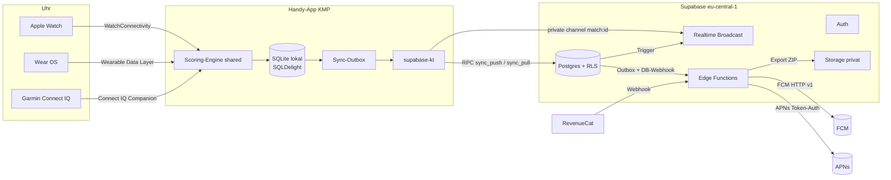
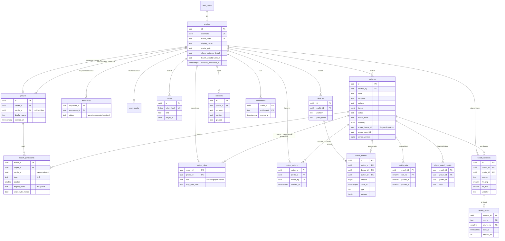
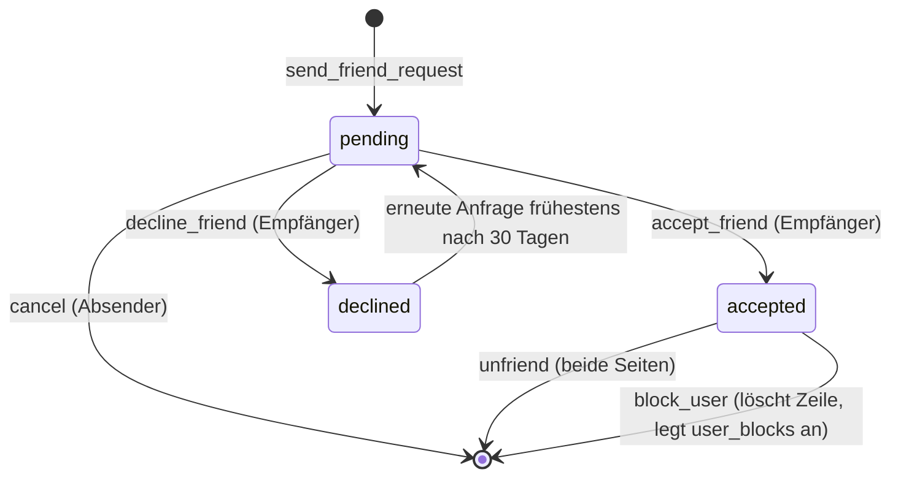
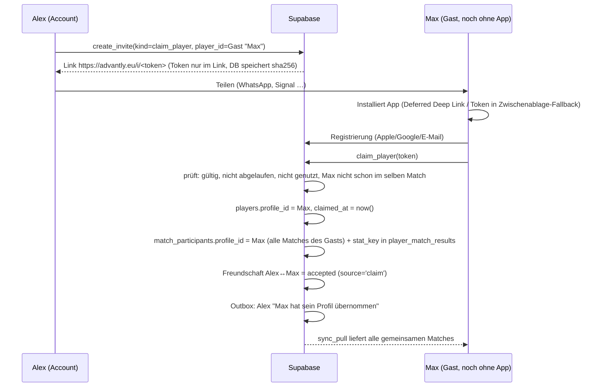
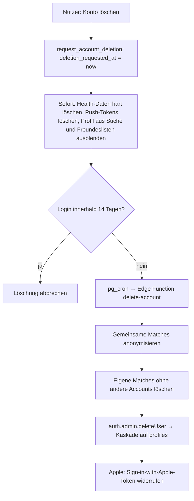

# 03 – Backend & Datenmodell (Supabase)

| | |
|---|---|
| **Status** | Entwurf zur Entscheidung |
| **Stand** | 15.10.2026 |
| **Rolle** | Backend-Architektur |
| **Betrifft Phasen** | P2 (Accounts/Freunde/Sync), P3 (Statistik & Health), P4 (Garmin) – P1 ist backendfrei |
| **Ziel** | Datenmodell, RLS, Sync-Protokoll, Freundes-Flows, Statistik, DSGVO, Betrieb und Kosten so weit festlegen, dass P2 ohne Grundsatzdiskussion starten kann |

> Dieses Dokument enthält **SQL-Skizzen**, keinen fertigen Produktivcode. Namen, Typen und Policies sind bewusst konkret, damit sie direkt in die erste Migration übernommen und dort verfeinert werden können.

---

## 0. Entscheidungen auf einen Blick

| # | Frage | Empfehlung | Kurzbegründung |
|---|---|---|---|
| E1 | Hosting/Region | Supabase Cloud, **eine konkrete EU-Region: `eu-central-1` (Frankfurt)**, DPA abschließen | DACH-Zielmarkt, niedrige Latenz. „Europe“ als Sammelbegriff schließt London/Zürich ein – nicht nehmen. |
| E2 | Plan | Lokal + **Free** für Entwicklung/Closed Beta, **Pro (ab 25 $/Monat)** ab erstem öffentlichen Release | Free pausiert nach 1 Woche Inaktivität und hat keine Backups – für Produktion ungeeignet. |
| E3 | Login | **Sign in with Apple + Google + E-Mail-OTP**; Apple auch auf Android (OAuth-Flow) | Guideline 4.8 (Apple-Login ist der anerkannte Weg, die Anforderung zu erfüllen); Plattformwechsler müssen sich mit demselben Konto einloggen können. |
| E4 | IDs | **Client-generierte UUIDv7** für alle syncbaren Entitäten | Offline-first, Idempotenz, gute Index-Lokalität. |
| E5 | Spieler-Identität | `players`-Tabelle: **Self-Player mit `id = profile.id`**, Gäste mit eigener UUID; Claim setzt `players.profile_id` (Historie bleibt unverändert) | Kein Umschreiben alter Matches; Statistik-Schlüssel `coalesce(profile_id, player_id)`. |
| E6 | Sichtbarkeit | **Pro Teilnehmer** steuerbar (`share_with_friends`), Default **aus** (Privacy by Default) | Jeder entscheidet selbst, ob *seine* Matches bei *seinen* Freunden auftauchen. |
| E7 | Events | Zeilenbasiert in `match_events`, append-only, `ON CONFLICT DO NOTHING`; Kompaktierung alter Matches optional ab P3 | Idempotenz + Realtime + einfache RLS; Speicher ist kein Kostentreiber. |
| E8 | Zähler-Rolle | **Entschieden 2026-10-15: genau ein Zähler-Gerät**, Wechsel durch repliziertes Engine-Event „Zähler wechselt“ (`scorer_handover` als Arbeitsname), kein Zeit-Lease | Nur der zum jeweiligen Event-Zeitpunkt aktive Zähler erzeugt wirksame Zähl-/Undo-Events. Engine- und Ordnungsdetails siehe [02](02-scoring-regeln.md), Replikation siehe [01](01-architektur.md). |
| E9 | Match-Zusammenfassung | **Client-Engine berechnet**, Server prüft **Plausibilität in SQL** beim Finalisieren; vollständiger Server-Replay (Kotlin/JS-Engine in Edge Function) erst bei Ranglisten | Eine Engine-Implementierung, keine Duplikation; Manipulation hat heute keinen Anreiz. |
| E10 | Health-Zeitreihe | **Ein Datensatz pro Session & Metrik mit `smallint[]` auf festem 5-s-Raster** (NULL = Lücke) | ~2 KB pro Match statt 5.000 Zeilen; Postgres komprimiert (TOAST); trivial zu löschen/exportieren. |
| E11 | Health-Sichtbarkeit | Eigene Tabellen, eigene Policies, Default `private`; Erfassung nur mit Art.-9-Einwilligung (in DB geprüft) | Gesundheitsdaten strikt getrennt von Spieldaten. |
| E12 | Live-Ansicht | **Realtime Broadcast aus DB-Trigger** auf privatem Kanal `match:<id>` + RLS auf `realtime.messages` | Von Supabase für Skalierung/Sicherheit empfohlen, statt Postgres Changes. |
| E13 | Fan-out | Über `match_participants.profile_id`; Benachrichtigung via **Outbox-Tabelle → Edge Function → FCM v1 / APNs** | Matches „erscheinen“ durch RLS automatisch beim Pull; Push nur als Anstoß. |
| E14 | Uhren | Uhren sprechen **nicht direkt** mit Supabase, sondern über das Handy (Ausnahme später: Wear OS standalone) | Keine Tokens auf Uhren, ein Sync-Pfad, Garmin kann ohnehin nur über die Companion-App. |
| E15 | Account-Löschung | 14 Tage Karenz, dann Hard Delete; gemeinsame Matches bleiben für andere, Teilnehmer wird zu „Gelöschter Spieler“ anonymisiert; Health sofort hart gelöscht | DSGVO Art. 17 + Datenintegrität der Mitspieler. |
| E16 | Repo/Tooling | `backend/supabase` mit CLI-Migrationen, `seed.sql`, pgTAP-Tests (`supabase test db`) in CI; Umgebungen local → staging → prod | Reproduzierbar, RLS testbar. |

---

## 1. Recherche: Stand Oktober 2026

### 1.1 Supabase-Pläne (laut supabase.com/pricing, abgerufen 14.10.2026)

| | **Free** | **Pro** |
|---|---|---|
| Preis | 0 $ | ab 25 $/Monat (inkl. 10 $ Compute-Credits = 1× Micro) |
| Auth-MAU | 50.000 | 100.000, danach 0,00325 $/MAU |
| DB-Größe | 500 MB | 8 GB, danach 0,125 $/GB |
| Egress | 5 GB | 250 GB, danach 0,09 $/GB |
| Storage | 1 GB | 100 GB, danach 0,0213 $/GB |
| Edge-Function-Aufrufe | 500.000 | 2 Mio., danach 2 $/Mio. |
| Realtime gleichzeitige Verbindungen | 200 | 500 (mit Spend Cap), danach 10 $/1.000 |
| Realtime-Nachrichten | 2 Mio./Monat | 5 Mio./Monat, danach 2,50 $/Mio. |
| Pausierung | nach 1 Woche Inaktivität, max. 2 aktive Projekte | nie |
| Backups | keine | täglich, 7 Tage; PITR +100 $/Monat (7 Tage) |

- **Team** ab 599 $/Monat (SOC2/ISO 27001, 14 Tage Backups) – für uns erst relevant, wenn B2B (Vereine) dazukommt.
- **Compute:** Micro (1 GB RAM, ~10 $), Small (2 GB, ~15 $), Medium (4 GB, ~60 $), Large (8 GB dedicated, ~110 $). Micro: 60 direkte DB-Verbindungen / 200 Pooler-Clients.
- **Branching:** laut Drittquellen ~0,0134 $/h pro Preview-Branch (Micro), außerhalb des Spend Caps – nur bei Bedarf.
- **Spend Cap** ist bei Pro standardmäßig an. Achtung: Mit Spend Cap sind Realtime-Verbindungen auf 500 gedeckelt (ohne: 10.000).

### 1.2 Region & DSGVO
- Region **Central EU (Frankfurt), `eu-central-1`**. Wahl einer konkreten EU-Region pinnt Postgres, Auth und Storage dorthin.
- Supabase stellt klar: Region ≠ DSGVO-Konformität. Backups, Logs, **Edge-Function-Ausführung** und Subprozessoren müssen in der Transfer-Analyse betrachtet werden. Supabase Inc. ist ein US-Unternehmen → Drittlandtransfer über DPA/SCC bzw. EU-US Data Privacy Framework dokumentieren.
- DPA ist über die Legal-Seite von Supabase abschließbar → **vor P2-Launch abschließen** und im Verzeichnis der Verarbeitungstätigkeiten (VVT) ablegen.

### 1.3 Auth-Provider
- **App Store Guideline 4.8:** Wer Drittanbieter-/Social-Login (z. B. Google) für das Hauptkonto anbietet, muss eine gleichwertige datensparsame Option anbieten (nur Name + E-Mail, E-Mail verbergbar, kein Werbetracking). Sign in with Apple wird von Apple selbst als Erfüllung genannt → **wir bieten Apple an**.
- **Supabase + Apple:** Auf iOS nativ (ID-Token → `signInWithIdToken`), auf Android/Web über OAuth (`signInWithOAuth`). Für den OAuth-Weg muss das **Client-Secret alle 6 Monate neu erzeugt werden** (Kalendererinnerung, Runbook). Apple liefert den **Namen nur beim ersten Login** → sofort clientseitig in `profiles.display_name` speichern.
- **Google:** nativ über Credential Manager (Android) bzw. Google-Sign-In-SDK (iOS) → ID-Token → `signInWithIdToken`.
- **E-Mail-OTP / Magic Link** als neutraler Fallback (u. a. für Nutzer ohne Apple-/Google-Konto); SMTP über eigenen EU-Anbieter (Supabase-Default-SMTP ist rate-limitiert und nicht für Produktion gedacht).
- **API-Keys:** Neue Supabase-Projekte nutzen **Publishable/Secret Keys** statt `anon`/`service_role`. Im Client nur den Publishable Key, Secret Key ausschließlich in Edge Functions/CI.

### 1.4 supabase-kt
- Community-Bibliothek (supabase-community), aktiv gepflegt. Aktuelles Stable **3.8.0 (26.08.2026)**, **3.9.0-beta-1 (12.10.2026)**.
- Relevante Neuerungen 2026: Postgrest-Retries bei transienten Fehlern (3.6), Realtime Binary Broadcast + `httpSend` + Protokoll VSN 2.0.0 (3.7), Filter-Builder für Postgres Changes (3.8), Logging-Fixes bei Auth (3.9-beta).
- **Empfehlung:** 3.8.x pinnen, Updates bewusst. Nur im **Handy-Shared-Module** nutzen; Watch-Targets bekommen keine Supabase-Abhängigkeit (E14). Typ-Generierung für Kotlin gibt es nicht (`supabase gen types` kann TypeScript/Go/Swift) → DTOs als `@Serializable`-Klassen von Hand, abgesichert durch Contract-Tests gegen die lokale DB.

### 1.5 Realtime-Limits (docs/guides/realtime/limits)

| | Free | Pro | Pro ohne Spend Cap |
|---|---|---|---|
| Gleichzeitige Verbindungen | 200 | 500 | 10.000 |
| Nachrichten/s | 100 | 500 | 2.500 |
| Channel-Joins/s | 100 | 500 | 2.500 |
| Broadcast-Payload | 256 KB | 3.000 KB | 3.000 KB |

- Supabase empfiehlt für Skalierung und Sicherheit **Broadcast (via `realtime.broadcast_changes()` aus Triggern, private Channels, RLS auf `realtime.messages`)** statt Postgres Changes.
- **Konsequenz:** Realtime-Verbindung nur öffnen, solange ein Live-Match angesehen wird – keine Dauerverbindung für „neue Matches“ (das macht Push + Pull).

### 1.6 Edge Functions (docs/guides/functions/limits)
- 256 MB RAM, **2 s CPU-Zeit** pro Request (I/O zählt nicht), Wall-Clock 150 s (Free) / 400 s (bezahlt).
- Für Push-Versand, Webhooks, Export, Löschung ausreichend. Für einen vollständigen Engine-Replay ist 2 s CPU pro Match ebenfalls ausreichend (wenige Hundert Events).

### 1.7 RevenueCat (nur Vorbereitung)
- Kostenlos bis 2.500 $ Monthly Tracked Revenue, danach 1 % (Drittquellen, vor Vertrag prüfen).
- Webhook mit frei konfigurierbarem **Authorization-Header**, der serverseitig geprüft werden muss; 200 als Antwort erwartet, sonst bis zu 5 Retries → **idempotent verarbeiten**.

---

## 2. Architekturüberblick



Grundsätze:
1. **Postgres ist die Wahrheit, RLS ist die Sicherheitsgrenze.** Kein „Business-Server“ dazwischen; Schreiblogik mit mehreren Tabellen läuft in **RPCs (Postgres-Funktionen)**, damit sie transaktional ist.
2. **RPCs laufen als `security invoker`** (RLS greift), außer klar abgegrenzte Hilfsfunktionen im nicht exponierten Schema `private` (`security definer`, `search_path = ''`).
3. **Edge Functions** nur für Dinge, die Postgres nicht kann: Push-Versand, externe Webhooks, Export-Dateien, Auth-Admin-Löschung, später Engine-Replay.

---

## 3. Datenmodell

### 3.1 Designprinzipien
- **IDs:** `uuid`, vom Client als **UUIDv7** erzeugt (zeitsortiert → B-Tree-freundlich). Server erzeugt IDs nur für serverseitige Objekte (Invites, Outbox).
- **Enums als `text` + `CHECK`** statt Postgres-`ENUM`: Sportarten/Beläge/Eventtypen werden wachsen (Squash? Badminton?), `ALTER TYPE` ist in Migrationen unhandlich.
- **Tombstones statt DELETE** für syncbare Objekte (`deleted_at`), damit Löschungen beim Delta-Pull ankommen. Echte Löschung durch Aufräumjob bzw. DSGVO-Löschung.
- **`server_version bigint`** aus einer globalen Sequenz, per Trigger bei jedem Insert/Update gesetzt → robuster Delta-Cursor (keine Uhrzeit-Probleme).
- **Snapshots für Anzeige:** `match_participants.display_name` speichert den Namen zum Match-Zeitpunkt → Matchansicht braucht keinen Zugriff auf fremde Profile/Spieler.
- **Schemas:** `public` (über API erreichbar, alles mit RLS), `private` (Helper, nicht exponiert), `ops` (Outbox, Webhook-Rohdaten, Jobs; nicht exponiert).

### 3.2 ER-Diagramm



### 3.3 SQL-Skizze

#### 3.3.1 Grundlagen

```sql
create extension if not exists citext;
create schema if not exists private;
create schema if not exists ops;

create sequence public.sync_version_seq;

create or replace function private.touch_server_version()
returns trigger language plpgsql as $$
begin
  new.server_version := nextval('public.sync_version_seq');
  new.updated_at := now();
  return new;
end $$;
```

#### 3.3.2 Profile, Spieler, Freunde

```sql
create table public.profiles (
  id                         uuid primary key references auth.users(id) on delete cascade,
  username                   citext unique
                               check (username ~ '^[a-z0-9_.]{3,20}$'),
  friend_code                text not null unique,          -- z. B. 'K7QF-92MX' (Crockford Base32)
  display_name               text not null check (length(display_name) between 1 and 40),
  avatar_path                text,                          -- Storage-Pfad, Bucket 'avatars' (privat, signierte URLs)
  locale                     text not null default 'de' check (locale in ('de','en')),
  share_matches_default      boolean not null default false, -- Privacy by Default
  health_visibility_default  text not null default 'private'
                               check (health_visibility_default in ('private','participants','friends')),
  discoverable_by_username   boolean not null default true,
  deletion_requested_at      timestamptz,                   -- Karenzphase
  created_at                 timestamptz not null default now(),
  updated_at                 timestamptz not null default now()
);

-- Spieler: Self-Player (id = profile.id) oder Gast (profile_id null bis Claim)
create table public.players (
  id             uuid primary key,                 -- Client-UUIDv7; Self-Player: = profiles.id
  owner_id       uuid not null references public.profiles(id) on delete cascade,
  profile_id     uuid references public.profiles(id) on delete set null,
  display_name   text not null check (length(display_name) between 1 and 40),
  claimed_at     timestamptz,
  deleted_at     timestamptz,
  server_version bigint not null,
  created_at     timestamptz not null default now(),
  updated_at     timestamptz not null default now(),
  constraint self_player_consistent
    check (id <> owner_id or profile_id = owner_id)
);
create index on public.players (owner_id, server_version);
create index on public.players (profile_id);

-- Trigger: bei Profilanlage (nach auth.users-Insert) Profil + Self-Player anlegen
-- (handle_new_user() als security definer im Schema private)

create table public.friendships (
  requester_id  uuid not null references public.profiles(id) on delete cascade,
  addressee_id  uuid not null references public.profiles(id) on delete cascade,
  status        text not null default 'pending'
                  check (status in ('pending','accepted','declined')),
  source        text not null check (source in ('username','code','qr','invite','claim')),
  created_at    timestamptz not null default now(),
  responded_at  timestamptz,
  primary key (requester_id, addressee_id),
  check (requester_id <> addressee_id)
);
-- genau eine Beziehung pro Paar, egal in welcher Richtung
create unique index friendships_pair_uq on public.friendships
  (least(requester_id, addressee_id), greatest(requester_id, addressee_id));
create index on public.friendships (addressee_id, status);

-- Blockieren ist gerichtet und überstimmt alles → eigene Tabelle
create table public.user_blocks (
  blocker_id  uuid not null references public.profiles(id) on delete cascade,
  blocked_id  uuid not null references public.profiles(id) on delete cascade,
  created_at  timestamptz not null default now(),
  primary key (blocker_id, blocked_id)
);
```

**Entscheidung Freundschaft:** Eine Zeile pro Paar mit Status (`pending/accepted/declined`) + **separate Block-Tabelle**. Blockieren löscht eine bestehende Freundschaft (RPC `block_user`), verhindert neue Anfragen und Suche in beide Richtungen. Eine einzelne Statusspalte „blockiert“ wäre ungerichtet und würde die Anfrage-Historie überschreiben.

#### 3.3.3 Matches, Teilnehmer, Events

```sql
create table public.matches (
  id                uuid primary key,                       -- Client-UUIDv7
  created_by        uuid not null references public.profiles(id),
  sport             text not null check (sport in ('tennis','padel','pickleball')),
  discipline        text not null check (discipline in ('singles','doubles')),
  surface           text check (surface in ('clay','hard','grass','carpet','artificial_grass',
                                            'indoor_hard','indoor_other')),
  venue_name        text check (length(venue_name) <= 80), -- Freitext, KEIN GPS (Datensparsamkeit)
  format            jsonb not null,                         -- MatchFormat der Engine
  format_version    smallint not null,
  engine_version    text not null,                          -- z. B. '1.4.0'
  status            text not null default 'in_progress'
                      check (status in ('in_progress','completed','retired','abandoned')),
  started_at        timestamptz not null,
  ended_at          timestamptz,
  winner_team       text check (winner_team in ('A','B')),
  summary           jsonb,                                  -- Engine-Ergebnis (siehe 5.4)
  summary_event_count int,
  summary_last_lamport bigint,
  validation_status text not null default 'pending'
                      check (validation_status in ('pending','ok','suspicious','invalid')),
  validation_notes  text[],
  scorer_device_id  uuid,                                   -- Projektion des Engine-Zustands, siehe 5.3
  scorer_event_id   uuid,                                   -- zuletzt angewandter Zählerwechsel, kein Zeit-Lease
  deleted_at        timestamptz,
  server_version    bigint not null,
  created_at        timestamptz not null default now(),
  updated_at        timestamptz not null default now()
);
create index on public.matches (created_by, server_version);

create table public.match_participants (
  match_id           uuid not null references public.matches(id) on delete cascade,
  player_id          uuid not null references public.players(id),
  profile_id         uuid references public.profiles(id) on delete set null, -- denormalisiert aus players
  team               text not null check (team in ('A','B')),
  position           smallint not null check (position in (1,2)),
  display_name       text not null,                    -- Snapshot zum Match-Zeitpunkt
  share_with_friends boolean not null default false,   -- Sichtbarkeit für MEINE Freunde
  hidden             boolean not null default false,   -- „aus meiner Liste ausblenden“
  server_version     bigint not null,
  primary key (match_id, player_id),
  unique (match_id, team, position)
);
create index on public.match_participants (profile_id, match_id);
create index on public.match_participants (player_id);
-- Ein Profil darf nicht zweimal im selben Match stehen (relevant beim Claim)
create unique index match_participants_profile_once
  on public.match_participants (match_id, profile_id) where profile_id is not null;

create table public.match_events (
  id               uuid primary key,                    -- Client-UUIDv7 → Idempotenz
  match_id         uuid not null references public.matches(id) on delete cascade,
  device_id        uuid not null,                       -- references devices(id), bewusst ohne FK (Uhr-IDs)
  author_id        uuid not null references public.profiles(id),
  lamport          bigint not null check (lamport > 0),
  client_ts        timestamptz not null,
  received_at      timestamptz not null default now(),
  type             text not null check (type in (
                     'match_start','point','undo','server_change','side_change',
                     'scorer_handover','timeout','retire','match_end','correction')),
  payload          jsonb not null default '{}'::jsonb,
  -- point:   {"team":"A","detail":"ace|winner|unforced_error|double_fault|..."}
  -- undo:    {"target_event_id":"<uuid>"}
  -- retire:  {"team":"B"}
  unique (match_id, lamport, device_id)                -- totale Ordnung
);
create index on public.match_events (match_id, lamport, device_id);
```

**Warum `device_id` ohne FK?** Events von Uhren werden über das Handy hochgeladen; die Uhr bekommt eine eigene `devices`-Zeile, die aber evtl. erst im selben Sync-Batch angelegt wird. Der RPC legt fehlende Geräte vorab an; ein FK würde nur Reihenfolgeprobleme erzeugen.

#### 3.3.3a Rollen und Visitor (P2)

**Entschieden 2026-10-15 (PLAN K1):** Teilnehmeridentität, Zugriffsrecht und aktives Zähler-Gerät sind getrennt. Standard ist die Uhr des startenden Spielers; Director ist eine außenstehende Person am Handy, ohne Spieler-/Health-Zuordnung. P1 bleibt lokal (eigene Uhr oder eigenes Handy). Ab P2 wählt der Starter die Zähler-Person (Mitspieler/Freund mit Account oder externer Director mit Account) und deren Gerät; das Match wird per Cloud zugestellt.

| Rolle | Abbildung | Rechte |
|---|---|---|
| `scorer` | Genau eine aktive `device_id`, aus Start-/Zählerwechsel-Events abgeleitet; `matches.scorer_device_id` ist nur Projektion | Punkte, Undo und Match-Steuerung am aktiven Gerät |
| `director` | `match_roles.role = 'director'`, unabhängig von `match_participants` | Match lesen; am zugewiesenen aktiven Handy zählen, übrige Geräte Anzeige; keine fremden Health-Rechte |
| `player-viewer` | Spieler aus `match_participants`, optional zusätzlich in `match_roles` als Übernahme-Kandidat | Anzeige; Übergabe nur nach Bestätigung und Berechtigung, niemals paralleles Zählen |
| `visitor` | Benannter Account in `match_visitors` | Nur Live-Kanal und reduziertes Match-Ergebnis lesen, kein Zählen/Undo/Übernehmen, keine Health-Daten |

```sql
-- Zugriffs-/Übernahme-Kandidaten; kein zweiter autoritativer Zählerstand.
create table public.match_roles (
  match_id uuid not null references public.matches(id) on delete cascade,
  profile_id uuid not null references public.profiles(id) on delete cascade,
  role text not null check (role in ('director','player-viewer')),
  may_take_over boolean not null default false,
  server_version bigint not null,
  primary key (match_id, profile_id)
);
create table public.match_visitors (
  match_id uuid not null references public.matches(id) on delete cascade,
  profile_id uuid not null references public.profiles(id) on delete cascade,
  invited_by uuid not null references public.profiles(id) on delete cascade,
  revoked_at timestamptz,
  server_version bigint not null,
  primary key (match_id, profile_id)
);
```

Rollen-/Visitor-Vergabe nur über validierte Verwaltungs-RPCs, kein direktes Client-Schreiben. Vorschlag bis Entscheidung F16: Ersteller verwaltet Einladungen/Widerruf. `scorer` ist **keine frei schreibbare Rollen-Zeile**: Start und bestätigter Zählerwechsel bestimmen genau ein Gerät. Projektionen `scorer_device_id/scorer_event_id` werden nur aus dem Engine-Log aktualisiert, nie über Match-Upsert oder Ablaufzeit. Autorisierte Gerätezuordnung und Übernahme-Kandidaten müssen auch für historische Events nachvollziehbar bleiben (keine Prüfung verspäteter Uploads allein gegen den aktuellen Zähler). Visitor werden nicht gleichzeitig als Spieler/Director geführt; Rollenwechsel erfordern eine explizite neue Zuweisung. Auch eine bestehende Freundschaft erteilt Visitor keine Health-Rechte; dies ist in den Health-Policies ausdrücklich ausgeschlossen.

#### 3.3.4 Materialisierte Ergebnisse für Statistik

```sql
create table public.match_sets (
  match_id     uuid not null references public.matches(id) on delete cascade,
  set_no       smallint not null,
  games_a      smallint not null,           -- Pickleball: Punkte des Spiels
  games_b      smallint not null,
  tiebreak_a   smallint,
  tiebreak_b   smallint,
  winner_team  text check (winner_team in ('A','B')),
  duration_s   int,
  primary key (match_id, set_no)
);

-- Ein Fakt pro Teilnehmer und Match: Basis aller Statistiken
create table public.player_match_results (
  match_id        uuid not null references public.matches(id) on delete cascade,
  player_id       uuid not null references public.players(id),
  profile_id      uuid references public.profiles(id) on delete set null,
  stat_key        uuid not null,                    -- coalesce(profile_id, player_id)
  sport           text not null,
  discipline      text not null,
  surface         text,
  ended_at        timestamptz not null,
  team            text not null,
  won             boolean,                          -- null bei abandoned
  result_type     text not null,                    -- completed | retired | abandoned
  sets_won        smallint, sets_lost   smallint,
  games_won       smallint, games_lost  smallint,
  points_won      int,      points_lost int,
  partner_key     uuid,                             -- stat_key des Doppelpartners
  opponent_keys   uuid[] not null,                  -- stat_keys der Gegner
  detail          jsonb,                            -- Asse, Doppelfehler, Breakbälle …
  primary key (match_id, player_id)
);
create index on public.player_match_results (stat_key, sport, ended_at desc);
create index on public.player_match_results using gin (opponent_keys);
```

`match_sets` und `player_match_results` werden **ausschließlich serverseitig** in `finalize_match()` aus `matches.summary` befüllt (keine Client-Schreibrechte) und beim Claim (stat_key-Update) nachgezogen.

#### 3.3.5 Health

```sql
create table public.health_sessions (
  id              uuid primary key,                       -- Client-UUIDv7
  match_id        uuid not null references public.matches(id) on delete cascade,
  profile_id      uuid not null references public.profiles(id) on delete cascade,
  device_id       uuid,
  source          text not null check (source in ('apple_health','health_connect','wear_os','garmin')),
  started_at      timestamptz not null,
  ended_at        timestamptz not null,
  duration_s      int generated always as (extract(epoch from ended_at - started_at)::int) stored,
  hr_avg          smallint check (hr_avg between 25 and 250),
  hr_max          smallint check (hr_max between 25 and 250),
  hr_min          smallint check (hr_min between 25 and 250),
  steps           int  check (steps >= 0),
  active_kcal     int  check (active_kcal >= 0),
  total_kcal      int  check (total_kcal >= 0),
  visibility      text not null default 'private'
                    check (visibility in ('private','participants','friends')),
  consent_id      uuid not null references public.consents(id), -- consents siehe 3.3.6 (in Migration vorher anlegen)
  server_version  bigint not null,
  created_at      timestamptz not null default now(),
  updated_at      timestamptz not null default now(),
  unique (match_id, profile_id, source)
);

create table public.health_series (
  session_id   uuid not null references public.health_sessions(id) on delete cascade,
  metric       text not null check (metric in ('heart_rate')),   -- später: 'speed', 'cadence'
  chunk_no     smallint not null default 0,
  start_at     timestamptz not null,
  interval_ms  int not null default 5000,
  values       smallint[] not null,               -- NULL-Elemente = Lücke
  check (cardinality(values) <= 4320),            -- max. 6 h bei 5 s pro Chunk
  primary key (session_id, metric, chunk_no)
);
```

#### 3.3.6 Geräte, Einladungen, Einwilligungen, Entitlements, Outbox

```sql
create table public.devices (
  id             uuid primary key,                   -- stabile Installations-ID vom Client
  profile_id     uuid not null references public.profiles(id) on delete cascade,
  platform       text not null check (platform in ('ios','android','watchos','wearos','garmin')),
  paired_with    uuid references public.devices(id), -- Uhr → Handy
  model          text,
  app_version    text,
  push_provider  text check (push_provider in ('apns','fcm')),
  push_token     text,
  push_enabled   boolean not null default true,
  locale         text,
  last_seen_at   timestamptz not null default now(),
  revoked_at     timestamptz
);
create unique index on public.devices (push_token) where push_token is not null;

create table public.invites (
  id           uuid primary key default gen_random_uuid(),
  token_hash   bytea not null unique,                  -- sha256(token); Klartext nur im Link
  kind         text not null check (kind in ('friend','claim_player')),
  created_by   uuid not null references public.profiles(id) on delete cascade,
  player_id    uuid references public.players(id) on delete cascade, -- bei claim_player
  expires_at   timestamptz not null default now() + interval '14 days',
  max_uses     smallint not null default 1,
  used_count   smallint not null default 0,
  accepted_by  uuid references public.profiles(id) on delete set null,
  accepted_at  timestamptz,
  revoked_at   timestamptz,
  created_at   timestamptz not null default now()
);

-- Verknüpfungsanfrage: Besitzer schlägt vor „Gast X ist mein Freund Y“ → Y bestätigt
create table public.player_link_requests (
  player_id    uuid primary key references public.players(id) on delete cascade,
  target_id    uuid not null references public.profiles(id) on delete cascade,
  created_at   timestamptz not null default now(),
  status       text not null default 'pending' check (status in ('pending','accepted','declined'))
);

-- Einwilligungen: append-only Nachweis (Art. 7 Abs. 1)
create table public.consents (
  id          uuid primary key default gen_random_uuid(),
  profile_id  uuid not null references public.profiles(id) on delete cascade,
  purpose     text not null check (purpose in (
                'terms','privacy_notice','health_processing','health_sharing',
                'push_marketing','analytics')),
  version     text not null,                 -- Version des Einwilligungstexts, z. B. 'health-2026-10'
  granted     boolean not null,
  source      text not null,                 -- 'ios-app 1.3.0' …
  created_at  timestamptz not null default now()
);
create index on public.consents (profile_id, purpose, created_at desc);

create view public.my_consent_state with (security_invoker = true) as
  select distinct on (purpose) purpose, version, granted, created_at
  from public.consents
  where profile_id = (select auth.uid())
  order by purpose, created_at desc;

create table public.entitlements (
  profile_id    uuid not null references public.profiles(id) on delete cascade,
  entitlement   text not null,             -- 'pro'
  product_id    text,
  store         text,                      -- app_store | play_store | promotional
  period_type   text,                      -- trial | normal | intro
  expires_at    timestamptz,               -- null = lifetime
  updated_at    timestamptz not null default now(),
  primary key (profile_id, entitlement)
);

create table ops.revenuecat_events (
  event_id     text primary key,           -- Idempotenz bei Retries
  app_user_id  text not null,              -- = profiles.id
  type         text not null,
  payload      jsonb not null,
  received_at  timestamptz not null default now()
);

create table ops.notification_outbox (
  id          bigint generated always as identity primary key,
  profile_id  uuid not null references public.profiles(id) on delete cascade,
  kind        text not null,               -- match_shared | friend_request | friend_accepted | claim_done
  payload     jsonb not null,              -- nur IDs + Titel-Keys, keine Gesundheitsdaten
  created_at  timestamptz not null default now(),
  sent_at     timestamptz,
  attempts    smallint not null default 0,
  last_error  text
);
```

### 3.4 Health-Zeitreihe: Speicherform

| Option | Größe 90-min-Match | Abfragen | Löschen/Export | Bewertung |
|---|---|---|---|---|
| Zeile pro Sample (1 Hz) | 5.400 Zeilen ≈ 400 KB inkl. Index | flexibel | viele Zeilen | zu teuer, unnötig |
| JSON-Chunks (`jsonb`) | ≈ 10–20 KB | mittelmäßig | einfach | Overhead durch Text/Keys |
| Datei in Storage (gzip) | ≈ 2 KB | nur Download | eigene Löschlogik nötig | zweites System, RLS schwerer |
| **`smallint[]` auf festem Raster** | 1.080 Werte × 2 B ≈ 2 KB (TOAST-komprimiert) | `unnest()` in SQL möglich | `on delete cascade` | **Empfehlung** |

**Entscheidung:** Das Handy **resampled** die HF-Rohdaten (Apple Watch liefert unregelmäßig im Sekundenbereich) auf ein **5-Sekunden-Raster** (Mittelwert, Lücke = NULL) und lädt eine Zeile pro Session/Metrik hoch. 5 s reicht für Kurven und Zonen-Auswertung; Rohdaten bleiben in Apple Health / Health Connect / Garmin, wo sie hingehören. Live-HF (z. B. für Zuschauer) wird – wenn überhaupt – nur ephemer per Broadcast gesendet und **nicht** persistiert.

### 3.5 Event-Volumen und Kompaktierung
- Tennis-Match ≈ 150–250 Punkte → ≈ 300 Events inkl. Undo/Seitenwechsel. Pro Zeile inkl. zweier Indizes ≈ 260 B → **≈ 80 KB pro Match**.
- 10.000 aktive Nutzer, ~4 Matches/Monat, ~1,6 Accounts pro Match → ~25.000 Matches/Monat → **≈ 2 GB/Monat**. Das kostet bei Pro 0,125 $/GB/Monat, ist also finanziell irrelevant, wächst aber linear (Backups, Restore-Dauer).
- **Option ab P3:** pg_cron-Job verschiebt Events von Matches, die > 90 Tage `completed` sind, in `match_event_archive(match_id, events jsonb)` (eine TOAST-komprimierte Zeile, ≈ 8–10 KB) und löscht die Einzelzeilen. `sync_pull_events` liefert transparent aus beiden Quellen. **Erst einführen, wenn DB > 6 GB.**

---

## 4. Row Level Security

### 4.1 Sichtbarkeitsmatrix

| Datensatz | Ich (Ersteller) | Teilnehmer mit Account | Freund eines Teilnehmers X | Fremder / Blockierter |
|---|---|---|---|---|
| Match, Sets, Teilnehmer (Snapshot-Namen), Ergebnis | lesen; Verwaltung per RPC, Zählen nur am Zähler-Gerät | lesen; Zählen nur am Zähler-Gerät | lesen, **wenn X `share_with_friends = true`** | nichts |
| Match-Events (Detailverlauf) | ja | ja | ja (wie Match) | nichts |
| `player_match_results` | ja | ja | wie Match | nichts |
| Health-Session/Serie von Person P | nur P selbst | nur bei P.visibility ∈ {participants, friends} | nur bei `friends` **und** Freund von P **und** Match sichtbar | nichts |
| Profil (Name, Avatar, Username) | eigenes voll | Co-Teilnehmer: Basisfelder | Freunde: Basisfelder | nur via Such-RPC bei exaktem Treffer |
| Gast-Spieler | Besitzer | – (Snapshot im Match genügt) | – | – |

**Zusätzliche Rollen:** Director liest das Match/Event-Log für seine Aufgabe, schreibt nur über die gerätegebundene Event-Annahme (4.3/5.3) und erhält dadurch keine Health-Rechte. Visitor erhält **keinen** Zugriff auf diese Basistabellen oder das vollständige Event-Log: ausschließlich privater Live-Kanal und reduzierte Ergebnis-RPC (4.4), keine Schreibrechte, keine Health-Daten.

Begründung für „pro Teilnehmer“ statt „pro Match“: Ein Match gehört allen Beteiligten. Wenn ich es mit meinen Freunden teilen will, ist das meine Entscheidung – unabhängig davon, wer gezählt hat. Gegner, die privat bleiben wollen, sind trotzdem nur mit ihrem Snapshot-Namen sichtbar (keine Profilverlinkung für Nicht-Freunde, siehe 4.3).

### 4.2 Hilfsfunktionen (Schema `private`)

```sql
-- IDs meiner akzeptierten Freunde (einmal pro Statement ausgewertet)
create or replace function private.my_friend_ids()
returns uuid[] language sql stable security definer set search_path = '' as $$
  select coalesce(array_agg(case when f.requester_id = auth.uid()
                                 then f.addressee_id else f.requester_id end), '{}')
  from public.friendships f
  where f.status = 'accepted'
    and auth.uid() in (f.requester_id, f.addressee_id);
$$;

create or replace function private.is_match_participant(p_match uuid)
returns boolean language sql stable security definer set search_path = '' as $$
  select exists (select 1 from public.match_participants mp
                 where mp.match_id = p_match and mp.profile_id = auth.uid());
$$;

create or replace function private.can_view_match(p_match uuid)
returns boolean language sql stable security definer set search_path = '' as $$
  select private.is_match_participant(p_match)
      or exists (select 1 from public.matches m
                 where m.id = p_match and m.created_by = auth.uid())
      or exists (select 1 from public.match_roles r
                 where r.match_id = p_match and r.profile_id = auth.uid()
                   and r.role = 'director')
      or exists (
        select 1 from public.match_participants mp
        where mp.match_id = p_match
          and mp.share_with_friends
          and mp.profile_id = any (private.my_friend_ids())
      );
$$;

-- Identitäts-/Uploadrecht, NICHT die aktive Zähler-Rolle.
create or replace function private.can_submit_match_events(p_match uuid)
returns boolean language sql stable security definer set search_path = '' as $$
  select exists (select 1 from public.matches m
                 where m.id = p_match and m.created_by = auth.uid() and m.deleted_at is null)
      or exists (select 1 from public.match_roles r
                 where r.match_id = p_match and r.profile_id = auth.uid()
                   and (r.role = 'director' or r.may_take_over));
$$;

create or replace function private.is_match_visitor(p_match uuid)
returns boolean language sql stable security definer set search_path = '' as $$
  select exists (select 1 from public.match_visitors v
                 where v.match_id = p_match and v.profile_id = auth.uid()
                   and v.revoked_at is null);
$$;

create or replace function private.has_consent(p_purpose text)
returns boolean language sql stable security definer set search_path = '' as $$
  select coalesce((select c.granted from public.consents c
                   where c.profile_id = auth.uid() and c.purpose = p_purpose
                   order by c.created_at desc limit 1), false);
$$;
```

`security definer` ist hier nötig, um Rekursion zwischen den Policies von `matches` und `match_participants` zu vermeiden. Die Funktionen liegen in einem nicht exponierten Schema, haben `search_path = ''` und geben nur Booleans/IDs des aufrufenden Nutzers zurück.

### 4.3 Policies (Auszug)

```sql
alter table public.matches               enable row level security;
alter table public.match_participants    enable row level security;
alter table public.match_events          enable row level security;
alter table public.match_roles           enable row level security;
alter table public.match_visitors        enable row level security;
alter table public.match_sets            enable row level security;
alter table public.player_match_results  enable row level security;
alter table public.players               enable row level security;
alter table public.profiles              enable row level security;
alter table public.friendships           enable row level security;
alter table public.health_sessions       enable row level security;
alter table public.health_series         enable row level security;
alter table public.devices               enable row level security;
alter table public.consents              enable row level security;
alter table public.entitlements          enable row level security;
alter table public.invites               enable row level security;

-- MATCHES ---------------------------------------------------------------
create policy matches_select on public.matches for select to authenticated
  using ( (select private.can_view_match(id)) );

create policy matches_insert on public.matches for insert to authenticated
  with check ( created_by = (select auth.uid()) );

create policy matches_update on public.matches for update to authenticated
  using ( created_by = (select auth.uid()) )
  with check ( created_by = (select auth.uid()) );
-- kein DELETE: Löschen = deleted_at setzen (Tombstone)
-- Spalten summary/validation_* werden nur über RPC finalize_match geschrieben:
revoke update (validation_status, validation_notes, scorer_device_id, scorer_event_id)
  on public.matches from authenticated;
-- Produktive Migration: kein übergeordnetes Tabellen-UPDATE-Grant stehen lassen;
-- nur erlaubte Metadatenspalten freigeben. Zählerprojektion ausschließlich intern.

-- ROLLEN / VISITOR: Client darf eigene Zuweisung lesen, nur RPCs verwalten.
create policy roles_own_select on public.match_roles for select to authenticated
  using (profile_id = (select auth.uid()));
create policy visitors_own_select on public.match_visitors for select to authenticated
  using (profile_id = (select auth.uid()));
-- Keine INSERT/UPDATE/DELETE-Policies für diese Tabellen.

-- TEILNEHMER --------------------------------------------------------------
create policy mp_select on public.match_participants for select to authenticated
  using ( (select private.can_view_match(match_id)) );

create policy mp_write_by_creator on public.match_participants for all to authenticated
  using ( exists (select 1 from public.matches m
                  where m.id = match_id and m.created_by = (select auth.uid())) )
  with check ( exists (select 1 from public.matches m
                  where m.id = match_id and m.created_by = (select auth.uid())) );
-- Eigene Flags (share_with_friends, hidden) setzen Teilnehmer per RPC set_my_participation()

-- EVENTS: append-only ------------------------------------------------------
create policy events_select on public.match_events for select to authenticated
  using ( (select private.can_view_match(match_id)) );

-- Kein direkter Client-INSERT: sync_push prüft Uploadrecht, Gerätebindung,
-- zulässige Event-Typen und Übergabe-Berechtigung in einem engen internen Pfad.
revoke insert, update, delete on public.match_events from authenticated;
-- Keine UPDATE/DELETE-Policy → unveränderlich. Visitor hat keinen Schreibpfad.

-- ABGELEITETE TABELLEN: nur lesen ------------------------------------------
create policy sets_select on public.match_sets for select to authenticated
  using ( (select private.can_view_match(match_id)) );
create policy pmr_select on public.player_match_results for select to authenticated
  using ( (select private.can_view_match(match_id)) );

-- SPIELER ------------------------------------------------------------------
create policy players_select on public.players for select to authenticated
  using ( owner_id = (select auth.uid())
       or profile_id = (select auth.uid())
       or (id = profile_id and profile_id = any ((select private.my_friend_ids()))) );
create policy players_write on public.players for all to authenticated
  using ( owner_id = (select auth.uid()) and claimed_at is null )
  with check ( owner_id = (select auth.uid()) );
-- profile_id/claimed_at nur via RPC claim_player / accept_player_link

-- PROFILE ------------------------------------------------------------------
create policy profiles_select on public.profiles for select to authenticated
  using ( id = (select auth.uid())
       or id = any ((select private.my_friend_ids())) );
create policy profiles_update on public.profiles for update to authenticated
  using ( id = (select auth.uid()) ) with check ( id = (select auth.uid()) );
-- Fremde Profile nur über search_profiles() / Co-Teilnehmer-Infos über View mit Basisfeldern

-- HEALTH -------------------------------------------------------------------
create policy hs_select on public.health_sessions for select to authenticated
  using (
    profile_id = (select auth.uid())
    or (visibility = 'participants'
        and not (select private.is_match_visitor(match_id))
        and (select private.is_match_participant(match_id)))
    or (visibility = 'friends'
        and not (select private.is_match_visitor(match_id))
        and profile_id = any ((select private.my_friend_ids()))
        and (select private.can_view_match(match_id)))
  );

create policy hs_insert on public.health_sessions for insert to authenticated
  with check ( profile_id = (select auth.uid())
               and (select private.has_consent('health_processing'))
               and (select private.is_match_participant(match_id))
               and (visibility = 'private' or (select private.has_consent('health_sharing'))) );

create policy hs_update on public.health_sessions for update to authenticated
  using ( profile_id = (select auth.uid()) )
  with check ( profile_id = (select auth.uid())
               and (visibility = 'private' or (select private.has_consent('health_sharing'))) );

create policy hs_delete on public.health_sessions for delete to authenticated
  using ( profile_id = (select auth.uid()) );   -- echtes DELETE erlaubt (Art. 17)

create policy hser_select on public.health_series for select to authenticated
  using ( exists (select 1 from public.health_sessions s where s.id = session_id) ); -- erbt RLS
create policy hser_write on public.health_series for all to authenticated
  using ( exists (select 1 from public.health_sessions s
                  where s.id = session_id and s.profile_id = (select auth.uid())) )
  with check ( exists (select 1 from public.health_sessions s
                  where s.id = session_id and s.profile_id = (select auth.uid())) );

-- GERÄTE, EINWILLIGUNGEN, ENTITLEMENTS -------------------------------------
create policy devices_own on public.devices for all to authenticated
  using ( profile_id = (select auth.uid()) ) with check ( profile_id = (select auth.uid()) );
create policy consents_select on public.consents for select to authenticated
  using ( profile_id = (select auth.uid()) );
create policy consents_insert on public.consents for insert to authenticated
  with check ( profile_id = (select auth.uid()) );          -- append-only, kein UPDATE/DELETE
create policy ent_select on public.entitlements for select to authenticated
  using ( profile_id = (select auth.uid()) );               -- Schreiben nur Webhook (Secret Key)
```

Hinweise:
- **Gast-Spieler sind nur für ihren Besitzer sichtbar.** Andere sehen im Match nur den Snapshot-Namen aus `match_participants.display_name`.
- **Blockierte:** `my_friend_ids()` enthält sie nie (Blockieren beendet die Freundschaft). Gemeinsame historische Matches bleiben für beide sichtbar (sie waren beide dabei) – das ist gewollt und wird in der Datenschutzerklärung nicht gesondert benötigt.
- **Health-Widerruf:** Wird `health_processing` widerrufen, löscht der RPC `revoke_health_consent()` alle Health-Daten des Nutzers (siehe 8.3); die Policy verhindert zusätzlich neue Inserts.

### 4.4 Realtime-Autorisierung (Live-Match)

```sql
-- Broadcast neuer Events an privaten Kanal match:<id>, nur während das Match läuft
create or replace function private.broadcast_match_event()
returns trigger language plpgsql security definer set search_path = '' as $$
begin
  if exists (select 1 from public.matches m
             where m.id = new.match_id and m.status = 'in_progress') then
    perform realtime.broadcast_changes(
      'match:' || new.match_id::text, tg_op, tg_op,
      tg_table_name, tg_table_schema, new, null);
  end if;
  return null;
end $$;

create trigger match_events_broadcast
  after insert on public.match_events
  for each row execute function private.broadcast_match_event();

-- Wer darf den Kanal abonnieren?
create policy live_match_receive on realtime.messages for select to authenticated
  using (
    realtime.messages.extension = 'broadcast'
    and realtime.topic() ~ '^match:[0-9a-f-]{36}$'
    and private.can_view_match(substring(realtime.topic() from 7)::uuid)
  );
```

Spieler-Anzeige und Director empfangen Engine-Events und verwenden dieselbe Engine. **Visitor erhalten einen separaten privaten Kanal `match-live:<id>` mit bereinigter Stand-Projektion** (Teams/Snapshot-Namen, Sätze, Punkte, Hinweise, Zähler, Versionsstand), ohne vollständiges Event-Log, Geräte-/Profilmetadaten oder Health. Die obige Event-Broadcast-Skizze bleibt nur für voll leseberechtigte Match-Geräte; sie darf nicht für Visitor geöffnet werden.

RLS-/RPC-Skizze für Visitor:
```sql
create policy visitor_live_receive on realtime.messages for select to authenticated
  using (realtime.messages.extension = 'broadcast'
    and realtime.topic() ~ '^match-live:[0-9a-f-]{36}$'
    and private.is_match_visitor(substring(realtime.topic() from 12)::uuid));
-- Keine Send-Policy für Visitor; Veröffentlichung nur serverseitig.
-- get_visitor_match_result(match_id): SECURITY DEFINER, search_path = '',
-- prüft is_match_visitor; liefert nur Sport, Snapshot-Teamnamen, Sätze,
-- Endstand, Status. Kein SELECT * und kein Zugriff auf health_* / Storage.
```

Die bereinigte Stand-Projektion folgt dem wirksamen Engine-Zustand einschließlich Zählerwechsel, nicht einem ungeprüften Zählen aller eingehenden Punkt-Events. Publishing-/Validierungspfad ist in P2 mit 01/02 abzustimmen.

Initialstand und Reconnect über eine ebenso autorisierte `get_visitor_live_state`-RPC, nicht `sync_pull_events`. Widerruf muss auch aktive Abos beenden bzw. vor weiterer Auslieferung neu autorisieren; bereits angezeigte Stände lassen sich nicht zurückholen. Visitor werden weder in `can_view_match` noch als Teilnehmer ergänzt. Eine Freundschaft allein erweitert den Visitor-Kanal nicht um Health. Health-Freigaben erfordern weiterhin separate Berechtigung/Einwilligung; der externe Director zählt nicht als Teilnehmer. Testen: Visitor kann weder Events/Übergaben schreiben noch Health-Tabellen/-Storage lesen, auch nicht über verschachtelte RPCs.

### 4.5 Performance-Regeln für RLS
1. `auth.uid()` und Helper immer in `(select …)` wrappen → wird als InitPlan einmal pro Query ausgewertet.
2. Indizes auf allen Policy-Spalten: `match_participants(profile_id, match_id)`, `matches(created_by)`, `friendships` Pair-Index.
3. Listenabfragen (Match-Feed) **nicht** über `select * from matches` mit RLS-Filter, sondern über den RPC `sync_pull`, der gezielt über `match_participants` joint (RLS greift trotzdem, aber der Planner bekommt einen selektiven Einstieg).
4. Regelmäßig `supabase inspect db` / Performance Advisor im Dashboard prüfen.

---

## 5. Sync-Protokoll

### 5.1 Clientseite
- Lokale Datenbank (SQLDelight) spiegelt die syncbaren Tabellen + eine **Outbox** (`pending_ops`) mit Ops in Reihenfolge.
- Jede Entität und jedes Event bekommt beim Erzeugen eine **UUIDv7**; Events zusätzlich **Lamport-Zähler** (pro Match, pro Gerät: `lamport = max(eigener, max_gesehener) + 1`) und `device_id`.
- Sync-Trigger: App-Start, Netz wieder da, Match beendet, alle 10 s während Live-Match mit aktivem Zuschauer-Modus, manueller Pull-to-Refresh.

### 5.2 Upload: `sync_push` (idempotent, transaktional)

```sql
create or replace function public.sync_push(p jsonb)
returns jsonb language plpgsql security invoker set search_path = '' as $$
-- p = { "devices":[…], "players":[…], "matches":[…], "participants":[…], "events":[…] }
declare
  v_accepted uuid[];
begin
  -- 1) Geräte des Nutzers upserten (profile_id = auth.uid())
  -- 2) Gast-Spieler upserten:  insert … on conflict (id) do update … where owner_id = auth.uid()
  -- 3) Matches upserten:       insert … on conflict (id) do update set … where created_by = auth.uid()
  --                             (Felder summary/status nur via finalize_match)
  -- 4) Teilnehmer ersetzen (nur Creator, nur solange status = 'in_progress' oder bei Korrektur)
  --    profile_id wird serverseitig aus players.profile_id übernommen, nie vom Client
  -- 5) Events: SQL unten ist nur der Insert-Kern eines internen Pfads.
  --    Vorher can_submit_match_events, authentifizierten Autor, Besitz/Bindung
  --    der Quell-device_id (auch beim Companion-Relay), zulässige Event-Typen
  --    und Übergabe-Kandidaten prüfen; Visitor strikt abweisen.
  --    RPC-Rechte/enge SECURITY-DEFINER-Grenze in Migration ausarbeiten:
  --    SECURITY INVOKER allein kann nach Entzug direkter INSERT-Rechte nicht schreiben.
  --    Aktuelle Zählerprojektion NICHT als Filter für verspätete Events verwenden.
  -- Insert-Kern:
  with ins as (
    insert into public.match_events (id, match_id, device_id, author_id, lamport, client_ts, type, payload)
    select e.id, e.match_id, e.device_id, auth.uid(), e.lamport, e.client_ts, e.type, e.payload
    from jsonb_to_recordset(p->'events')
         as e(id uuid, match_id uuid, device_id uuid, lamport bigint,
              client_ts timestamptz, type text, payload jsonb)
    on conflict (id) do nothing
    returning id
  )
  select array_agg(id) into v_accepted from ins;

  -- 6) Antwort: pro betroffenem Match max(lamport), count(*), server_version
  return jsonb_build_object(
    'accepted_event_ids', coalesce(to_jsonb(v_accepted), '[]'),
    'matches', ( select jsonb_agg(jsonb_build_object(
                    'id', m.id, 'server_version', m.server_version,
                    'event_count', (select count(*) from public.match_events e where e.match_id = m.id),
                    'max_lamport', (select max(lamport) from public.match_events e where e.match_id = m.id)))
                 from public.matches m
                 where m.id in (select (x->>'id')::uuid from jsonb_array_elements(p->'matches') x)));
end $$;
```

Eigenschaften:
- **Idempotenz:** Wiederholter Upload derselben Ops ändert nichts (`on conflict do nothing` / `do update` mit identischen Werten). Der Client löscht Outbox-Einträge erst nach erfolgreicher Antwort.
- **Batch-Größe:** max. 500 Events pro Aufruf (ein ganzes Match passt in einen Request).
- **Konflikt `unique (match_id, lamport, device_id)`** mit *anderer* `id` bedeutet Client-Bug → Request schlägt fehl, Client loggt und setzt Match auf „Sync-Fehler“ (sollte nie passieren).
- `author_id` setzt der Server, nie der Client.

### 5.3 Ordnung und Zählerwechsel

**Entschieden 2026-10-15:** Genau ein Gerät zählt. Kein Handy-Master, keine zwischen Uhr und Handy geteilte Lease und keine zeitliche Verlängerung. Start-/Zählerwechsel-Events sind die einzige fachliche Quelle der Rolle; der Backend-Stand ist eine Projektion. Kanonische Event-Ordnung, Übergabe-Validierung und deterministische Behandlung konkurrierender Wechsel spezifiziert der Engine-Entwickler in [02](02-scoring-regeln.md), Replikation in [01](01-architektur.md). Die SQL-/Wire-Skizzen hier werden daran ausgerichtet und definieren keine abweichenden Regeln.

| Fall | Behandlung |
|---|---|
| Standard / Director | Uhr des startenden Spielers zählt; alternativ Director-Handy. Alle übrigen Geräte sind Anzeige, ohne Punkte/Undo. |
| „Zählen übernehmen“ | Bestätigter Wechsel wird als Engine-Event repliziert; danach zählt ausschließlich das neue Gerät. Kein Zeit-Lease und keine automatische Übernahme bei Verbindungsabbruch. |
| Altgerät sendet verspätet / nach Ausfall | Autorisierte Events werden idempotent transportiert; die Engine prüft die Rolle zum jeweiligen Event-Zeitpunkt und ignoriert Events eines dann nicht aktiven Geräts deterministisch. Kein Zeitfenster-Dedup von Ballwechseln und kein Konflikt-Dialog. |
| Übernahme bei getrennten Geräten | Bestätigungs-/Verfügbarkeitsgrenzen gemäß 01/02; UX zeigt letzten bekannten Stand (PLAN F15). Keine zusätzliche serverseitige Lease-Logik. |
| Korrektur / Undo | Nur das aktive Zähler-Gerät erzeugt wirksame Korrektur-/Undo-Events gemäß 02. Erstellerstatus allein berechtigt kein zweites Gerät. |

Uploadberechtigung und Engine-Wirksamkeit sind getrennt: `sync_push` authentifiziert Autor/Quellgerät und prüft Übergabeberechtigung; die Engine entscheidet beim Replay über den aktiven Zähler. Ein gültiges historisches Event wird nicht verworfen, nur weil inzwischen ein anderes Gerät zählt. `matches.scorer_device_id/scorer_event_id` sind nicht vom Client frei änderbar.

### 5.4 Match-Zusammenfassung: Client berechnet, Server prüft

**Empfehlung:** Die KMP-Engine im Client berechnet `summary`; `finalize_match(match_id, summary, event_count, last_lamport)` übernimmt sie nach **SQL-Plausibilitätsprüfung**:

1. `event_count`/`last_lamport` stimmen mit dem Server-Bestand überein (sonst: „erst Events hochladen“ → Client pusht und wiederholt).
2. Satzergebnisse passen zum `format` (z. B. Tennis: Sieger hat ≥ `games_per_set`, Differenz ≥ 2 oder Tiebreak-Ergebnis 7:6; Pickleball: bis 11/15/21, 2 Punkte Abstand; Padel inkl. Golden Point/Star Point je Format).
3. Anzahl gewonnener Sätze des Siegers = `sets_to_win` (außer `retired`/`abandoned`).
4. Anzahl **wirksamer** `point`-Events nach Rollenprüfung gemäß 02 minus rückgängig gemachte ≥ theoretisches Minimum für das Ergebnis (z. B. 6:0 6:0 → ≥ 48).
5. Dauer `ended_at - started_at` ≥ Punkte × 5 s (sonst `suspicious`, nicht `invalid`).

Ergebnis: `validation_status = ok | suspicious | invalid`. `invalid` wird nicht in Statistik übernommen; `suspicious` schon, aber markiert. Danach (gleiche Transaktion): `match_sets` und `player_match_results` neu schreiben, `status` setzen, **Outbox-Einträge** für alle verknüpften Teilnehmer außer dem Aufrufer.

**Warum nicht serverseitig rechnen?** Die Engine existiert einmal in Kotlin. Eine zweite Implementierung in SQL/TypeScript wäre Drift-Risiko. Sobald es Ranglisten/Wettbewerbe gibt (Manipulationsanreiz), wird die Engine per Kotlin/JS (oder Wasm) gebaut und in einer Edge Function `verify-match` als **Replay** ausgeführt (2 s CPU genügen); bis dahin reicht die Plausibilitätsprüfung.

### 5.5 Download: `sync_pull(cursor bigint)`
- Liefert alle für mich sichtbaren `matches`, `match_participants`, `match_sets`, eigene `players`, Freundschaften, eigene `health_sessions` mit `server_version > cursor`, plus Tombstones; Antwort enthält neuen Cursor = max(server_version).
- **Events werden nicht im Feed-Pull geladen**, sondern bei Bedarf über `sync_pull_events(match_id, after_lamport)` (Detailansicht, Live-Ansicht, Korrektur). Das hält den Pull klein.
- Erst-Sync nach Login: Cursor 0, Paging à 200 Matches.
- **Hinweis:** Sichtbarkeitsänderungen (neuer Freund, Claim) ändern keine `server_version` der betroffenen Matches. Deshalb erhöhen die RPCs `accept_friend`, `claim_player`, `set_my_participation` die `server_version` der betroffenen Teilnehmerzeilen („touch“), damit diese Matches im nächsten Pull auftauchen. Beim Entfreunden/Blocken kann ein Match unsichtbar werden → Client macht nach solchen Aktionen einen **Full-Resync der Freundes-Matches** (selten, günstig).

### 5.6 Live-Anzeige und Visitor-Accounts (P2)
- Das aktive Zähler-Gerät lädt Events sofort hoch, ggf. über sein Companion-Handy. Beim Start gewählter Mitspieler/Freund oder externer Director bekommt das Match per Cloud; alle anderen Geräte bleiben Anzeige. Broadcast gemäß 4.4.
- Spieler-Anzeige: `sync_pull_events` für den Anfangszustand, dann privater Event-Kanal; Reconnect gemäß 01/02. Benannte Visitor-Accounts: nur bereinigter Live-Kanal/Stand-RPC und Ergebnis-RPC (4.4), kein vollständiges Event-Log, keine Health-Daten, kein Zählen/Undo/Übernehmen.
- Uhren-Zuschauer (z. B. Partner) bekommen den Stand über ihr Handy.
- Kosten: Nachrichten = Events × Zuschauer. 25.000 Matches/Monat × 10 % live × 300 Events × 2 Zuschauer ≈ 1,5 Mio. Nachrichten → im Pro-Kontingent (5 Mio.).

### 5.7 Fan-out an Freunde & Push
- **Fan-out passiert implizit:** Ein Teilnehmer mit Account sieht das Match per RLS und bekommt es beim nächsten `sync_pull`. Es gibt keine Kopien pro Nutzer.
- **Benachrichtigung:** `finalize_match`, `send_friend_request`, `accept_friend`, `claim_player` schreiben in `ops.notification_outbox`.
- **Versand:** Database Webhook (pg_net) auf Insert in die Outbox → Edge Function `push-dispatch` → lädt `devices` des Empfängers → **FCM HTTP v1** (Android, Wear OS) bzw. **APNs Token-Auth (.p8)** (iOS; die Apple Watch bekommt Mitteilungen über das iPhone). Ungültige Tokens → `push_token = null`. Ein pg_cron-Job (jede Minute) versendet liegengebliebene Einträge erneut (max. 5 Versuche), ein Job löscht gesendete Einträge nach 30 Tagen.
- **Inhalt der Push-Nachricht:** lokalisierter Titel-Key + IDs (`"match_shared", match_id`), keine Ergebnisse und **niemals Gesundheitsdaten**; die App lädt Details nach (Silent-/Data-Push löst `sync_pull` aus).
- Garmin bekommt keine Push-Mitteilungen aus dem Backend (Mitteilungen spiegelt das Handy ohnehin).

### 5.8 Uhren & Garmin
- Nur die aktive Zähler-Uhr erzeugt wirksame Zähl-/Undo-Events mit eigener `device_id` und Event-Ordnung gemäß 02, auch offline. Anzeige-Uhren messen ihre eigene Belastung unabhängig davon weiter. Das Handy übernimmt die Events 1:1 in seine Outbox (Autor = eingeloggter Nutzer).
- **Health-Daten** werden ebenfalls auf dem Handy finalisiert: Apple HealthKit-Workout bzw. Health Connect / Health Services / Garmin-FIT-Daten → Resampling (5 s) → `health_sessions` + `health_series`.
- P4 Garmin: Connect IQ Watch App ↔ Companion (Handy-App) über Connect IQ Mobile SDK; gleiche Event-Struktur, `platform = 'garmin'`. Kein direkter Backend-Zugriff, keine Garmin-Cloud-API in P4.

### 5.9 Übergang P1 → P2
- P1-Daten liegen lokal mit lokalem Self-Player („Ich“, lokale UUID) und lokalen Gästen.
- Beim ersten Login: lokale Self-Player-ID wird lokal auf `auth.uid()` umgeschlüsselt (inkl. Teilnehmer-Referenzen), dann regulärer `sync_push` aller Matches. Da alle IDs bereits UUIDs sind, ist das ein reines Mapping, keine Datenmigration.
- **Login auf neuem Gerät mit bereits lokalen Daten** (selten): Zusammenführen statt überschreiben – lokale Matches werden hochgeladen, Server-Matches heruntergeladen; Duplikate sind ausgeschlossen, da IDs global eindeutig.

---

## 6. Freundes-Flows

### 6.1 Freunde finden
| Weg | Mechanik | Datenschutz |
|---|---|---|
| **Benutzername** | RPC `search_profiles(q)` – **exakter** Treffer auf `username` (case-insensitive), nur wenn `discoverable_by_username` | Keine Präfix-/Volltextsuche → keine Nutzer-Enumeration; Rate-Limit 30/min pro Nutzer |
| **Freundescode** | 8 Zeichen Crockford-Base32 (z. B. `K7QF-92MX`), exakter Treffer | Neu generierbar („Code zurücksetzen“) |
| **QR-Code** | QR enthält `https://advantly.eu/f/<friend_code>`; Scannen → Anfrage. Variante „persönlich treffen“: Gerät zeigt einen **kurzlebigen QR-Token** (5 min, aus `create_friend_qr()`); wer ihn scannt, wird **sofort** Freund (Zeigen = Zustimmung) | Kurzlebiger Token verhindert, dass ein abfotografierter QR dauerhaft Freundschaften erzeugt |
| Kontakte-Abgleich | **Nicht** in P2 | Telefonbuch-Upload wäre unverhältnismäßig (Daten Dritter) |

`search_profiles` gibt nur `id, username, display_name, avatar_url` zurück und lässt blockierende/blockierte Nutzer aus.

### 6.2 Anfrage-Lebenszyklus



Gegenseitige gleichzeitige Anfragen (A→B und B→A) werden durch den Pair-Unique-Index abgefangen; `send_friend_request` erkennt die bestehende Gegenanfrage und **akzeptiert sie direkt**.

### 6.3 Einladungslink für Gäste & Claim



Regeln:
- Token: 128 Bit zufällig, **einmalig**, 14 Tage gültig, widerrufbar; DB speichert nur `sha256`.
- **Rückgängig machen:** Der Besitzer des Gasts kann einen Claim **14 Tage** lang zurücksetzen („Das ist nicht Max“) → `profile_id = null`, Teilnehmer und Statistik werden zurückgenommen. Schützt gegen weitergeleitete Links.
- **Gast ist bereits Freund mit Account** (häufig nach P1): Besitzer stellt `player_link_request` („Dieser Gast ist Max“), Max bestätigt in der App → gleicher Ablauf wie Claim, ohne Link.
- **Mehrere Gast-Einträge derselben Person** bei verschiedenen Besitzern: Jeder Besitzer lädt separat ein bzw. stellt einen Link-Request. Keine automatische „Ist das du?“-Erkennung (Datenschutz, Fehlzuordnungen).
- Konflikt: Max war im selben Match bereits mit Account eingetragen → Claim für dieses Match wird abgelehnt (Unique-Index `match_participants_profile_once`), restliche Matches werden übernommen; Meldung an Besitzer.
- **Freundes-Einladung** (`kind = 'friend'`) für Personen ohne Gast-Eintrag: gleicher Link-Mechanismus, Ergebnis ist nur die Freundschaft.
- Links: Universal Links (iOS) / App Links (Android) auf `advantly.eu`; Fallback-Webseite mit Store-Links (statische Seite, kein Tracking).

---

## 7. Statistik-Abfragen

Grundlage ist `player_match_results` (ein Fakt pro Teilnehmer und Match, RLS wie Match). Schlüssel ist `stat_key = coalesce(profile_id, player_id)`: verknüpfte Personen werden über alle Matches zusammengeführt, Gäste bleiben pro Gast-Eintrag getrennt.

### 7.1 Bilanz pro Sport/Belag/Disziplin

```sql
create or replace function public.stats_record(
  p_key uuid default auth.uid(), p_sport text default null, p_from timestamptz default null)
returns table (sport text, discipline text, surface text,
               played int, won int, lost int, win_rate numeric,
               sets_won int, sets_lost int, games_won int, games_lost int)
language sql stable security invoker set search_path = '' as $$
  select r.sport, r.discipline, coalesce(r.surface, 'unknown'),
         count(*)                            as played,
         count(*) filter (where r.won)       as won,
         count(*) filter (where not r.won)   as lost,
         round(avg(r.won::int)::numeric, 3)  as win_rate,
         sum(r.sets_won), sum(r.sets_lost), sum(r.games_won), sum(r.games_lost)
  from public.player_match_results r
  join public.matches m on m.id = r.match_id
  where r.stat_key = p_key
    and r.won is not null
    and m.validation_status in ('ok','suspicious')
    and m.deleted_at is null
    and (p_sport is null or r.sport = p_sport)
    and (p_from  is null or r.ended_at >= p_from)
  group by grouping sets ((r.sport), (r.sport, r.discipline), (r.sport, r.discipline, r.surface));
$$;
```

### 7.2 Head-to-Head

```sql
create or replace function public.stats_head_to_head(p_a uuid, p_b uuid, p_sport text default null)
returns table (
  matches_against int, a_wins int, b_wins int,
  matches_together int, together_wins int,
  last_matches jsonb)
language sql stable security invoker set search_path = '' as $$
  with a as (
    select * from public.player_match_results
    where stat_key = p_a and won is not null and (p_sport is null or sport = p_sport)
  )
  select
    count(*) filter (where p_b = any(a.opponent_keys)),
    count(*) filter (where p_b = any(a.opponent_keys) and a.won),
    count(*) filter (where p_b = any(a.opponent_keys) and not a.won),
    count(*) filter (where a.partner_key = p_b),
    count(*) filter (where a.partner_key = p_b and a.won),
    (select jsonb_agg(x order by x.ended_at desc) from (
       select a2.match_id, a2.ended_at, a2.won, a2.sport
       from a a2 where p_b = any(a2.opponent_keys)
       order by a2.ended_at desc limit 10) x)
  from a;
$$;
```

Da `security invoker`: Ein Nutzer sieht H2H nur über Matches, die er per RLS sehen darf – also nie „fremde“ Bilanzen ohne Freundschaft/Teilnahme.

### 7.3 Verlauf / Form

```sql
create or replace function public.stats_timeline(
  p_key uuid default auth.uid(), p_sport text default 'tennis', p_bucket text default 'month')
returns table (bucket timestamptz, played int, won int, win_rate numeric,
               rolling_win_rate_10 numeric)
language sql stable security invoker set search_path = '' as $$
  with base as (
    select r.ended_at, r.won,
           avg(r.won::int) over (order by r.ended_at rows between 9 preceding and current row) as roll10
    from public.player_match_results r
    where r.stat_key = p_key and r.sport = p_sport and r.won is not null
  )
  select date_trunc(p_bucket, ended_at) as bucket,
         count(*), count(*) filter (where won),
         round(avg(won::int)::numeric, 3),
         round((array_agg(roll10 order by ended_at desc))[1]::numeric, 3)
  from base group by 1 order by 1;
$$;
```

### 7.4 Health-Statistik (nur eigene Daten)
- `stats_health_trend(p_sport)`: Ø-HF, Max-HF, kcal pro Match über Zeit; nur `profile_id = auth.uid()` (explizit, nicht nur RLS), damit geteilte Pulsdaten anderer nie in Trends einfließen.
- Herzfrequenzzonen werden **clientseitig** aus `health_series` berechnet (Max-HF/Alter-Annahmen gehören nicht in die DB).

### 7.5 Materialisierung
- Für P3 reichen RPCs auf `player_match_results` (Index `stat_key, sport, ended_at`): Ein Vielspieler hat < 500 Zeilen pro Jahr.
- **Keine Materialized Views** (Refresh-Logik + RLS-Probleme: MVs unterstützen kein RLS). Falls nötig später: Tabelle `profile_stats_cache` per Trigger in `finalize_match` gepflegt.
- Statistik offline: Der Client hält dieselben Fakten lokal und rechnet einfache Bilanzen selbst; RPCs sind für geräteübergreifende/vollständige Sicht und H2H mit Freunden.

---

## 8. DSGVO

### 8.1 Verarbeitungen & Rechtsgrundlagen

| Verarbeitung | Daten | Rechtsgrundlage | Speicherdauer |
|---|---|---|---|
| Konto | E-Mail, Auth-Provider-ID, Name, Benutzername, Avatar | Art. 6 (1) b (Vertrag) | bis Löschung + 14 Tage Karenz |
| Matches & Statistik | Spielstände, Events, Zeit, Belag, Ort-Freitext | Art. 6 (1) b | bis Löschung durch Nutzer/Konto |
| **Namen von Gästen** (Dritte!) | frei eingegebener Name | Art. 6 (1) f (berechtigtes Interesse des Nutzers, Spiele zu dokumentieren) | wie Match; Gast kann Löschung/Anonymisierung verlangen |
| Freundschaften | Beziehungen, Anfragen | Art. 6 (1) b | bis Entfreunden/Löschung |
| **Gesundheitsdaten** | HF-Zeitreihe, Ø/Max-HF, Schritte, kcal, Dauer | **Art. 9 (2) a – ausdrückliche Einwilligung** | bis Widerruf/Löschung; Widerruf löscht alles |
| Teilen von Gesundheitsdaten mit anderen | wie oben | **separate** ausdrückliche Einwilligung (`health_sharing`) | bis Widerruf |
| Push | Gerätetoken, Plattform | Art. 6 (1) b; Marketing-Push nur mit Einwilligung | bis Abmeldung/Gerät entfernt; Tokens inaktiver Geräte nach 180 Tagen löschen |
| Abo-Status | RevenueCat-App-User-ID, Produkt, Ablauf | Art. 6 (1) b | Laufzeit + 13 Monate (Rohevents) |
| Technische Logs | IP, User-Agent in Supabase-Logs | Art. 6 (1) f | Supabase-Retention (Pro: 7 Tage) |

### 8.2 Einwilligungen
- **Health-Einwilligung** erst beim ersten Aktivieren von „Gesundheitsdaten erfassen“ (nicht im Onboarding gebündelt), eigener Screen mit: welche Daten, wozu, wer sieht sie (Default nur ich), Widerruf jederzeit, Löschung bei Widerruf.
- Zusätzlich die **Plattform-Berechtigungen** (HealthKit, Health Connect, Garmin) – sie ersetzen die DSGVO-Einwilligung nicht.
- Jede Einwilligung/jeder Widerruf ist eine neue Zeile in `consents` mit Textversion; bei neuer Textversion erneut einholen, wenn sich Zweck/Empfänger ändern.
- **Mindestalter 16** (Nutzungsbedingungen + Abfrage bei Registrierung), weil Art.-9-Einwilligungen und Art. 8 DSGVO (Deutschland: 16) sonst Eltern-Einwilligung erfordern würden.
- **Plattformregeln:** Apple HealthKit (Guideline 5.1.3): keine Nutzung für Werbung/Data-Mining, keine Weitergabe an Dritte ohne Zustimmung, Zweckangabe in der App und Datenschutzerklärung. Google Health Connect: Berechtigungsdeklaration und „Limited Use“-Richtlinie. Beides deckt sich mit unserem Design (keine Werbung, keine Analyse-SDKs auf Health-Daten).

### 8.3 Betroffenenrechte

**Auskunft/Portabilität (Art. 15/20):** Edge Function `export-my-data` (manuell aus App angestoßen, 1×/Tag):
- Sammelt als Nutzer (mit dessen JWT, also RLS-konform) Profil, Freunde, eigene Gäste, alle sichtbaren Matches inkl. Events, eigene Health-Daten, Einwilligungshistorie, Entitlements.
- Schreibt `export-<uuid>.zip` (JSON + CSV für Matches/Health) in den **privaten** Storage-Bucket `exports/<user_id>/`, signierte URL 24 h, Datei wird nach 7 Tagen durch pg_cron gelöscht.

**Berichtigung:** Name/Profil direkt; Match-Daten über Korrektur-Events.

**Löschung (Art. 17) – Account:** In-App-Funktion (App Store verlangt Account-Löschung in der App).



Kaskaden im Detail:

| Objekt | Behandlung |
|---|---|
| `health_sessions/series` | sofort hart gelöscht (bei Antrag, nicht erst nach Karenz) |
| `devices`, `consents`, `entitlements`, `invites`, `friendships`, `user_blocks` | `on delete cascade` |
| Self-Player | `display_name = 'Gelöschter Spieler'` / `'Deleted player'` (lokalisiert im Client per Flag), `profile_id = null`, `owner_id` → System-Platzhalterprofil |
| `match_participants` des Nutzers in Matches **mit anderen Accounts** | `profile_id = null`, `display_name = 'Gelöschter Spieler'`, `share_with_friends = false` → Match bleibt für die anderen vollständig (Ergebnis + Verlauf) |
| Matches, die der Nutzer erstellt hat, **mit anderen Accounts** | `created_by` → anderer verknüpfter Teilnehmer (der mit der niedrigsten Team/Position); Events behalten `author_id` = Platzhalterprofil |
| Matches **nur mit Gästen** | komplett gelöscht (Events, Sets, Ergebnisse) |
| Eigene Gast-Spieler | gelöscht, sofern nicht von anderen beansprucht; beanspruchte Gäste gehen an das Profil des Claimers über |
| `player_match_results` | Zeilen des Gelöschten: `profile_id = null`, `stat_key = player_id` (Statistik der anderen bleibt korrekt, H2H gegen „Gelöschter Spieler“) |
| `match_roles`, `match_visitors` | Zuweisungen des gelöschten Accounts sowie von ihm erteilte Visitor-Zugriffe kaskadierend löschen; aktive Live-Abos entziehen. Laufender Zählerwechsel bleibt ein Engine-Event, keine stille Neuzuweisung. |
| `ops.notification_outbox` | cascade |
| `ops.revenuecat_events` | `app_user_id` wird gehasht (Abrechnung läuft über Apple/Google, wir stellen keine Rechnungen → keine HGB/AO-Aufbewahrung bei uns) |
| Backups | Daten verschwinden spätestens nach 7 Tagen aus den täglichen Backups (PITR nicht aktivieren oder Retention dokumentieren) |

**Löschung einzelner Matches:** Teilnehmer, die nicht Creator sind, können ein Match nur für sich ausblenden (`hidden`) oder ihre Verknüpfung lösen („Ich war das nicht“ → `profile_id = null`, Snapshot-Name bleibt). Der Creator kann löschen (Tombstone, nach 30 Tagen hart gelöscht), sofern keine anderen Accounts beteiligt sind; sonst Übergabe wie oben.

**Gäste ohne Account** (Dritte) können über den Support die Anonymisierung ihres Namens verlangen → Admin-RPC ersetzt `display_name` in allen Snapshots dieses Gast-Eintrags.

**Sign in with Apple:** Bei Kontolöschung muss das Apple-Token über Apples REST-API widerrufen werden. Supabase erledigt das nicht automatisch; Voraussetzung ist ein Refresh-Token/Authorization-Code, den wir beim ersten Login serverseitig sichern müssen (offene Frage O5).

### 8.4 Punkte für die Datenschutzerklärung
1. Verantwortlicher, Kontakt, ggf. Datenschutzbeauftragter (Pflicht in DE ab 20 Personen mit ständiger Verarbeitung – oder bei umfangreicher Verarbeitung von Art.-9-Daten; prüfen, siehe O6).
2. Zwecke und Rechtsgrundlagen je Verarbeitung (Tabelle 8.1).
3. Gesundheitsdaten: ausdrückliche Einwilligung, Freiwilligkeit, Sichtbarkeit, Widerruf = Löschung, keine Werbung, keine Weitergabe.
4. Gästedaten: Hinweis, dass Nutzer Namen von Mitspielern eingeben; Rechte der Gäste; Claim-Mechanismus.
5. Sichtbarkeit für Freunde und Mitspieler (was sehen andere?).
6. Empfänger/Auftragsverarbeiter: Supabase Inc. (AWS Frankfurt), Google (FCM), Apple (APNs, Sign in with Apple), Google (Sign-In), E-Mail-Versanddienst, RevenueCat, ggf. Crash-Reporting.
7. Drittlandübermittlung (USA): EU-US Data Privacy Framework/SCC je Anbieter.
8. Speicherdauern (8.1), Backups 7 Tage.
9. Betroffenenrechte inkl. In-App-Export und -Löschung, Beschwerderecht bei Aufsichtsbehörde.
10. Mindestalter 16.
11. Keine automatisierte Entscheidungsfindung/Profiling im Sinne Art. 22.

### 8.5 Organisatorisches
- **DSFA (Art. 35)** vor P3: Verarbeitung von Gesundheitsdaten in größerem Umfang → Datenschutz-Folgenabschätzung durchführen (kompakt, Vorlage der DSK).
- **VVT** anlegen, **AVV/DPA** mit Supabase, RevenueCat, E-Mail-Dienst.
- Zugriff auf Prod-DB: nur 2 Personen, MFA in Supabase-Org, keine Prod-Daten in dev/staging (Seeds sind synthetisch).
- Health-Daten nie in Logs (Edge Functions loggen nur IDs), nie in Push-Payloads, nie in Analytics.

---

## 9. Umgebungen, Migrationen, Seeds, Tests

### 9.1 Umgebungen

| Umgebung | Wo | Zweck | Kosten |
|---|---|---|---|
| **local** | `supabase start` (Docker) | Entwicklung, pgTAP, Contract-Tests | 0 |
| **staging** | eigenes Supabase-Projekt, `eu-central-1` | Integrations-/Beta-Tests (TestFlight, interne Play-Tracks) | Free bis Beta; im Pro-Org +~10 $ Compute |
| **prod** | Supabase-Projekt Pro, `eu-central-1` | Live | 25 $ + Nutzung |

- Getrennte Apple-/Google-OAuth-Clients und Push-Credentials pro Umgebung; App-Builds wählen Umgebung über Build-Flavor/Scheme.
- Branching nicht von Anfang an (Kosten pro Branch-Stunde, für Ein-Personen-Backend überdimensioniert).

### 9.2 Repo-Struktur

```
backend/
  supabase/
    config.toml                 # Auth-Provider, Redirect-URLs, Realtime, Storage-Buckets
    migrations/
      20261101000000_init_schemas.sql
      20261101000100_profiles_players_friends.sql
      20261101000200_matches_events.sql
      20261101000300_rls_helpers_policies.sql
      20261101000400_rpc_sync.sql
      ...
    seed.sql                    # synthetische Testdaten
    functions/
      push-dispatch/index.ts
      revenuecat-webhook/index.ts
      export-my-data/index.ts
      delete-account/index.ts
      _shared/                  # FCM/APNs-Clients, Supabase-Admin-Client
    tests/
      database/
        00_helpers.test.sql
        10_rls_matches.test.sql
        20_rls_health.test.sql
        30_sync_push_idempotency.test.sql
        40_claim_player.test.sql
        50_finalize_validation.test.sql
        60_account_deletion.test.sql
  fixtures/
    engine-golden/              # Event-Folgen + erwartete Summaries (aus der Kotlin-Engine exportiert)
```

### 9.3 Migrationen
- Neue Migration: `supabase migration new <name>`, SQL von Hand schreiben; `supabase db diff` nur als Hilfe nach Dashboard-Experimenten in **local**, nie in prod klicken.
- Deployment: `supabase db push` gegen staging (bei Merge auf `main`), gegen prod bei Release-Tag. Edge Functions: `supabase functions deploy`.
- Regeln: Migrationen sind vorwärtsgerichtet und **abwärtskompatibel** zu der letzten veröffentlichten App-Version (Apps werden langsam aktualisiert): erst Spalte hinzufügen, später entfernen; RPCs versionieren (`sync_push_v2`), alte Version ≥ 6 Monate behalten.
- `supabase db lint` (plpgsql_check) in CI; Security/Performance Advisor nach jedem prod-Deploy prüfen.

### 9.4 Seeds
- `seed.sql`: 5 Nutzer (`alice`, `bob`, `carol`, `dave`, `eve`) in `auth.users` + Profile; Freundschaften (alice↔bob accepted, alice→carol pending, eve blockiert alice); Gäste von alice; je Sportart ein abgeschlossenes Einzel und Doppel; ein laufendes Match; Health-Sessions mit allen Sichtbarkeiten.
- Event-Folgen stammen aus den **Golden Files der Engine** (`fixtures/engine-golden`), damit Plausibilitätsprüfung und Engine dieselben Fälle testen.

### 9.5 Tests (pgTAP)
- Ausführung: `supabase test db` (lokal und in CI). Helfer: **supabase_test_helpers** (basejump) für `tests.create_supabase_user()` / `tests.authenticate_as()`.
- Pflicht-Testmatrix RLS: Ersteller, aktiver Zähler, ehemaliger Zähler (verspäteter Upload), Director, Spieler-Anzeige, Visitor (auch nach Widerruf, inkl. Live-Kanal/Ergebnis und Health-Storage), Teilnehmer, Freund mit/ohne `share_with_friends`, Freund eines Nicht-Teilnehmers, Fremder, Blockierter, anon – jeweils für `matches`, `match_events`, `player_match_results`, `health_*`, `players`, `profiles`, Realtime-Policy.

```sql
begin;
select plan(5);

select tests.create_supabase_user('alice');
select tests.create_supabase_user('bob');
select tests.create_supabase_user('eve');
-- (Fixture: alice erstellt Match M mit Gast; bob ist Freund von alice;
--  alice share_with_friends = false; Health-Session von alice visibility = 'private')

select tests.authenticate_as('bob');
select is_empty($$ select 1 from public.matches where id = '00000000-0000-7000-8000-0000000000a1' $$,
  'Freund sieht Match nicht, solange alice nicht teilt');

select tests.authenticate_as('alice');
select lives_ok($$ select public.set_my_participation('00000000-0000-7000-8000-0000000000a1', true, false) $$);

select tests.authenticate_as('bob');
select isnt_empty($$ select 1 from public.matches where id = '00000000-0000-7000-8000-0000000000a1' $$,
  'Freund sieht Match nach Teilen');
select is_empty($$ select 1 from public.health_sessions where match_id = '00000000-0000-7000-8000-0000000000a1' $$,
  'Freund sieht private Pulsdaten nie');

select tests.authenticate_as('eve');
select throws_ok($$ insert into public.match_events (id, match_id, device_id, author_id, lamport, client_ts, type)
                    values (gen_random_uuid(), '00000000-0000-7000-8000-0000000000a1', gen_random_uuid(),
                            auth.uid(), 999, now(), 'point') $$,
  '42501', null, 'Fremde können keine Events schreiben');

select * from finish();
rollback;
```

- Weitere Tests: Idempotenz (`sync_push` 2× → identischer Zustand), Claim inkl. Undo, Finalize-Validierung mit Golden Files, Account-Löschung (Kaskaden-Tabelle 8.3 vollständig), Edge Functions mit `deno test` gegen lokalen Stack.
- **Client-Contract-Tests** (KMP, JVM-Target) gegen lokale Supabase in CI: Serialisierung der DTOs ↔ RPC-Signaturen.

### 9.6 CI (GitHub Actions, Skizze)
1. `supabase start` → `supabase db reset` (Migrationen + Seed) → `supabase db lint` → `supabase test db` → Deno-Tests.
2. Merge auf `main`: Deploy staging. Tag `backend-v*`: Deploy prod (manuelle Freigabe). Secrets: Access-Token + DB-Passwort pro Projekt.

---

## 10. Kostenabschätzung

Annahmen pro aktivem Nutzer/Monat: 4 Matches (≈ 1,6 Accounts pro Match), 50 % mit Health-Daten, 10 % der Matches live verfolgt (2 Zuschauer), App öffnet 20×/Monat (Pull), 5 Push-Mitteilungen.

| Kennzahl | 100 aktive Nutzer | 10.000 aktive Nutzer |
|---|---|---|
| Matches/Monat | ~250 | ~25.000 |
| Event-Zuwachs DB | ~20 MB/Monat | ~2 GB/Monat (≈ 0,25 GB mit Kompaktierung) |
| Health-Zuwachs | < 1 MB | ~60 MB/Monat |
| DB nach 12 Monaten | < 0,3 GB | ~25 GB ohne / ~5 GB mit Kompaktierung |
| Egress | < 1 GB | ~50–150 GB (im Pro-Kontingent) |
| Realtime-Nachrichten | < 20.000 | ~1,5 Mio. (Kontingent 5 Mio.) |
| Edge-Function-Aufrufe | < 5.000 | ~150.000 (Kontingent 2 Mio.) |
| Auth-MAU | 100 | 10.000 (Kontingent 100.000) |

| Kostenposition (USD/Monat) | 100 Nutzer | 10.000 Nutzer |
|---|---|---|
| Supabase Plan | 0 (Free, nur Beta) bzw. **25** (Pro) | 25 |
| Compute | Micro (durch Credits gedeckt) | Micro → **Small/Medium**: +5 bis +50 |
| DB-Disk über 8 GB | 0 | 0–2 (Jahr 1) |
| Staging-Projekt | 0 (Free) | ~10 |
| PITR (optional) | – | 100 (eher nicht, siehe 8.3 Backups) |
| E-Mail-Versand (EU-Anbieter) | 0 (Free-Tier) | ~10–20 |
| FCM / APNs | 0 | 0 |
| RevenueCat | 0 | 0 bis 2.500 $ MTR, danach 1 % des Umsatzes |
| **Summe laufend** | **0–25 $** | **≈ 50–110 $** (ohne PITR) |

Einmalig/jährlich außerhalb des Backends: Apple Developer Program 99 $/Jahr, Google Play 25 $ einmalig, Domain `advantly.eu` ~15–20 $/Jahr.

Fazit: Das Backend kostet bei 10.000 aktiven Nutzern **unter 1 Cent pro Nutzer und Monat**. Kostentreiber ist ab dann eher Compute (gleichzeitige Last am Wochenende) als Speicher. Wichtige Stellschraube: Realtime nur im Live-Screen öffnen (sonst greift das 500-Verbindungen-Limit des Spend Caps).

---

## 11. Zuordnung zu Phasen

| Phase | Backend-Umfang |
|---|---|
| **P1** | Kein Backend. Aber: IDs, Event-Ordnung, `device_id`, Event-Typen (inkl. Zählerwechsel) und `format`-JSON gemäß 01/02 → P2 ist reines Hochladen. Self-Player lokal mit eigener UUID. |
| **P2** | Projekte + Region, Auth (Apple/Google/E-Mail), `profiles`, `players`, `friendships`, `user_blocks`, `invites`, `player_link_requests`, `matches`, `match_participants`, `match_roles`, `match_visitors`, `match_events`, `match_sets`, `player_match_results`, `devices`, `consents` (terms/privacy), Outbox + `push-dispatch`, `sync_push/sync_pull/finalize_match`, Claim-Flow, Realtime-Live, Account-Löschung, Export (ohne Health), `entitlements` + RevenueCat-Webhook (vorbereitet, ohne Paywall). |
| **P3** | `health_sessions/series`, Health-Einwilligungen, DSFA, Statistik-RPCs (Bilanz, H2H, Verlauf, Health-Trend), Export mit Health, optional Event-Kompaktierung. |
| **P4** | `platform = 'garmin'`, Garmin-Health-Quelle; keine Schemaänderung erwartet. |

---

## 12. Offene Fragen an den Nutzer

| # | Frage | Vorschlag |
|---|---|---|
| O1 | Sollen Matches standardmäßig mit Freunden geteilt werden (`share_matches_default`)? | **Aus** (Privacy by Default), mit einmaliger Abfrage im Onboarding. |
| O2 | Health-Sichtbarkeit für Mitspieler/Freunde überhaupt in P3 anbieten oder erst später? | Erst „nur ich“; Teilen in P3.1, weil zweite Einwilligung + mehr Tests. |
| O3 | Mindestalter 16 akzeptabel (Jugendspieler im Verein fallen raus)? | Ja für Start; Jugendmodus (ohne Health, Eltern-Einwilligung) später. |
| O4 | Gibt es bereits Domain + Firma/Verantwortlichen für Impressum, DPA-Abschluss und Store-Konten? | Domain `advantly.eu` (o. Ä.) früh sichern – nötig für Universal/App Links und E-Mail. |
| O5 | Sign-in-with-Apple-Token-Widerruf bei Löschung: Authorization-Code serverseitig speichern (zusätzliche Edge Function beim ersten Login)? | Ja, in P2 einplanen (App-Review-Thema). |
| O6 | Datenschutzbeauftragter/DSFA: extern beauftragen oder selbst mit Vorlage? | DSFA selbst (DSK-Vorlage), DSB-Pflicht vor P3 prüfen lassen. |
| O7 | Belag als feste Liste (Vorschlag in 3.3.3) oder zusätzlich Freitext/Hallen? | Feste Liste + `indoor_*`; Freitext nur für Venue. |
| O8 | Doppelpartner mitzählen? | **Entschieden 2026-10-15:** kein paralleles Zählen; nur ein Gerät. Ab P2 beim Start Zähler wählen oder später Rolle bestätigt übergeben. Sonst Spieler-Anzeige. `can_score` entfällt zugunsten Rollen-/Übernahmeberechtigung. |
| O9 | Live-Mitverfolgen / Zuschauer? | **Entschieden 2026-10-15:** ab P2 benannte Visitor-Accounts, ausschließlich Live-Stand und Ergebnis, kein Zählen und keine Health-Daten. Verwaltung/Widerruf/Dauer noch offen (PLAN F16); öffentlicher Live-Link später. |
| O10 | Freemium-Grenzen (was ist „Pro“)? | Für Backend irrelevant bis P3; Entitlement-Tabelle steht. |

---

## Quellen (abgerufen 14.10.2026)
- Supabase Pricing: https://supabase.com/pricing
- Supabase Compute & Disk: https://supabase.com/docs/guides/platform/compute-and-disk
- Supabase Realtime Limits: https://supabase.com/docs/guides/realtime/limits
- Supabase Realtime – Subscribing to Database Changes (Broadcast vs. Postgres Changes): https://supabase.com/docs/guides/realtime/subscribing-to-database-changes
- Supabase Edge Function Limits: https://supabase.com/docs/guides/functions/limits
- Supabase GDPR Compliance: https://supabase.com/docs/guides/security/gdpr-compliance
- Supabase Regions: https://supabase.com/docs/guides/platform/regions
- Supabase Login with Apple: https://supabase.com/docs/guides/auth/social-login/auth-apple
- supabase-kt Releases: https://github.com/supabase-community/supabase-kt/releases
- Apple App Review Guideline 4.8 (Diskussion/Ablehnungsbegründungen): https://developer.apple.com/forums/thread/765145
- RevenueCat Webhooks: https://www.revenuecat.com/docs/integrations/webhooks
- RevenueCat Pricing (Drittquelle, vor Vertrag prüfen): https://toolradar.com/tools/revenuecat/pricing
- Supabase Branching-Preise (Drittquelle): https://toolradar.com/blog/supabase-pricing-2026
