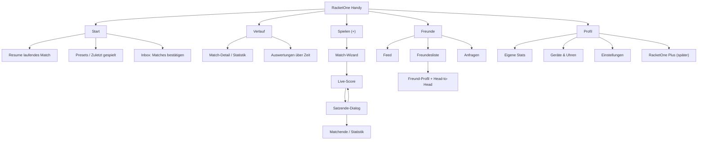
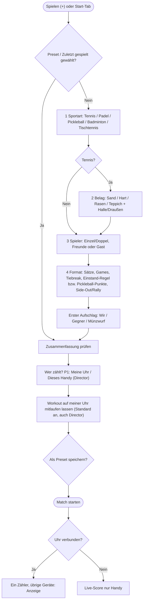
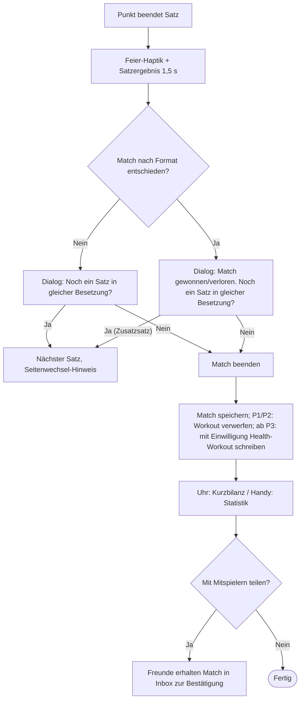
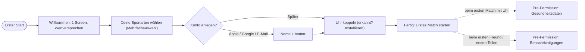
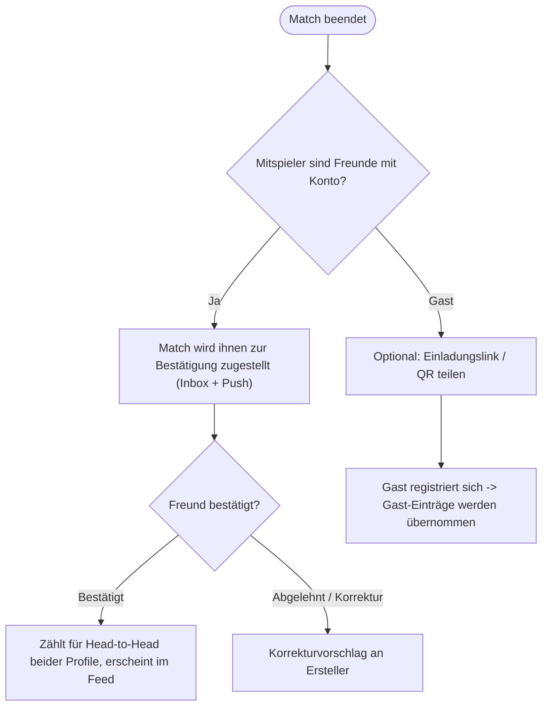

# 04 – UX- & Designkonzept Advantly

Stand: 2026-10-15 · Status: Entwurf v0.1 zur Abstimmung · Klickbarer Mockup: [mockups/index.html](mockups/index.html)

Bezug: [00 Grundsatzentscheidungen](00-entscheidungen.md) · [02 Scoring-Regeln](02-scoring-regeln.md) · [05 Watches & Health](05-watches-health.md)

---

## 0. Leitidee & Designprinzipien

**Advantly ist ein Scoreboard am Handgelenk, das danach zur Match-Story wird.** Während des Spiels zählt nur eins: in unter einer Sekunde, ohne Hinsehen, fehlerfrei den Punkt eintragen. Vor und nach dem Spiel darf die App erzählen, vergleichen und motivieren.

| # | Prinzip | Was das konkret heißt |
|---|---|---|
| 1 | **Ein Daumen, ein Punkt** | Jede Live-Aktion ist ein großflächiger Tap (≥ 40 % der Bildschirmfläche) oder eine physische Taste. Keine Menüs, keine Präzision während des Ballwechsels. |
| 2 | **Fühlen statt Lesen** | Jeder Punkt hat ein eigenes Haptik-Muster (Wir ≠ Gegner ≠ Undo), damit man die Eingabe ohne Blick bestätigt bekommt. |
| 3 | **Sonne & Schweiß zuerst** | Live-Screens sind Schwarz/Weiß mit großen, fetten Ziffern; Farbe kodiert nur Team-Zugehörigkeit und wird *immer* zusätzlich durch Position und Text getragen. |
| 4 | **Fehler sind billig** | Undo ist auf dem aktiven Zähler-Gerät immer einen Schritt entfernt, mit sichtbarer Vorher→Nachher-Anzeige. Destruktive Aktionen (Match beenden) brauchen Bestätigung, Punkte nicht. |
| 5 | **Eindeutige Rollen** | Genau ein Gerät zählt und führt Undo aus. Alle anderen zeigen denselben Stand ohne Eingabeflächen, mit Kennzeichnung „Anzeige“ und Name/Gerät des Zählers. Bestätigte Übergabe statt parallelem Zählen (Entscheidung 2026-10-15, PLAN K1). |
| 6 | **Sport hat Charakter** | Tennis, Padel und Pickleball haben eigene Akzentfarben, Icons und Begriffe – die Bedienlogik bleibt identisch. |
| 7 | **Plattform-nativ, markentreu** | Auf jeder Uhr wird die jeweilige Designsprache befolgt (Liquid Glass / Material 3 Expressive / Garmin-Tastenlogik); die Marke lebt in Farbe, Ziffern-Typo und Icon, nicht in eigenwilligen Bedienmustern. |

---

## 1. Recherche: Plattform-Richtlinien (Stand Oktober 2026)

> Hinweis zur Quellenlage: Die offiziellen Seiten wurden am 2026-10-14 abgerufen, liefern aber teils nur Navigation (Garmin) bzw. Teilinhalte (Apple). Was nicht direkt verifiziert werden konnte, ist mit **(prüfen)** markiert und muss vor dem Design-Freeze gegen die Originalquelle abgeglichen werden – insbesondere Neuerungen aus watchOS 27 / Wear OS 6.x, die nach Juni 2026 erschienen sind.

### 1.1 Apple watchOS (HIG, Liquid Glass)

- **Liquid Glass** (WWDC25, ausgeliefert mit watchOS 26) ist ein Material für *Bedienelemente und Navigation*, das Inhalte in den Vordergrund stellt. Auf watchOS ist es zurückhaltend umgesetzt: glänzende Kanten an Buttons/Toolbars, Positionen der Elemente wie bisher. HIG-Update 09/2025: semantischer Einsatz, Lesbarkeit, Kontrast, keine unnötigen Glas-Ebenen.
  - **Konsequenz für uns:** Glas nur für Toolbar-/Kontroll-Buttons (z. B. Seite „Steuerung“), **niemals** hinter Spielstand-Ziffern. Der Score liegt auf opakem Schwarz.
- **Glanceability:** „quick, glanceable, single-screen interactions … with a simple gesture or two.“ → Live-Score ist ein einziger Screen, Bedienung mit einer Geste.
- **Digital Crown:** primär vertikale Navigation/Scrollen; Navigation flach halten. → Auf dem Scoring-Screen **keine** Score-Aktion auf der Krone (beim Tennis knickt das Handgelenk, die Krone wird versehentlich gedreht).
- **Always On:** „infrequent, subtle updates“; Beispiel aus der HIG: eine Sport-App aktualisiert im Always-On nur noch, wenn sich der Score ändert. Interaktive Elemente in einen „nicht verfügbar“-Zustand überführen statt sie zu entfernen; Bewegung sanft auslaufen lassen; Gesundheitsdaten können redigiert werden, Puls während eines Workouts ist aber ausdrücklich erwünscht.
- **Action Button (Ultra) & Double Tap:** „initiates an essential action without looking at the screen“. → Kandidat für „Punkt für uns“ bzw. Undo (siehe 4.3, offene Frage).
- **Water Lock** kann während einer Workout-Session von der App aktiviert werden (prüfen: API-Verfügbarkeit in watchOS 26/27). Entsperren über Krone.
- Tap-Ziele: Richtwert ≥ 44 × 44 pt (iOS-HIG); auf der Uhr gilt „so groß wie möglich“ (prüfen: aktueller watchOS-Mindestwert).

### 1.2 Wear OS – Material 3 Expressive

- **Formen:** flexible Containerformen, Shape-Morphing von Buttons und Listen; **Edge-hugging Button (EdgeButton)** als ikonisches Muster für runde Displays – gehört in den `edgeButton`-Slot des `ScreenScaffold`, nicht in die Liste.
- **Typografie:** vereinfachte Type-Scale mit variablen Achsen (Gewicht/Breite animierbar); neue Rollen **Arc Text** (gebogene Titel) und **Numerals** (große, gestylte Ziffern für nicht zu lokalisierende Zahlen) – passt perfekt zum Score.
- **Farbe:** tiefere Tonpaletten, mehr Tokens.
- **Layout:** Ränder auf runden Displays in **Prozent** definieren (Clipping vermeiden); größere Displays dürfen nie *weniger* zeigen als kleine (Qualitätsstufen „Ready / Responsive / Adaptive“).
- **Listen:** `TransformingLazyColumn` (Items skalieren/morphen an den Rändern).
- Touch-Ziel min. **48 × 48 dp** (Android-Grundregel).
- **Ambient Mode / Ongoing Activity:** laufendes Match als Ongoing Activity (Rückkehr-Chip auf dem Zifferblatt), im Ambient Mode reduzierte Darstellung (prüfen: aktuelle Anforderungen der Quality-Guidelines).
- **Swipe-to-dismiss** (Wischen nach rechts = zurück) ist Systemverhalten → auf dem Scoring-Screen deaktivieren bzw. nur auf Unterseiten zulassen.

### 1.3 Garmin Connect IQ

- Gerätespektrum laut Garmin: „button to touchscreen, black and white to color memory-in-pixel (MIP) to AMOLED“. MIP ist historisch der Hauptdisplaytyp, neuere Geräte haben AMOLED.
- **Behaviors statt Tastencodes:** Apps reagieren auf Verhaltensweisen (onSelect, onBack, onNextPage, onPreviousPage, onMenu), nicht auf physische Tasten – Garmin mappt je Gerät. Mapping im Simulator *und* auf echten Geräten prüfen (Abweichungen bekannt).
- **MIP-Farben:** begrenzte Palette (neuere MIP-Geräte 64 Farben, ältere 16, Instinct-Familie teils monochrom – prüfen je Zielgerät); Farben wirken auf dem Gerät deutlich blasser als im Simulator.
- Relevante UX-Seiten (bei Umsetzung lesen): Views, Menus, Confirmations, Progress Bars, Localization, Personality Library (Input Hints, Action Views, Confirmations).
- AMOLED-Geräte: Burn-in-Schutz im Low-Power-Modus (begrenzter Anteil leuchtender Pixel, Pixel-Shift – Grenzwerte prüfen).

### 1.4 Barrierefreiheit (WCAG 2.2)

- Text-Kontrast ≥ 4.5:1 (AA), großer Text und UI-Komponenten ≥ 3:1 (1.4.3 / 1.4.11). **Unser Live-Ziel: ≥ 7:1** für Score und Labels (Sonnenlicht senkt effektiven Kontrast drastisch).
- Zielgrößen: 2.5.8 (AA) ≥ 24 × 24 CSS-px, 2.5.5 (AAA) ≥ 44 × 44.
- Ergänzend APCA (WCAG-3-Entwurf) als Zweitprüfung für dünne/kleine Schriften auf Dunkel.

Quellen: [WWDC25 Liquid Glass](https://developer.apple.com/videos/play/wwdc2025/219) · [HIG Designing for watchOS](https://developer.apple.com/design/human-interface-guidelines/designing-for-watchos) · [HIG Always On](https://developer.apple.com/design/human-interface-guidelines/always-on) · [MacStories watchOS 26 Review](https://www.macstories.net/stories/watchos-26-the-macstories-review/2) · [Wear OS M3 Expressive](https://developer.android.com/design/ui/wear/guides/get-started/apply) · [Wear OS Quality Tiers](https://developer.android.com/design/ui/wear/guides/foundations/quality-tiers) · [Compose for Wear OS Lists](https://developer.android.com/training/wearables/compose/lists) · [Garmin UX Guidelines](https://developer.garmin.com/connect-iq/user-experience-guidelines/) · [Garmin Personality Library – Input Hints](https://developer.garmin.com/connect-iq/personality-library/input-hints) · [Garmin Forum: Farben auf MIP](https://forums.garmin.com/developer/connect-iq/f/discussion/3546/colors-on-colored-watches)

---

## 2. Informationsarchitektur & Navigation

### 2.1 Handy – Tab-Struktur

Fünf Ziele in der Bottom-Navigation, die Mitte ist die Primäraktion (Sport-App-Konvention, vgl. „Aufnehmen“ bei Strava):

| Tab | DE / EN | Inhalt |
|---|---|---|
| 1 | **Start** / Home | Laufendes Match (Resume-Karte), Schnellstart-Presets & „Zuletzt gespielt“, Bestätigungs-Inbox (Matches, die Freunde mit dir eingetragen haben), Wochenbilanz |
| 2 | **Verlauf** / History | Match-Historie (Filter Sport, Gegner, Belag, Zeitraum), Match-Detail = Statistik, Auswertungen über Zeit |
| 3 | **Spielen** / Play (+) | Startet den Match-Wizard (Modal/Fullscreen). Bei laufendem Match: springt zum Live-Score |
| 4 | **Freunde** / Friends | Segmente *Feed · Freunde · Anfragen*; Freund-Profil mit Head-to-Head |
| 5 | **Profil** / Profile | Eigene Statistiken, Geräte (Uhren), Einstellungen, Konto, später Abo |

Laufendes Match ist überall präsent: **Mini-Scorebar** über der Tab-Leiste (wie „Now Playing“), plus **Live Activity / Dynamic Island** (iOS) bzw. **Live-Update-Benachrichtigung** (Android 16+, ansonsten Ongoing Notification) mit Score und Undo-freiem Read-only-Zustand.



### 2.2 Watch – Struktur (alle Plattformen gleich gedacht)

Flach, maximal zwei Ebenen:

1. **Startliste**: laufendes Match (falls vorhanden) · Presets/„Revanche“ (vom Handy synchronisiert) · „Neues Match“ (Kurz-Wizard) · Verlauf (letzte 5 Ergebnisse).
2. **Live-Match** als horizontaler Pager (Muster der Apple-Workout-App):
   - **Links: Steuerung** – nur am Zähler: Pause, Sperre, Rückgängig, Seitenwechsel bestätigen, Match beenden. Anzeige-Geräte bieten stattdessen Rolleninfo und „Zählen übernehmen“ (Visitor ausgeschlossen).
   - **Mitte: Score** (Standardseite, App kehrt nach 8 s Inaktivität auf anderen Seiten hierher zurück).
   - **Rechts: Fitness** – Puls groß mit Zone, Dauer, Kalorien, Schritte.
3. Dialoge: Satzende, Matchende (Kurzbilanz + „Am Handy ansehen“).

Einstiege: Komplikation/Tile (Wear OS Tile „Schnellstart“, watchOS Smart Stack/Komplikation mit laufendem Score), Garmin: Device App im Aktivitätsmenü.

---

## 3. User Flows

### 3.1 Match-Erstellung (Handy, Wizard)

Schritte: Sport → (nur Tennis: Belag) → Spieler → Format → **Wer zählt?** → Start. Jeder Schritt hat sinnvolle Defaults; „Match starten“ ist ab Schritt Spieler über eine Sticky-Zusammenfassung erreichbar; die Zähler-Auswahl wird auch beim Schnellstart bestätigt.



**Watch-Kurz-Wizard** (ohne Handy): Sport (Liste) → Einzel/Doppel → Format-Preset (3–4 Vorschläge je Sport, z. B. „Best of 3 · MTB“, „1 Satz bis 6“, „Pickleball 11 · Side-Out“) → Start. Gegner werden als „Gegner“ angelegt und später am Handy zugeordnet.

**Zähler-Auswahl:** P1 bietet „Meine Uhr“ (Standard: Uhr des startenden Spielers) und „Dieses Handy (Director)“. Ohne verfügbare Uhr ist nur das Handy wählbar. Im Director-Modus zählt die außenstehende Person am Handy, die Spieler-Uhren zeigen nur an. Ab P2 folgt eine Personen-Auswahl: ich, Mitspieler/Freund mit Account oder externe Person/Director mit Account; anschließend konkretes Zähler-Gerät bestätigen. Das Match wird dessen Gerät per Cloud zugestellt; erst nach bestätigter Bereitstellung startet es. Spieler und Zähler sind getrennte Rollen. Watch-Start setzt die eigene Uhr als Zähler; Presets vergeben keine dauerhaften Zählrechte.

**Offline-Start ab P2:** Antwortet die gewählte Zähler-Person nicht, bleibt der Start unbestätigt. Offene Frage F17 in PLAN: Wartezeit, Abbruch bzw. ausdrücklich bestätigter Wechsel auf ein eigenes Gerät und Umgang mit späterer Zustellung.

**Workout-Option:** Im Startdialog steht unabhängig von der Zähler-Wahl „Workout auf meiner Uhr mitlaufen lassen“ (Standard an), auch im Director-Modus. Die Option startet nur die eigene Uhr und ordnet einem außenstehenden Director kein Spieler-Workout zu. In P1/P2 hält die Session die App wach und zeigt Live-Puls; am Ende wird sie verworfen (`discardWorkout`, kein Health-Connect-Write). Persistenz und Health-Einwilligungen folgen ab P3; nötige Systemberechtigungen für Session/Sensor werden zuvor separat erklärt (05 E2/E5).

### 3.2 Live-Scoring & Synchronisation

```mermaid
sequenceDiagram
  participant Z as Zähler (Uhr oder Director-Handy)
  participant A as Anzeige (übrige Geräte)
  participant B as Backend (ab P2)
  Z->>Z: Punkt oder Undo, lokal persistent anwenden
  Z->>A: Engine-Event via WC/Mirroring oder Data Layer
  A->>A: Stand aktualisieren, keine Zählaktion
  A-->>Z: Ack
  Z->>B: Event-Log (ggf. über Companion-Handy)
  Note over Z,A: Verbindungsabbruch: nur Zähler zählt weiter; Anzeige zeigt letzten Stand
```

UX-Regeln zur Synchronität:
- **Sync-Pill bleibt:** Verbindung **zum Zähler**, mit Name/Gerät. Zustände: „Mit Zähler verbunden“, „Verbindung zum Zähler unterbrochen – letzter Stand …“, „Wird abgeglichen“. Am Zähler selbst: „Zähler · Anzeigen verbunden“ bzw. „Zähler · nur lokal“. Bei Abbruch wechselt kein Gerät automatisch die Rolle.
- **Vorschlag bei Verbindungsverlust:** Anzeige zeigt fortlaufend „Stand vor X s“ seit dem letzten bestätigten Abgleich. Nach > 30 s ohne Verbindung erscheint ein Hinweis mit „Zählen übernehmen“ und Bestätigung für berechtigte Anzeige-Geräte, auch Anzeige-Uhren; Visitor sehen nur den Hinweis. Bei langem Ausfall bleiben letzter Stand, Staleness und Verbindungsstatus sichtbar, ohne automatische Rollenänderung; bei Wiederverbindung wird abgeglichen. Schwelle, Hinweis-Wiederholung und weitere Details bleiben in PLAN F15 offen.
- **Rückmeldung nach Übernahme:** Meldet die Engine ignorierte Eingaben des alten Zählers, zeigt das Altgerät „N Eingaben nicht übernommen“ mit Aktion „Eingaben ansehen“. Gleichzeitige Übernahme-Versuche werden deterministisch geordnet; das in der Ordnung letzte `ScorerChanged` gilt (Details in 02). Darstellung und Aufbewahrung der einsehbaren Eingaben: PLAN F15.
- **Kein Fork-Dialog, kein Konflikt-Banner und keine Aktion „Beide zusammenführen“.** Geräteübergreifende Doppel-Tap-Konflikte entfallen: Nur das aktive Gerät erzeugt wirksame Zähl-/Undo-Events. Die Engine ignoriert Events nicht aktiver Zähler deterministisch; Rollenwechsel und Replikationsdetails siehe [02](02-scoring-regeln.md) und [01](01-architektur.md).
- **Perspektive:** Spieler-Geräte zeigen das eigene Team als „Wir“; der Director und Visitor sehen neutrale Teamnamen (A/B). Die Engine speichert neutrale Team-IDs.

**Übergabe „Zählen übernehmen“:** Auf einem berechtigten Anzeige-Gerät Rolleninfo öffnen → „Zählen übernehmen“ → Bestätigung „Auf diesem Gerät zählen? Bisher zählt [Name · Gerät]. Danach zeigt das bisherige Gerät nur noch an.“ → „Übernehmen“ / „Abbrechen“. Erst der angewandte replizierte Engine-Event „Zähler wechselt“ schaltet die Eingaben am Ziel frei und am bisherigen Gerät aus. Während der Bestätigung bleibt das Ziel Anzeige; Abbruch ändert nichts. Alle Geräte zeigen danach den neuen Zähler. P1: eigene Uhr ↔ eigenes Handy; P2: auch dafür berechtigte andere Accounts/Geräte, niemals Visitor. Bei leerem Akku/nicht erreichbarem Altgerät zeigt der Flow letzten bekannten Stand und Verbindungsstatus; Bestätigungs-/Verfügbarkeitsdetails sind mit 01/02 abzustimmen (PLAN F15). Keine parallele Zählfreigabe und kein Zeit-Lease.

**Visitor (P2):** Benannte Zuschauer-Accounts öffnen ein freigegebenes Match aus ihrer Live-Liste/Einladung. Sie sehen Stand, Sätze, Hinweise, Zähler und Verbindungsstatus sowie nach Ende das Ergebnis. Keine Tap-Flächen, kein Undo, kein Übernehmen, keine Match-Steuerung, keine Health-Daten. Zugriff bis Widerruf gemäß noch festzulegender Verwaltung (PLAN F16); öffentlicher Live-Link bleibt später.

### 3.3 Satzende & Matchende



Details zum Satzende-Dialog:
- Text (DE): **„Noch ein Satz in gleicher Besetzung?“** · Zeile darüber: „Satz 2 · 6:4 gewonnen“. EN: „Another set, same line-up?“
- **Ja** ist Primäraktion (Watch: EdgeButton bzw. großer unterer Button; Garmin: START), **Nein** sekundär (Garmin: BACK). Keine automatische Auswahl per Countdown (Fehlbedienung!).
- Nur das Zähler-Gerät bietet den entscheidenden Dialog; Anzeige-Geräte zeigen Satzergebnis und „[Name] entscheidet“. Die Antwort des Zählers aktualisiert alle Geräte.
- Der Dialog am zählenden Handy bietet zusätzlich „Besetzung ändern…“ (Textlink) – auf der Uhr bewusst weggelassen.
- Wird nichts gewählt, bleibt der Dialog stehen (Match pausiert, Workout läuft weiter).

### 3.4 Onboarding & Konto



### 3.5 Teilen & Bestätigen (Social)



Die Bestätigung schützt die Head-to-Head-Bilanz vor einseitigen Einträgen und ist ein natürlicher Wiederkehr-Anlass.

---

## 4. Screens

### 4.1 Handy

| # | Screen | Inhalte | Interaktionen |
|---|---|---|---|
| H1 | **Start** | Begrüßung, Resume-Karte (falls Match läuft), „Revanche“-Presets (Sport-Icon, Gegner, Format), Inbox-Karte „2 Matches bestätigen“, Wochenbilanz (Matches, Siege, Spielzeit) | Tap Preset → Zusammenfassung → Start; Long-Press Preset → bearbeiten/löschen |
| H2 | **Wizard 1 – Sportart** | 3 große Sportkarten (Icon, Name, Akzentfarbe, Kurzinfo „zuletzt vor 3 Tagen“), Zeile „Zuletzt gespielt“ | Tap = Auswahl + automatisch weiter (kein extra „Weiter“) |
| H3 | **Wizard 2 – Belag** (nur Tennis) | Sand, Hartplatz, Rasen, Teppich/Kunstrasen; Schalter Halle/Draußen | Tap = Auswahl + weiter; „Überspringen“ |
| H4 | **Wizard 3 – Spieler** | Segment Einzel/Doppel; Team-Slots „Wir“ (Du + ggf. Partner) und „Gegner“; Freundesliste mit Suche & „Zuletzt“; „+ Gast“ (nur Name) | Tap Freund füllt nächsten freien Slot; Slot antippen = leeren; Drag zwischen Teams (Doppel) |
| H5 | **Wizard 4 – Format + Wer zählt?** | Tennis/Padel: Sätze (1 · Best of 3 · Best of 5 · Offen), Games pro Satz (4/6/8 + Short Sets), Tiebreak (bei x:x, bis 7), Entscheidungssatz (normal · Match-Tiebreak bis 10), Einstand (Vorteil · No-Ad/Golden Point · Star Point), Erster Aufschlag. Pickleball: Spiele (1 · Best of 3 · Best of 5), Punkte (11 · 15 · 21), Zählweise (Side-Out · Rally), Gewinn mit 2 Abstand (fix), Erster Aufschlag. Zähler-Auswahl gemäß 3.1; Sticky-Zusammenfassung mit Name/Gerät + „Match starten“ | Segmente, Schalter; „Als Preset speichern“; Info-Icons erklären jede Regel in 1 Satz |
| H6 | **Live-Score / Director** (nur zählendes Handy) | Kopf: Kennzeichnung „Zähler · Director“, neutrale Teamnamen bei außenstehender Person; Sport-Chip, Matchdauer, Sync-Pill, eigener Puls nur bei eigener Spieler-Uhr. Satztabelle. Zwei Tap-Flächen (Team A oben, Team B unten; bei Spielerperspektive Wir/Gegner) mit großem Punktestand, Namen, Aufschläger-Ball. Hinweis-Pill zwischen den Flächen (Breakball/Satzball/Matchball/Einstand/Golden Point/Side-Out/Seitenwechsel). Fußleiste: Rückgängig, Sperren, Mehr | Tap Fläche = Punkt; Undo-Button (+ Snackbar mit Vorher→Nachher); Sperren (Entsperren: 1 s gedrückt halten); Mehr: Pause, Aufschläger korrigieren, Score manuell setzen, Match beenden. Querformat: Flächen nebeneinander |
| H6a | **Anzeige (P1) / Visitor (P2)** | Gleiche Score-, Satz- und Hinweis-Darstellung wie H6, aber ohne Tap-Flächen und Steuerungsleiste; deutlich „Anzeige · [Name/Gerät] zählt“, Sync-Pill zum Zähler. Eigener Puls nur für Spieler, nie für Visitor | Nur berechtigte Geräte: „Zählen übernehmen“ mit Bestätigung (3.2); Visitor ausschließlich lesen |
| H7 | **Satzende-Sheet** (nur Zähler) | Satzergebnis, Frage „Noch ein Satz in gleicher Besetzung?“ | Ja (primär) · Nein · „Besetzung ändern…“ |
| H8 | **Matchende / Statistik** | Ergebnis-Hero, Kacheln (Dauer, Ø/Max-Puls, kcal, Schritte), Momentum, Satzverlauf, Punkte-Statistik, Head-to-Head, Herzfrequenz-Kurve | Teilen, Bestätigung anfordern, Notiz/Foto hinzufügen (später), jede Grafik → Tabellenansicht |
| H9 | **Verlauf** | Liste nach Monaten, Filter-Chips (Sport, Gegner, Belag), Siegquote je Filter | Tap → H8; Wischen → löschen (mit Undo) |
| H10 | **Freunde – Feed** | Inbox oben (Bestätigungen), darunter Match-Karten der Freunde (Ergebnis, Sport, Dauer, Reaktionen) | Bestätigen/Ablehnen inline; Reagieren (Like/„Starkes Match“); Tap → Detail |
| H11 | **Freunde – Liste/Anfragen** | Suche, Freunde mit H2H-Kurzbilanz, Einladen per Link/QR, offene Anfragen | Annehmen/Ablehnen; Tap → Freund-Profil |
| H12 | **Freund-Profil** | Avatar, Sportarten, gemeinsame Matches, H2H je Sport/Belag | „Revanche starten“ (füllt Wizard vor) |
| H13 | **Profil & Einstellungen** | Eigene Stats, Uhren & Geräte, Live-Einstellungen (Haptik, Töne, Sperre, Outdoor-Kontrast, Seitenzuordnung), Sprache, Health, Konto, Datenschutz, später Abo | Standard-Settings-Muster |
| H14 | **Onboarding / Pre-Permissions / Paywall** | siehe Kapitel 7 | |

H7 und die Match-Steuerung sind nur am Zähler bedienbar. Auch Änderungen an laufendem Match/Ergebnis in H8–H13 dürfen kein zweites Zähler-Gerät freischalten; Anzeige-Geräte bieten dafür zunächst die bestätigte Übernahme.

### 4.2 Watch – Screen-Liste

| # | Screen | Apple Watch (rechteckig) | Wear OS (rund) | Garmin (rund/eckig, Tasten) |
|---|---|---|---|---|
| W1 | Startliste | `List` mit Liquid-Glass-Toolbar, Presets oben | `TransformingLazyColumn`, Arc-Text-Titel, EdgeButton „Neues Match“ | Menü (Menu2), START = auswählen |
| W2 | Kurz-Wizard | 3 Listen-Schritte | 3 Listen-Schritte | 3 Menüs |
| W3 | **Live-Score / Anzeige** | rollenabhängig, siehe 4.3 | rollenabhängig, siehe 4.3 | rollenabhängig, siehe 4.3 |
| W4 | Steuerung (Pager links) | Glas-Buttons 2×2 + „Beenden“ | Button-Gruppe + EdgeButton „Beenden“ | Pause-Menü über START |
| W5 | Fitness (Pager rechts) | Puls groß, Zone, Dauer, kcal | dito, Arc Text | Datenseite über DOWN im Pause-Menü |
| W6 | Satzende-Dialog | Text + 2 Buttons (Ja prominent) | Text + EdgeButton „Ja“ + Button „Nein“ | Confirmation View: START = Ja, BACK = Nein |
| W7 | Matchende | Ergebnis, Siegerin/Sieger, Puls Ø, „Am iPhone ansehen“ | dito | dito |
| W8 | Always-On / Ambient | gedimmter Score (siehe 4.3.6) | Ambient-Score | Low-Power-Modus (AMOLED) bzw. Dauer-Anzeige (MIP) |
| W9 | Tile / Komplikation | Smart-Stack-Widget: laufender Score / „Revanche“ | Tile: Schnellstart + letztes Ergebnis | Glance: letztes Ergebnis |

### 4.3 Watch-Scoring-Screen im Detail

**Rollengrenze:** Layout und Hinweise sind auf allen Uhren gleich. Die folgenden Tap-Flächen, Gesten, Hardware-Aktionen (Action Button, Double Tap, Garmin-Tasten), Undo und Match-Dialoge sind ausschließlich am Zähler aktiv. In der **Anzeige-Ansicht** fehlen diese Aktionen vollständig; stattdessen stehen dauerhaft „Anzeige“ und „[Name · Gerät] zählt“ am Score. Navigation zur eigenen Fitness bleibt möglich, „Zählen übernehmen“ nur nach 3.2. Jede Spieler-Uhr führt ihre eigene Workout-Session und zeigt den eigenen Puls auch als Anzeige weiter.

#### 4.3.1 Layout

```
        ┌──────── Uhrzeit (System) ────────┐
        │  WIR · Alex            ● Aufschlag│   obere Hälfte  = Tap-Fläche „Wir“
        │               40                  │   Akzentlinie Team Wir (Orange)
        │───── 6:4 │ 3:2  [ BREAKBALL ] ────│   Mittelband: Sätze/Games + Hinweis
        │               15                  │
        │  GEGNER · Jonas                   │   untere Hälfte = Tap-Fläche „Gegner“
        └──────────── ♥ 142 ───────────────┘   Puls (Arc Text unten bei rund)
```

- **Oben = Wir, unten = Gegner** – identisch zur Satztabelle auf dem Handy (Wir = erste Zeile) und zu den Garmin-Tasten (UP = Wir, DOWN = Gegner). Alternative „Court-Perspektive“ (Gegner oben, wie über das Netz geschaut) als Einstellung *Seiten tauschen*.
- Ziffern: Numerals-Rolle (Wear) bzw. SF Compact/Marken-Ziffernschrift (Apple), ≥ 40 % der Displayhöhe pro Hälfte, Halbfett/Fett, tabellarische Ziffern („AD“ und „40“ gleich breit).
- **Aufschläger:** gefüllter Ball-Punkt in der Team-Hälfte + Haptik-Hinweis „Aufschlagwechsel“ beim neuen Spiel. Pickleball-Doppel: Ansage-Zeile „4 – 2 – 1“ (Score Aufschläger – Score Rückschläger – Aufschläger-Nr.) im Mittelband.
- **Hinweis-Pill** im Mittelband, Bernstein/Amber mit Text (nie nur Farbe): Spielball (nur Handy), **Breakball**, **Satzball**, **Matchball**, Einstand, Golden Point, Star Point, Tiebreak, Seitenwechsel, Side-Out. Matchball zusätzlich gefüllt (stärkste Stufe).
- Team-Hälften: dunkel getönte Fläche (Orange- bzw. Blau-Tönung, ~12 %) + 4 px Akzentkante; die Ziffer selbst ist Weiß (max. Kontrast). Keine vollflächig gesättigten Farben (Blendung, Akku, Burn-in).

#### 4.3.2 Gesten – Entscheidung: zwei Tap-Hälften statt zwei Buttons

| Variante | Pro | Contra | Entscheidung |
|---|---|---|---|
| **Tap linke/rechte Hälfte** | gleich große Flächen | Ziffern müssen schmal werden; Zuordnung links/rechts kollidiert mit Uhr am linken/rechten Arm | nein |
| **Tap obere/untere Hälfte** | maximale Fläche, breite Ziffern, deckt sich mit Tabellen- & Tastenlogik | Swipe-Down-System-Gesten an der Oberkante (watchOS) | **ja** – oberste 12 % als Totzone |
| Zwei Buttons | klare Affordanz | kleiner, Präzision nötig, verschwitzt schlecht | nur als Darstellung bei Bedienhilfen (Switch Control) |

Gesten-Matrix (Scoring-Seite):

| Aktion | Apple Watch | Wear OS | Garmin (5 Tasten) | Garmin (Touch + 2 Tasten, z. B. Venu) |
|---|---|---|---|---|
| Punkt Wir | Tap obere Hälfte | Tap obere Hälfte | **UP** | Tap obere Hälfte |
| Punkt Gegner | Tap untere Hälfte | Tap untere Hälfte | **DOWN** | Tap untere Hälfte |
| Rückgängig | **Wischen nach unten** (ganzer Screen) · Button auf Steuerseite · optional Double Tap | Wischen nach unten · Steuerseite · optional Rotary zurück (mit Bestätigung) | **BACK/LAP** (1× = Undo + Toast) | untere Taste |
| Pause/Menü | Wischen nach rechts → Steuerseite | Wischen nach links → Steuerseite (rechts-Wisch = System-Back, deaktiviert) | **START** | obere Taste |
| Sperre | Steuerseite → Water Lock (Entsperren: Krone drehen) | Steuerseite → Touch-Sperre (Entsperren: Krone/Rotary oder lange Taste) | Garmin-System-Tastensperre | System |
| Krone/Rotary | **ohne Funktion** auf der Score-Seite (Fehlbedienung durch Handgelenk) | ohne Funktion auf der Score-Seite | – | – |

#### 4.3.3 Fehlbedienungs-Schutz

1. **Entprellung:** Nach jedem Punkt 600 ms Sperrzeit für *beide* Flächen (sichtbar als kurzes Aufleuchten → Abklingen). Ein Ballwechsel dauert länger, Doppeltaps werden so abgefangen.
2. **Handballen-/Ärmel-Filter:** Berührungen mit sehr großer Kontaktfläche oder Mehrfinger-Kontakt ignorieren; Tap gilt erst beim Loslassen (Abbruch durch Wegziehen möglich).
3. **Totzonen:** oberste ca. 12 % (System-Wischgesten) und das Mittelband (Grenze Wir/Gegner, ~ 10 %) sind nicht scorend.
4. **Handgelenk unten = Eingaben aus** (Systemverhalten nutzen; Wear: Ambient). Erst nach Aufwecken reagieren die Flächen wieder – mit 300 ms Verzögerung, damit der „Aufweck-Tap“ nicht zählt.
5. **Sperre** in Pausen/Seitenwechsel (Water Lock bzw. Touch-Lock); Garmin: Tasten-Bedienung ist ohnehin robust.
6. **Undo immer da:** Wischen nach unten → Toast „Rückgängig: 30:15 → 15:15“ für 3 s mit eigener Haptik. Mehrfaches Undo möglich (Event-Stack).
7. **Verwechslungs-Feedback:** Unterschiedliche Haptik für Wir/Gegner – wer sich „vertippt“, spürt es sofort.
8. **Kein Auto-Weiter** bei Dialogen; Satzende-Dialog braucht eine bewusste Antwort.

#### 4.3.4 Haptik auf der Uhr (Muster s. 5.8)

Punkt Wir = 1 kurzer Klick · Punkt Gegner = 2 kurze Klicks · Undo = abwärts gerichtetes Muster · Breakball/Satzball/Matchball = Aufmerksamkeits-Impuls *zu Beginn* des Punktes · Game = Erfolg · Satz = langer Erfolg · Seitenwechsel = 3 Impulse.

#### 4.3.5 Rund vs. eckig

- **Rund (Wear OS, Garmin):** Ränder in % (≥ 10 % horizontal in Höhe der Ziffern), Namen/Labels als **Arc Text** oben/unten, keine Inhalte in die Ecken des gedachten Quadrats. Hälften folgen der Kreisform.
- **Rechteckig (Apple Watch, Garmin Venu X1/Venu Sq-Klasse):** Labels linksbündig oben in der Hälfte, Systemuhrzeit oben rechts frei lassen; Ultra-Displays nutzen die Zusatzfläche für Satzhistorie (Qualitätsstufe „mehr Wert auf größeren Displays“).
- **Garmin MIP:** reine Palettenfarben (Schwarz, Weiß, Garmin-Orange, Garmin-Blau, Amber), *keine* Tönungsflächen (werden gedithert), Teamzuordnung über farbige Randbögen an den Tasten UP/DOWN + Text „WIR“/„GEG.“. Input Hints (kleine Bögen an den Tasten) gemäß Personality Library.

#### 4.3.6 Always-On / Ambient

- Hintergrund rein schwarz, Ziffern in 60–70 % Helligkeit, Team-Flächen nur als Kontur, Puls ohne Sekundentakt (Update bei Score-Änderung oder ≤ 1×/min laut Plattformlimit), Hinweis-Pill als Kontur.
- Interaktive Elemente gehen in einen „inaktiv“-Zustand über (HIG), nichts verschwindet abrupt.
- Score-Änderungen vom Handy werden auch im AOD angezeigt (sanfter Übergang), damit ein Blick auf die gesenkte Uhr reicht.
- Garmin AMOLED: Low-Power-Darstellung mit begrenzter Leuchtfläche und Pixel-Shift; MIP: Anzeige bleibt dauerhaft, nur Sekunden-/Puls-Updates reduzieren.

---

## 5. Designsystem

### 5.1 Markenfarbe aus dem Icon

Das vorhandene Icon (`assets/icon.svg`) ist ein abgerundetes Quadrat (rx 14/64 ≈ 22 %) in **#EA580C** mit weißem „R“. Das Orange erinnert an Sandplatz und passt zu Sport/Energie → wird **Markenfarbe „Clay“** und zugleich **Teamfarbe „Wir“**. Die Icon-Rundung (22 %) wird zum Formmaß für Karten und App-Kacheln.

### 5.2 Farb-Tokens

**Dark-Mode-first:** Uhren sind ohnehin schwarz (OLED, Akku, Sonne), Live-Screens am Handy ebenfalls (Default „Dunkel“ unabhängig vom System). Restliche Handy-App folgt dem System-Theme; Light Mode ist gleichwertig spezifiziert.

| Token | Dark | Light | Verwendung / Kontrast |
|---|---|---|---|
| `bg` | #0B0C0F | #F6F6F4 | App-Hintergrund; Live-Screen immer #000000 |
| `surface` | #15171C | #FFFFFF | Karten, Sheets |
| `surface-2` | #1E2128 | #EEEEEA | Eingabefelder, Segmente |
| `text` | #F5F6F7 | #121317 | Primärtext (≥ 15:1) |
| `text-2` | #9AA1AD | #50555F | Sekundärtext (6.9:1 auf surface dark) |
| `brand / team-us` | #FF6A1A (UI) · #E2621B (Charts) | #C2410C | Marke, Team Wir, Primär-CTA (CTA-Label dunkel #0B0C0F, 6.8:1) |
| `team-them` | #5B9BFF (UI) · #4A88F2 (Charts) | #2563EB | Team Gegner (7.1:1 auf #0B0C0F) |
| `sport-tennis` | #C8E62E „Optic“ | #6B7F00 | Tennis-Akzent (Ball-Gelbgrün) |
| `sport-padel` | #22C3E6 „Glass“ | #0E7490 | Padel-Akzent (Glaswand/Cyan) |
| `sport-pickleball` | #FF5FA2 „Kitchen“ | #BE185D | Pickleball-Akzent |
| `sport-badminton` | #A78BFA „Shuttle“ | #6D28D9 | Badminton-Akzent (ergänzt 2026-10-14) |
| `sport-tabletennis` | #34D399 „Table“ | #047857 | Tischtennis-Akzent (ergänzt 2026-10-14). Nah an `success` – deshalb wie alle Sportfarben nie allein, immer mit Icon + Name |
| `hint` | #FFB020 | #B45309 | Breakball/Satzball/Matchball (10.7:1 auf Schwarz) |
| `success` / `danger` | #3DDC84 / #FF4D4F | #15803D / #DC2626 | nur Status, immer mit Icon + Text |
| Belag-Swatches | Sand #C4572A · Hart #2F6DB3 · Rasen #3F8F3A · Teppich #7A5CA8 | dito | nur Illustration im Wizard/Verlauf |

Geprüft (WCAG-Kontrast + Farbfehlsichtigkeits-Simulation, OKLab ΔE): Teamfarbenpaar Orange #E2621B / Blau #4A88F2 besteht alle Prüfungen auf dunklem Grund (Protan-ΔE 29, Normal 33). Die drei Sportakzente sind untereinander auch für Deuteranopie unterscheidbar (schlechtestes Paar Pink↔Cyan ΔE 10) – werden aber **nie allein** zur Unterscheidung genutzt (immer Icon + Name). Sportakzente sind für UI-Flächen bewusst heller als das Chart-Helligkeitsband; in Diagrammen werden nur die Team-Chartfarben verwendet.

**Regel:** Sportfarbe = *was* gespielt wird (Wizard, Chips, Verlauf, Header-Tönung). Teamfarbe = *wer* punktet (Live, Statistik). Auf dem Live-Screen ist die Sportfarbe nur im kleinen Sport-Chip sichtbar, damit Padel-Cyan nicht mit Gegner-Blau konkurriert.

### 5.3 Outdoor-/Sonnenlicht-Modus

- Live-Screens: Hintergrund #000, Ziffern #FFF, Schriftgewicht ≥ SemiBold, keine Grautexte unter 7:1, keine Information in dünnen Linien.
- Einstellung **„Outdoor-Kontrast“** (auch automatisch bei sehr hoher Umgebungshelligkeit, wo verfügbar): Team-Tönungen werden zu 6 px Kanten, alle Texte reinweiß, Hinweis-Pill gefüllt Amber mit schwarzem Text, Animationen reduziert.
- Handy: Bildschirm während des Live-Scores wach halten (Einstellung), Helligkeit nicht künstlich reduzieren.
- Garmin MIP: Sonnenlicht ist der *beste* Fall (transflektiv) – Schwarz auf Weiß oder Weiß auf Schwarz, Farbe nur für Randbögen.

### 5.4 Typografie

| Rolle | Handy | Watch | Schrift |
|---|---|---|---|
| Score XL (Live-Punkte) | 96–120 pt, Bold | 56–72 pt (≈ 40 % Hälfte) | **Barlow Condensed** (OFL, schmal → „40“, „AD“, „15“ passen auch in Arc-Bereiche); Wear: Numerals-Rolle mit Breitenachse; Apple: alternativ SF Compact Rounded mit `.monospacedDigit()` |
| Score M (Games, Satztabelle) | 28–40 pt, SemiBold, tabellarisch | 20–24 pt | Barlow Condensed |
| Headline | 28 / 34 pt, Bold | – | **Inter** (Handy, Compose MP gebündelt) |
| Title | 20 pt, SemiBold | 15–17 pt (System) | Inter / System |
| Body | 16 pt, Regular | 15 pt (System) | Inter / System |
| Label / Chip | 13–14 pt, SemiBold, Versalien sparsam | 12–13 pt, Versalien für WIR/GEGNER | Inter / System |
| Caption | 12 pt, Medium | 11–12 pt | Inter / System |

- Auf den Uhren für Fließtext/Labels **Systemschriften** (Dynamic Type, Rendering, Arc Text). Marke lebt in der Ziffernschrift.
- Dynamic Type / Font Scale bis 200 % (Handy) – Live-Screen skaliert Labels, nicht die ohnehin maximalen Ziffern.
- Tabellarische Ziffern überall, wo Werte sich ändern (kein Springen).

### 5.5 Abstände, Raster, Formen

- 4-pt-Raster: 4 · 8 · 12 · 16 · 24 · 32 · 48. Bildschirmrand Handy 16 (Kompakt) / 24 (≥ 600 dp).
- Radien: 8 (Chips, Inputs) · **14 (Karten, analog Icon 22 %)** · 24 (Sheets, große Sportkarten) · voll (Pills, Buttons). Wear OS: M3-Expressive-Formen inkl. Morphing beim Drücken.
- Mindest-Touchfläche Handy 48 × 48 dp, Live-Flächen ≥ 40 % des Screens.
- Elevation: im Dark Mode über Flächenhelligkeit (surface → surface-2), nicht über Schatten.

### 5.6 Komponenten (Auswahl)

| Komponente | Beschreibung |
|---|---|
| Sport-Karte | Groß, Icon + Name + Akzent-Verlauf, Auswahlzustand mit Haken + Akzent-Rand |
| Belag-Kachel | Textur-Swatch + Name; Halle/Draußen als Schalter darunter |
| Spieler-Slot | Avatar/Initialen, Name, Rolle; leer = gestrichelt mit „+“ |
| Team-Stack | 1–2 Avatare überlappend, Teamkante in Teamfarbe |
| Segment-Control | 2–4 Optionen, gefüllte Auswahl in Sportakzent mit dunklem Label |
| Regel-Zeile | Titel + 1-Satz-Erklärung + Schalter/Segment, Info-Icon |
| **Score-Panel** | Team-Label, Namen, Score XL, Aufschlag-Ball; nur am Zähler Tap-Fläche mit Druck-Feedback (Flash 120 ms), sonst reine Anzeige |
| Satztabelle | Zeilen Wir/Gegner, Spalten Sätze + aktuelles Game; gewonnene Sätze fett |
| Hinweis-Pill | Amber, Versalien, Icon; 3 Stufen: Kontur (Einstand) · gefüllt-hell (Break/Satzball) · gefüllt + Puls-Animation (Matchball, außer Reduce Motion) |
| Sync-Pill | Punkt + Text zur Verbindung zum Zähler, Name/Gerät; Zustände gemäß 3.2, keine Konfliktstufe |
| Undo-Snackbar (nur Zähler) | „Rückgängig: 30:15 → 15:15“ + „Wiederholen“ |
| Edge-Button (Wear) | Primäraktion unten am runden Rand |
| Stat-Kachel | Label, Wert, optional Delta/Sparkline |
| Vergleichsbalken | zwei Balken von der Mitte (Wir links/Orange, Gegner rechts/Blau), Werte außen |
| Game-Streifen | Ein Kästchen pro Game, Farbe = Gewinner, „B“ = Break |
| Feed-Karte | Avatar, Text, Ergebnis-Zeile, Sport-Chip, Reaktionen, ggf. Bestätigen/Ablehnen |
| Bottom-Sheet-Dialog | Satzende, Bestätigungen |

### 5.7 Bewegung

- Score-Wechsel: Ziffer rollt vertikal (150 ms, ease-out), Fläche blitzt 120 ms auf; Undo rollt rückwärts.
- Satz-/Matchgewinn: kurze Feier (Konfetti nur Handy, 1 s) – bei „Bewegung reduzieren“ nur Überblendung.
- Wear OS: M3-Expressive-Shape-Morphing für Buttons; Apple: System-Übergänge, kein eigenes Glas-Theater.

### 5.8 Haptik-Muster

| Ereignis | Bedeutung | watchOS (`WKHapticType`) | Wear OS / Android | Garmin (`Attention.vibrate`) | Handy |
|---|---|---|---|---|---|
| Punkt Wir | Bestätigung A | `.click` | `VibrationEffect` Composition `PRIMITIVE_CLICK` | 1 × 40 ms | leichter Impact |
| Punkt Gegner | Bestätigung B | 2 × `.click` (120 ms Abstand) | 2 × `PRIMITIVE_CLICK` | 2 × 40 ms | 2 × leicht |
| Rückgängig | „zurück“ | `.directionDown` | `PRIMITIVE_QUICK_FALL` bzw. `REJECT` | 1 × 150 ms schwach | Warning |
| Game gewonnen (Wir) / verloren | Fortschritt | `.success` / `.directionDown` | `CONFIRM` / `PRIMITIVE_LOW_TICK` | 2 × 80 ms | Success |
| Satz gewonnen | Meilenstein | `.success` + `.notification` | `PRIMITIVE_SLOW_RISE` + `CLICK` | 300 ms | Success stark |
| Break-/Satz-/Matchball | Aufmerksamkeit | `.notification` | `PRIMITIVE_THUD` | 3 × 30 ms | – |
| Seitenwechsel | Aktion nötig | `.start` | 3 × `TICK` | 3 × 60 ms | Notification |
| Gesperrt-Tap / Fehler | Ablehnung | `.failure` | `REJECT` | 1 × 200 ms | Error |

Alle Muster einzeln abschaltbar; Ton optional (Standard aus). Haptik ersetzt nie den visuellen Zustand.

---

## 6. Statistik-Visualisierung

Grundsätze: Teamfarben konsistent (Wir = Orange, Gegner = Blau), Legende/Direktbeschriftung bei ≥ 2 Reihen, Text nie in Datenfarbe, dünne Marken (Balken ≤ 24 px, Linien 2 px), keine Doppelachsen, jede Grafik mit **Tabellenansicht** und Tooltip/Scrubbing.

| Frage | Visualisierung | Warum |
|---|---|---|
| Wie ist es ausgegangen? | **Ergebnis-Hero** (Satzergebnisse groß, Sieger hervorgehoben) – keine Grafik | Eine Zahl/Zeile ist die Botschaft |
| Wer hatte wann die Oberhand? | **Momentum-Diagramm**: divergierende Balken je Punkt um eine Nulllinie (gleitende Summe der letzten 5 Punkte, nach oben = Wir/Orange, unten = Gegner/Blau), Satzgrenzen als Trenner, Breaks als Marker (Mockup zeigt die einfachere Variante „Punktedifferenz je Game“ – beide testen) | Polarität über Zeit; zeigt Wendepunkte |
| Wie liefen die Sätze? | **Game-Streifen** je Satz (ein Kästchen pro Game, Farbe = Gewinner, „B“ = Break, Tiebreak-Score am Ende) | Kompakter als Liniendiagramme, auch auf kleinen Displays lesbar |
| Wer war wo besser? | **Vergleichsbalken (Butterfly)**: gewonnene Punkte, Aufschlagpunkte %, Returnpunkte %, Breakbälle genutzt (x/y), längste Punkteserie, Games zu null | Direkter Paarvergleich mit gemeinsamer Mitte |
| Wie stehe ich gegen X? | **Head-to-Head**: große Bilanz „7 – 4“, Formkurve als Chips der letzten 5 (S/N), Aufteilung nach Belag als gestapelter 100-%-Balken | Zahl + Verlauf + Kontext |
| Wie anstrengend war es? | **Herzfrequenz-Kurve** (Linie 2 px, Fläche 10 %) mit **Zonenbändern** im Hintergrund (Graustufen, Z1–Z5 beschriftet), Satzgrenzen; daneben Zeit-in-Zonen als horizontaler gestapelter Balken | Eine Reihe, eine Achse; Zonen als Kontext |
| Fitness-Eckdaten | **Stat-Kacheln**: Dauer, Ø/Max-Puls, aktive kcal, Schritte (ggf. Distanz) | Einzelwerte brauchen keine Grafik |
| Entwicklung über Zeit (Profil) | Siegquote je Monat (Säulen), Matches pro Woche (Säulen), Punkte-% (Linie) – getrennte Diagramme | Keine Doppelachsen |

Pickleball-spezifisch: Side-Out-Quote, Punkte als Aufschlagteam, längster Lauf. Padel: Golden-/Star-Point-Bilanz.
Erweiterung (optional, später/Plus): Punkt-Details per Long-Press (Ass, Doppelfehler, Winner, Fehler) – bewusst **nicht** im Basis-Flow, um das Zählen nicht zu verlangsamen.

---

## 7. Onboarding, Berechtigungen, Paywall

### 7.1 Onboarding (max. 4 Screens bis zum ersten Match)

1. **Willkommen** – Icon, „Zählen. Spielen. Vergleichen.“, Buttons „Los geht’s“ / „Ich habe ein Konto“.
2. **Deine Sportarten** – Mehrfachauswahl Tennis/Padel/Pickleball/Badminton/Tischtennis (steuert Presets & Reihenfolge).
3. **Konto** – Mit Apple / Mit Google / E-Mail · „Später“ (lokal zählen geht ohne Konto; Freunde/Sync brauchen eins).
4. **Uhr** – erkannt: „Apple Watch gefunden – App installieren“ / Wear OS: Install-Prompt / Garmin: Link zum Connect IQ Store. Überspringbar.

Danach direkt Start-Tab mit großer Karte „Erstes Match starten“.

### 7.2 Berechtigungs-Dialoge (kontextuell, mit Vorab-Erklärung)

| Berechtigung | Zeitpunkt | Vorab-Screen (Kern-Text) | Bei Ablehnung |
|---|---|---|---|
| Gesundheitsdaten ab P3 (HealthKit / Health Connect: Puls, aktive Energie, Schritte; Workouts schreiben) | Ab P3: erstes Aktivieren der Health-Erfassung **oder** erster Aufruf der Fitness-Statistik | „Damit wir Puls, Kalorien und Schritte zu deinem Match zeigen und es als Training in Apple Health / Health Connect speichern. Daten bleiben auf deinem Gerät, bis du teilst.“ | Statistik ohne Fitness-Teil, dezenter Hinweis mit Link zu Einstellungen |
| Benachrichtigungen | Nach erstem Freund **oder** erstem geteilten Match | „Wir sagen dir Bescheid, wenn Freunde ein Match mit dir bestätigen wollen.“ | Inbox-Badge in der App genügt |
| Workout/Sensor auf der Uhr | Erster Start auf der Uhr, bereits P1 | „Hält die App während des Matches wach und zeigt deinen Puls. Bis P3 wird das Workout danach verworfen.“ Systemberechtigungen separat von den Health-Einwilligungen ab P3 erklären. | Zählen ohne Puls, Hinweis auf mögliche Hintergrundgrenzen |
| Kontakte | **nicht** anfordern – Einladungen per Link/QR/Benutzername | – | – |
| Standort | nicht in v1 (später evtl. Platz-Erkennung) | – | – |

Pre-Permission-Screens immer mit „Später“; Systemdialog erst nach „Erlauben“. Workout-Typ-Mapping (Padel hat nicht überall einen eigenen Typ) → siehe [05 Watches & Health](05-watches-health.md).

### 7.3 Paywall-Platzhalter (Freemium später)

- Produktname **„Advantly Pro“**.
- **Nie** während eines Matches oder auf der Uhr anzeigen. Zählen, Basis-Statistik, Freunde, H2H-Bilanz bleiben kostenlos.
- Kandidaten für Plus: erweiterte Statistik (Momentum-Details, Trends über Zeit), unbegrenzter Verlauf, Export (CSV/PDF), Punkt-Details, eigene Presets > 3, Themes/Zifferblatt-Komplikationen.
- Gestaltung: Sheet mit Nutzenliste (3–4 Punkte), Plan-Auswahl (Monat/Jahr, Jahres-Ersparnis), Testzeitraum-Hinweis, „Käufe wiederherstellen“, AGB/Datenschutz – eindeutig schließbar (X oben). Trigger: Tap auf gesperrtes Feature (Schloss-Symbol), nie Pop-up beim App-Start.
- Architektur: Feature-Flags je Funktion, Paywall-Komponente als austauschbarer Platzhalter.

---

## 8. Barrierefreiheit

- **Screenreader** (VoiceOver/TalkBack): Nur am Zähler Score-Flächen als Buttons mit Label „Punkt für Wir, Alex. Stand 30 zu 15, Aufschlag Wir“; Score-Änderungen als Live-Region (höflich), Hinweise (Matchball) als Ansage. Benutzerdefinierte Aktionen nur am Zähler: „Rückgängig“, „Sperren“. Anzeige/Visitor: Score als Text/Live-Region, Rollenkennzeichnung und Name des Zählers vorlesen, keine Zähl-/Undo-Aktionen.
- **Farbunabhängigkeit:** Team = Position + Text + Farbe; Hinweise = Text + Icon; Diagramme = Legende + Direktlabels + Tabellenansicht; optional Muster-Füllung (Schraffur) für Gegner-Balken.
- **Schriftgrößen:** Dynamic Type/Font Scale bis 200 % am Handy; Uhr: Systemgrößen inkl. „Größerer Text“. Labels kürzen vor Umbruch (siehe 9), Ziffern nie kürzen.
- **Bewegung reduzieren:** keine Roll-/Puls-Animationen, nur Überblendungen.
- **Motorik:** Live-Flächen riesig; Apple-Watch-Bedienungshilfen (AssistiveTouch, Double Tap) und Switch Control werden unterstützt, indem es auch eine „Button-Darstellung“ mit fokussierbaren Elementen gibt.
- **Hören:** Töne optional, alles hat Haptik + visuelles Pendant. Optional (später): **Score-Ansage** per Sprachausgabe am Handy/Kopfhörer („Dreißig – fünfzehn“, „Breakball“).
- **Händigkeit:** Uhr links/rechts, Krone links/rechts → Gesten bleiben gleich, weil oben/unten statt links/rechts.
- Kontrast-Ziele siehe 1.4 und 5.2.

---

## 9. Internationalisierung (DE/EN)

### 9.1 Regeln

- Alle Texte über Schlüssel (`score.hint.breakpoint`), **mit Längenvarianten**: `long` (Handy), `short` (Uhr), ggf. `micro` (Garmin/kleine Rund-Displays). Fallback-Kette micro → short → long – aber nie kryptisch: lieber ein Icon + kurzes Wort als Abkürzung.
- **Pseudo-Lokalisierung** in CI/Screenshots mit +40 % Textlänge; Screenshot-Tests für 40-mm-/41-mm-Uhren in DE.
- Deutsche Komposita: weiche Trennstellen (`Auf­schlag­wechsel`) in Strings hinterlegen, Silbentrennung aktivieren (Compose `Hyphens.Auto`, iOS `hyphenationFactor`), auf der Uhr dennoch kurze Varianten bevorzugen.
- Zahlen/Datum lokal: „6.840 Schritte“ / „6,840 steps“; Satzergebnis DE „6:4“, EN „6–4“; Dauer „1:32 h“ / „1h 32m“.
- Tennis-Zählweise bleibt numerisch (0/15/30/40); Vorteil: DE „Vorteil“ (Handy) / „AD“ (Uhr), EN „Ad“. Einstand/Deuce.
- Team-Labels: **WIR / GEGNER** (Uhr: „WIR / GEG.“ nur auf Garmin-micro) · EN **US / THEM**.
- Layouts RTL-fähig bauen (Spiegelung), aber Oben/Unten-Logik bleibt unverändert.

### 9.2 Glossar (Auszug, inkl. Kurzformen für die Uhr)

| Schlüssel | DE lang | DE Uhr | EN lang | EN Uhr |
|---|---|---|---|---|
| hint.breakpoint | Breakball | Breakball | Break point | Break pt |
| hint.setpoint | Satzball | Satzball | Set point | Set pt |
| hint.matchpoint | Matchball | Matchball | Match point | Match pt |
| hint.deuce | Einstand | Einstand | Deuce | Deuce |
| hint.goldenpoint | Entscheidender Punkt (Golden Point) | Golden Pt | Golden point | Golden pt |
| hint.changeends | Seitenwechsel | Wechsel (mit Icon ⇄) | Change ends | Change ends |
| role.scorer | Zähler | Zähler | Scorer | Scorer |
| role.director | Director | Director | Director | Director |
| role.viewer | Anzeige | Anzeige | View only | View |
| role.visitor | Zuschauer | Zuschauer | Visitor | Visitor |
| action.take_over | Zählen übernehmen | Übernehmen | Take over scoring | Take over |
| action.undo | Rückgängig | Zurück (Icon ↶) | Undo | Undo |
| format.matchtiebreak | Match-Tiebreak statt 3. Satz | MTB | Match tiebreak instead of 3rd set | MTB |
| stat.servicepointswon | Gewonnene Aufschlagpunkte | Aufschlag-Pkt. | Service points won | Serve pts |
| dialog.anotherset | Noch ein Satz in gleicher Besetzung? | Noch ein Satz? | Another set, same line-up? | Another set? |
| fitness.heartrate | Herzfrequenz | Puls | Heart rate | HR |
| social.friendrequest | Freundschaftsanfrage | – | Friend request | – |

---

## 10. Mockup

`docs/mockups/index.html` – eine selbsttragende Datei (nur Google Fonts extern, mit System-Fallback). Enthält:

- **Globale Umschalter:** Sportart (Tennis/Padel/Pickleball/Badminton/Tischtennis – Akzentfarbe und Format-Screen passen sich an), Sprache DE/EN (ausgewählte Texte), Outdoor-Kontrast.
- **Match erstellen:** Start, Sportauswahl, Belag, Spieler, Format (Handy) + Watch-Schnellstart (Apple Watch).
- **Live:** Handy-Live-Score, Wear OS rund, Apple Watch eckig, Garmin MIP rund (mit klickbaren Tasten), Always-On-Variante – **alle live gekoppelt**: Ziel laut Rollenentscheidung ist ein aktives Zähler-Gerät, dessen Punkte auf allen erscheinen. Undo per Button, Wischen nach unten (Uhren) oder BACK (Garmin) ausschließlich am Zähler. Sperre am Handy (1 s halten zum Entsperren). „Demo“-Knöpfe springen zu Satzball/Matchball.
- **Satzende:** Dialog auf Uhr (rund/eckig) und Handy-Sheet; erscheint auch automatisch im Live-Teil.
- **Statistik:** Ergebnis, Kacheln, Momentum, Game-Streifen, Vergleichsbalken, H2H, Puls-Kurve (mit Hover-Tooltips) + Uhr-Kurzbilanz.
- **Freunde/Feed, Profil, Onboarding/Berechtigung, Paywall-Platzhalter, Designsystem-Übersicht.**

**Abgleich offen:** Der bestehende Mockup kann noch parallele Eingaben anbieten; seine Anpassung an Single-Scorer ist separat umzusetzen. Für Rollen und Eingaberechte gelten die Abschnitte 3/4 dieses Dokuments.

Der Mockup ist eine Diskussionsgrundlage, kein Pixel-Spec; Plattform-Details (Liquid Glass, M3-Expressive-Morphing) werden nur angedeutet.

---

## 11. Offene Fragen & Geschmacksfragen

1. **Oben = Wir** (konsistent mit Tabelle/Tasten) oder Court-Perspektive (Gegner oben)? Empfehlung: oben = Wir, Tauschen als Einstellung.
2. **Satzende-Dialog nach *jedem* Satz** (wie gewünscht) – oder nur bei Format „Offen“ und nach Matchentscheidung, sonst automatisch weiter mit Hinweis „Satz 2“? Empfehlung: nach jedem Satz, „Ja“ als große Primäraktion – kostet nur einen Tap.
3. **Teamfarben Orange/Blau** fest für alle Sportarten (Empfehlung) vs. Sportfarbe für „Wir“.
4. **Sportakzente** Optic-Gelbgrün / Cyan / Pink – Pink für Pickleball ist die mutigste Wahl (Alternative: Violett #A78BFA).
5. **Ziffernschrift:** Barlow Condensed (sportlich, schmal) vs. Inter Tight / SF Rounded (neutraler).
6. **Action Button / Double Tap** auf der Apple Watch: „Punkt Wir“ (schnell, aber asymmetrisch) oder „Rückgängig“ (sicher)? Empfehlung: standardmäßig aus, wählbar.
7. **Vorteil-Anzeige**: „AD“ oder „V“ im Deutschen?
8. **Light Mode** für Handy-Live-Score anbieten (manche empfinden Hell im Sonnenlicht besser) oder Live immer dunkel?
9. **Entschieden 2026-10-15:** Spieler-Uhren messen unabhängig von der Zähler-Rolle, auch bei Director-Handy. Noch offen bleibt die Fitness-Schätzung ganz ohne Uhr (05 F5).
10. Punkt-Details (Ass/Fehler/Winner) jemals im Basis-Flow – oder dauerhaft optional/Plus?
