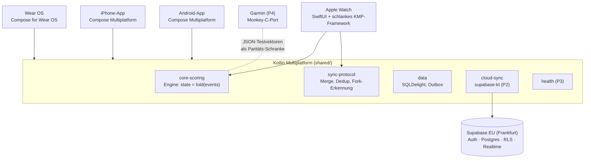

# Advantly – Gesamtplan & Roadmap

Stand: 2026-10-14 · Name: **Advantly** (vorher „RacketOne“, Prüfung: [07](07-namenspruefung-advantly.md)) · Domain `advantly.eu` · ID `eu.advantly`

Dieser Plan fasst die Fachdokumente zusammen und löst ihre Widersprüche auf. Bei Abweichungen gilt **dieses Dokument**.

| Dokument | Inhalt |
|---|---|
| [00 Entscheidungen](00-entscheidungen.md) | Grundsatzentscheidungen des Nutzers |
| [01 Architektur](01-architektur.md) | KMP-Monorepo, Event-Sourcing-Engine, Uhr↔Handy-Sync, CI/CD |
| [02 Scoring-Regeln](02-scoring-regeln.md) + [Testvektoren](testvectors/README.md) | ITF/FIP/USAP 2026, `MatchFormat`, 28 Presets, Events, Zustand |
| [03 Backend](03-backend-datenmodell.md) | Supabase-Schema, RLS, Sync, Freunde, DSGVO, Kosten |
| [04 UX & Design](04-ux-design.md) + [Mockup](mockups/index.html) | Flows, Screens, Designsystem, klickbarer Prototyp |
| [05 Watches & Health](05-watches-health.md) | HealthKit, Health Services, Garmin, Testmatrix |
| [06 Marktanalyse](06-marktanalyse.md) | 29 Wettbewerber, Lücke, Preis, Namensrisiko |

---

## 1. Produktbild

**Ein Match – auf Handy und Uhr gleichwertig gezählt, für alle Mitspieler sauber festgehalten, mit der eigenen Belastung im Verlauf.**

- Tennis, Padel, Pickleball, Badminton, Tischtennis · Einzel und Doppel · alle offiziellen Regelvarianten 2026 als getestete Presets (Regeln: [02](02-scoring-regeln.md) §2.1–2.5)
- Schritt-für-Schritt-Assistent **plus Schnellstart** („Wie letztes Mal“, Favoriten-Besetzungen)
- Zählen auf Apple Watch, Wear OS, Garmin **und** Handy – gleichzeitig, live, offline-fest, mit Undo über Satzgrenzen
- Nach dem Satz: „Noch ein Satz in gleicher Besetzung?“
- Statistik: Ergebnis, Satzverlauf, Momentum, Head-to-Head, Puls-Kurve pro Satz, Schritte, Kalorien
- Accounts, Freunde, geteilte Matches (bestätigt durch Mitspieler), Gäste können ihr Profil später beanspruchen

**Positionierung (aus der Marktanalyse):** Der Funktionsumfang allein ist nicht einzigartig. On Court Pro, All Sports Score Keeper, Tally und andere decken Teile ab. Advantly gewinnt über **nachweisbare Zuverlässigkeit**: kein verlorener oder doppelter Punkt, echtes gleichwertiges Zählen über gemischte Geräte, korrekte Doppel-Logik und Health-Daten entlang des Punktverlaufs.

**Freemium:** Zählen, Undo, eigene Historie, Freunde und geteilte Matches sind **immer kostenlos**. Pro bietet tiefe Statistik (H2H über viele Matches, Belag- und Partner-Analysen, Health-Trends) und kostet testweise 3,99 €/Monat oder 29,99 €/Jahr. In P2 wird das nur vorbereitet (Entitlements), die Paywall kommt frühestens nach P3.

## 2. Architektur in einem Bild

**Leitentscheidungen:** Kotlin 2.4.20 + CMP 1.12 auch für iPhone-UI, damit auf Windows lokal testbar. SKIE für die Swift-Anbindung, SQLDelight, Koin, XcodeGen. GitHub Actions mit macOS-Runner, fastlane match und TestFlight. Details und Versionen in [01 §0](01-architektur.md).

## 3. Aufgelöste Widersprüche zwischen den Fachdokumenten

| # | Thema | Widerspruch | **Entscheidung** |
|---|---|---|---|
| K1 | Gleichzeitiges Zählen | 01: Merge aller Geräte · 03: ein Scorer pro Match (Lease) | **Merge (01 §4)**, weil der Nutzer „Uhr + Handy gleichwertig“ gewählt hat. Der Server nimmt alle Events idempotent an, Dedup und Konflikte löst die Engine; ein Lease gibt es nicht. 03 streicht `scorer_device_id/scorer_lease_until`. **Wer** zählen darf, regelt eine Berechtigung: Teilnehmer des Matches, Standard = der Ersteller und seine Geräte, weitere Teilnehmer per Einladung „Mitzählen“. |
| K2 | Belag | 03: kombiniert (`indoor_hard`) · 02/04: getrennt | **Getrennt:** `surface` + `environment` (Halle/Draußen). 03 passt die Constraint an. |
| K3 | „Noch ein Satz?“ | 04: Dialog nach jedem Satz · 02: nur im Modus „Offen“ | **Zwei Modi (02 §5.2):** *Offen* (Standard bei Freizeit): Dialog nach jedem Satz. *Best-of*: Der nächste Satz startet automatisch, nach Matchende kommt die Frage, und „Ja“ legt ein **verknüpftes Folge-Match** an, ohne die Wertung zu verfälschen. → Rückfrage F7. |
| K4 | Live-Sync Apple | 01: WatchConnectivity · 05: Workout Mirroring | **Beides:** Mirroring als schneller Kanal während des Workouts, WatchConnectivity als Fallback. Die Anti-Entropie (Abgleich bei jedem Wiederverbinden und alle 30 s) garantiert, dass am Ende alle Events ankommen. |
| K5 | Name | „RacketOne“ kollidiert ([06 §8](06-marktanalyse.md)) | **Advantly** (Prüfung [07](07-namenspruefung-advantly.md): gelb). `advantly.app` ist fremd vergeben → Domain **`advantly.eu`** (gekauft), Bundle-/Package-ID **`eu.advantly`**. Vor dem Store-Release kurze Markenrecherche durch eine Fachperson (Klassen 9/41/42). |

## 4. Phasen und Meilensteine

Jede Phase endet mit einem **Quality Gate**. Erst wenn es bestanden ist, beginnt die nächste Phase.

### P0 – Fundament & Spikes
> **Stand 2026-10-15:** Apple-Tests auf echten Geräten sind **zurückgestellt**, bis ein Apple-Developer-Account existiert. Apple-Code wird trotzdem geschrieben und in der macOS-CI (unsigniert, Simulator) gebaut und getestet. Die Scoring-Engine (P1-A) ist vorgezogen und läuft parallel zu den Spikes.

| Arbeitspaket | Ergebnis | Stand |
|---|---|---|
| Monorepo-Gerüst (Gradle, Module laut [01 §2](01-architektur.md)), Lint, Formatter, `CLAUDE.md`/`AGENTS.md` mit Konventionen | baut auf Windows + CI (ubuntu + macOS) | ✅ PR #4 (Welle 0a). Abweichung: kein SKIE im Watch-Framework |
| **S1** watchOS-Framework: lokale DB (SQLDelight) und Größe pro Slice | Go/No-Go für KMP auf der Apple Watch | 🔄 Welle 0b (CI). App-Store-Upload-Validierung erst mit Apple-Account |
| **S2** CI → TestFlight | Ultra und iPhone bekommen Builds | ⏸ zurückgestellt (Apple-Account fehlt) |
| **S3** `device-link`: Wear Data Layer (real testbar) + WatchConnectivity (CI-Build) | Entscheidung Transport-Schicht | 🔄 Welle 0b |
| **S4** CMP-Scoring-Screen: Latenz, Haptik, Look | Go/No-Go CMP auf iOS | 🔄 Welle 0b – real auf Pixel-Handy, iOS nur Simulator-Screenshot |
| **S5** Wear OS: ExerciseClient + Ongoing Activity auf Pixel und Galaxy, 30 min Display aus | Laufzeit- und Akkubasis | 🔄 Welle 0b – Feldtest durch dich |
| **P1-A vorgezogen:** Scoring-Engine für alle 5 Sportarten + Testvektor-Runner | 136/136 Checkpoints grün | 🔄 Welle 0b |

**Gate P0:** Alle Spikes grün oder mit dokumentiertem Plan B (z. B. SwiftUI fürs iPhone, JSON-Store auf der Watch).

### P1 – Zählen offline: Handy + Wear OS + Apple Watch
| Arbeitspaket | Abhängig von |
|---|---|
| **A** `core-scoring`: alle Presets aus 02, Event-Reducer, Zustand inkl. Break-/Satz-/Matchball, Testvektor-Generator (≥ 150 Vektoren), Property-Tests | – (blockiert alle anderen) |
| **B** `sync-protocol` + `device-link` (Wear Data Layer, Apple WC/Mirroring), Merge, Dedup, Fork-Dialog, Sync-Simulationstests | A |
| **C** Handy-UI (CMP): Assistent, Schnellstart, Live-Score, Satzende-Dialog, einfache Ergebnisansicht, DE/EN | A |
| **D** Wear-OS-App: Scoring-Screen, Workout-Session, Tile zum Schnellstart | A, B |
| **E** Apple-Watch-App (SwiftUI): Scoring-Screen, Workout-Session, Action Button | A, B, S1 |
| **F** Lokale Datenbank + Match-Historie | A |

**Gate P1:** 10 echte Matches über alle drei Sportarten auf Ultra, Pixel Watch, Galaxy Watch und Handys. Dabei gehen **0 Punkte verloren und keiner wird doppelt gezählt**, auch bei Flugmodus mitten im Satz. Akku < 15 %/h auf der Uhr. Alle Testvektoren grün.

### P2 – Accounts, Freunde, Cloud-Sync
Supabase (Frankfurt), Login mit Apple/Google/E-Mail-Code, Profile, Spieler und Gäste-Claim, Freundschaften (Suche, QR, Einladungslink), Upload der Events über die Outbox, geteilte Matches mit Bestätigung, Push-Benachrichtigungen, Live-Mitverfolgen (Realtime), Account-Löschung und Export, Entitlements vorbereitet. Wear OS synchronisiert standalone.
**Gate P2:** pgTAP-RLS-Tests grün. Zwei echte Accounts mit gemischten Geräten (iPhone + Ultra / Android + Galaxy Watch) spielen ein Doppel, und beide sehen das Match. Sync verträgt Abbrüche und Wiederholungen ohne Doppelungen.

### P3 – Statistik & Health
Puls (5-s-Raster), Kalorien, Schritte und Dauer von der Uhr. Drei getrennte Einwilligungen: messen, synchronisieren, teilen. Schreiben nach Apple Health und Health Connect, ohne Schritte (vermeidet doppelte Zählung). Statistik-Screens: Momentum, Satzverlauf, H2H, Puls pro Satz. Optionale Punktdetails (Ass, Doppelfehler) per Long-Press. Datenschutz-Folgenabschätzung (DSFA) und Datenschutzerklärung.
**Gate P3:** Puls-Qualität auf Ultra, Pixel und Galaxy validiert. Store-Review-Texte fertig. Danach sind **Closed Beta und Store-Release** möglich.

### P4 – Garmin
Monkey-C-Port der Engine gegen die Testvektoren, App für Gerätewelle 1, Companion-Anbindung über das Connect IQ Mobile SDK, Beta mit echten Garmin-Nutzern.
**Gate P4:** 100 % Testvektor-Parität, Simulator-Matrix grün, mindestens 3 externe Tester.

### Danach (bewusst nicht in V1)
KI-Videoanalyse, Platzbuchung, Ligen und Turniere, Chat, eigenes Rating. Später möglich: öffentlicher Live-Link, Americano-Sessions (Padel), Jugendmodus.

## 5. Agenten-Orchestrierung

So arbeitet das Agenten-Team ab P0 zusammen:

| Rolle | Wer | Aufgabe |
|---|---|---|
| **Orchestrator** | Hauptthread (Claude) | Plan, Aufteilung, Integration, Rückfragen an dich, Merges |
| **Implementierer** | Claude-Agenten, je Arbeitspaket ein **eigener Git-Worktree und Branch** | Code + Tests für ein Paket, PR gegen `main` |
| **Reviewer** | **GPT (Codex)** als zweite Meinung, anderes Modell als der Implementierer | Code-Review jedes PRs, besonders Engine, Sync, RLS |
| **Regel-Prüfer** | eigener Agent | Hält die Testvektoren aktuell und prüft die Engine gegen 02 |
| **QA-Agent** | eigener Agent | CI-Ergebnisse, Screenshots aus Simulator/Emulator, Testprotokolle für deine Gerätetests |

**Parallelisierung P1:** Erst **A** (Engine) allein, weil alles darauf aufbaut. Danach laufen **B, C, F** parallel, anschließend **D und E** parallel. Jeder PR braucht grüne CI und einen Review, bevor er gemergt wird.

**Deine Rolle:** Entscheidungen treffen, auf echten Geräten testen (TestFlight / interne Play-Testspur) und Feedback geben. Die QA-Agenten schreiben dir dafür kurze Testskripte („Spiele Tiebreak, drücke bei 5:5 Undo auf der Uhr, …“).

## 6. Top-Risiken

| Risiko | Gegenmaßnahme |
|---|---|
| KMP-Framework auf Apple Watch (arm64-Pflicht, Größe) | Spike S1 zuerst. Plan B: Engine-Port in Swift, abgesichert durch dieselben Testvektoren |
| Kein Mac → langsames Watch-Debugging | Minimaler Swift-Anteil, In-App-Log-Export, CI-Screenshots, notfalls Cloud-Mac stundenweise |
| Verlorene/doppelte Punkte beim Sync | Event-Log + Anti-Entropie + Dedup, Sync-Simulationstests als CI-Pflicht |
| Galaxy Watch beendet Apps / stoppt Sensoren | Foreground Service, Test mit Display aus, Hinweis zu Samsung-Akkueinstellungen |
| watchOS 27 Puls-Bug, Action-Button-Bug (26.5) | Früh auf der Ultra testen, Undo bleibt immer auf dem Display |
| Health-Daten = DSGVO Art. 9 | Privacy by Default, getrennte Tabellen + Einwilligungen, DSFA vor P3 |
| Starke Konkurrenz (On Court Pro) | On Court Pro vor P1 selbst testen, Fokus auf Zuverlässigkeit, Kernfunktionen bleiben kostenlos |
| macOS-CI-Kosten (~50–75 $/Monat) | Pfadfilter, nur `main`/Tags bauen, Caching |

## 7. Offene Entscheidungen an dich

**Beantwortet (2026-10-14):**
| # | Frage | Antwort | Folge |
|---|---|---|---|
| F1 | Android-Handy | **Google Pixel** | Pixel Watch ideal. Galaxy Watch läuft am Pixel, Samsung-Health-Sync dort aber nur eingeschränkt testbar |
| F2 | Ultra-Generation | **Ultra 1** | Real testbar bis watchOS 26, kein Double Tap. watchOS 27 (inkl. Puls-Bug R1) nur im CI-Simulator, später über externe TestFlight-Tester |
| F3 | Repo | **öffentlich** | macOS-CI kostenlos. Secrets **nur** in GitHub Secrets / fastlane match (verschlüsseltes Zertifikats-Repo, privat) |
| F4 | Store-Konten | **Google Play Console vorhanden**, Apple fehlt | Apple Developer Program (99 $/Jahr) vor Spike S2 anlegen |

**Noch offen:**
| # | Frage | Vorschlag |
|---|---|---|
| F5 | Domain | **advantly.eu gekauft**, Website per GitHub Pages (`site/`) |

**Regeln & Bedienung (Vorschläge gelten, wenn du nichts änderst):**
| # | Frage | Vorschlag |
|---|---|---|
| F6 | Padel-Standard für Freizeit | Golden Point (Star Point als Preset „Padel Premier“) |
| F7 | „Noch ein Satz?“ → Modi wie in K3 | ja, Standard = *Offen* |
| F8 | Action Button der Ultra im Match | **Undo** (sicher) – einstellbar |
| F9 | Uhr-Layout | oben = Wir, unten = Gegner (umschaltbar) |
| F10 | Sportfarben | Pickleball Pink · **Badminton Violett #A78BFA** · **Tischtennis Smaragd #34D399** (wie auf der Website) |
| F11 | Vorteil-Anzeige im Deutschen | „AD“ |
| F12 | Matches standardmäßig mit Freunden teilen? | Nein, Abfrage im Onboarding |
| F13 | Mindestalter | 16 (Jugendmodus später) |
| F14 | Ass/Doppelfehler erfassen | ab P3, optional |

Weitere Detailfragen stehen in den Fachdokumenten: 02 §12, 03 §12, 04 §11, 05 §9.

## 8. Nächste Schritte

1. ✅ Planung, Website **advantly.eu**, Projektgerüst (Welle 0a) – alles auf `main`.
2. 🔄 Welle 0b: S1/S3, S4, S5 und Engine (P1-A) parallel in eigenen Worktrees; danach GPT-Review je PR.
3. Du: Feldtests S5 (Wear-Workout) und S3 (Ping-Pong Handy ↔ Uhr), S4 auf dem Pixel-Handy – Anleitungen unter `docs/spikes/`.
4. Später: Apple Developer Program anlegen → S2 (TestFlight) und Apple-Feldtests nachholen.
5. Optional: GitHub-Repo in `advantly` umbenennen; On Court Pro selbst ausprobieren.
