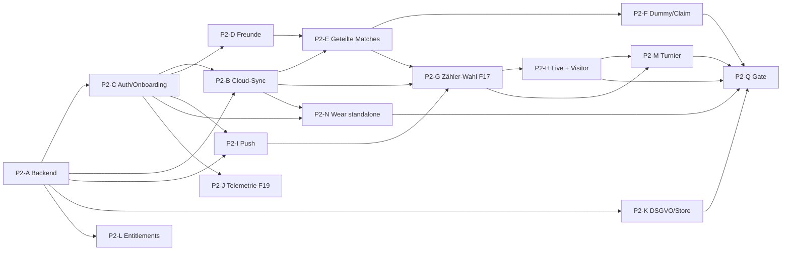

# Phase 2 – Plan: Accounts, Freunde, Cloud-Sync

| | |
|---|---|
| **Stand** | 15.10.2026 · Branch `p2/a-plan-backend-spike` |
| **Status** | Planung + lauffähiger Backend-Spike (`supabase/`) + Schnittstellenentwurf (`shared/cloud-sync`) |
| **Grundlage** | [PLAN](PLAN.md) (P2, Gate P2, F13–F22), [00](00-entscheidungen.md), [01](01-architektur.md) §4–5, [02](02-scoring-regeln.md) §7, [03](03-backend-datenmodell.md) (§13 = Abgleich mit dem Spike), [Veröffentlichungsplan](release/veroeffentlichungsplan.md) |
| **Gilt bei Widerspruch** | PLAN.md vor diesem Dokument; dieses Dokument vor 03 für alles, was der Spike konkret festlegt |

**Offene Entscheidungen an dich stehen gesammelt in [§12](#12-offene-entscheidungen-an-dich) – jede mit Empfehlung.**
Bis du etwas anderes sagst, plane ich mit der Empfehlung.

---

## 0. Kurzfassung

- **Ziel P2:** Konten (Google, Apple, E-Mail-Code) mit Länder-/Altersabfrage vor dem Konto, öffentlicher Alias, Freunde
  (Suche, Code, QR, Link), Cloud-Sync der Event-Logs über die Outbox, geteilte Matches mit Bestätigung,
  Dummy-Zuweisung mit „War ich nicht“, Zähler-Wahl beim Start mit Cloud-Zustellung (F17), Visitor-Live (nur lesen),
  Telemetrie-Sichtbarkeit (nur Einstellung), Löschung/Export, Entitlements vorbereitet, Turnierdirektor-Grundgerüst,
  Wear OS standalone.
- **Spike-Ergebnis:** Das komplette P2-Datenmodell steht als 11 Migrationen mit RLS und 33 RPCs. **211 pgTAP-Prüfungen
  in 10 Dateien** decken die RLS-Matrix ab (Fremde, Freunde, Teilnehmer, Zähler, Director, Visitor, gelöschter Account,
  Turnierhelfer). Sie laufen lokal grün gegen Postgres 17 mit Supabase-Nachbau; maßgeblich ist der neue CI-Job (Docker,
  echter Supabase-Stack), der nur bei Änderungen unter `supabase/` startet.
- **Client:** neues, noch nicht verdrahtetes Modul `shared/cloud-sync` mit Wire-DTOs (Vertrag zu den RPCs, gegen echte
  SQL-Antworten getestet), Ports (Backend, Auth, Outbox, Live, Sync-Worker) und reiner Outbox-Logik (Batching,
  Auswertung) – 11 JVM-Tests.
- **Reihenfolge:** P2-1 Fundament (Backend härten, Auth/Onboarding, Outbox-Upload) → P2-2 Sozialer Kern (Freunde,
  geteilte Matches, Dummy-Zuweisung, Push) → P2-3 Live über Accounts (Zähler-Wahl, Visitor, gemischte Geräte, Wear
  standalone) → P2-4 Abschluss (DSGVO, Entitlements, Turnier, Gate). Details §4.

---

## 1. Ausgangslage nach P1

| Vorhanden (P1) | Bedeutung für P2 |
|---|---|
| Append-only Event-Log je Match (`match_event`), IDs als UUIDv7, Ordnung `(lamport, deviceId, id)`, `deviceSeq` lückenlos je Gerät | Upload = Zeilen 1:1 hochladen, Idempotenz über die Event-ID; die Anti-Entropie per Wasserstand gibt es schon |
| Single-Scorer per `MatchCreated.scorerDeviceId` / `ScorerChanged` (02 §7.5), Engine ignoriert Events nicht aktiver Zähler | Server muss nur prüfen, **wer** übernehmen/zuweisen darf – nicht, ob ein Punkt wirkt |
| `PlayerAssigned` + Platzhalter (F20), Ersteller-Self + Aliase (W1-I) | Zuweisungs-Events brauchen in P2 eine Account-Prüfung; Self-IDs bleiben in den Logs → Self-Aliase im Backend |
| Mehrere Matches parallel am Handy, Beenden/Abbrechen (F21/F22) | Director-Matches haben bisher **kein Backup** (01 §4.9) – die Cloud wird ihr Replikationsziel |
| `confirmed`-Flag je Event (Gegenstelle hat es) | Cloud-Upload braucht ein **eigenes** Flag (`cloud_state`), weil „Uhr hat es“ ≠ „Cloud hat es“ |
| Löschmarkierungen werden an eigene Geräte repliziert | P2: Löschen eines geteilten Matches darf nur die eigene Sicht entfernen (match-session README) |

Was fehlt: Backend, Konten, Freunde, alles Accountübergreifende, Push, Datenschutz-Prozesse.

---

## 2. Leitentscheidungen aus dem Spike

Diese Punkte legt der Spike konkret fest. Abweichungen von 03 sind dort in §13 begründet.

| # | Entscheidung | Warum |
|---|---|---|
| L1 | Backend unter **`supabase/`** im Repo-Root (nicht `backend/supabase`) | Supabase-CLI findet den Ordner ohne `--workdir`; CI-Pfadfilter einfach |
| L2 | `match_events` hat **dieselben Spalten wie lokal** (`device_seq`, `wall_clock_ms`, `parent_id`), `type` = Engine-Name (`PointWon` …), `payload` = unveränderter Event-JSON | Kein Umkodieren, kein Drift zwischen Wire, lokal und Cloud; eine Genesis je Match per Unique-Index |
| L3 | **Self-Aliase statt Umschlüsseln:** lokale Self-IDs (Handy, Uhr) werden als `players.kind = 'self'` dem Profil zugeordnet | Events sind unveränderlich und verweisen auf die lokalen IDs; ein Umschlüsseln (03 E5) würde Logs umschreiben |
| L4 | **Upload-Recht ≠ Zählerrolle:** Server prüft Autor (= `auth.uid()`), Quellgerät gehört dem Autor, Match-Mitgliedschaft. Wer zum Zeitpunkt zählt, entscheidet weiterhin die Engine | Verspätete Events früherer Zähler bleiben gültig (02 §7.5), kein zweites Regelwerk in SQL |
| L5 | **Übernahme-Recht über Accounts:** `ScorerChanged` nur von Ersteller, verknüpften Mitspielern, angenommenen Zähler-/Director-Rollen, Turnierleitung; Ziel-Gerät muss einer ebenso berechtigten Person gehören | Single-Scorer über Accounts, Visitor nie |
| L6 | **Projektionen liefert der Client** (`status`, `summary`, `live_state`), monoton über `eventCount`, jedes Mitglied mit Upload-Recht | Eine Engine (03 E9); der zählende Freund/Director hält den Stand aktuell |
| L7 | **Visitor sehen nie Basistabellen**, nur `get_visitor_match` und den Kanal `match-live:<id>`; Inhalte per **Whitelist** bereinigt | Keine Profil-/Geräte-IDs, kein Event-Log, keine Telemetrie – auch wenn ein Client zu viel schreibt |
| L8 | **Länder-/Altersabfrage vor dem Konto in der App, Wiederholung im Server** (`complete_onboarding`), gespeichert werden nur Land, Zeitpunkt, angewandte Grenze – **nicht das Geburtsdatum** | F13 (AT 14, DE 16), Datenminimierung; Profile im Status `onboarding` dürfen nichts |
| L9 | **Teilnehmer-Verknüpfung mit Status:** `self` · `pending` (Freund eingetragen, Bestätigung offen) · `confirmed` · `assigned` (Dummy-Zuweisung, sofort wirksam) | Bildet 04 §3.5 (Bestätigung) und die Zuweisungs-Entscheidung (sofort + „War ich nicht“) in einem Modell ab |
| L10 | **Kontolöschung als Trigger auf `profiles`** (Ersteller wechselt, Teilnehmer → „Gelöschter Spieler“, Dummy-Zuweisungen lösen) | Gleiches Ergebnis für jeden Löschweg (Löschjob, `auth.admin.deleteUser`, Dashboard) |
| L11 | **Least Privilege:** alle Default-Grants entzogen, nur RPCs ausführbar, direkte Schreibrechte nur für Alias/Einstellungen/Geräte löschen/Turnier | RLS ist zweite Linie; ein vergessenes Grant fällt im Test 010 auf |
| L12 | Realtime nur als **Broadcast aus Triggern** auf private Kanäle (`match:`, `match-live:`, `tournament:`), Empfangs-Policy über einen Helfer | 03 E12; Kanalrecht testbar ohne laufenden Realtime-Dienst |

---

## 3. Arbeitspakete

Größe: S ≤ 2 Tage, M ≤ 1 Woche, L > 1 Woche (Agentenarbeit inkl. Review-Runden, ohne deine Feldtests).

| ID | Paket | Inhalt | Ergebnis / Abnahme | Abh. | Größe |
|---|---|---|---|---|---|
| **P2-A** | Backend-Fundament | Spike härten: Rate-Limits (Suche, Einladungen), Aufräumjob für `onboarding`-Leichen, `db lint` in CI, Index-/Performance-Prüfung (`sync_pull` mit 500 Matches), `staging`-Projekt in **eu-central-1**, DPA, Deploy-Workflow (`supabase db push` bei Merge auf `main`) | Migrationen auf staging, pgTAP grün in CI, Advisor ohne Befund | – | M |
| **P2-B** | Cloud-Sync Client | `shared/cloud-sync` implementieren (supabase-kt 3.8.x, nur Handy + Wear): `CloudBackend`, Outbox in `shared/data` (Migration 2.sqm: `match_event.cloud_state`, `cloud_cursor`), Worker (Android WorkManager, iOS BGTask + Vordergrund), Pull + Event-Download + Anti-Entropie per Wasserstand, Contract-Tests gegen lokale Supabase in CI | Abbruch-/Wiederholungs-Tests ohne Doppelungen; Director-Matches haben Cloud-Backup | A, C | L |
| **P2-C** | Auth + Onboarding | Login Google (Credential Manager / iOS SDK), E-Mail-Code, Apple (iOS nativ; Android OAuth sobald Apple-Account da), **Länder-/Altersabfrage vor dem Konto** (AT 14, DE 16, weitere laut §12), Alias/Benutzername, Übernahme lokaler P1-Daten (Self-Aliase hochladen, alle Matches pushen), Abmelden ohne Datenverlust | Neues Konto auf Pixel + iPhone; lokale P1-Matches erscheinen nach Login auf dem zweiten Gerät | A | M |
| **P2-D** | Profile & Freunde | Suche (exakt), Freundescode, QR (kurzlebig) und Link (`advantly.eu/i/…`, App Links/Universal Links, Fallback-Seite in `site/`), Anfragen, Blockieren, Profil-Screen „Mein Alias“ | Freundschaft per QR in < 10 s, Blockieren wirkt beidseitig | C | M |
| **P2-E** | Geteilte Matches | Teilnehmer mit Freunden → `pending`, Inbox „Matches bestätigen“, Ablehnen sperrt Neuverknüpfung, „mit Freunden teilen“ je Teilnehmer (Default aus), Feed, „aus meiner Liste ausblenden“, Löschen geteilter Matches = nur eigene Sicht | Zwei Accounts sehen dasselbe Doppel; Bestätigen/Ablehnen synchron | B, D | M |
| **P2-F** | Dummy-Zuweisung + Claim | „Einem Freund zuweisen“ (sofort, alle Matches), Mitteilung mit „War ich nicht“ (Sperre), Rücknahme durch Anleger, Einladungslink zum Selbst-Beanspruchen, `PlayerAssigned` mit Account-Prüfung (F20 → P2) | Zuweisung/Widerspruch über zwei Geräte, keine Doppelbesetzung | E | M |
| **P2-G** | Zähler-Wahl + Cloud-Zustellung (F17) | Wizard „Wer zählt?“ um Personen erweitern (ich, Mitspieler/Freund, externer Director), Einladung per Push, Annahme → Gerät erzeugt `ScorerChanged` (automatische Übergabe), Match startet **nie blockiert** am Starter-Gerät, „Zählen übernehmen“ über Accounts, Rücknahme | Übergabe accountübergreifend, verspätete Events des Altzählers korrekt ignoriert | B, E, I | L |
| **P2-H** | Live über die Cloud + Visitor | Realtime-Kanäle (nur im Live-Screen offen), Anzeige für Mitspieler auf gemischten Geräten (iPhone + Wear OS nur über Cloud, 01 §4.1), Visitor benennen/widerrufen (nur Freunde), Visitor-Ansicht H6a, bereinigte Live-Projektion vom Zähler/Hub | Visitor sieht Stand < 2 s nach Punkt, keine Schreibaktion möglich | B, G | M |
| **P2-I** | Push-Benachrichtigungen | Outbox → DB-Webhook → Edge Function `push-dispatch` → FCM v1 / APNs; Gerätetoken-Verwaltung; Silent-Push löst Pull aus; Pre-Permission (04 §3.4) | Freundschaftsanfrage, Match geteilt, Zähler-Einladung, Zuweisung kommen an | A, C | M |
| **P2-J** | Telemetrie-Sichtbarkeit (F19) | Einstellung „Teilen / Nur für mich (Standard) / Gar nicht“ im Profil, gespeichert in `profile_settings`; „Gar nicht“ schaltet Live-Puls/Schritte (P1) ab; **keine** Health-Speicherung (P3) | Einstellung wirkt auf Uhr und Handy; Visitor/Freunde sehen nie Telemetrie | C | S |
| **P2-K** | DSGVO & Store | In-App-Löschung (14 Tage Karenz, Abbruch per Login), Löschjob (pg_cron → Edge Function, Apple-Token-Widerruf O5), Export (Edge Function → ZIP mit JSON/CSV), Datenschutzerklärung DE/EN, VVT, AVV (Supabase, E-Mail-Dienst, Google/Apple), **Play Data safety neu** (Konto, Freunde, Spielstände), App-Zugang für Prüfer | Löschung + Export Ende-zu-Ende auf staging; Data-safety-Entwurf geprüft | A, C | M |
| **P2-L** | Entitlements vorbereiten | `entitlements`-Tabelle (steht), `EntitlementProvider` liest aus Cloud mit lokalem Fallback „alles frei“, RevenueCat-Webhook-Skizze (idempotent, ohne Paywall) | Kein sichtbarer Unterschied; Gate-Punkte im Code markiert | A | S |
| **P2-M** | Turnierdirektor (F22) | Datenmodell steht (Turnier, Plätze, Helfer, Matches mit `tournamentId/courtId`, Live-Übersicht, Kanal `tournament:<id>`); grobe UX: Turnier anlegen → Plätze → Spielplan (Matches je Platz/Zeit) → Zähler je Match zuweisen → Live-Übersicht aller Plätze; Director zählt Nachbarplätze am Handy (F22) | Ein Turnier mit 3 Plätzen, 2 Helfern, Übersicht live | G, H | M |
| **P2-N** | Wear OS standalone | Uhr synchronisiert direkt per WLAN/LTE (eigenes Gerät, Token vom gekoppelten Handy über Data Layer, keine Login-UI auf der Uhr), gleiche Outbox, gleiche Session-Regeln | Uhr-Match ohne Handy in der Nähe landet in der Cloud | B, C | M |
| **P2-Q** | QA & Gate | Sync-Chaos-Tests (Abbruch, Wiederholung, Reihenfolge), Contract-Tests, Gerätetests nach §11, Pilot-Kandidat | Gate P2 bestanden (Android-Teilgate gesondert) | alle | M |

---

## 4. Abhängigkeiten und Reihenfolge

| Welle | Pakete (parallel) | Kritischer Pfad |
|---|---|---|
| **P2-1 Fundament** | A, C, B (Outbox-Upload + Pull ohne soziale Funktionen), J | A → C → B |
| **P2-2 Sozialer Kern** | D, E, F, I, L | B + D → E → F |
| **P2-3 Live über Accounts** | G, H, N | E + I → G → H |
| **P2-4 Abschluss** | K, M, Q | H → M → Gate |

Vor P2-1 musst du nur Punkte aus §12 klären, die P2-A/C betreffen (Q1–Q4, Q9). Apple-Login hängt am Apple-Account
(F4) und blockiert den Android-Pfad nicht.

---

## 5. Cloud-Sync: Protokoll Client ↔ Supabase

### 5.1 Outbox-Format (lokal)

Kein zweites Log: Die Outbox ist ein Zustand **am vorhandenen Event**. SQLDelight-Migration 2.sqm in `shared/data`:

| Lokal | Neu | Bedeutung |
|---|---|---|
| `match_event` | `cloud_state INTEGER NOT NULL DEFAULT 0` (0 = ausstehend, 1 = in der Cloud, 2 = abgewiesen) + Index | Push-Kandidaten; abgewiesene Events werden nicht wiederholt, aber angezeigt (Diagnose) |
| `match_header` | `cloud_dirty INTEGER`, `cloud_version INTEGER` | Kopf/Teilnehmer/Projektion seit letztem Upload geändert; letzte bekannte `serverVersion` |
| `player` | `cloud_dirty INTEGER` | Self-Aliase/Dummys hochladen |
| neu `cloud_cursor` | `stream TEXT PK, value INTEGER` | `sync_pull`-Cursor und je Match `server_seq` |

Empfangene Cloud-Events werden mit `cloud_state = 1` und `confirmed = 1` gespeichert (`EventRows.toStored`). Bestands-
Events beim ersten Login: alle eigenen Matches → `cloud_state = 0`.

### 5.2 Abbildung Event ↔ Tabelle

| `ScoreEvent` / lokal `match_event` | Cloud `match_events` | Wire (`EventRow`) |
|---|---|---|
| `id` (UUIDv7) | `id uuid` PK – **Idempotenz** | `id` |
| `matchId` | `match_id uuid` → `matches` | `matchId` |
| `deviceId` | `device_id uuid` (muss dem Uploader gehören) | `deviceId` |
| `deviceSeq` | `device_seq bigint`, unique `(match_id, device_id, device_seq)` | `deviceSeq` |
| `lamport` | `lamport bigint` | `lamport` |
| `wallClockMs` | `wall_clock_ms bigint` | `wallClockMs` |
| `parentId` | `parent_id uuid` | `parentId` |
| Payload-Typ (`type`) | `type text` (Whitelist der 12 Engine-Typen) | `type` |
| Payload-JSON | `payload jsonb` (muss `type` enthalten) | `payload` (Objekt, unverändert) |
| – | `author_id` (Server: `auth.uid()`), `server_seq` (Download-Cursor), `received_at` | `serverSeq` beim Download |
| `confirmed` | – (lokal) | – |

Match-Kopf: `MatchCreated.config/lineup/meta` → `matches.format/meta` + `match_participants` (ein Platz je Lineup-ID,
inkl. `placeholder:`-IDs; aufgelöste Zuweisungen aus `match_assignment` als `playerId`/`profileId`). Status/Ergebnis
aus dem Engine-Zustand als `projection` (`status` und `resultReason` kleingeschrieben, `CloudNames`).

### 5.3 Upload (`sync_push`)

1. Auslöser: neues Event (debounced 2 s, im Live-Match sofort), App-Start, Netz wieder da, Push-Nachricht, manuell.
2. `OutboxPlanner.plan`: ausstehende Events je Match in Event-Ordnung, ≤ 500 je Aufruf; Kopf reist mit jedem Batch,
   der Events des Matches enthält; Geräte und Spieler im ersten Batch.
3. Server verarbeitet in **einer Transaktion**: Geräte → Spieler → Köpfe/Teilnehmer → Events → Projektionen; Antwort
   je Element.
4. `OutboxPlanner.evaluate`: `accepted`/`duplicate` → `cloud_state = 1`; `rejected` → `cloud_state = 2` + Grund;
   fehlende Antwort oder `unknown_match` → nächster Lauf. Wiederholung ist immer gefahrlos.

Event-Ablehnungsgründe (stabile Schlüssel): `invalid`, `id_conflict` (gleiche ID, anderer Inhalt), `sequence_conflict`
(Gerät+Seq belegt), `unknown_match`, `match_deleted`, `forbidden` (kein Mitglied/Visitor), `device_not_owned`,
`genesis_forbidden`, `genesis_exists`, `takeover_forbidden`, `scorer_target_invalid`, `scorer_target_forbidden`,
`assignment_forbidden`.

### 5.4 Download

- `sync_pull(cursor)`: alle sichtbaren Matches mit `serverVersion > cursor` (inkl. Tombstones, Teilnehmer mit
  aufgelösten Aliasen, Rollen), eigene/zugewiesene Spieler, Freundschaften; Paging à 200. Änderungen an Teilnehmern,
  Rollen und Visitor heben die Version des Matches (Trigger) → neue Sichtbarkeit erscheint automatisch.
- Events je Match über `pull_match_events(matchId, afterServerSeq)` – nur beim Öffnen/Live/Hub, nicht im Feed.
- **Lückenschutz:** Sequenzen werden bei Insert vergeben, Commits können sich überholen. Deshalb vergleicht der Client
  nach jedem Event-Download `match_event_watermarks` (max. `deviceSeq` und Anzahl je Gerät) mit dem lokalen Stand
  und lädt das Match bei Abweichung ab Cursor 0 nach – dieselbe Idee wie die Geräte-Anti-Entropie (01 §4.3).
  Für den Feed-Cursor (`sync_pull`) gleicht P2-B das Risiko mit einem Sicherheitsabstand aus (Cursor nur bis zu
  Versionen, deren Transaktion abgeschlossen ist, z. B. über `pg_snapshot_xmin`) – im Spike noch nicht umgesetzt.
- Realtime ergänzt nur (Live-Screen offen); verpasste Nachrichten holt der Pull.

### 5.5 Konflikte

| Daten | Regel |
|---|---|
| Events | unveränderlich, keine Konflikte; gleiche ID + anderer Inhalt = Client-Fehler (`id_conflict`) |
| Wirkung von Events | Engine beim Replay (Single-Scorer, Undo, Ordnung) – der Server filtert nicht nach aktuellem Zähler |
| Match-Kopf, Teilnehmer | nur Ersteller schreibt; Last-Writer-Wins je Upload; bestätigte Verknüpfungen bleiben erhalten |
| Projektion (`status`, `summary`, `liveState`) | jedes Mitglied mit Upload-Recht; monoton über `eventCount` (ältere Stände → `stale`) |
| Eigene Teilnahme (teilen, ausblenden, bestätigen) | nur die Person selbst (RPC) |
| Freundschaften, Rollen, Visitor, Zuweisungen | serverautoritativ über RPCs |
| Profil/Einstellungen | Last-Writer-Wins (direktes Update, nur eigene Zeile) |
| Löschen | Ersteller ohne andere Accounts → Tombstone; mit anderen Accounts → nur für ihn ausgeblendet |

### 5.6 Single-Scorer über Accounts

| Aktion | Wer darf (Server) | Bemerkung |
|---|---|---|
| Match anlegen (Kopf) | jedes aktive Konto; Turnier-Matches nur Turnierleitung | |
| Genesis `MatchCreated` | Ersteller oder angenommene Zähler-/Director-Rolle | genau eine je Match |
| Events hochladen | Ersteller, verknüpfte Teilnehmer, Rollen `accepted`/`revoked`, Turnierleitung | `revoked` nur für verspätete Events |
| `ScorerChanged` erzeugen | Ersteller, verknüpfte Teilnehmer, Rolle `accepted`, Turnierleitung | Bestätigung in der UI am übernehmenden Gerät |
| Ziel eines `ScorerChanged` | Gerät einer Person mit Übernahme-Recht | `pending-watch` u. Ä. abgewiesen |
| `PlayerAssigned` | nur Ersteller (F20) | |
| Zähler einladen | Ersteller/Turnierleitung; Ziel: Freund, Mitspieler oder Turnierhelfer; nie Visitor | F17 |
| Visitor | nie Events, nie Übernahme | F16 |

**F17 im Ablauf:** Start → Starter-Gerät zählt sofort (`scorerDeviceId` = eigene Uhr/eigenes Handy) → `invite_scorer`
+ Push → gewählte Person nimmt an (`respond_scorer_invitation` mit eigenem Gerät) → **ihr Gerät** erzeugt
`ScorerChanged(eigene deviceId)` → alle Geräte folgen über Cloud/Realtime; bis dahin gezählte Punkte bleiben. Offline-
Annahme: Das Event wartet in ihrer Outbox; der Starter zählt weiter, bis es ankommt (02 §7.5: letzte Übernahme in der
Ordnung gilt, spätere Starter-Eingaben werden dann unwirksam und gemeldet).

---

## 6. Client-Schnittstellen: `shared/cloud-sync`

**Entscheidung: echtes, noch nicht verdrahtetes Modul** statt nur Text im Plan.

Begründung:
1. Der Vertrag zum Backend ist so **kompiliert und getestet** – `WireContractTest` dekodiert echte Antworten der
   SQL-RPCs; ändert sich ein Schlüssel, fällt es sofort auf.
2. Mapping Event ↔ Zeile und Outbox-Batching sind reine Logik, die jetzt schon gegen `shared/data` testbar ist und in
   P2-B unverändert weiterverwendet wird.
3. Kosten gering: kein supabase-kt/Ktor, kein watchOS-Target (`advantly.kmp.watchos=false`), niemand hängt davon ab;
   `umbrella-watch` bleibt unberührt (CLAUDE.md Regel 3).

Inhalt (Paket `eu.advantly.cloud.sync`):

| Datei | Inhalt |
|---|---|
| `Wire.kt` | `CloudJson`, `EventRow`, `PulledEvent`, `EventWatermark`, `DeviceDto`, `PlayerDto`, `ParticipantDto`, `ProjectionDto`, `MatchDto`, `PushBatch` (max. 500), `PushResponse`/`ItemResult`, `PullResponse` mit `PulledMatch`/`PulledParticipant`/`PulledRole`/`PulledPlayer`/`PulledFriendship` |
| `EventRows.kt` | `StoredEvent` ↔ `EventRow` (Payload 1:1, Typprüfung), `CloudNames` (Engine-Namen ↔ Cloud) |
| `OutboxPlanner.kt` | `plan(...)` → `List<PushBatch>`, `evaluate(sent, response)` → `OutboxUpdate(uploaded, rejected, retry)` |
| `Ports.kt` | `CloudBackend`, `CloudException`, `CloudAuthPort` (+ `CloudSession`, `IdTokenProvider`), `CloudOutboxStore`, `LiveChannelPort`, `CloudSyncPort` (+ `CloudSyncState`) |

Modulgraph ab P2-B: `cloud-sync → data` (+ supabase-kt, Ktor-Engines je Plattform); `presentation → cloud-sync`
(Sync-Status, Konto, Freunde); `match-session` bleibt cloudfrei – die Cloud ist ein weiterer Replikationspeer
hinter einem Port, den `presentation` verdrahtet. `umbrella-watch` nie.

---

## 7. UX-Grobskizzen (Ergänzung zu 04)

**Onboarding/Konto (04 §3.4 erweitert):** „Konto anlegen“ → **Land** (Liste der freigeschalteten Länder) → **Geburtsdatum**
(nur zur Prüfung, Hinweis „wird nicht gespeichert“) → unter der Grenze: „Advantly ohne Konto nutzen“ (lokal zählen
bleibt) → sonst Apple/Google/E-Mail-Code → Alias (vorbelegt mit Vorname) + optional Benutzername → „Matches mit
Freunden teilen?“ (Standard aus, F12) → fertig. Lokale P1-Matches werden im Hintergrund hochgeladen („Wird gesichert …“).

**Zähler-Wahl (F17):** Schritt „Wer zählt?“: *Meine Uhr* · *Dieses Handy* · *Mitspieler/Freund …* (Liste: Mitspieler mit
Konto zuerst, dann Freunde) · *Externe Person (Director) …* (Freunde). Live-Screen bis zur Annahme: Hinweis „Zählen geht
an [Alias], sobald verbunden“, Starter zählt. Annahme beim Gewählten: Push → Karte „[Alias] möchte, dass du zählst“ →
„Auf dieser Uhr/diesem Handy zählen“.

**Visitor:** Live-Screen → Teilen-Symbol → „Zuschauer einladen“ → Freundesliste (Mehrfachauswahl) → Visitor bekommen Push
„[Alias] lädt dich zum Zuschauen ein“ → H6a ohne Steuerung. Liste „Zuschauer“ mit Entfernen; Visitor kann „Verlassen“.

**Dummy-Zuweisung:** wie 04 §3.2 (entschieden). Mitteilung beim Freund: „[Alias] hat dir N Matches zugeordnet“ mit
„Ansehen“ / „War ich nicht“. Einladungslink zusätzlich im Spieler-Detail.

**Turnierdirektor (grob):** Tab „Turnier“ (nur sichtbar, wenn aktiviert) → Turnier anlegen (Name, Sport, Datum) → Plätze
(Chips „Platz 1…n“) → Spielplan (Liste je Platz: Uhrzeit, Teams als Dummys/Freunde, Format-Preset) → Zähler je Match
(Helfer aus Freunden, alternativ „ich als Director“) → **Live-Übersicht**: Raster mit einer Karte je Platz (Stand, Satz,
Zähler, Verbindungsstatus „Stand vor X s“), Tippen öffnet die Anzeige. Keine Auslosung, keine Brackets in P2.

---

## 8. Datenschutz und Release-Stufe

- Release-Stufe bleibt der **geschlossene Pilot**; neue Datenflüsse vor dem Pilot-Kandidaten deklarieren
  (Veröffentlichungsplan §2B). **Play Data safety muss ab dem ersten Konto-Build geändert werden:** E-Mail, Nutzer-ID,
  Name/Alias, Spielstände (App-Aktivität), Freundesbeziehungen; Verschlüsselung in Transit; Löschung möglich.
- Datenschutzerklärung DE/EN (03 §8.4) auf `advantly.eu` vor dem Pilot-Kandidaten; App-Zugang für Prüfer (Testkonto).
- AVV/DPA: Supabase (Frankfurt), E-Mail-Versand (EU-Anbieter), Google/Apple (Login, Push).
- Altersgrenzen: AT 14, DE 16 serverseitig erzwungen; Länder außerhalb der Liste bekommen kein Konto.
- Keine Health-Speicherung in P2. Telemetrie-Sichtbarkeit wird nur als Einstellung gespeichert (F19).

---

## 9. Agenten-Aufteilung

Jeder Agent: eigener Worktree `H:/racketone-wt/<thema>`, Branch `p2/<welle>-<thema>`, Review durch GPT/Codex (Engine,
Sync, RLS besonders), CI grün vor Merge.

| Welle | Worktree / Branch | Pakete | Hinweis |
|---|---|---|---|
| P2-1 | `p2/1-backend` | A, Teile K (Löschjob/Export als Edge Functions) | SQL + Deno; pgTAP je PR erweitern |
| P2-1 | `p2/1-auth` | C, J | Android zuerst, iOS per CI; Apple-Login hinter Feature-Flag bis Apple-Account |
| P2-1 | `p2/1-cloud-sync` | B (Upload, Pull, Outbox-Migration) | nach A-Grundlage; Contract-Tests gegen lokale Supabase in CI |
| P2-2 | `p2/2-friends` | D | inkl. App Links (`site/.well-known`) |
| P2-2 | `p2/2-shared-matches` | E, F | |
| P2-2 | `p2/2-push` | I, L | FCM zuerst, APNs vorbereitet |
| P2-3 | `p2/3-scorer-choice` | G | Engine unverändert; Session/Presentation + Cloud |
| P2-3 | `p2/3-live-visitor` | H | Realtime nur im Live-Screen |
| P2-3 | `p2/3-wear-standalone` | N | Token-Übergabe Handy → Uhr |
| P2-4 | `p2/4-tournament` | M | |
| P2-4 | `p2/4-privacy` | K (Rest), Store-Texte | Datenschutzerklärung im `site/` nur mit Auftrag |
| P2-4 | QA-Agent | Q | Testskripte für deine Gerätetests |

---

## 10. Risiken

| Risiko | Gegenmaßnahme |
|---|---|
| RLS-Lücke legt fremde Matches/Profile offen | pgTAP-Matrix je Rolle (Spike: 211 Prüfungen), Least-Privilege-Grants mit Strukturtest, Review jedes SQL-PRs durch zweites Modell |
| Doppelte oder fehlende Events nach Abbrüchen | Idempotenz über Event-ID, Outbox-Status am Event, Wasserstands-Abgleich nach Download, Chaos-Tests in P2-Q |
| Cursor-Lücke durch überholende Commits | Wasserstand je Match (umgesetzt), Feed-Cursor mit Snapshot-Grenze (P2-B) |
| Accountübergreifende Übergabe verwirrt (wer zählt?) | Engine-Regeln unverändert, Server prüft nur Rechte; UI zeigt Zähler-Person + Gerät; F15 offen halten und im Pilot testen |
| Supabase-Realtime-Limits (500 Verbindungen mit Spend Cap) | Kanäle nur im Live-Screen, Visitor über bereinigten Kanal, Pull als Rückfall |
| Apple-Login ohne Apple-Account nicht testbar | Android-Pfad mit Google + E-Mail-Code; Apple hinter Flag; Apple-Teilgate offen dokumentieren |
| Altersprüfung umgehbar (Selbstauskunft) | Rechtlich übliche „angemessene Anstrengung“; Server prüft erneut; keine Speicherung des Geburtsdatums; Frage Q3 |
| supabase-kt (Community) bricht bei Updates | 3.8.x pinnen, Contract-Tests in CI, Ports kapseln die Bibliothek |
| Kosten/Pausieren im Free-Plan während des Pilots | Pro ab Pilot mit Cloud (Q10) |
| Datenschutz-Pflichten (Data safety, AVV, Erklärung) verzögern den Pilot | P2-K früh starten (parallel ab P2-2) |
| Feed-Leser (Freund eines teilenden Teilnehmers) können per Direktabfrage `match_participants.profile_id` fremder Mitspieler lesen (nur UUID, kein Name) | `sync_pull` gibt sie nicht aus; P2-A: Spaltenrechte auf `match_participants` einschränken oder Feed über eine View führen |
| Geräte-ID wird von einem anderen Konto zuerst registriert („Squatting“) | IDs werden erst nach der Registrierung durch den Besitzer sichtbar (Upload setzt Registrierung voraus); P2-A: Geräteschlüssel/Attestierung prüfen |
| Spike-SQL nur gegen Nachbau geprüft | CI-Job mit echtem Supabase-Stack ist Pflicht vor Merge; Abweichungen dort beheben |

---

## 11. Gate-P2-Testplan

**Automatisiert (CI, Pflicht):**
1. `supabase test db` grün (RLS-Matrix: Fremder, Freund mit/ohne Teilen, Teilnehmer pending/bestätigt/zugewiesen,
   Ersteller, Zähler eingeladen/angenommen/widerrufen, Director, Visitor aktiv/widerrufen/abgelaufen, Turnierleitung und
   -helfer, Kontolöschung in Karenz und nach Löschung, anon).
2. Contract-Tests `shared/cloud-sync` gegen lokale Supabase (P2-B) + `WireContractTest`.
3. Sync-Chaos-Test (JVM): zufällige Abbrüche vor/nach Server-Commit, doppelte Uploads, vertauschte Batches,
   Download-Lücken → Endzustand auf beiden Clients = Fold aller Events, keine Doppelungen.
4. `./gradlew check`, Android-Lint, Apple-CI wie bisher.

**Manuell (du, mit QA-Skripten):**
| # | Szenario | Erwartung |
|---|---|---|
| G1 | Neues Konto AT mit 14 J., DE mit 15 J. (Testdatum) | AT ok, DE abgelehnt, ohne Konto weiter lokal zählbar |
| G2 | Zwei Konten (Pixel + Pixel Watch / iPhone + Ultra), Doppel 2 App-Nutzer + 2 Dummys | beide sehen das Match; Bestätigung beim Mitspieler |
| G3 | Flugmodus mitten im Satz am Zähler, später online; zusätzlich App-Kill während Upload | 0 verlorene/doppelte Punkte in der Cloud und auf dem zweiten Konto |
| G4 | Zähler-Wahl: Freund offline gewählt, Starter zählt 5 Punkte, Freund kommt online und nimmt an | automatische Übergabe, alle 5 Punkte bleiben, danach zählt nur noch der Freund |
| G5 | Übergabe zurück an den Starter, Altgerät zählt offline weiter | Eingaben des Altgeräts unwirksam + Hinweis „N Eingaben nicht übernommen“ |
| G6 | Visitor (Freund) schaut live zu; versucht nichts zu können; Widerruf | Stand < 2 s; keine Steuerung; nach Widerruf leer |
| G7 | Dummy einem Freund zuweisen → „War ich nicht“ | sofort sichtbar / sofort weg, erneute Zuweisung gesperrt |
| G8 | Konto löschen, Abbruch per Login; erneut löschen, Job nach Frist (staging: verkürzt) | geteiltes Match bleibt beim Mitspieler mit „Gelöschter Spieler“ |
| G9 | Export anfordern | ZIP mit eigenen Daten, keine Daten Dritter außer Snapshot-Namen |
| G10 | Wear OS ohne Handy (WLAN): Match zählen | landet in der Cloud, Handy zeigt es nach Pull |
| G11 | Turnier mit 3 Plätzen, 2 Helfern | Live-Übersicht aktualisiert alle Plätze |

Android-Teilgate gesondert abnehmen, solange Apple-Realtests fehlen (PLAN §4).

---

## 12. Offene Entscheidungen an dich

| # | Frage | Empfehlung (gilt, wenn du nichts änderst) |
|---|---|---|
| **P2-Q1** | Freund direkt als Mitspieler eingetragen: erst nach **Bestätigung** gewertet (04 §3.5) oder **sofort** wie bei der Dummy-Zuweisung? | **Sichtbar sofort, gewertet (H2H/Statistik ab P3) erst nach Bestätigung**; Dummy-Zuweisung bleibt sofort wirksam. Der Spike kann beides (`pending` vs. `assigned`). |
| **P2-Q2** | Welche Länder bekommen zum Start ein Konto, welche Grenze für CH/LI? | **AT 14, DE 16, CH 16, LI 16**; alle anderen „noch nicht verfügbar“ (lokal zählen geht). Weitere Länder einzeln nach Veröffentlichungsplan §2D. |
| **P2-Q3** | Reicht die Selbstauskunft (Geburtsdatum, nicht gespeichert) als Altersprüfung? | **Ja**, ohne Ausweis/Elternfreigabe; unter der Grenze kein Konto. |
| **P2-Q4** | F16-Details: Wie lange sehen Visitor ein beendetes Match, wer darf benennen/widerrufen? | **7 Tage** nach Matchende; benennen: Ersteller + bestätigte Mitspieler (je eigene Freunde); widerrufen: Benennender, Ersteller, Visitor selbst; Entfreunden/Blockieren beendet automatisch. |
| **P2-Q5** | Wer darf als Zähler-Person/Director gewählt werden? | **Freunde des Starters und Mitspieler mit Konto** (P2); externe Personen ohne Freundschaft per Einladungslink erst später. |
| **P2-Q6** | Wer darf accountübergreifend „Zählen übernehmen“ (F15)? | **Ersteller, Mitspieler mit Konto, angenommene Zähler/Director**; Bestätigung am übernehmenden Gerät, der bisherige Zähler bekommt nur einen Hinweis (keine Zustimmung nötig, sonst blockiert ein leerer Akku). |
| **P2-Q7** | Umfang Turnierdirektor in P2? | **Turnier, Plätze, Spielplan, Zähler-Zuweisung, Live-Übersicht**; Helfer müssen Freunde sein; keine Auslosung/Brackets/öffentlichen Ergebnisse. |
| **P2-Q8** | Apple-Login auf Android (OAuth, Secret alle 6 Monate erneuern) oder nur auf iOS? | **Auch auf Android**, sobald der Apple-Account existiert (Plattformwechsler). Bis dahin Android mit Google + E-Mail-Code. |
| **P2-Q9** | E-Mail-Versand (OTP) über welchen EU-Anbieter? | Ein **EU-Anbieter mit AVV** (z. B. Brevo oder Mailjet); Supabase-Standard-SMTP nur lokal. |
| **P2-Q10** | Supabase-Plan im Pilot | **Pro (25 $/Monat) ab dem ersten Pilot-Build mit Cloud** (Backups, kein Pausieren); staging auf Free. |
| **P2-Q11** | Wear OS standalone: Login auf der Uhr? | **Nein** – Token-Übergabe vom gekoppelten Handy (Data Layer); ohne Handy-Kopplung kein Cloud-Sync auf der Uhr. |
| **P2-Q12** | Kontolöschung mit 14 Tagen Karenz (03 E15)? | **Ja**; Health gibt es in P2 nicht, ab P3 sofortige Löschung bei Antrag. |
| **P2-Q13** | Telemetrie-Sichtbarkeit: Standard „Nur für mich“ bestätigen; wirkt „Gar nicht“ schon in P2 auf die Live-Anzeige? | **Ja und ja** – „Gar nicht“ schaltet auch die P1-Live-Werte (Puls/Schritte) ab. |

---

## 13. Spike: Inhalt und Testlage

**Inhalt** (Details: [`supabase/README.md`](../supabase/README.md)):
- 11 Migrationen: Grundlagen + Länderregeln, Profile/Einstellungen/Freunde/Geräte, Spieler/Turniere/Matches/Teilnehmer/
  Rollen/Visitor/Events/Einladungen/Entitlements, RLS-Helfer + Policies, 6 RPC-Migrationen, Rechte.
- 33 RPCs (32 für angemeldete Nutzer, 1 Löschjob nur für service_role), u. a. `complete_onboarding`, `find_profile`, `send_friend_request`, `respond_friend_request`, `block_user`,
  `register_device`, `sync_push`, `sync_pull`, `pull_match_events`, `match_event_watermarks`, `invite_scorer`,
  `respond_scorer_invitation`, `revoke_scorer`, `add_match_visitor`, `revoke_match_visitor`, `get_visitor_match`,
  `assign_player`, `reject_player_assignment`, `create_invite`, `redeem_invite`, `respond_match_participation`,
  `set_my_participation`, `request_account_deletion`, `cancel_account_deletion`, `export_my_data`,
  `admin_purge_due_accounts` (nur service_role), `tournament_overview`.
- Realtime: Trigger-Broadcasts auf `match:<id>`, `match-live:<id>`, `tournament:<id>` + Empfangs-Policy.
- CI-Job „Supabase – Migrationen + pgTAP (ubuntu)“, nur bei Änderungen unter `supabase/`.

**Testlage:**

| Was | Wo gelaufen | Ergebnis |
|---|---|---|
| Migrationen + 10 pgTAP-Dateien (211 Prüfungen) | lokal, Windows, **Postgres 17.10** (embedded) + pgTAP 1.3.3 + Supabase-Nachbau (Rollen, `auth.uid()`, `realtime.*`) | alle grün |
| `supabase start` + `supabase test db` (echter Stack) | **nur CI** (kein Docker auf dem Entwicklungsrechner) | ausstehend – der Orchestrator beobachtet den ersten Lauf |
| `shared/cloud-sync` (11 Tests, ktlint) | lokal, `./gradlew check` | grün |
| Realtime-Zustellung an echte Clients, Edge Functions, Auth-Provider | – | erst P2-A/B/C |

Bekannte Unterschiede Nachbau ↔ Supabase, die nur die CI prüft: Besitzrechte an `auth.users`/`realtime.messages`
(Trigger und Policy legt dort `postgres` an), Partitionen von `realtime.messages` (Test 090 überspringt die
Broadcast-Prüfung, wenn keine Partition existiert), Default-Privileges von `supabase_admin`.
