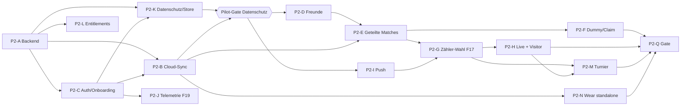

# Phase 2 – Plan: Accounts, Freunde, Cloud-Sync

Aktueller Ausführungsplan ab 16.10.2026: [nächste Phasen und Abnahmekriterien](p2-next-steps.md).

| | |
|---|---|
| **Stand** | 15.10.2026 · Branch `p2/a-plan-backend-spike` · Review-Runden 1–3 (PR #40) eingearbeitet |
| **Status** | Planung + lauffähiger Backend-Spike (`supabase/`) + Schnittstellenentwurf (`shared/cloud-sync`) |
| **P2-A · 16.10.2026** | Code umgesetzt: Rate-Limits, Onboarding-Cron, Spaltenrechte, CI-Lint, lokaler 500-Match-/Parallel-Lasttest, staging-Deploy-Workflow. Lokal pgTAP/Gradle grün; echter Stack-Lint/Cron in CI und gehostetes staging, DPA/Advisor noch offen. Details: [Backend-README](../supabase/README.md). |
| **Grundlage** | [PLAN](PLAN.md) (P2, Gate P2, F13–F29), [00](00-entscheidungen.md), [01](01-architektur.md) §4–5, [02](02-scoring-regeln.md) §7, [03](03-backend-datenmodell.md) (§13 = Abgleich mit dem Spike), [Veröffentlichungsplan](release/veroeffentlichungsplan.md) |
| **Gilt bei Widerspruch** | PLAN.md vor diesem Dokument; dieses Dokument vor 03 für alles, was der Spike konkret festlegt |

**Deine Entscheidungen vom 15.10.2026 (F23–F29) stehen in [§12](#12-entscheidungen-f23f29); dort ist auch vermerkt,
wo du von meiner Empfehlung abgewichen bist.**

---

## 0. Kurzfassung

- **Ziel P2:** Konten (Google und E-Mail-Code, Apple sobald der Developer-Account da ist) mit Länder-/Altersabfrage vor
  dem Konto, öffentlicher Alias, Freunde (Suche, Code, QR, Link), Cloud-Sync der Event-Logs über die Outbox, geteilte
  Matches (Freunde sofort verknüpft, „War ich nicht“), Dummy-Zuweisung, Zähler-Wahl beim Start mit Cloud-Zustellung
  (F17), Visitor-Live (nur lesen, bis Widerruf), Telemetrie-Sichtbarkeit (nur Einstellung), Löschung/Export,
  Entitlements vorbereitet, Turnierdirektor-Grundgerüst, Wear OS standalone.
- **Spike-Ergebnis:** Das P2-Datenmodell steht als 11 Migrationen mit RLS und 33 RPCs. **280 pgTAP-Prüfungen in
  11 Dateien** decken die RLS-Matrix ab (Fremde, Feed-Leser, Teilnehmer, Zähler, Director, Visitor, gelöschter
  Account, Turnierhelfer) sowie Wire-Vertrag und Sperr-Reihenfolge. Der CI-Job mit echtem Supabase-Stack lief in
  Review-Runde 1 und 2 grün; die Fixes aus Runde 2 sind lokal gegen Postgres 17 geprüft (inkl. Deadlock-Nachstellung
  mit zwei Verbindungen) und warten auf den nächsten CI-Lauf.
- **Client:** neues, noch nicht verdrahtetes Modul `shared/cloud-sync` mit Wire-DTOs (gegen echte RPC-Antworten als
  Fixtures getestet), Ports und reiner Outbox-Logik – 15 JVM-Tests.
- **Reihenfolge:** P2-1 Fundament (Backend härten, Auth/Onboarding, Outbox-Upload, Datenschutz-Grundlagen) →
  **Pilot-Gate Datenschutz/Store** → P2-2 Sozialer Kern → P2-3 Live über Accounts → P2-4 Abschluss. Details §4.

---

## 1. Ausgangslage nach P1

| Vorhanden (P1) | Bedeutung für P2 |
|---|---|
| Append-only Event-Log je Match (`match_event`), IDs als UUIDv7, Ordnung `(lamport, deviceId, id)`, `deviceSeq` lückenlos je Gerät | Upload = Zeilen 1:1 hochladen, Idempotenz über die Event-ID; die Anti-Entropie per Wasserstand gibt es schon |
| Single-Scorer per `MatchCreated.scorerDeviceId` / `ScorerChanged` (02 §7.5), Engine ignoriert Events nicht aktiver Zähler | Server muss nur prüfen, **wer** übernehmen/zuweisen darf – nicht, ob ein Punkt wirkt |
| `PlayerAssigned` + Platzhalter (F20), Ersteller-Self + Aliase (W1-I) | Zuweisungs-Events brauchen in P2 eine Account-Prüfung; Self-IDs bleiben in den Logs → Self-Aliase im Backend; `PlayerAssigned` trägt einen Klarnamen → Lösch-Ausnahme (§5.7) |
| Mehrere Matches parallel am Handy, Beenden/Abbrechen (F21/F22) | Director-Matches haben bisher **kein Backup** (01 §4.9) – die Cloud wird ihr Replikationsziel |
| `confirmed`-Flag je Event (Gegenstelle hat es) | Cloud-Upload braucht ein **eigenes** Flag (`cloud_state`), weil „Uhr hat es“ ≠ „Cloud hat es“ |
| Löschmarkierungen werden an eigene Geräte repliziert | P2: Löschen eines geteilten Matches darf nur die eigene Sicht entfernen (match-session README) |

Was fehlt: Backend, Konten, Freunde, alles Accountübergreifende, Push, Datenschutz-Prozesse.

---

## 2. Leitentscheidungen aus dem Spike

Abweichungen von 03 sind dort in §13 begründet.

| # | Entscheidung | Warum |
|---|---|---|
| L1 | Backend unter **`supabase/`** im Repo-Root (nicht `backend/supabase`) | Supabase-CLI findet den Ordner ohne `--workdir`; CI-Pfadfilter einfach |
| L2 | `match_events` hat **dieselben Spalten wie lokal** (`device_seq`, `wall_clock_ms`, `parent_id`), `type` = Engine-Name, `payload` = unveränderter Event-JSON | Kein Umkodieren, kein Drift zwischen Wire, lokal und Cloud; eine Genesis je Match per Unique-Index |
| L3 | **Self-Aliase statt Umschlüsseln:** lokale Self-IDs (Handy, Uhr) werden als `players.kind = 'self'` dem Profil zugeordnet | Events sind unveränderlich und verweisen auf die lokalen IDs |
| L4 | **Upload-Recht ≠ Zählerrolle:** Server prüft Autor (= `auth.uid()`), Quellgerät gehört dem Autor, Match-Mitgliedschaft. Wer zählt, entscheidet die Engine | Verspätete Events früherer Zähler bleiben gültig (02 §7.5) |
| L5 | **Übernahme über Accounts:** `ScorerChanged` nur von Ersteller, verknüpften Mitspielern, angenommenen Zähler-/Director-Rollen, Turnierleitung. **Ziel** ist ein eigenes Gerät des Hochladenden oder genau das Gerät, mit dem eine andere Person ihre Rolle serverseitig angenommen hat | Kein Zählerwechsel auf ein fremdes Konto ohne dessen nachgewiesene Annahme |
| L6 | **Projektionen liefert der Client** (`status`, `summary`, `live_state`) über die Events, die schon in der Cloud liegen; Server bindet sie an den eigenen Event-Stand (`eventCount` ≤ gespeicherte Events), monoton, nur mit Übernahme-Recht | Eine Engine (03 E9); keine Projektion vor dem Log, keine Projektion von widerrufenen Zählern |
| L7 | **Visitor sehen nie Basistabellen**, nur `get_visitor_match` und `match-live:<id>:<epoch>`; die Ausgabe wird aus einem **festen Schema neu aufgebaut** (Typ-/Wertprüfung auf jeder Ebene) | Keine Profil-/Geräte-IDs, kein Event-Log, keine Telemetrie – auch verschachtelt nicht |
| L8 | **Länder-/Altersabfrage vor dem Konto in der App, Wiederholung im Server**; gespeichert werden nur Land, Zeitpunkt, angewandte Grenze – **nicht das Geburtsdatum**. Serverseitiges Gate vor Kontoanlage per Auth-Hook ist Abnahmekriterium von P2-C (§8) | F24, Datenminimierung |
| L9 | **Teilnehmer-Verknüpfung (F23):** `self` · `linked` (Freund vom Ersteller eingetragen) · `assigned` (Dummy einem Freund zugewiesen) · `confirmed` (per Link beansprucht) – alle **sofort sichtbar und gewertet**; „War ich nicht“ löst und sperrt | Keine Bestätigung je Match (deine Entscheidung) |
| L10 | **Kontolöschung als Trigger auf `profiles`** inkl. Lösch-Ausnahme für Klarnamen in Payloads (§5.7) | Gleiches Ergebnis für jeden Löschweg |
| L11 | **Least Privilege:** alle Default-Grants entzogen, nur RPCs ausführbar | RLS ist zweite Linie; Strukturtest 010 |
| L12 | Realtime nur als **Broadcast aus Triggern** auf **versionierte** private Kanäle (`match:<id>:<epoch>`, `match-live:…`, `tournament:…`); jeder Rechteentzug erhöht die Version | Supabase prüft Kanalrechte nur beim Beitritt – Entzug muss bestehende Abos abschneiden |
| L13 | **Basistabellen nur für Mitglieder.** Freunde eines teilenden Teilnehmers (Feed) bekommen ausschließlich die bereinigte Sicht aus `sync_pull` (`access = feed`: kein Ersteller, keine Rollen, kein Live-Stand, keine Events, Konto/Alias nur von eigenen Freunden) | Keine fremden Profil-, Autor- oder Geräte-IDs über Direktabfragen |
| L14 | **Commit-geordnete Versionen + Sichtbarkeits-Epoche:** Versionen entstehen unter einer Transaktionssperre in Commit-Reihenfolge, `sync_pull` liest konsistent unter der geteilten Sperre; `visibilityEpoch` je Nutzer erzwingt einen Vollabgleich, wenn sich Sichtbarkeit ohne neue Match-Version ändert | Cursor überspringt nichts; Gewinne und Verluste an Sichtbarkeit kommen beim Client an |

---

## 3. Arbeitspakete

Größe: S ≤ 2 Tage, M ≤ 1 Woche, L > 1 Woche (Agentenarbeit inkl. Review-Runden, ohne deine Feldtests).

| ID | Paket | Inhalt | Ergebnis / Abnahme | Abh. | Größe |
|---|---|---|---|---|---|
| **P2-A** | Backend-Fundament | Spike härten: Rate-Limits (Suche, Einladungen), Aufräumjob für `onboarding`-Leichen, `db lint` in CI, Last-/Performance-Prüfung (`sync_pull` mit 500 Matches, Durchsatz der serialisierten Versionsvergabe), Spaltenrechte prüfen, `staging`-Projekt in **eu-central-1** (Free, F28), DPA, Deploy-Workflow | Migrationen auf staging, pgTAP grün in CI, Advisor ohne Befund; Abnahmekriterien §5.4 erfüllt | – | M |
| **P2-B** | Cloud-Sync Client | `shared/cloud-sync` implementieren (supabase-kt 3.8.x, nur Handy + Wear): `CloudBackend`, Outbox-Adapter über neue Primitive in `shared/data` (Migration 2.sqm: `match_event.cloud_state`, `cloud_cursor`), Worker (WorkManager, BGTask), Pull + Vollabgleich bei `visibilityEpoch` inkl. Zugriffswechsel `member → feed` (§5.4), Event-Download + Wasserstand, Redaktions-Mechanismus bis auf die Uhr (§5.7), Contract-Tests gegen lokale Supabase | Abbruch-/Wiederholungs-Tests ohne Doppelungen; Director-Matches haben Cloud-Backup | A, C | L |
| **P2-C** | Auth + Onboarding | Google (Credential Manager / iOS SDK) und E-Mail-Code über EU-Anbieter mit AVV; Apple sobald Developer-Account (iOS nativ, Android OAuth mit Secret-Rotation alle 6 Monate); **Account-Linking** (gleiche E-Mail über mehrere Anbieter, manuelles Verknüpfen in den Einstellungen); **Altersgate vor Kontoanlage** (Ticket + Auth-Hook, §8); Alias/Benutzername; Übernahme lokaler P1-Daten | Neues Konto auf Pixel; Unter-Grenze-Fall erzeugt keinen Auth-Nutzer; lokale P1-Matches nach Login auf zweitem Gerät | A | M |
| **P2-D** | Profile & Freunde | Suche (exakt), Freundescode, QR (kurzlebig) und Link (`advantly.eu/i/…`, App Links/Universal Links), Anfragen, Blockieren, Profil „Mein Alias“ | Freundschaft per QR in < 10 s, Blockieren wirkt beidseitig | C | M |
| **P2-E** | Geteilte Matches (F23) | Freunde als Mitspieler sofort verknüpft (`linked`), Mitteilung „[Alias] hat dich als Mitspieler eingetragen“ mit **„War ich nicht“** (löst + sperrt je Match), „mit Freunden teilen“ je Teilnehmer (Standard aus), Feed (bereinigt), „aus meiner Liste ausblenden“, Löschen geteilter Matches = nur eigene Sicht | Zwei Accounts sehen dasselbe Doppel sofort; Widerspruch synchron | B, D | M |
| **P2-F** | Dummy-Zuweisung + Claim | „Einem Freund zuweisen“ (sofort, alle Matches), „War ich nicht“ (Sperre), Rücknahme durch Anleger, Einladungslink zum Selbst-Beanspruchen, `PlayerAssigned` mit Account-Prüfung | Zuweisung/Widerspruch über zwei Geräte, keine Doppelbesetzung | E | M |
| **P2-G** | Zähler-Wahl + Cloud-Zustellung (F17, F26) | „Wer zählt?“ mit Personen (Freunde + Mitspieler), Einladung per Push, Annahme mit eigenem Gerät → dieses Gerät erzeugt `ScorerChanged`; **vor der Übernahme kausaler Abgleich** (Wasserstand des Matches holen, alle bekannten Events laden); Match startet **nie blockiert**; „Zählen übernehmen“ mit Bestätigung am übernehmenden Gerät | Übergabe accountübergreifend, verspätete Events des Altzählers korrekt ignoriert (G4/G5) | B, E, I | L |
| **P2-H** | Live über die Cloud + Visitor (F25) | versionierte Realtime-Kanäle (nur im Live-Screen offen, `rotate` → Kanal neu holen), Anzeige auf gemischten Geräten (iPhone + Wear OS nur über Cloud), Visitor benennen/widerrufen (Freunde, dauerhaft bis Widerruf), H6a | Visitor sieht Stand < 2 s nach Punkt; nach Widerruf sofort keine Daten mehr | B, G | M |
| **P2-I** | Push-Benachrichtigungen | Outbox → DB-Webhook → Edge Function `push-dispatch` → FCM v1 / APNs; Silent-Push löst Pull aus | Freundschaftsanfrage, Mitspieler-Eintrag, Zähler-Einladung, Zuweisung kommen an | A, C | M |
| **P2-J** | Telemetrie-Sichtbarkeit (F19, F29) | Einstellung „Teilen / Nur für mich (Standard) / Gar nicht“; „Gar nicht“ stoppt Live-Anzeige **und** gepufferte Übertragung (Uhr sendet nichts mehr, Puffer werden verworfen); keine Health-Speicherung (P3) | Einstellung wirkt auf Uhr und Handy | C | S |
| **P2-K** | **Datenschutz & Store (Pilot-Gate)** | In-App-Löschung (14 Tage, F29) + Löschjob (Apple-Token-Widerruf O5) + Export (Edge Function → ZIP) **funktionsfähig**, Datenschutzerklärung DE/EN, Nutzungsbedingungen, **Versionierung** von Terms/Privacy (Zustimmung mit Textversion), VVT, AVV/DPA (Supabase, E-Mail-Dienst, Google/Apple), **Play Data safety neu**, App-Zugang für Prüfer | **Gate vor dem ersten Pilot-Build mit Auth/Cloud** (§8) | A, C | M |
| **P2-L** | Entitlements vorbereiten | `entitlements`-Tabelle (steht), `EntitlementProvider` liest aus Cloud mit Fallback „alles frei“, RevenueCat-Webhook-Skizze | Kein sichtbarer Unterschied | A | S |
| **P2-M** | Turnierdirektor (F22, F27) | Datenmodell steht; UX: Turnier → Plätze → Spielplan → Zähler je Match → Live-Übersicht; Helfer sind Freunde; keine Auslosung/Brackets | Ein Turnier mit 3 Plätzen, 2 Helfern, Übersicht live | G, H | M |
| **P2-N** | Wear OS standalone (F28) | **Eigene Uhr-Session** (§5.9): Handy übergibt über den Data Layer einen Einmal-Code, die Uhr tauscht ihn gegen eine eigene Sitzung; eigener Refresh-Zyklus; Logout/Kontolöschung am Handy beendet die Uhr-Sitzung; kein unkoordiniertes Teilen von Refresh-Tokens | Uhr-Match ohne Handy in der Nähe landet in der Cloud; Logout am Handy sperrt die Uhr | B, C | M |
| **P2-Q** | QA & Gate | Sync-Chaos-Tests, Contract-Tests, Gerätetests nach §11, Pilot-Kandidat | Gate P2 bestanden (Android-Teilgate gesondert) | alle | M |

---

## 4. Abhängigkeiten und Reihenfolge

| Welle | Pakete (parallel) | Kritischer Pfad |
|---|---|---|
| **P2-1 Fundament** | A, C, B (Upload + Pull ohne soziale Funktionen), J, **K** | A → C → B/K |
| **Pilot-Gate** | Abnahme §8 (Löschung + Export funktionsfähig, Erklärungen, AVV, Data safety, Terms-Versionierung) | – |
| **P2-2 Sozialer Kern** | D, E, F, I, L | D → E → F |
| **P2-3 Live über Accounts** | G, H, N | E + I → G → H |
| **P2-4 Abschluss** | M, Q | H → M → Gate |

Apple-Login hängt am Apple-Developer-Account (F4) und blockiert den Android-Pfad nicht.

---

## 5. Cloud-Sync: Protokoll Client ↔ Supabase

### 5.1 Outbox-Format (lokal)

Kein zweites Log: Die Outbox ist ein Zustand **am vorhandenen Event**. SQLDelight-Migration 2.sqm in `shared/data`
(nur Primitive; der Outbox-Adapter liegt in `cloud-sync`, damit `data` nicht von `cloud-sync` abhängt):

| Lokal | Neu | Bedeutung |
|---|---|---|
| `match_event` | `cloud_state INTEGER NOT NULL DEFAULT 0` (0 = ausstehend, 1 = in der Cloud, 2 = abgewiesen) + Index | Push-Kandidaten; abgewiesene Events werden nicht wiederholt, aber angezeigt (Diagnose) |
| `match_header` | `cloud_dirty`, `cloud_version`, `projection_pending` | Kopf/Teilnehmer seit letztem Upload geändert; letzte `serverVersion`; Projektion noch nicht übernommen |
| `player` | `cloud_dirty INTEGER` | Self-Aliase/Dummys hochladen |
| neu `cloud_cursor` | `stream TEXT PK, value INTEGER` | `sync_pull`-Cursor, `visibilityEpoch`, je Match `server_seq` und `redactionEpoch` |

Empfangene Cloud-Events werden über `CloudSyncRepository.storeDownloaded` mit `cloud_state = 1` gespeichert.
Neue Events behalten `confirmed = 0`, damit sie an gekoppelte Geräte weitergegeben werden. Bei Duplikaten
bleibt der vorhandene Geräte-Ack unverändert. Cloud-Empfang ersetzt keinen Geräte-Ack (Review-Korrektur P2-B1).

### 5.2 Abbildung Event ↔ Tabelle

| `ScoreEvent` / lokal `match_event` | Cloud `match_events` | Wire (`EventRow` / `PulledEvent`) |
|---|---|---|
| `id` (UUIDv7) | `id uuid` PK – **Idempotenz** | `id` |
| `matchId` | `match_id uuid` → `matches` | `matchId` |
| `deviceId` | `device_id uuid` (muss dem Uploader gehören) | `deviceId` |
| `deviceSeq` | `device_seq bigint`, unique `(match_id, device_id, device_seq)` | `deviceSeq` |
| `lamport` | `lamport bigint` | `lamport` |
| `wallClockMs` | `wall_clock_ms bigint` | `wallClockMs` |
| `parentId` | `parent_id uuid` | `parentId` |
| Payload-Typ (`type`) | `type text` (Whitelist der 12 Engine-Typen) | `type` |
| Payload-JSON | `payload jsonb` (muss `type` enthalten) | `payload` (Objekt, unverändert) |
| – | `author_id` (Server: `auth.uid()`), `server_seq`, `received_at`, `redacted_at` | `serverSeq`, `redacted` beim Download |
| `confirmed` | – (lokal) | – |

Alle RPC-Antworten verwenden **camelCase** (auch Tabellenfunktionen wie `pull_match_events`, deren Spalten in SQL
gequotet camelCase heißen). Vertrag doppelt abgesichert: pgTAP `095_wire_vertrag` prüft die Schlüssel der echten RPCs,
`WireFixturesTest` (Kotlin) prüft die DTO-Felder gegen Fixtures aus `supabase/tests/fixtures/generate.psql`.

### 5.3 Upload (`sync_push`)

1. Auslöser: neues Event (debounced 2 s, im Live-Match sofort), App-Start, Netz wieder da, Push-Nachricht, manuell.
2. `OutboxPlanner.plan`: ausstehende Events je Match in Event-Ordnung, ≤ 500 je Aufruf; Kopf reist mit jedem Batch,
   der Events des Matches enthält; **die Projektion nur mit dem letzten Batch des Matches**; Geräte/Spieler im ersten.
3. Server in **einer Transaktion**: Geräte → Spieler → Köpfe/Teilnehmer → Events → Projektionen; Antwort je Element.
4. `OutboxPlanner.evaluate`: `accepted`/`duplicate` → `cloud_state = 1`; `rejected` → `cloud_state = 2` + Grund;
   fehlende Antwort oder `unknown_match` → nächster Lauf; Projektion `ahead_of_events` → nächster Lauf.

Event-Ablehnungsgründe: `invalid`, `id_conflict` (gleiche ID, anderer Inhalt – auch bei parallelem Upload, Vergleich
aller unveränderlichen Felder), `sequence_conflict`, `unknown_match`, `match_deleted`, `forbidden` (kein Mitglied,
Feed-Leser, Visitor), `device_not_owned`, `genesis_forbidden`, `genesis_exists`, `takeover_forbidden`,
`scorer_target_invalid`, `scorer_target_forbidden`, `assignment_forbidden`.
Projektionsergebnisse: `applied`, `stale`, `ahead_of_events`, `forbidden`, `invalid`.

### 5.4 Download und Konsistenz

- `sync_pull(cursor)`: alle sichtbaren Matches mit `serverVersion > cursor` (inkl. Tombstones; Mitglieder vollständig,
  Feed bereinigt), eigene/zugewiesene Spieler, Freundschaften, `visibilityEpoch`; Paging à 200.
- **Commit-geordneter Cursor (umgesetzt):** Versionen werden unter einer exklusiven Transaktionssperre vergeben
  (gehalten bis Commit), `sync_pull` liest unter der geteilten Sperre → alle Anweisungen sehen denselben Stand, keine
  später committete kleinere Version kann übersprungen werden; Cursor = höchste vergebene Version.
- **Einheitliche Sperr-Reihenfolge (umgesetzt, Review R2):** Jeder Schreibweg nimmt diese Sperre **zuerst** – RPCs als
  erste Anweisung (`private.require_active()` bzw. `private.lock_sync()`), direkte Schreibrechte, Kaskaden und
  Trigger über einen BEFORE-STATEMENT-Trigger `zz_lock_sync` auf jeder Tabelle in `public`. Strukturtest 010 prüft das
  statisch (Trigger überall, keine RPC sperrt Zeilen vor der Versionssperre). Der gemeldete Deadlock
  (`revoke_match_visitor` gegen `sync_push`, `40P01`) ist lokal mit zwei Verbindungen nachgestellt: ohne Fix tritt er
  auf, mit Fix nicht (20 Runden).
- **Auth-Löschwege (Review R3):** `zz_lock_sync` auch als BEFORE-DELETE-Statement-Trigger auf `auth.users` – ein
  direktes `DELETE FROM auth.users` nimmt die Versionssperre vor den Auth-Zeilensperren (lokal nachgestellt: ohne
  Trigger `40P01` gegen `purge_account`, mit Trigger 10 Runden ohne Deadlock). **Betriebsregel:** Konten werden nur über
  `purge_account`/`admin_purge_due_accounts` gelöscht; die Edge Function `delete-account` ruft diesen Weg auf und
  verwendet `auth.admin.deleteUser` nicht direkt (GoTrue könnte vor dem DELETE andere Auth-Zeilen sperren).
- **TRUNCATE:** API-Rollen (auch `service_role`) haben kein TRUNCATE (nimmt Tabellensperren vor jedem Trigger).
  Wartung nur als Owner im Wartungsfenster mit `select private.lock_sync();` als erster Anweisung.
  **Abnahmekriterium P2-A:** Lasttest mit parallelen Uploads (kein übersprungenes Match, Wartezeiten < 200 ms bei
  Pilotlast); sonst Umstieg auf einen commit-geordneten Änderungsstrom (z. B. `pg_snapshot_xmin`-Grenze).
- **Sichtbarkeitsänderungen (umgesetzt):** `visibilityEpoch` steigt bei Freundschaft/Entfreunden/Blockieren (beide),
  Entzug von Teilnahme/Rolle/Turnierhelfer, „nicht mehr teilen“ eines Freundes und Lösch-Antrag eines Freundes (auch
  wenn die **andere** Person handelt). Abweichung → Vollabgleich ab Cursor 0, nicht mehr gelieferte Cloud-Matches
  lokal entfernen (lokale, noch nicht hochgeladene bleiben).
- **Zugriffsklasse je Match:** `sync_pull` liefert `access` (`member` | `feed`). Der Client speichert sie je Match.
  Wechselt sie im Vollabgleich von `member` auf `feed` (Rolle entzogen, „War ich nicht“, Helfer entfernt, Match bleibt
  aber über einen teilenden Freund sichtbar), löscht er **alle gespeicherten Mitgliedsdaten** dieses Matches: Event-Log,
  Rollen, Live-Stand, Teilnehmer-Details, Realtime-Abo – und schickt dafür eine Zugriffs-Löschmarkierung an seine
  Replikate (Uhr; wie `Deleted`, aber ohne die Cloud-Kopie anzufassen). Übrig bleibt nur die bereinigte Feed-Sicht.
  Verschwindet ein Match ganz, gilt dasselbe für alle Daten. Im Spike geprüft: Wechsel auf `feed` mit leeren Rollen,
  ohne Live-Stand und ohne Events (Test 050).
- Events je Match über `pull_match_events(matchId, afterServerSeq)` (nur Mitglieder); danach
  `match_event_watermarks` mit dem lokalen Stand vergleichen, bei Abweichung ab 0 nachladen.
- Realtime ergänzt nur (Live-Screen offen); verpasste Nachrichten holt der Pull.

### 5.5 Konflikte

| Daten | Regel |
|---|---|
| Events | unveränderlich; gleiche ID + anderer Inhalt = `id_conflict`; einzige Ausnahme: Redaktion (§5.7) |
| Wirkung von Events | Engine beim Replay (Single-Scorer, Undo, Ordnung) – der Server filtert nicht nach aktuellem Zähler |
| Match-Kopf, Teilnehmer | nur Ersteller schreibt; Last-Writer-Wins je Upload; bestehende Verknüpfungen bleiben erhalten |
| Projektion | Mitglieder mit Übernahme-Recht; monoton über `eventCount`, nie vor dem Server-Log |
| Eigene Teilnahme (teilen, ausblenden, „War ich nicht“) | nur die Person selbst (RPC) |
| Freundschaften, Rollen, Visitor, Zuweisungen | serverautoritativ über RPCs |
| Profil/Einstellungen | Last-Writer-Wins (direktes Update, nur eigene Zeile) |
| Löschen | Ersteller ohne andere Accounts → Tombstone; mit anderen Accounts → nur für ihn ausgeblendet |

### 5.6 Single-Scorer über Accounts

| Aktion | Wer darf (Server) | Bemerkung |
|---|---|---|
| Match anlegen (Kopf) | jedes aktive Konto; Turnier-Matches nur Turnierleitung | |
| Genesis `MatchCreated` | Ersteller oder angenommene Zähler-/Director-Rolle | genau eine je Match |
| Events hochladen | Ersteller, verknüpfte Teilnehmer, Rollen `accepted`/`revoked`, Turnierleitung | `revoked` nur für verspätete Events |
| `ScorerChanged` erzeugen | Ersteller, verknüpfte Teilnehmer, Rolle `accepted`, Turnierleitung | Bestätigung in der UI am übernehmenden Gerät (F26); vorher kausaler Abgleich |
| Ziel eines `ScorerChanged` | eigenes Gerät des Hochladenden **oder** das Gerät, mit dem eine Person ihre Rolle angenommen hat | sonst `scorer_target_forbidden` |
| Projektion schreiben | Ersteller, verknüpfte Teilnehmer, Rolle `accepted`, Turnierleitung | widerrufene Zähler nicht |
| `PlayerAssigned` | nur Ersteller (F20) | |
| Zähler einladen | Ersteller/Turnierleitung; Ziel: Freund, Mitspieler oder Turnierhelfer; nie Visitor | F17/F26 |
| Visitor | nie Events, nie Übernahme | F16/F25 |

**F17 im Ablauf:** Start → Starter-Gerät zählt sofort → `invite_scorer` + Push → gewählte Person nimmt mit ihrem Gerät
an → Gerät lädt Wasserstand + fehlende Events (kausaler Abgleich) → erzeugt `ScorerChanged(eigene deviceId)` → alle
folgen; bis dahin gezählte Punkte bleiben. Offline-Annahme: Das Event wartet in ihrer Outbox; der Starter zählt
weiter (02 §7.5: letzte Übernahme in der Ordnung gilt, spätere Starter-Eingaben werden unwirksam und gemeldet).

### 5.7 Lösch-Ausnahme vom unveränderlichen Log

`PlayerAssigned.player.displayName` enthält einen Klarnamen. Bei endgültiger Kontolöschung ersetzt der Server diesen
Namen in allen Events, deren `player.id` eine Self-ID oder die Profil-ID der Person ist, durch „Gelöschter Spieler“,
setzt `redacted_at` und erhöht `redactionEpoch` der betroffenen Matches. Clients laden diese Matches neu und
**überschreiben ihre lokale Kopie** (inkl. Uhren-Replikate über die Anti-Entropie). Der Name hat keine Wirkung auf
Score oder Zuweisung, deshalb ist die Ausnahme von „bitgleich“ (02 §7.3) unschädlich; Re-Uploads alter Kopien gelten
als Duplikat. Export liefert nur noch die redigierte Fassung.

**Weitergabe an lokale Replikate (P2-B, Review R2):** Anti-Entropie erkennt nur fehlende Sequenzen, und der
EventStore behandelt eine bekannte ID als Duplikat – eine Redaktion käme so nie an. Deshalb ein eigener Mechanismus:
1. **Redaktionsmarker** je Match: `redactionEpoch` (Cloud) bzw. lokal gespeicherte Epoche; Abweichung → Handy lädt die
   Events des Matches neu und erhält je redigiertem Event `redacted = true` mit der neuen Payload.
2. **Autorisiertes Überschreiben:** neue Store-Operation `EventStore.applyRedaction(eventId, payload)` – nur für Events
   mit `redacted = true` aus der Cloud, nur gleiche ID/Typ/Ordnung, nur Klarnamen-Felder; danach Projektionen
   neu aufbauen (`rebuildAllAssignments`, Personenverzeichnis, `recentPlayers`).
3. **Weitergabe Handy → Uhr:** neue Wire-Nachricht `Redacted(matchId, epoch, events)` (Protokoll 4); `Summary` trägt
   je Match die Redaktions-Epoche, damit eine zeitweise offline Uhr beim nächsten `Hello` nachzieht. Die Uhr wendet
   nur Redaktionen ihres Handys an (gekoppeltes Gerät, gleiches Konto).
   **Protokollmigration 3 → 4** (Regeln wie 01 §4.3): `CURRENT = MIN_SUPPORTED = 4`, weil eine Uhr mit Protokoll 3
   `Redacted` nicht versteht und Klarnamen behalten würde – ein halb-redigierter Stand wäre ein Datenschutzfehler, kein
   Anzeigefehler. Folge: Handy 4 ↔ Uhr 3 sind inkompatibel; beide zeigen „Bitte Uhr/Handy aktualisieren“
   (`SyncStatus.versionMismatch`) und tauschen außer `Hello` nichts aus; die alte Uhr zählt lokal weiter, ihre Events
   kommen nach dem Update per Anti-Entropie. Handy- und Uhr-App erscheinen mit derselben Versionsnummer (Phone- und
   Wear-Track gemeinsam ausrollen). Gespeicherte Logs bleiben lesbar. Tests: Codec-Test für `Redacted`,
   Versions-Aushandlung 3↔4 (Mischversion → `PEER_TOO_OLD/NEW`, keine Datenübertragung), Redaktion nach Update einer
   zuvor alten Uhr (Uhr holt per `Summary`-Epoche nach).
4. **Abnahme G8:** vollständig synchronisierte Uhr, die während der Löschung offline ist, zeigt nach dem
   Wiederverbinden keinen Klarnamen mehr (auch nicht in Verlauf, Vorschlägen oder Wiederholungs-Match). **Folgearbeit (P2-B/Engine):** `PlayerAssigned` ab
Protokoll 4 ohne Klarnamen (Name nur über die Personen-Referenz/Tabelle) – dann entfällt die Ausnahme für neue Logs.

### 5.8 Realtime: versionierte Kanäle

Kanalnamen tragen die Rechte-Version: `match:<id>:<epoch>` (Mitglieder), `match-live:<id>:<epoch>` (Mitglieder +
Visitor), `tournament:<id>:<epoch>` (Leitung/Helfer). Jeder Entzug (Visitor widerrufen, Entfreunden, Verknüpfung
gelöst, Rolle entzogen, Helfer entfernt) erhöht die Version; Trigger senden nur noch auf den neuen Kanal, auf den alten
nur das inhaltslose Ereignis `rotate`. Der Beitritt zu einer alten Version wird abgelehnt. Berechtigte holen den
aktuellen Kanal über `get_visitor_match`/`sync_pull`/`tournament_overview` und treten neu bei.

### 5.9 Wear OS standalone: eigene Uhr-Session (F28)

Keine Login-Oberfläche auf der Uhr. Das Handy fordert per RPC einen kurzlebigen Einmal-Code (5 min, an Konto und
Uhr-`deviceId` gebunden) an und überträgt ihn über den Data Layer; die Uhr tauscht ihn gegen eine **eigene Sitzung**
(eigenes Refresh-Token, eigener Refresh-Zyklus). Refresh-Tokens werden nie zwischen Geräten kopiert. Logout am Handy
widerruft auch die Uhr-Sitzung (serverseitig über die Geräteliste); Kontolöschung beendet alle Sitzungen; „Gerät
entfernen“ widerruft gezielt. Umsetzung in P2-N (RPC + Edge Function für den Code-Tausch).

---

## 6. Client-Schnittstellen: `shared/cloud-sync`

**Entscheidung: echtes, noch nicht verdrahtetes Modul** statt nur Text im Plan.

Begründung:
1. Der Vertrag zum Backend ist **kompiliert und getestet** – `WireFixturesTest` (jvmTest) prüft jedes DTO gegen echte
   RPC-Antworten, pgTAP `095_wire_vertrag` dieselben Schlüssel an den RPCs.
2. Mapping Event ↔ Zeile und Outbox-Batching sind reine Logik, die P2-B unverändert weiterverwendet.
3. Kosten gering: kein supabase-kt/Ktor, kein watchOS-Target, niemand hängt davon ab (CLAUDE.md Regel 3).

| Datei | Inhalt |
|---|---|
| `Wire.kt` | `CloudJson`, `EventRow`, `PulledEvent` (`redacted`), `EventWatermark`, `DeviceDto`, `PlayerDto`, `ParticipantDto`, `ProjectionDto`, `MatchDto`, `PushBatch`, `PushResponse`/`ItemResult`/`ParticipantNote`, `PullResponse` (`visibilityEpoch`) mit `PulledMatch` (`access`, `accessEpoch`, `redactionEpoch`)/`PulledParticipant`/`PulledRole`/`PulledPlayer`/`PulledFriendship`, `VisitorView`/`VisitorTeamMember` |
| `EventRows.kt` | `StoredEvent` ↔ `EventRow` (Payload 1:1, Typprüfung), `CloudNames` |
| `OutboxPlanner.kt` | `plan(...)` (Projektion nur mit dem letzten Batch des Matches), `evaluate(...)` → `OutboxUpdate(uploaded, rejected, retry, projectionRetry)` |
| `Ports.kt` | `CloudBackend`, `CloudException`, `CloudAuthPort`, `CloudOutboxStore` (Adapter in cloud-sync über data-Primitive), `LiveChannelPort` (Kanal-Rotation), `CloudSyncPort` |

Modulgraph ab P2-B: `cloud-sync → data` (+ supabase-kt); `presentation-auth → cloud-sync`; `match-session` bleibt
cloudfrei; `data` kennt `cloud-sync` nicht; `umbrella-watch` nie.

---

## 7. UX-Grobskizzen (Ergänzung zu 04)

**Onboarding/Konto:** „Konto anlegen“ → **Land** (AT, DE, CH, LI; sonst „In deinem Land noch nicht verfügbar – lokal
zählen geht“) → **Geburtsdatum** (Hinweis „nur zur Altersprüfung, wird nicht gespeichert“) → unter der Grenze:
„Advantly ohne Konto nutzen“ → sonst Google/E-Mail-Code (Apple später) → Alias + optional Benutzername → „Matches mit
Freunden teilen?“ (Standard aus) → fertig. Lokale P1-Matches werden im Hintergrund hochgeladen.

**Geteilte Matches (F23):** Kein Bestätigen je Match. Der eingetragene Freund bekommt eine Mitteilung „[Alias] hat dich
als Mitspieler eingetragen“ mit „Ansehen“ / „War ich nicht“. 04 §3.5 (Bestätigungs-Inbox) entfällt für Freunde.

**Zähler-Wahl (F17/F26):** *Meine Uhr* · *Dieses Handy* · *Mitspieler/Freund …* · *Externe Person (Director) …* (nur
Freunde). Bis zur Annahme: „Zählen geht an [Alias], sobald verbunden“. Annahme: „Auf dieser Uhr/diesem Handy zählen“.

**Visitor (F25):** Live-Screen → „Zuschauer einladen“ → Freundesliste → Visitor sehen das Match **dauerhaft** in
„Zuschauen“, bis Benennender, Ersteller oder sie selbst es beenden; Entfreunden/Blockieren beendet automatisch.

**Dummy-Zuweisung:** wie 04 §3.2. **Turnierdirektor (F27):** Turnier → Plätze → Spielplan → Zähler je Match →
Live-Übersicht (Karte je Platz: Stand, Satz, Zähler, „Stand vor X s“). Keine Auslosung, keine Brackets in P2.

---

## 8. Datenschutz, Altersgate und Release-Stufe

**Pilot-Gate Datenschutz/Store – vor dem ersten Pilot-Build mit Auth/Cloud** (ausdrückliches Gate, P2-K):
1. Kontolöschung (In-App-Antrag, 14 Tage, Löschjob inkl. Payload-Redaktion) und Export funktionieren Ende-zu-Ende.
2. Datenschutzerklärung und Nutzungsbedingungen DE/EN veröffentlicht; **Versionierung**: Zustimmung wird mit
   Textversion gespeichert, neue Version mit geändertem Zweck/Empfänger fordert neue Zustimmung.
3. AVV/DPA mit Supabase (Frankfurt), E-Mail-Anbieter (EU), Google; VVT angelegt.
4. Play Data safety aktualisiert (E-Mail, Nutzer-ID, Alias, Spielstände, Freundesbeziehungen; Verschlüsselung in
   Transit; Löschung möglich); App-Zugang für Prüfer hinterlegt.
5. Altersgate wie unten aktiv.

**Altersgate (F24):** „Kein Konto“ heißt: Es entsteht kein Auth-Nutzer. Die App fragt Land und Geburtsdatum **vor**
dem Login; ein anonymer RPC stellt bei bestandener Prüfung ein kurzlebiges **Altersgate-Ticket** aus (nur Land und
angewandte Grenze, kein Geburtsdatum); der Supabase-Auth-Hook `before_user_created` lehnt jede Kontoanlage ohne gültiges
Ticket ab. `complete_onboarding` prüft im Spike bereits serverseitig; Ticket + Hook sind **Abnahmekriterium P2-C**
(im Spike noch nicht umgesetzt, Signup ist lokal offen). Für Anbieter-Logins, bei denen sich keine Metadaten
mitgeben lassen, wird das Ticket über die Gerätebindung zugeordnet – Detail in P2-C. Gelingt das für einen Anbieter
nicht, wird dieser Anbieter **nicht** freigeschaltet. Eine Ausnahme „Konto entsteht, bleibt funktionslos und wird
gelöscht“ ist **nicht freigegeben** und müsste dir ausdrücklich erneut zur Entscheidung vorgelegt werden.

**Begründung der Selbstauskunft (F24, risikobasiert):** Die EDPB-Leitlinien 05/2020 zur Einwilligung (Rn. 132 ff.)
verlangen „angemessene Anstrengungen“ unter Berücksichtigung der verfügbaren Technik und des Risikos; die
EDPB-Erklärung 1/2025 zur Altersverifikation betont Verhältnismäßigkeit und Datenminimierung. Advantly verarbeitet in
P2 keine Gesundheitsdaten, zeigt keine Werbung, hat keine öffentlichen Profile oder offene Kommunikation (nur Freunde,
exakte Suche) – das Risiko für Minderjährige ist gering. Eine stärkere Prüfung (Ausweis, Elternfreigabe) würde mehr
und sensiblere Daten erheben als der Zweck rechtfertigt. Deshalb: Selbstauskunft, Geburtsdatum nicht gespeichert,
24-h-Sperre nach Ablehnung im regulären Client (gegen schnelles Ausprobieren). `p_device_secret` ist
vollständig clientgewählt: ein modifizierter Client kann bei jedem Aufruf einen neuen Wert senden und diese
Sperre umgehen. Bewusst schwache Hürde, keine Geräteattestierung; IP-/Globalbudgets und Auth-Limits begrenzen
Missbrauch zusätzlich. App-Reset ist dafür nicht erforderlich.
Neu bewerten, sobald Health (P3) oder offene Kommunikation dazukommen.

**CH und LI:** Grenze 16 ist eine vorsichtige Annahme (CH: revDSG ohne feste Grenze; LI: EWR, DSGVO Art. 8 mit
nationaler Abweichungsmöglichkeit) – **vor der Freischaltung rechtlich gesondert bestätigen lassen.**

**Supabase-Plan (F28):** Free so lange wie möglich. Achtung: Free pausiert Projekte nach einer Woche Inaktivität und hat
**keine täglichen Backups** – vor dem Start mit echten Nutzerdaten (Pilot mit Fremden) neu bewerten; spätestens dann
Pro oder ein eigenes Backup-Verfahren (z. B. tägliches `pg_dump` in einen EU-Speicher).

Keine Health-Speicherung in P2; Telemetrie-Sichtbarkeit wird nur als Einstellung gespeichert (F19/F29).

---

## 9. Agenten-Aufteilung

Jeder Agent: eigener Worktree `H:/racketone-wt/<thema>`, Branch `p2/<welle>-<thema>`, Review durch GPT/Codex (Engine,
Sync, RLS besonders), CI grün vor Merge.

| Welle | Worktree / Branch | Pakete | Hinweis |
|---|---|---|---|
| P2-1 | `p2/1-backend` | A | SQL + Deno; pgTAP je PR erweitern; Lasttest Versionssperre |
| P2-1 | `p2/1-auth` | C, J | Android zuerst; Altersgate-Ticket + Hook |
| P2-1 | `p2/1-cloud-sync` | B (Upload, Pull, Outbox-Migration) | Contract-Tests gegen lokale Supabase |
| P2-1 | `p2/1-privacy` | K | Edge Functions Löschung/Export, Texte; `site/` nur mit Auftrag |
| P2-2 | `p2/2-friends` | D | inkl. App Links (`site/.well-known`) |
| P2-2 | `p2/2-shared-matches` | E, F | |
| P2-2 | `p2/2-push` | I, L | FCM zuerst |
| P2-3 | `p2/3-scorer-choice` | G | Engine unverändert; Session/Presentation + Cloud |
| P2-3 | `p2/3-live-visitor` | H | versionierte Kanäle, `rotate` |
| P2-3 | `p2/3-wear-standalone` | N | eigene Uhr-Session |
| P2-4 | `p2/4-tournament` | M | |
| P2-4 | QA-Agent | Q | Testskripte für deine Gerätetests |

---

## 10. Risiken

| Risiko | Gegenmaßnahme |
|---|---|
| RLS-Lücke legt fremde Matches/Profile offen | pgTAP-Matrix je Rolle (280 Prüfungen), Basistabellen nur für Mitglieder, Least-Privilege-Grants mit Strukturtest, Review jedes SQL-PRs durch zweites Modell |
| Doppelte oder fehlende Events nach Abbrüchen | Idempotenz über Event-ID (Vergleich aller Felder, auch parallel), Outbox-Status am Event, Wasserstand, Chaos-Tests |
| Serialisierte Versionsvergabe bremst bei Last | Kurze Transaktionen, Lasttest in P2-A; Plan B commit-geordneter Änderungsstrom |
| Widerrufene Personen hören auf alten Realtime-Kanälen mit | Versionierte Kanäle, Senden nur auf aktuelle Version; Gate-Test G6 |
| Klarnamen in unveränderlichen Logs | Lösch-Ausnahme mit Redaktion (§5.7); Protokoll 4 ohne Klarnamen |
| Accountübergreifende Übergabe verwirrt (wer zählt?) | Engine-Regeln unverändert, Server prüft Rechte und Ziel; kausaler Abgleich vor Übernahme; UI zeigt Zähler-Person + Gerät |
| Supabase-Realtime-Limits | Kanäle nur im Live-Screen, Pull als Rückfall |
| Apple-Login ohne Apple-Account nicht testbar | Android mit Google + E-Mail-Code; Apple-Teilgate offen dokumentieren |
| Altersprüfung umgehbar (Selbstauskunft) | Risikobasierte Begründung (§8), Gate vor Kontoanlage, keine Speicherung des Geburtsdatums |
| Free-Plan: Pausieren, keine Backups | Neu bewerten vor echtem Nutzerstart (§8) |
| supabase-kt (Community) bricht bei Updates | 3.8.x pinnen, Contract-Tests, Ports kapseln die Bibliothek |
| Datenschutz-Pflichten verzögern den Pilot | P2-K in Welle P2-1, ausdrückliches Pilot-Gate |
| Geräte-ID wird von anderem Konto zuerst registriert | IDs werden erst nach Registrierung durch den Besitzer sichtbar; P2-A: Geräteschlüssel prüfen |

---

## 11. Gate-P2-Testplan

**Automatisiert (CI, Pflicht):**
1. `supabase test db` grün (RLS-Matrix inkl. Feed-Leser, Kanalversionen, Redaktion, Wire-Vertrag).
2. `shared/cloud-sync`: `WireFixturesTest` + Contract-Tests gegen lokale Supabase (P2-B).
3. Sync-Chaos-Test (JVM): Abbrüche vor/nach Commit, doppelte Uploads, vertauschte Batches, Download-Lücken,
   Sichtbarkeitswechsel → Endzustand = Fold aller sichtbaren Events, keine Doppelungen, keine Reste.
4. Parallel-Tests gegen lokale Supabase (zwei Verbindungen): gleiche Event-ID mit abweichendem Inhalt → genau ein
   `accepted`, ein `id_conflict`; Cursor überspringt bei parallelen Uploads nichts; **kein Deadlock** bei
   gleichzeitigen Schreibwegen (Widerruf/„War ich nicht“/Löschung/Freundschaft gegen `sync_push` auf demselben Match,
   Erwartung: Warten statt `40P01`), inkl. direktem `DELETE FROM auth.users` gegen `purge_account`; echter
   Lasttest der Versionssperre (P2-A).
5. `./gradlew check`, Android-Lint, Apple-CI wie bisher.

**Manuell (du, mit QA-Skripten):**
| # | Szenario | Erwartung |
|---|---|---|
| G1 | Konto AT mit 14 J., DE mit 15 J. (Testdatum) | AT ok; DE abgelehnt **ohne** angelegten Auth-Nutzer; lokal weiter zählbar |
| G2 | Zwei Konten (Pixel + Pixel Watch / iPhone + Ultra), Doppel 2 App-Nutzer + 2 Dummys | beide sehen das Match sofort; „War ich nicht“ entfernt es beim Widersprechenden |
| G3 | Flugmodus mitten im Satz am Zähler, später online; App-Kill während Upload | 0 verlorene/doppelte Punkte in der Cloud und auf dem zweiten Konto |
| G4 | Zähler-Wahl: Freund offline, Starter zählt 5 Punkte, Freund kommt online, **holt den Stand (kausaler Abgleich)** und nimmt an | automatische Übergabe, alle 5 Punkte bleiben, danach zählt nur der Freund |
| G5 | Übergabe zurück, Altgerät zählt offline weiter | Eingaben des Altgeräts unwirksam + „N Eingaben nicht übernommen“ |
| G6 | Visitor schaut live zu; Widerruf **während** der Kanal offen ist; Entfreunden | Stand < 2 s; nach Widerruf sofort keine Daten mehr (nur `rotate`) |
| G7 | Dummy einem Freund zuweisen → „War ich nicht“ | sofort sichtbar / sofort weg, erneute Zuweisung gesperrt |
| G8 | Konto löschen, Abbruch; erneut löschen, Job nach Frist (staging verkürzt); die vollständig synchronisierte Uhr des Mitspielers ist währenddessen offline. **Voraussetzung:** Handy und Uhr mit Protokoll 4; zusätzlich Fall „Uhr noch Protokoll 3“: Aktualisierungshinweis, nach dem Update redigiert | geteiltes Match bleibt beim Mitspieler mit „Gelöschter Spieler“ – in Zuweisungs-Events, Verlauf, Vorschlägen und nach dem Wiederverbinden auch auf seiner Uhr |
| G13 | Mitspieler/Zähler verliert die Mitgliedschaft, Match bleibt über einen teilenden Freund im Feed | Events, Rollen und Live-Stand verschwinden lokal und auf der Uhr, nur die Feed-Karte bleibt |
| G9 | Export anfordern | ZIP mit eigenen Daten, keine fremden Profil-/Geräte-IDs |
| G10 | Wear OS ohne Handy (WLAN): Match zählen; danach Logout am Handy | landet in der Cloud; Uhr-Sitzung danach gesperrt |
| G11 | Turnier mit 3 Plätzen, 2 Helfern; einen Helfer entfernen | Übersicht live; entfernter Helfer empfängt nichts mehr |
| G12 | Freund teilt ein altes Match, danach neue Freundschaft / Entfreunden | altes Match erscheint bzw. verschwindet nach dem nächsten Pull |

Android-Teilgate gesondert abnehmen, solange Apple-Realtests fehlen (PLAN §4).

---

## 12. Entscheidungen (F23–F29)

Entschieden am 15.10.2026; in [00](00-entscheidungen.md) und [PLAN](PLAN.md) §7 übernommen.

| F | Frage (vorher P2-Q) | Entscheidung | Folge im Spike |
|---|---|---|---|
| **F23** | Q1 Freund direkt als Mitspieler | **Abweichend von meiner Empfehlung:** sieht das Match **sofort und es zählt sofort**, keine Bestätigung je Match; „War ich nicht“ löst die Verknüpfung (und sperrt sie für dieses Match) | Status `linked` statt `pending`, RPC `reject_match_participation`, Tests 040/060 |
| **F24** | Q2/Q3 Länder, Alter | AT 14, DE/CH/LI 16; andere Länder „noch nicht verfügbar“; Selbstauskunft Geburtsdatum (nicht gespeichert) mit risikobasierter Begründung (§8); **CH/LI rechtlich gesondert bestätigen** | `country_age_rules`, `complete_onboarding`; Gate vor Kontoanlage = P2-C |
| **F25** | Q4 Visitor | **Abweichend:** sichtbar **dauerhaft bis Widerruf** (kein Ablauf); benennen: Ersteller + verknüpfte Mitspieler (je eigene Freunde); widerrufen: Benennender, Ersteller, Visitor; Entfreunden/Blockieren beendet automatisch | kein Ablauf mehr in `is_match_visitor`; versionierte Kanäle |
| **F26** | Q5/Q6 Zähler-Person, Übernahme | Zähler-Person: Freunde + Mitspieler mit Konto; Übernahme durch Ersteller, Mitspieler, angenommene Zähler/Director mit Bestätigung am übernehmenden Gerät, bisheriger Zähler nur Hinweis | Ziel-Prüfung `ScorerChanged` (§5.6) |
| **F27** | Q7 Turnier | Plätze, Spielplan, Zähler, Live-Übersicht; Helfer sind Freunde; ohne Auslosung/Brackets | wie Spike |
| **F28** | Q8–Q11 Login, Betrieb, Uhr | Google + E-Mail-Code (EU-Anbieter mit AVV), Apple sobald Developer-Account (inkl. Account-Linking, Secret-Rotation); Supabase **Free so lange wie möglich** (Pausieren/keine Backups – vor echtem Nutzerstart neu bewerten); **kein Uhr-Login**, eigene Uhr-Session per Code vom Handy (§5.9) | Plan §3/§5.9/§8 |
| **F29** | Q12/Q13 Löschfrist, Telemetrie | 14 Tage Karenz; Telemetrie Standard „Nur für mich“, „Gar nicht“ stoppt auch Live-Anzeige und gepufferte Übertragung | `admin_purge_due_accounts`, `telemetry_visibility` |

---

## 13. Spike: Inhalt, Testlage und Review-Runde 1

**Inhalt** (Details: [`supabase/README.md`](../supabase/README.md)):
- 11 Migrationen: Grundlagen (commit-geordnete Versionen) + Länderregeln, Profile/Einstellungen (Sichtbarkeits-Epoche)/
  Freunde/Geräte, Spieler/Turniere/Matches/Teilnehmer/Rollen/Visitor/Events/Einladungen/Entitlements, RLS-Helfer +
  Policies + Zugriffs-Trigger, 6 RPC-Migrationen, Rechte.
- 33 RPCs (32 für angemeldete Nutzer, 1 Löschjob nur für service_role), u. a. `complete_onboarding`, `find_profile`,
  Freundschafts-RPCs, `register_device`, `sync_push`, `sync_pull`, `pull_match_events`, `match_event_watermarks`,
  `invite_scorer`, `respond_scorer_invitation`, `revoke_scorer`, `add_match_visitor`, `revoke_match_visitor`,
  `get_visitor_match`, `assign_player`, `reject_player_assignment`, `reject_match_participation`, `create_invite`,
  `redeem_invite`, `set_my_participation`, `request_account_deletion`, `cancel_account_deletion`, `export_my_data`,
  `admin_purge_due_accounts`, `tournament_overview`.
- Realtime: versionierte Trigger-Broadcasts + Empfangs-Policy; Fixtures unter `supabase/tests/fixtures`.

**Testlage:**

| Was | Wo | Ergebnis |
|---|---|---|
| Migrationen + 11 pgTAP-Dateien (280 Prüfungen) | lokal, **Postgres 17.10** + pgTAP 1.3.3 + Supabase-Nachbau | alle grün |
| Echter Supabase-Stack (`supabase start` + `supabase test db`) | CI | Runde 1 und 2 grün; Fixes aus Runde 2 warten auf den nächsten Lauf |
| `shared/cloud-sync` (15 Tests, ktlint) | lokal, `./gradlew check` | grün |
| Parallelität (zwei Verbindungen), Realtime-Zustellung an echte Clients, Edge Functions, Auth-Hook | – | Gate-Tests §11 bzw. P2-A/B/C |

**Review-Runde 1 (PR #40) – Umsetzung:**

| # | Befund | Umsetzung | Nachweis |
|---|---|---|---|
| 1 | Widerruf beendet Realtime-Abos nicht | versionierte Kanäle, `access_epoch` bei jedem Entzug, `rotate` auf alten Kanal | 060, 090 |
| 2 | Feed-Redaktion über Basistabellen umgehbar | Policies auf `matches`/`match_participants`/`match_events` nur für Mitglieder; Feed über bereinigtes `sync_pull` | 040 |
| 3 | Visitor-Whitelist nur oberste Ebene | Ausgabe aus festem Schema neu aufgebaut, Typ-/Wertprüfung je Ebene | 060 |
| 4 | Löschung anonymisiert Payloads nicht | Lösch-Ausnahme mit Redaktion, `redactionEpoch`, Duplikat-Erkennung redigierter Kopien, Export | 080 |
| 5 | Zählerwechsel auf fremdes Konto | Ziel = eigenes Gerät oder Gerät der angenommenen Rolle | 040, 050 |
| 6 | Cursor überspringt Änderungen | Versionen unter Transaktionssperre, `sync_pull` unter geteilter Sperre, Cursor = höchste Version; Lasttest als Abnahmekriterium | 090 (Cursor), Gate §11.4 |
| 7 | Sichtbarkeitswechsel fehlen im Delta | `visibilityEpoch` je Nutzer (auch bei Handlung der anderen Person) → Vollabgleich | 030, 040, 090 |
| 8 | Paralleler Insert-Konflikt als Duplikat | Nach Konflikt Vergleich aller unveränderlichen Felder (`private.same_event`) | 040 (Vergleichslogik), Gate §11.4 |
| 9 | RPC-Felder ≠ Kotlin-DTOs | camelCase-Spalten, pgTAP-Schlüsseltest + Kotlin-Fixtures aus echten Antworten | 095, `WireFixturesTest` |
| 10 | Projektion läuft dem Log voraus | Server: `eventCount` ≤ gespeicherte Events, nur Übernahme-Recht; Client: Projektion nur mit letztem Batch, Retry | 040, 050, `OutboxPlannerTest` |
| m | Modulzyklus Outbox | Adapter in `cloud-sync`, Primitive in `data` | `Ports.kt` |
| m | Realtime-Test überspringt | strikt, ohne `skip` | 090 |
| m | F13 „kein Konto“ | präzisiert + Hook-Gate als Abnahmekriterium (§8), Hinweis in `config.toml` | – |
| m | Export-Whitelist | explizite Felder, keine fremden Profil-/Geräte-IDs | 080 |
| m | F17 kausaler Abgleich | Ablauf §5.6, G4 | – |

**Review-Runde 2 (PR #40) – Umsetzung:**

| # | Befund | Umsetzung | Nachweis |
|---|---|---|---|
| 1 | Deadlock `40P01` (Zeilensperre vor Versionssperre) | Versionssperre zuerst in allen Schreibwegen: `private.lock_sync()`/`require_active()` als erste Anweisung, Statement-Trigger `zz_lock_sync` auf allen Tabellen | 010 (statisch); lokal mit zwei Verbindungen nachgestellt; Gate §11.4 |
| 2 | Export enthält fremde Geräte-IDs | Payload-Whitelist je Eventtyp (`private.export_payload`) | 080 |
| 3 | Redaktion erreicht Uhren/Replikate nicht | Mechanismus geplant (§5.7: Marker, autorisiertes Überschreiben, Protokoll 4, Summary-Epoche), G8 erweitert | Plan P2-B |
| 4 | Wechsel `member → feed` lässt Mitgliedsdaten liegen | `access` je Match als Signal, Löschung lokal + Replikate (§5.4), G13 | 050 (Signal), Plan P2-B |
| 5 | Kein `rotate` beim Entfernen eines Helfers | `rotate` auf alten `tournament:`-Kanal | 090 |
| 6 | Fallback „Konto entsteht“ widerspricht F24 | als nicht freigegebene Ausnahme markiert (§8) | – |

**Review-Runde 3 (PR #40) – Umsetzung:**

| # | Befund | Umsetzung | Nachweis |
|---|---|---|---|
| 1 | Auth-Kaskade deadlockt gegen `purge_account` | BEFORE-DELETE-Statement-Trigger `zz_lock_sync` auf `auth.users`; Löschung nur über `purge_account`; kein TRUNCATE für API-Rollen | 010 (statisch); lokal mit zwei Verbindungen nachgestellt; Gate §11.4 |
| 2 | Export bricht bei `detail = null` | `private.export_detail` behandelt null/Nicht-Objekte | 080 (Regression) |
| 3 | Test 090 erwartete leere Payload, Supabase ergänzt Transport-`id` | Prüfung auf fachliche Leerheit (`payload - 'id'`), lokaler Nachbau angeglichen | 090 |
| 4 | Protokollmigration für `Redacted` offen | 3 → 4 mit `MIN_SUPPORTED = 4`, Update-Verhalten, Mischversionstests, G8-Voraussetzung (§5.7) | Plan |
