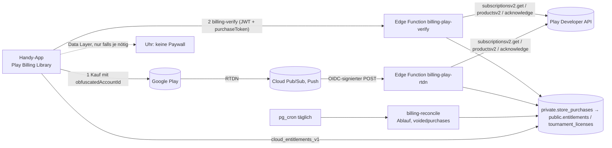

# Plan Pro: Pro-Statistik, Paywall und gemeinsame Abrechnung

> Status: Entwurf 2026-11-04 · Bezug: [PLAN §1 Freemium](PLAN.md), [04 §6/§7.3](04-ux-design.md),
> [06 §5/§7](06-marktanalyse.md), [01 §5.4](01-architektur.md), [03 §1.7/§3.3.6/§8](03-backend-datenmodell.md),
> [Veröffentlichungsplan](release/veroeffentlichungsplan.md), Nutzerentscheid „Gesundheitsdaten nur lokal“ (02.11.2026) ·
> Stand Code: `w12/plaene` auf Basis 0.6.3 (Build 16) · Turnierprodukte: [plan-turnier.md](plan-turnier.md) setzt auf §4 auf

## 1. Ziel und Abgrenzung kostenlos/Pro

**Ziel:** Ein kleines, ehrliches Pro-Abo, das nur **neue, tiefe Auswertungen über viele Matches** verkauft. Dazu eine
Abrechnungs- und Entitlement-Architektur, die Pro und später Turnierprodukte (Abo, Einmalkauf je Turnier) gleich behandelt.

**Grundsatz (PLAN §1, 06 §7):** Zählen, Undo, eigene Historie, Freunde und geteilte Matches sind immer kostenlos.
Zusätzlich gilt hier: **Nichts, was heute (0.6.3) kostenlos ist, wandert hinter die Paywall.** Pro bekommt nur Funktionen,
die es heute nicht gibt. Nach einer Kündigung bleiben alle eigenen Daten sichtbar und exportierbar. Nur die Pro-Ansichten
sperren sich wieder.

### 1.1 Free-Garantie: bleibt kostenlos (Stand 0.6.3)

| Bereich | Heute vorhanden, bleibt frei |
|---|---|
| Zählen | Alle 5 Sportarten und Presets, Handy und Uhr, Undo, Director, Übergabe, mehrere Matches parallel, Aufschlag-Erfassung, Satzende-Dialog |
| Verlauf | Unbegrenzt, Filter nach Sport, Gegner/Partner, Person und Name, Gruppierung nach Woche/Monat, Löschen, Ergebnis-Korrektur |
| Match-Detail | Ergebnis, Satzverlauf, Spielverlauf mit Highlights und Pulskurve, Game-Historie, Aufschlag-/Return-/Break-/Satzball-/Entscheidungspunkt-Kennzahlen je Match, Share-Card |
| Lokale Bilanz (H2H) | „Gegen X“ und „Mit X“: Siege/Niederlagen/Unentschieden und die letzten 5 Ergebnisse (`headToHead`, `HeadToHeadScreen`) |
| Startseite | „Letzte 7 Tage“ (Matches, Siege, Spielzeit), „Gesamtstatistik“ (Matches, gewonnene Games, höchster Puls, meiste Schritte in einem Satz) |
| Gesundheit | Puls/Schritte live, Pulsverlauf aufzeichnen, Pulskurve je Match, Export/Import der Pulsverläufe (JSON) |
| Konto/Cloud | Konto, Cloud-Sicherung, Freunde, Feed, geteilte Matches, Live, Zuschauer, Push, Gast mit Freund verknüpfen |
| Export | Kontodaten-Export (ZIP mit JSON + CSV, Art. 15/20 DSGVO), Kontodaten als JSON |
| Uhr | Alles auf der Uhr, auch die Kurzbilanz nach dem Match |
| Erfassung | Belag, Halle/Draußen und künftig Ort (§3.3). **Erfassen ist immer frei**, nur die Auswertung darüber ist Pro |

Die Tabelle wird als Test festgeschrieben (§8.1, `FreeFeatureGuardTest`).

### 1.2 Pro („Advantly Pro“, Empfehlung)

1. **H2H-Analyse:** Die Bilanz gegen eine Person, aufgeschlüsselt und über die Zeit (§3.1). Die Bilanz selbst bleibt frei.
2. **Partner-Analyse für Doppel** (§3.2).
3. **Belag-, Umgebungs- und Ort-Auswertung** (§3.3).
4. **Satz- und Momentum-Trends** über Wochen und Monate (§3.4).
5. **Health-Trends**, nur lokal berechnet (§3.5).
6. **Statistikbericht als PDF/CSV** für Zeitraum, Person oder Trainer (§3.6). Der Rohdaten-Export bleibt frei.

Nicht Pro (bewusst): unbegrenzter Verlauf, eigene Presets, Themes, Punktdetails beim Zählen. Die ersten drei Kandidaten aus
04 §7.3 sind heute schon frei bzw. betreffen das Zählen. Komplikationen auf der Uhr sind kein Thema für Pro, weil die Uhr
paywallfrei bleibt.

**Turnier:** Turnierprodukte (Turnier-Pass je Turnier, optional Club-Abo) sind eigene Produkte auf derselben Architektur
(§4.2/§4.3). Grenzen und Preise legt `plan-turnier.md` fest. Dort wird auch vorgeschlagen, dass ein aktives Pro größere
Turniere freischaltet. Technisch ist das nur eine Katalogzeile bzw. eine Regel im Server. Heute gibt es keine Turnier-UI, nur das Schema (`tournaments`, `tournament_courts`,
`tournament_staff`). Damit wird nichts Kostenloses nachträglich gesperrt.

## 2. Bestand Statistik

### 2.1 Auswertungen im Code

| Auswertung | Code | Daten | Ort |
|---|---|---|---|
| Kennzahlen je Match (Aufschlag, Return, Breaks, Satzbälle, Entscheidungspunkte, Netto-Spielzeit) | `presentation/stats/MatchStatistics.kt` (`MatchStats`, Replay über `pointHistory`) | Event-Log des Matches | Handy, lokal |
| Spielverlauf, Highlights, Zeitleiste | `MatchProgression.kt`, `MatchCourse.kt`, `MatchTimeline.kt`, UI `result/*` | Event-Log und Wanduhr | Handy, lokal |
| Pulskurve, Ø/Max, Schritte je Satz | `HealthTracks.kt`, `MatchCourse.pulseSummary`, `HealthRepository` | `HealthSeries` (5-s-Raster) | Handy und Uhr, **nur lokal** |
| Verlauf, Filter, Woche/Monat | `MatchHistory.kt` (`filterHistory`, `groupHistory`), `history/HistoryScreen.kt` | `MatchSummary` (ohne Replay) | Handy, lokal |
| Lokale Bilanz gegen/mit Person | `headToHead(…)`, `history/HeadToHeadScreen.kt` (Titel „Lokale Bilanz“) | `MatchSummary`, aufgelöste `PlayerId`s | Handy, lokal |
| Letzte 7 Tage, Gesamtstatistik | `home/HomeScreen.kt` (`WeekSummary`, `TotalSummary`, `gamesWon`) | `MatchSummary`, Health-Rekorde | Handy, lokal |
| Kurzbilanz nach dem Match | Wear `WatchState`, watchApp | laufende Session | Uhr |

### 2.2 Wo die Daten liegen

- **Matches** (Header, Lineup, Meta mit `surface`/`environment`/`venue`, Event-Log) liegen lokal in SQLDelight
  (`match_header`, Event-Store). Seit 0.3 werden sie automatisch in die Cloud gesichert (`public.matches.meta` jsonb,
  `match_events`, `match_participants`). Matches von Freunden, in denen ich eingetragen bin, kommen über den Pull in die
  lokale Replik (`replica_readable_match`). **Die lokale DB hat also alle eigenen Matches.** Pro-Auswertungen brauchen
  keine Server-Abfrage.
- **Gesundheitsdaten** liegen nur auf Uhr und Handy (`HealthRepository`). Sie gehen bei Gerätewechsel verloren, außer
  bei manuellem Export/Import. In der Cloud steht je Match nur, ob die Aufzeichnung gewählt war.
- **Server-Statistik** gibt es nicht. `match_sets` und `player_match_results` aus 03 sind nicht umgesetzt (03 A16).
  Das bleibt so.
- **Entitlements** (Migration `20261015000200`): Tabelle `public.entitlements (profile_id, entitlement, source, product_id,
  expires_at, updated_at)`, `source in ('app_store','play_store','promotional')`. RLS lesen nur eigene, mit
  `cloud_binding_required`. Schreiben kann nur `service_role`. Sie ist im Kontoexport enthalten (`export-my-data`, Feld
  `entitlements`). Der Kommentar „nur RevenueCat-Webhook“ ist überholt (§4.1).
- **Modul `shared/entitlements`** ist ein Platzhalter (`EntitlementsInfo`) ohne Logik und ohne Abhängigkeiten.

### 2.3 Lücken, die Pro vorher schließen muss

1. **Perspektive:** `MatchSummary.outcome()` und alle Kennzahlen setzen voraus, dass Seite A das eigene Team ist
   (`MatchPorts.kt`: „Side A ist immer das Team des Geräte-Besitzers“). Bei Matches, die ein Freund angelegt hat und in
   denen ich in Team B stehe, ist das **zu prüfen**. Wenn die Replik nicht spiegelt, werden diese Matches heute schon falsch
   gezählt. Das ist ein eigener Fix für alle (frei) und Voraussetzung für §3.1/§3.2.
2. **Ort:** `MatchMeta.venue` existiert, wird aber nirgends eingegeben. Belag gibt es nur bei Tennis im Handy-Assistenten,
   Halle/Draußen bei allen Sportarten. Die Uhr erfasst keinen Belag (§3.3).
3. **Rechenaufwand:** `MatchStats` entsteht je Match per Replay (`MatchStatisticsCache` nur im Speicher). Für Trends über
   Hunderte Matches braucht es einen abgeleiteten lokalen Kennzahlen-Cache (§3.4).

## 3. Pro-Funktionen im Detail

Alle Pro-Auswertungen rechnet **das Handy lokal**. Grundlage sind lokale Matches, Events und Health-Serien. Der Server
liefert nur die Berechtigung. Das passt zu „Gesundheit nur lokal“, funktioniert offline und belastet Supabase Free nicht.

**Gemeinsamer Unterbau (neu, frei nutzbar für alle Anzeigen):**
- Lokale Tabelle `match_stats_cache` (abgeleitet, jederzeit neu aufbaubar) je Match und `eventCount`, z. B. Punkte/Games/Sätze
  je Seite, Aufschlag-/Return-Quoten, Breaks, Tiebreaks, Entscheidungssatz, längste Serie und Führungswechsel.
  Sie wird nach Matchende bzw. Korrektur aktualisiert und beim ersten Start einmal im Hintergrund nachgebaut.
- Reine Aggregationsfunktionen in `presentation/stats` mit injiziertem Kalender wie `groupHistory`.
- **Mindestgrößen:** Unter 3 Matches zeigt eine Auswertung „Zu wenige Matches“ statt Prozentwerten. So entstehen keine
  Scheintrends.

### 3.1 H2H-Analyse über viele Matches

- **Frei bleibt:** Bilanz S/N/U und die letzten 5 Ergebnisse gegen bzw. mit einer Person.
- **Pro:**
  - Aufteilung nach Sport, Belag, Halle/Draußen und Ort.
  - Sätze, Games und Punkte gesamt, Tiebreak-Bilanz, Entscheidungssätze.
  - Formkurve über die Zeit und längste Sieg-/Niederlagenserie.
  - Aufschlag- und Breakball-Quoten gegen diese Person.
  - Vergleich „gegen X“ mit dem eigenen Durchschnitt.
- **Daten:** `MatchSummary` plus `match_stats_cache`. Identität über `PlayerId`, Freunde über ihr Konto.
  Zusammenführung Gast → Freund läuft über die vorhandene Zuweisung (`assign_player`, 0.6.3 §3.5).
- **Neue Erfassung:** keine. Voraussetzung ist der Perspektiven-Fix (§2.3).
- **Berechnung:** auf dem Gerät.
- **Gesundheit:** keine Health-Daten. Puls gegen eine Person läuft nur über §3.5.

### 3.2 Partner-Analyse für Doppel

- **Frei bleibt:** „Mit X“-Bilanz.
- **Pro:**
  - Rangliste der Partner nach Siegquote (ab 3 Matches).
  - Partner × Gegnerpaar.
  - Team-Aufschlagquoten und Breakverwertung je Partner.
  - Entscheidungspunkte (Golden/Star Point) je Partner.
  - Formverlauf je Partner.
- **Daten:** Lineup (Team, Position), `match_stats_cache`, Aufschläger je Punkt (`servers` in `MatchStats`).
  Die Lineup-Position ist **keine** Spielfeldseite (Vorhand/Rückhand). Eine Seitenanalyse bräuchte neue Erfassung und ist
  nicht Teil des Plans.
- **Neue Erfassung:** keine.
- **Berechnung:** auf dem Gerät.
- **Gesundheit:** keine.

### 3.3 Belag und Ort

**Bestand (geprüft):**

| Feld | Modell | Erfassung heute | Cloud |
|---|---|---|---|
| `surface` (8 Werte) | `MatchMeta` | nur Tennis, Handy-Assistent Schritt „Belag“ (5 Kacheln) | in `matches.meta` |
| `environment` (Halle/Draußen) | `MatchMeta` | alle Sportarten am Handy; Uhr setzt bei Badminton „Halle“ | in `matches.meta` |
| `venue` (Freitext) | `MatchMeta` | **keine UI** (nur Test) | würde in `matches.meta` mitgehen |

**Neue Erfassung (frei, vor Pro bauen):**
- Feld „Ort“ im Assistenten-Schritt „Belag/Umgebung“ (optional). Vorschläge aus den letzten eigenen Orten (lokale
  Liste), kein GPS und keine Standortberechtigung (04 §7.2).
- Belag auch für Padel (Kunstrasen/Sonstiges), Pickleball und Badminton nur Halle/Draußen. „Wie letztes Mal“ übernimmt
  Belag, Umgebung und Ort.
- Nachträglich im Match-Detail ändern (`MatchRepository.updateMeta` existiert).
- Uhr: nichts Neues. Uhr-Matches erben Belag/Ort aus „Wie letztes Mal“ bzw. werden am Handy ergänzt.
- Ortsnamen normalisieren (Trimmen, Groß/Klein) für die Gruppierung, ohne Geocoding.

**Pro:**
- Siegquote, Punkte-% und Aufschlagquoten je Belag, Halle/Draußen und Ort.
- „Lieblingsplatz“, Heim/Auswärts-Bilanz.
- Filter des Verlaufs nach Belag/Ort (04 §2.1 sieht einen Belag-Filter vor; der fehlt heute, ist also neu).

**Daten:** Meta lokal. **Berechnung:** auf dem Gerät.

**Datenschutz:**
- Der Ort ist personenbezogen (Aufenthaltsmuster). Die Datenschutzerklärung nennt den „optional eingegebenen Ort“ schon
  (§3.1, §4.2), das Upload-Format ebenfalls.
- Offen ist, ob Freunde und Zuschauer den Ort sehen (§9 E8). Empfehlung: Der Ort bleibt in geteilten Ansichten
  ausgeblendet.

**Gesundheit:** keine.

### 3.4 Satz- und Momentum-Trends

- **Frei bleibt:** Spielverlauf und Highlights je Match, 7-Tage- und Gesamt-Kacheln.
- **Pro:** Verläufe über Wochen und Monate (04 §6, Profil-Diagramme), getrennte Diagramme ohne Doppelachsen:
  - Siegquote je Monat, Punkte-% (Linie), 1.-Aufschlag-Quote und Doppelfehler je Match.
  - Bilanz nach Satz 1 gewonnen/verloren (Comeback-Quote).
  - Tiebreak- und Entscheidungssatz-Bilanz, Breakverwertung und abgewehrte Breakbälle.
  - Ø Führungswechsel und längste Punkteserie.
  - Rally-Sportarten: Side-Out-Quote (Pickleball), Satzbälle; Padel: Golden-/Star-Point-Bilanz.
  - Jede Grafik hat eine Tabellenansicht.
- **Daten:** `match_stats_cache` und Zeitstempel.
- **Neue Erfassung:** keine.
- **Berechnung:** auf dem Gerät.
- **Gesundheit:** keine.

### 3.5 Health-Trends (nur lokal)

- **Pro:**
  - Ø- und Max-Puls je Match im Zeitverlauf.
  - Belastung je Sport und je Satz, Schritte je Match/Satz im Trend.
  - Zeit in Zonen, wenn der Nutzer eine Maximalfrequenz einträgt. Sonst gilt der beobachtete Höchstwert. Der Wert bleibt
    **nur lokal** als Einstellung, ohne Alter oder Geburtsdatum.
  - Beschreibende Gegenüberstellung „Puls in gewonnenen vs. verlorenen Sätzen“.
  - Keine Gesundheits- oder Leistungsdiagnose, kein Medizinprodukt (Nutzungsbedingungen §7, 06 §6 Punkt 5).
- **Daten:** `HealthSeries` der Matches mit Aufzeichnung (`pulseVisibility ≠ OFF`) auf diesem Handy.
- **Neue Erfassung:** keine.
- **Berechnung:** **nur auf dem Handy.**
  - Keine Aggregate in die Cloud, keine Server-Funktion, kein Upload von Trendwerten.
  - Die Entitlement-Prüfung kennt keine Health-Daten.
  - Die Uhr zeigt keine Trends.
- **Zu „Gesundheit nur lokal“:**
  - Nach Gerätewechsel beginnen die Trends neu, außer der Nutzer importiert seine Pulsdatei. Das sagt die Ansicht offen
    („Trends aus N Matches auf diesem Handy“).
  - Bereits die Paywall-Vorschau nutzt keine echten Health-Werte, sondern Beispieldaten.
- **Rechtlich:** Die Auswertung über mehrere Matches ist eine neue Darstellung bereits eingewilligter Daten. Die
  Datenschutzerklärung §3.4 nennt heute nur Werte „im Match“. Sie bekommt einen Satz zu Auswertungen über mehrere Matches.
  Das ergibt eine neue PRIVACY-Fassung und eine erneute Bestätigung (§6). Die Erklärung „Health apps“ in der Play Console
  um die Trendansicht ergänzen.

### 3.6 Export

- **Frei bleibt:** Kontodaten-ZIP (JSON + CSV, Pflicht nach Art. 15/20 DSGVO), Pulsexport (JSON), Share-Card.
- **Pro:** „Statistikbericht“ als PDF und CSV der **Auswertungen** (nicht der Rohdaten):
  - Zeitraum/Saison, H2H gegen eine Person, Partnerbericht, z. B. für Trainer oder Verein.
  - Health-Teile nur nach ausdrücklicher Wahl je Export, mit demselben Warnhinweis wie beim Pulsexport.
- **Berechnung:** auf dem Gerät. PDF über die Plattform (Android `PdfDocument`, iOS `UIGraphicsPDFRenderer`) per
  `expect/actual` in `ui-phone`. Teilen über das System-Teilen-Menü, kein Upload.
- **Gesundheit:** Die Datei verlässt das Gerät nur durch den Nutzer selbst.

## 4. Abrechnung und Entitlements (gemeinsam für Pro und Turnier)

### 4.1 Architekturentscheidung

**Direkte Store-Anbindung mit eigener Serverprüfung in Supabase, ohne RevenueCat** (Empfehlung, §9 E1).

| | Direkt (Play Billing + Edge Functions) | RevenueCat |
|---|---|---|
| Datenschutz | keine weitere Stelle; nur Google/Apple als Zahlungsanbieter | zusätzlicher US-Auftragsverarbeiter, neue Fassung von Datenschutzerklärung und AVV |
| Kosten | 0 € (Edge Functions im Free-Kontingent) | frei bis 2.500 $ MTR, danach 1 % (03 §1.7, Drittquelle) |
| Aufwand | Play: mittel; Apple später: mittel | gering, Paywall-Werkzeuge inklusive |
| Kontrolle | volle Kontrolle über Turnier-Bindung und Kontowechsel | Turnier-Einmalkäufe je Turnier über Metadaten möglich, aber umständlicher |

Kommentar in `20261015000200` und 03 §1.7/§3.3.6/§8 („RevenueCat-Webhook“, `ops.revenuecat_events`) werden bei der
Umsetzung angepasst. Hier wird das nur vermerkt, keine Dokuänderung in diesem Plan.

### 4.2 Datenmodell (Migrationen, Vorschlag)

- **`private.billing_products`** ist der Produktkatalog. Er macht Pro und Turnier allgemein:
  `product_id`, `store` (`play_store`/`app_store`), `kind` (`subscription`/`one_time`), `grant_key` (z. B. `pro`,
  `tournament_host`, `tournament_pass`), `scope` (`account`/`tournament`), `limits jsonb` (z. B. `{"max_courts":8}`,
  Turnierplan), `active`.
  Neue Produkte entstehen als Katalogzeile ohne Codeänderung.
- **`private.store_purchases`** ist die Wahrheit aus dem Store, eine Zeile je Kauf:
  - `store`, `purchase_token_hash` (SHA-256, eindeutig), `purchase_token` (verschlüsselt im Vault bzw. nur `service_role`,
    wird für API-Aufrufe gebraucht), `linked_purchase_token_hash`, `order_id`, `product_id`, `profile_id`.
  - Bei Turnierkauf zusätzlich `scope_id`.
  - `state` (`active`, `grace`, `on_hold`, `paused`, `canceled` = läuft bis Ablauf, `expired`, `revoked`, `pending`),
    `expires_at`, `auto_renewing`, `acknowledged`, `test_purchase`, `raw_latest jsonb`, `updated_at`.
- **`private.store_notifications`** dient der Idempotenz: `message_id` (Pub/Sub) bzw. `notificationUUID` (Apple) als PK,
  dazu `received_at`, `processed_at`, `error`. Bereinigung nach 13 Monaten (03 §8.1: Laufzeit + 13 Monate).
- **`public.entitlements`** bleibt die **lesbare Projektion je Konto** und wird erweitert:
  - `status` (`active`/`grace`/`on_hold`/`expired`/`revoked`), `limits jsonb`, `will_renew boolean`.
  - `source` bleibt unverändert: Die Testphase ist ein Store-Angebot (`play_store`), Pilot-Promo ist `promotional`.
  - Wird ausschließlich aus `store_purchases` bzw. Promo-Einträgen abgeleitet (Funktion `private.recompute_entitlements(profile)`).
- **Turnier:** Einmalkäufe gelten für ein **Turnier**, nicht für ein Konto. Dafür kommt die Tabelle
  `public.tournament_licenses (tournament_id PK, grant_key, limits, purchase_id, granted_by, created_at)` dazu. Lesen dürfen
  alle `tournament_staff` des Turniers, schreiben nur `service_role`. Legt `plan-turnier.md` die Stufe als Spalten am
  Turnier ab (`tier*`), gilt dieselbe Regel; die Tabelle entfällt dann. Die Grenzen prüft der **Server** in den Turnier-RPCs
  (z. B. Anzahl Plätze), nicht nur der Client. Felder, Stufen und Grenzen legt `plan-turnier.md` fest. Dieser Plan liefert
  Katalog, Kaufprüfung und Projektion.
- **RPC `cloud_entitlements_v1()`**: eigene Konto-Entitlements plus Serverzeit, im Muster der übrigen `cloud_*_v1`
  (Binding, Versionssperre). Der Kontoexport enthält weiterhin `entitlements`, ab jetzt ohne Tokens.
- **Admin:** `ops`-Funktionen mit Audit für Support: Promo vergeben/entziehen, Kauf einem Konto neu zuordnen (§4.5).

### 4.3 Google Play Billing (zuerst)

- **Bibliothek:**
  - Play Billing Library **8 oder neuer**. Seit 31.08.2026 brauchen neue Apps und Updates mindestens Version 8;
    Verlängerungen waren bis 01.11.2026 möglich.
  - Nur im `androidApp` (Activity für `launchBillingFlow`) hinter einem Port `StoreBilling` (Produkte laden, kaufen,
    eigene Käufe abfragen, Abo-Verwaltung öffnen). Der Port liegt in `presentation`, damit `ui-phone` ihn nutzen kann und
    iOS ihn später implementiert.
- **Produkte:**
  - Abo `pro` mit zwei Base Plans `monthly` (3,99 €) und `yearly` (29,99 €), je mit Angebot `trial-14d` (§5.2).
  - Pause **aus**. Grace Period aktiv (Standard ist an), Account Hold Standard (60 Tage minus Grace Period).
  - Turnier: einmalige, verbrauchbare Produkte je Stufe (`tournament_pass_*`) und optional ein Veranstalter-Abo
    (`tournament_host`). Stufen bestimmt `plan-turnier.md`.
- **Kaufablauf:**
  1. Die App setzt `obfuscatedAccountId = HMAC-SHA256(profile_id, server_secret)` (hex, ≤ 64 Zeichen). Den Wert holt sie
     vorab per RPC. Google bekommt so keine direkte Konto-ID.
  2. Nach `PURCHASED` sendet die App `purchaseToken`, `productId` und bei Turnier die `tournament_id` an
     `billing-play-verify`. Bei `PENDING` (z. B. Barzahlung) zeigt sie „Zahlung ausstehend“ und schaltet nichts frei.
  3. Der Server ruft `purchases.subscriptionsv2.get` bzw. für Einmalkäufe die Produkt-API auf.
     - Er prüft Paket, Produkt, Zustand, `obfuscatedExternalAccountId` und `linkedPurchaseToken` (Upgrade/Wiederkauf:
       altes Token ablösen).
     - Danach schreibt er `store_purchases`, berechnet die Entitlements neu und **bestätigt (acknowledge) serverseitig**.
     - Ohne Bestätigung innerhalb von 3 Tagen erstattet Google automatisch.
     - Turnierpässe bindet er genau einmal an ein Turnier und verbraucht (consume) sie danach.
     - Scheitert die Bindung, bleibt der Kauf unbestätigt, und Google erstattet nach 3 Tagen. Der Nutzer verliert also
       kein Geld.
  4. Die App lädt `cloud_entitlements_v1` neu. Die Freischaltung ist sichtbar, sobald der Server zustimmt.
- **RTDN:**
  - Pub/Sub-Thema im Google-Cloud-Projekt der App, Push-Abo auf die Edge Function `billing-play-rtdn` mit
    **OIDC-Token** (Audience = Funktions-URL, wird geprüft).
  - Jede Nachricht: Typ lesen, Zustand **immer** frisch über die API holen (die Nachricht ist nur ein Anstoß), idempotent
    über `message_id`. 200 erst nach dem Commit.
  - Verarbeitet werden `SUBSCRIPTION_PURCHASED/RENEWED/RECOVERED/RESTARTED/IN_GRACE_PERIOD/ON_HOLD/CANCELED/EXPIRED/REVOKED/PENDING_PURCHASE_CANCELED`,
    `ONE_TIME_PRODUCT_PURCHASED/CANCELED` und `voidedPurchaseNotification`.
- **Abgleich:** `billing-reconcile` (pg_cron, täglich):
  - Prüft Käufe mit `expires_at` in den nächsten/letzten 48 h und `pending` nach.
  - Liest `voidedpurchases.list` (Erstattungen und Rückbuchungen) und entzieht entsprechend.
  - Deckt Ausfälle ab, etwa wenn Supabase Free pausiert und Pub/Sub nur begrenzt wiederholt.
- **Zugang:**
  - Eigenes Dienstkonto `play-billing` mit Play-Console-Rechten „Finanzdaten ansehen“ und „Bestellungen und Abos
    verwalten“, nur für die App Advantly.
  - Getrennt vom Upload-Dienstkonto des Veröffentlichungsplans.
  - Secret `PLAY_BILLING_SERVICE_ACCOUNT_JSON` als Function-Secret (Dashboard, wie `FCM_SERVICE_ACCOUNT_JSON`).
- **Gebühren:** In EWR/UK/US gilt seit 30.06.2026 für Auto-Abos 10 % Servicegebühr + 5 % Billing-Gebühr. Für andere
  Käufe (z. B. Turnierpass) bei Neuinstallationen 20 % + 5 %. Externe Angebote und alternatives Billing sind im EWR möglich,
  lohnen sich bei dieser Größe aber nicht (§9 E2).

### 4.4 Apple (später, StoreKit 2)

- Erst mit Apple-Developer-Account und iOS-Release (PLAN §4). Dieselben Produkte und Kataloge, `store = app_store`.
- StoreKit 2 im Swift-Host (`iosApp`) implementiert `StoreBilling`. `appAccountToken` = eigene zufällige UUID je Konto
  (`billing_account_token`, serverseitig), nicht die Profil-ID.
- Server:
  - Edge Function `billing-apple-notify` für App Store Server Notifications V2 (JWS mit Apple-Zertifikatskette prüfen).
  - Prüfung über die App Store Server API.
  - Gleiches Schreiben in `store_purchases`.
- „Käufe wiederherstellen“ ist Pflicht (Guideline 3.1.1). Abos dauern mindestens 7 Tage und gelten auf allen Geräten
  (3.1.2). Bei Pro trifft beides zu.
- **Plattformübergreifend:** Ein auf Android gekauftes Pro gilt auch auf dem iPhone, wenn Pro dort ebenfalls als IAP
  angeboten wird (Guideline 3.1.3(b)). Hat das Konto schon Pro über Google, zeigt iOS statt der Paywall „Aktiv über
  Google Play“. Umgekehrt gilt dasselbe. So entstehen keine Doppelabos.
- **EU-Konditionen** (neue Apple-EU-Bedingungen seit 01.10.2026):
  - App-Store-IAP 26 % Standard bzw. 15 % u. a. im Small Business Program.
  - Auto-Abos nach dem ersten Jahr 15 %.
  - Alternative Zahlung 20 %/10 %, Link-out 15 %/10 %, CTC 5 % außerhalb des App Store.
  - Empfehlung: StoreKit-IAP mit Small Business Program, keine alternative Zahlung.
- watchOS: keine Käufe, keine Paywall.

### 4.5 Wiederherstellen, Kontowechsel, mehrere Geräte, Uhr

- **Bindung:** Ein Kauf gehört dem Advantly-Konto, mit dem er gekauft wurde. Pro gilt kontoweit auf allen Handys des
  Kontos (Android und später iOS).
- **Wiederherstellen:**
  - Beim Start, bei Anmeldung und per Knopf „Käufe wiederherstellen“ fragt die App `queryPurchasesAsync` ab und schickt
    unbekannte Tokens an `billing-play-verify`.
  - Neuinstallation und neues Handy funktionieren so ohne Support.
- **Kontowechsel auf demselben Google-Konto:**
  - Meldet sich ein anderes Advantly-Konto an und Play liefert ein Abo, das einem anderen Konto gehört, schaltet der Server
    **nicht** frei.
  - Die App erklärt: „Dieses Abo gehört zu einem anderen Advantly-Konto. Melde dich mit diesem an oder schreib dem Support.“
  - Der Support kann im Admin-Tool mit Audit umhängen (z. B. nach versehentlicher Registrierung).
  - Kein automatisches Umhängen: Ein Familienhandy mit zwei Konten bekäme sonst zwei Pros für ein Abo.
- **Abmelden:** Der Cache wird mit dem Konto verworfen (wie die übrigen kontobezogenen Daten).
- **Offline und Ausfall:**
  - Die App speichert die letzte Antwort (`entitlements` + Serverzeit) lokal.
  - Pro bleibt bis `expires_at` + **72 h** offen, ohne Serverkontakt.
  - Danach sperren sich die Pro-Ansichten, die Daten bleiben vollständig.
  - Serverfehler sperren nie sofort.
  - Lokale Freischaltung ist manipulierbar (modifizierte APK). Das wird für reine Lokal-Auswertungen bewusst in Kauf
    genommen. Turniergrenzen prüft dagegen der Server.
- **Uhr:**
  - Keine Paywall, keine Käufe, keine Pro-Funktionen.
  - Die Wear-App bleibt ohne Internet.
  - Sollte die Uhr je eine Pro-Ansicht bekommen, überträgt das Handy nur das Flag `pro_until` per Data Layer, nie Kaufdaten.
- **Kontolöschung:**
  - Das Abo bei Google läuft sonst weiter. Der Löschdialog warnt deshalb bei aktivem Abo und verlinkt die Kündigung.
  - Bei der **endgültigen** Löschung (nach 14 Tagen) kündigt der Server das Abo zum Laufzeitende über die API, ohne
    Erstattung.
  - `entitlements` wird per Kaskade gelöscht. `store_purchases` bleibt mit gehashtem Bezug bis 13 Monate (Streitfälle,
    Erstattungen).
  - Der Kontoexport enthält Produkt, Status und Ablauf.

### 4.6 Testkäufe und Lizenztester

- In der Play Console unter „Lizenztests“ das eigene Konto und den Pilot-Tester eintragen. Testkäufe laufen mit
  Testkarten („immer genehmigt“ bzw. „immer abgelehnt“) **im internen Track**. Dafür braucht es weder Produktion noch
  geschlossenen Test.
- Test-Abos verlängern sich verkürzt (Minuten statt Monate). Damit lassen sich Grace Period, Account Hold, Kündigung und
  Ablauf in Minuten durchspielen. `test_purchase` (`purchaseType = TEST`) markieren. Testkäufe zählen nie in Statistiken.
- Staging: gleiche Edge Functions, eigenes Pub/Sub-Thema. Ein Produktions-Supabase gibt es noch nicht (Staging ist die
  einzige Umgebung).
- Turnierpass mit Bindungsfehler gezielt testen (keine Bestätigung → Erstattung nach 3 Tagen).

### 4.7 Kündigung, Zahlungsverzug, Grace Period, Erstattung

| Ereignis (Play) | Zustand | Pro? | App-Hinweis |
|---|---|---|---|
| `CANCELED` (Nutzer kündigt) | `canceled`, läuft bis `expiryTime` | ja, bis Ablauf | „Pro endet am …“ + „Wieder aktivieren“ |
| `IN_GRACE_PERIOD` | `grace` | ja | „Zahlung fehlgeschlagen – bitte in Google Play aktualisieren“ (Deep Link) |
| `ON_HOLD` | `on_hold` | **nein** | gleicher Hinweis, Pro gesperrt, Daten bleiben |
| `RECOVERED`/`RESTARTED` | `active` | ja | – |
| `EXPIRED` | `expired` | nein | einmaliger, schließbarer Hinweis |
| `REVOKED`, Voided Purchase (Erstattung/Rückbuchung) | `revoked` | nein, sofort | kein Vorwurf, neutraler Text |
| Turnierpass erstattet | Lizenz entzogen | – | Turnier fällt auf Gratisgrenze; **laufende Matches werden nie abgebrochen**, nur Neuanlage über der Grenze gesperrt (Abstimmung `plan-turnier.md`) |

Erstattungen wickelt Google ab (eigene Richtlinie). Kulanzerstattungen gibt der Support über die Play Console
(Bestellverwaltung), der Server sieht sie über RTDN und den Abgleich.

### 4.8 Steuern und Zahlungsabwicklung

- **Merchant of Record:** In AT, DE und LI (und dem übrigen EWR, UK) ist **Google** Merchant of Record und führt die
  Umsatzsteuer an die Endkunden ab. In der **Schweiz nicht**: Dort ist der Entwickler Merchant of Record und selbst für
  Transaktionssteuern verantwortlich. Empfehlung: Pro zunächst nur in AT/DE/LI anbieten (Base-Plan-Verfügbarkeit je Land),
  CH erst nach steuerlicher Klärung (§9 E5).
- **Ertragsseite (AT):**
  - Die Auszahlung von Google ist Einkommen.
  - Umsatzsteuerlich liegt eine Leistung an eine Google-Gesellschaft in Irland vor (Reverse-Charge-Konstellation).
  - Die österreichische Kleinunternehmergrenze liegt seit 2025 bei 55.000 € brutto (Toleranz 10 %).
  - Fragen für die Steuerberatung: UID-Nummer, Zusammenfassende Meldung, Behandlung der Google-Gebühr, Gewerbe/SVS,
    Einkommensteuer.
  - Vor dem ersten Verkauf klären. **Kein Code.**
- Rechnungen an Endkunden stellt Google aus. Advantly speichert keine Zahlungsdaten (Karte, IBAN) und sieht sie nie.

## 5. Paywall-UX

### 5.1 Wo und wann

- **Nur am Handy, nur durch eigenes Antippen:**
  - Pro-Bereiche tragen ein kleines „Pro“-Abzeichen: Abschnitt „Mehr Auswertungen“ unter der lokalen Bilanz, Tab/Karte
    „Trends“ im Profil, Belag-/Ort-Filter, Partner-Rangliste, „Bericht erstellen“.
  - Ein Tipp öffnet das Paywall-Sheet (04 §7.3). Dazu gibt es den Eintrag „Advantly Pro“ unter Profil.
- **Nie:**
  - beim App-Start, während eines Matches oder Live-Ansicht, auf der Uhr
  - im Satz- oder Matchende-Dialog, in Push-Nachrichten, per E-Mail
  - als nicht schließbares Overlay (vgl. DUPR-Kritik, 06 §5)
- **Einmaliger Hinweis:** frühestens nach dem 10. gewerteten Match eine schließbare Karte im Verlauf („Neu: Advantly Pro“).
  Nach „Schließen“ kommt sie nie wieder.
- **Vorschau:** Das Sheet zeigt die Pro-Ansicht mit **Beispieldaten** (nie echte Health-Werte) und je Auswertung eine echte
  Kennzahl aus den eigenen Matches als Appetithappen, z. B. „Deine Siegquote auf Sand: ?“.
- **Abbruch:** Das Sheet schließt sich mit X oben, Zurück-Geste oder „Weiter mit der kostenlosen Version“.
  Mehrfaches Tippen an derselben Stelle führt nie in einen Kauf (Play-Abo-Richtlinie).

### 5.2 Testphase

- **14 Tage kostenlos**, einmal je Google-Konto (Play prüft die Berechtigung), für Monats- und Jahresabo.
- Vor dem Start nennt das Sheet: Dauer, danach fälliger Preis und Datum, automatische Umwandlung, Kündigen bis zum Ende
  der Testphase kostet nichts, und wo man kündigt.
- 2 Tage vor Ende ein lokaler Hinweis in der App (keine Push-Pflicht): „Deine Testphase endet am …“.
- **Pilot-Tester:** Promo-Entitlement `pro` (`source = promotional`) bis 3 Monate nach dem Pro-Start, als Dank.
  Das Feature ist so von Anfang an als Pro gekennzeichnet und wird nie „weggenommen, was kostenlos war“ (§7.2).

### 5.3 Preise DE/EN

- Preise kommen immer aus `ProductDetails.formattedPrice` (lokalisiert, inkl. USt.), **nie hart im Code**. Die
  Texte haben Platzhalter in `strings.xml` DE/EN (`ui-phone` composeResources).

| Plan | DE | EN |
|---|---|---|
| Jahr (hervorgehoben) | „29,99 € pro Jahr“ · klein: „entspricht 2,50 € im Monat · 37 % günstiger als monatlich“ | “€29.99 per year” · small: “equals €2.50 per month · 37% less than monthly” |
| Monat | „3,99 € pro Monat“ | “€3.99 per month” |
| Test | „14 Tage kostenlos, danach 29,99 € pro Jahr“ | “14 days free, then €29.99 per year” |

- Jahrespreis groß, Monatsäquivalent nur klein (Play-Richtlinie: Jahrespläne nicht mit Monatspreis bewerben; 06 §5:
  „Jahresgesamtpreis offen“). Echte Monatsoption bleibt.
- Die Ersparnis berechnet die App aus beiden Preisen (3,99 × 12 = 47,88 €; 29,99/47,88 ≈ 63 % → 37 % günstiger),
  nicht als fester Text.

### 5.4 Pflichtangaben im Sheet (vor dem Kauf-Button)

- Leistung in 3–4 Punkten; der Satz „Zählen, Verlauf, Bilanz und Freunde bleiben kostenlos“.
- Preis inkl. USt. je Laufzeit, Gesamtpreis, Laufzeit, **automatische Verlängerung**, jederzeit zum Ende der Laufzeit
  kündbar, Testphase und Umwandlung.
- Kündigen: „In Google Play unter Abos oder in Advantly unter Profil → Advantly Pro → Abo kündigen.“
- Links: Nutzungsbedingungen (neue Fassung mit Abo-Klauseln, §6), Datenschutzerklärung, „Käufe wiederherstellen“.
- Kauf-Button eindeutig, z. B. „Jahresabo starten“ bzw. „Kostenlos testen“. Die verbindliche Bestellung erfolgt im
  Google-Bestellblatt.
- Unter Profil → „Advantly Pro“: Status, nächstes Abbuchungs- bzw. Enddatum, „Abo verwalten“ (Deep Link
  `https://play.google.com/store/account/subscriptions?sku=…&package=eu.advantly`), „Abo kündigen“, „Vertrag widerrufen“
  (§5.5), „Käufe wiederherstellen“.

### 5.5 Verbraucherrecht EU/AT/DE (vor Verkaufsstart anwaltlich prüfen)

- **Kündigungsbutton DE (§ 312k BGB):**
  - Pflicht für online abschließbare Dauerschuldverhältnisse.
  - Nach Rechtsprechung: ohne Login erreichbar (OLG Nürnberg 30.07.2024), direkter Weg ohne Halteangebote (BGH
    23.01.2025, I ZR 115/23).
  - Nach OLG Hamburg (26.09.2024) kommt es nicht darauf an, wer die Website betreibt.
  - Ob bei In-App-Abos über Google Play der App-Anbieter oder Google verpflichtet ist, ist **nicht höchstrichterlich
    geklärt**.
  - **Empfehlung (vorsorglich):**
    - In der App „Abo kündigen“ in Profil → Advantly Pro, direkt ohne Rückhalteschritte.
    - Auf der Website (ohne Login) `advantly.eu/abo-kuendigen.html` bzw. `en/cancel-subscription.html`. Dort ein Formular
      „Verträge hier kündigen“ mit Bestätigungsseite „Jetzt kündigen“: E-Mail des Kontos, Art der Kündigung, Zeitpunkt.
    - Eine Edge Function kündigt über die Play Developer API zum Laufzeitende und schickt eine Bestätigung in Textform per
      E-Mail (Resend, vorhanden).
    - Der Link steht im Footer jeder Seite.
- **Widerrufsfunktion (§ 356a BGB DE seit 19.06.2026; AT § 13a FAGG durch VerbRÄG 2026, Stichtag laut Quellen 19.06.
  bzw. 01.10.2026, im RIS prüfen):**
  - Gilt für online geschlossene Fernabsatzverträge, auch in Apps.
  - Empfehlung: Unter Profil → Advantly Pro „Vertrag widerrufen“ mit Bestätigungsschritt, solange eine Widerrufsfrist
    läuft. Wirkung: Kündigung plus Erstattungsantrag (Google-Erstattung bzw. Kulanzerstattung über die Console).
  - Gleicher Weg auf der Website-Seite.
- **Widerrufsrecht:**
  - Bei digitalen Dienstleistungen bleibt das 14-tägige Widerrufsrecht grundsätzlich bestehen, mit anteiligem Wertersatz
    bei ausdrücklichem Wunsch nach sofortigem Beginn.
  - Da Google in AT/DE/LI Merchant of Record ist, regeln Googles Bedingungen den Kaufvertrag. Die Nutzungsbedingungen
    müssen das Verhältnis klarstellen (§6).
  - Anwaltlich zu prüfen: Wer ist Vertragspartner für Belehrung, Button-Lösung (§ 312j BGB) und Widerruf?
- **Transparenz (§ 6 Abs. 3 KSchG, AGB-Kontrolle):** Laufzeit, Verlängerung und Kündigung klar und ohne „soweit zulässig“
  formulieren (wie bei den Nutzungsbedingungen 2).

## 6. Datenschutz und Play-Datensicherheit

- **Neue Daten:**
  - Kaufbezug: Produkt, Status, Ablauf, Bestellnummer, Purchase-Token (verschlüsselt/gehasht), Store, Testkauf-Flag,
    HMAC-Kennung an Google.
  - Bei Website-Kündigung die angegebene E-Mail und der Zeitpunkt.
  - **Keine** Zahlungsmittel, keine Adresse, kein Name von Google.
  - Rechtsgrundlage Art. 6 Abs. 1 lit. b DSGVO, Speicherdauer Laufzeit + 13 Monate (03 §8.1).
- **Empfänger:**
  - Google (Google Commerce Limited bzw. Google Ireland, Google LLC) wickelt Zahlung und Abo als **eigener
    Verantwortlicher** ab (Google-Bedingungen).
  - Wir übermitteln an Google nur die HMAC-Kennung und rufen über die Play Developer API Kaufstatus ab.
  - Google Cloud Pub/Sub liefert die Benachrichtigungen (Google als Dienstleister).
  - Später Apple (App Store) für iOS.
  - Kein RevenueCat (§4.1).
- **Datenschutzerklärung:**
  - Neuer Abschnitt „Advantly Pro und Käufe“ (Daten, Zweck, Empfänger, Dauer, Löschung, Kontolöschung kündigt das Abo).
  - §3.4 ergänzen um „Auswertungen über mehrere Matches, nur auf dem Handy“ (§3.5).
  - Wenn der Ort kommt, §3.1/§4.3 präzisieren (sichtbar für Freunde: nein, §9 E8).
  - Das ergibt eine **neue PRIVACY-Fassung** in `private.consent_versions`/`consent_translations`, `is_current` +
    `approved_at` im selben Release-Schritt. Danach mit `select * from private.consent_versions where is_current` prüfen.
    **Alle Konten bestätigen neu** (Regel seit 03.11.2026).
- **Nutzungsbedingungen:**
  - Neue **TERMS-Fassung 3** mit:
    - Kostenlose Leistung und Pro abgrenzen. §2 „Die Nutzung ist derzeit kostenlos“ ersetzen.
    - Abo-Klauseln: Vertragsschluss über Google Play/App Store, Preis, Laufzeit, automatische Verlängerung, Kündigung
      (App, Store, Website), Testphase, Preisänderungen nur mit Zustimmung über den Store, Widerruf und Erstattung,
      Verhalten bei Kontolöschung.
    - „Pro-Funktionen können sich weiterentwickeln, der Kernumfang laut Liste bleibt“.
    - Die Free-Garantie als Zusage, dass Zählen, Verlauf und Freunde kostenlos bleiben.
  - Neue Fassung heißt neue Bestätigung (wie PRIVACY). Englische Fassung synchron halten.
- **Play-Datensicherheit:**
  - „Finanzinformationen → Kaufverlauf: erhoben, nicht geteilt, Zweck App-Funktionen/Kontoverwaltung, Verschlüsselung bei
    Übertragung, löschbar mit Konto“.
  - Die Daten, die die Play Billing Library selbst an Google gibt, sind Googles Verarbeitung. Gegen die aktuelle Hilfe prüfen.
  - Gesundheitsangaben bleiben unverändert (Health-Trends lokal).
- **Weitere Console-Angaben:**
  - Store-Eintrag „Enthält In-App-Käufe“ (automatisch).
  - Händlerstatus (DSA) und öffentliche Kontaktangaben in der Console prüfen. Monetarisierung macht Advantly eindeutig zum
    Händler.
  - Impressum und `site/` bei Bedarf um UID ergänzen. Das ist Website-Arbeit mit eigenem Auftrag.

## 7. Voraussetzungen und Reihenfolge

### 7.1 Was „frühestens nach P3“ bedeutet

- **Stand heute:**
  - 0.6.3 ist nur im **internen Test** (Nutzer + 1 Tester).
  - Der geschlossene Test (Alpha) hat keine Tester.
  - Produktionszugang fehlt.
  - P3 ist nicht abgenommen: Puls-Zeitleiste ist da, aber Tracker-Import, DSFA-Abschluss, Puls-Qualität auf Pixel/Galaxy
    und Store-Texte stehen aus.
- **Reihenfolge (Empfehlung):**
  1. **Jetzt, ohne Kauf:** Free-Garantie, Gates, Ort-Erfassung, Kennzahlen-Cache, Perspektiven-Fix (§8.2 Phase A).
     Nützt sofort allen.
  2. **Pilot (12 × 14 Tage):** Pro-Funktionen (Phase B) mit Promo-Entitlement für Pilot-Tester, sichtbar als „Pro“.
     Gleichzeitig Abrechnung bauen und intern mit Lizenztestern testen (Phasen C–D).
  3. **Produktionszugang** beantragen, P3-Gate abnehmen.
  4. **Produktionsstart DACH ohne Paywall** (Veröffentlichungsplan C). Pro bleibt technisch vorhanden, aber nicht
     kaufbar; der Pro-Bereich zeigt „Bald verfügbar“, Promo-Konten nutzen ihn.
  5. **4–8 Wochen messen:** Wiederkehr, Matches je aktivem Nutzer, Nutzung der Pro-Vorschau (06 §7: Zahlungsbereitschaft
     vor Monetarisierung messen). Ohne Tracking: nur Server-Zählwerte (Anzahl Uploads/Konten), keine Analyse-SDKs.
  6. **Pro-Start** als Update in gestaffeltem Rollout (5 → 20 → 50 → 100 %). Zuerst AT/DE/LI.
  7. iOS mit StoreKit 2 nach Apple-Account und iOS-Release.
- **Folge:** Der frühste sinnvolle Pro-Verkauf liegt **4–8 Wochen nach dem Produktionsstart**. Der Produktionsstart liegt
  frühestens „T + 14 Tage + Review“ nach dem zwölften Pilot-Tester und nach dem P3-Gate. Ohne Kalenderversprechen
  (Veröffentlichungsplan §Zeitachse).

### 7.2 Play Console: Zahlungsprofil, Händlerkonto

- In-App-Produkte und Abos lassen sich erst anlegen, wenn ein **Zahlungsprofil (Payments profile, Händlerkonto)** mit der
  Console verknüpft ist. Bankkonto im Land des Profils (AT).
- Vorher: Rechtsform und Steuer klären (§4.8). Das Profil läuft auf die natürliche Person bzw. den Gewerbebetrieb des
  Anbieters. Name und Adresse sind ohnehin im Impressum.
- Produkte anlegen setzt ein hochgeladenes Bundle mit Billing-Bibliothek voraus (im internen Track genügt das). Produkte
  aktivieren, Base Plans veröffentlichen.
- Pub/Sub: Google-Cloud-Projekt (das Firebase-Projekt `advantly-8ebb7` kann es sein) mit Thema; in der Console unter
  Monetarisierungseinrichtung das Thema eintragen; Dienstkonto `google-play-developer-notifications@system.gserviceaccount.com`
  als Publisher berechtigen.

### 7.3 Muss der geschlossene Test (12 Tester × 14 Tage) vorher laufen?

- **Für Entwicklung und Testkäufe: nein.** Lizenztester kaufen im internen Track.
- **Für echte Verkäufe: ja, indirekt.** Echte Kunden erreicht nur der Produktions-Track. Den gibt es für private Konten,
  die nach dem 13.11.2023 erstellt wurden, erst nach 12 Testern × 14 Tagen ununterbrochenem Opt-in und dem Antrag. Im
  geschlossenen Test wären Käufe technisch möglich (echte Abbuchung), sind aber laut PLAN §1 vor P3 nicht vorgesehen.
  Empfehlung: im Pilot nur Promo, keine Verkäufe.

## 8. Tests, Phasen, Aufwand, Risiken

### 8.1 Tests

- **Free-Garantie:** `FreeFeatureGuardTest` (`entitlements`, commonTest): Jede Funktion aus §1.1 ist im Feature-Register
  `FREE`. Dazu UI-Tests (`desktopTest`) mit Konto ohne Pro: Verlauf, lokale Bilanz, Match-Detail, Startseiten-Kacheln
  und Exporte zeigen kein Schloss und öffnen kein Sheet.
- **Gates:** Reine Tests für `Gate.allows(feature, snapshot, now)`: aktiv, grace, on_hold, canceled vor/nach Ablauf,
  revoked, Offline-Toleranz 72 h, Uhrsprung (Serverzeit gegen Gerätezeit).
- **Statistik:** Regel-Tabellen für jede Aggregation (fester Kalender, Doppel/Einzel, Abbrüche zählen nie, Unentschieden,
  Mindestgrößen, Perspektive Team B). Property-Test: Cache-Neuaufbau ergibt dieselben Werte wie das Replay.
- **Health-Trends:** Kein Netzwerkaufruf in den Trend-Pfaden (Port-Fake ohne Cloud). Matches ohne Aufzeichnung fehlen
  sauber. Die Vorschau nutzt Beispieldaten.
- **Server:**
  - pgTAP: RLS (nur eigene Entitlements; Turnierlizenz nur für Staff), kein Schreibrecht für `authenticated`,
    `recompute_entitlements` für alle Zustände, Idempotenz doppelter Notifications, Umhängen nur über `ops` mit Audit,
    Kaskade bei Kontolöschung.
  - Deno-Tests der Edge Functions mit aufgezeichneten API-Antworten: Kauf, Verlängerung, Grace, Hold, Kündigung, Ablauf,
    Widerruf, Voided, Upgrade mit `linkedPurchaseToken`, fremde `obfuscatedExternalAccountId`, Pub/Sub-OIDC falsch/fehlend,
    Turnierpass doppelt binden.
- **Android:** JVM-Tests des `StoreBilling`-Adapters mit Fake-BillingClient (PENDING, USER_CANCELED, ITEM_ALREADY_OWNED,
  Service getrennt).
- **Geräte:** Lizenztester im internen Track, mit Testkarten Kauf, Grace (abgelehnte Karte), Kündigung, Wiederherstellen
  nach Neuinstallation, zweites Advantly-Konto auf demselben Google-Konto, Offline-Toleranz, Website-Kündigung.
- **Recht/Texte:** `StringResourcesParityTest` für alle neuen Strings DE/EN. Screenshot-Review der Pflichtangaben.

### 8.2 Phasen und Aufwand

| Phase | Inhalt | Aufwand | Abhängig von |
|---|---|---|---|
| **A** Fundament (frei) | Feature-Register + `Gate` in `entitlements`, `FreeFeatureGuardTest`, `match_stats_cache`, Perspektiven-Prüfung/-Fix, Ort-Erfassung + Belag für Padel (der Belag-/Ort-Filter gehört zu B) | M (4–6 Agententage) | – |
| **B** Pro-Statistik | §3.1–3.6, Pro-Abzeichen, Vorschau mit Beispieldaten, Health-Trends lokal, PDF/CSV-Bericht | L (8–12) | A |
| **C** Abrechnung Server | Migrationen (`billing_products`, `store_purchases`, `store_notifications`, `entitlements`-Erweiterung, `tournament_licenses`), `cloud_entitlements_v1`, Edge Functions verify/rtdn/reconcile, Pub/Sub, Dienstkonto, pgTAP + Deno-Tests, Admin-Funktionen | L (6–9) | Zahlungsprofil (§7.2) für echte Ende-zu-Ende-Tests |
| **D** Abrechnung App | Play Billing Library 8+ in `androidApp`, `StoreBilling`-Port, Paywall-Sheet, Pro-Seite im Profil, Wiederherstellen, Kontowechsel-Hinweis, Löschdialog-Warnung, Offline-Cache | M (5–7) | C |
| **E** Recht und Console | TERMS 3, PRIVACY neu, Website-Seite + Kündigungsformular-Function, Data Safety, Health-apps-Erklärung, Steuerberatung, anwaltliche Prüfung §5.5 | M (3–4 + extern) | Nutzerentscheidungen §9 |
| **F** Start | Promo-Entitlements Pilot, Messphase, gestaffelter Pro-Rollout | S | Produktion |
| **G** iOS | StoreKit 2, `billing-apple-notify`, App Store Connect Produkte, plattformübergreifende Anzeige | M (4–6) | Apple-Account, iOS-Release |

A und C können sofort parallel laufen. B nach A. D nach C. E parallel zu B–D, muss aber vor F fertig sein.

### 8.3 Risiken

| Risiko | Gegenmaßnahme |
|---|---|
| Paywall-Frust, Gefühl „kostenlos wird weggenommen“ | Free-Garantie als Test und in den Nutzungsbedingungen, Pro nur Neues, Pilot-Promo, keine Pop-ups |
| Falsche Statistik (Perspektive, Gäste, Abbrüche) zerstört Vertrauen in ein Bezahlprodukt | Perspektiven-Fix vor B, Regel-Tabellen, Mindestgrößen |
| Rechtsunsicherheit Kündigungs-/Widerrufsbutton bei Store-Abos | Vorsorglich eigener Kündigungsweg ohne Login, anwaltliche Prüfung vor Verkauf |
| Fehlende RTDN (Supabase Free pausiert, Function-Fehler) | Täglicher Abgleich, Wiederherstellen beim Start, Offline-Toleranz, Idempotenz |
| Nutzer zahlt, Freischaltung bleibt aus | Serverseitige Bestätigung erst nach Schreiben, sonst Auto-Erstattung nach 3 Tagen; Support-Umhängen mit Audit |
| Lokale Manipulation schaltet Pro frei | Bewusst in Kauf genommen (lokale Auswertungen); serverrelevante Grenzen (Turnier) prüft der Server |
| Steuern/Schweiz | Verkauf erst in AT/DE/LI, CH nach Klärung; Steuerberatung vor dem Zahlungsprofil |
| Geringe Zahlungsbereitschaft | Messphase, Preis testweise; keine Lifetime-Zusage; Jahresabo mit offener Ersparnis |
| Gebühren- und Regeländerungen (Google/Apple 2026 mehrfach geändert) | Katalog serverseitig, Preise aus dem Store, jährliche Prüfung |
| Health-Trends wecken Erwartung an Cloud-Sicherung | Klarer Hinweis „nur auf diesem Handy“, Export/Import bewerben |

## 9. Offene Entscheidungen (mit Empfehlung)

| # | Frage | Empfehlung |
|---|---|---|
| E1 | Direkte Anbindung oder RevenueCat? | **Direkt** (Play Developer API + RTDN + Edge Functions); bei iOS neu bewerten |
| E2 | Alternatives Billing / externe Angebote im EWR? | **Nein**, nur Google Play Billing (10 % + 5 % bei Abos, kein eigener Zahlungsdienstleister) |
| E3 | Umfang Pro | Wie §1.2: H2H-Analyse, Partner, Belag/Ort, Trends, Health-Trends lokal, Bericht |
| E4 | Preise | 3,99 €/Monat, 29,99 €/Jahr (PLAN/06), EUR auch in EN; nach 3 Monaten anhand der Messung prüfen |
| E5 | Länder für den Verkauf | **AT, DE, LI** zuerst (Google Merchant of Record); CH nach Steuerklärung |
| E6 | Testphase | **14 Tage**, Monat und Jahr, einmal je Google-Konto |
| E7 | Pilot-Tester | Promo-Pro bis 3 Monate nach dem Pro-Start |
| E8 | Ort in geteilten Ansichten (Feed, Zuschauer, Live) sichtbar? | **Nein**, nur in den eigenen Matches |
| E9 | Eigener Kündigungsweg auf der Website (Formular + API-Kündigung) | **Ja**, vor dem ersten Verkauf in DE |
| E10 | Offline-Toleranz nach Ablauf | **72 h** |
| E11 | Kontolöschung mit aktivem Abo | Warnung im Dialog + automatische Kündigung zum Laufzeitende bei endgültiger Löschung, keine Erstattung |
| E12 | Lifetime- oder Einmalkauf für Pro | **Nein** (06 §7); später höchstens begrenzt prüfen |
| E13 | Turnierprodukte | Einmalkauf je Turnier als verbrauchbares Produkt + optional Veranstalter-Abo; Grenzen und Preise in `plan-turnier.md`, Abrechnung nach §4 |
| E14 | Pro auf der Uhr | **Nein**, die Uhr bleibt paywallfrei |
| E15 | Zeitpunkt | Pro-Verkauf frühestens 4–8 Wochen nach dem Produktionsstart; Phasen A und C sofort |
| E16 | Rechtsform/Zahlungsprofil | Vor dem Anlegen mit Steuerberatung klären (Gewerbe, UID, Kleinunternehmer) |

## 10. Quellen (Abruf 04.11.2026)

- Google Play Billing Library, Deprecation-FAQ (Version 8 ab 31.08.2026, Verlängerung bis 01.11.2026):
  https://developer.android.com/google/play/billing/deprecation-faq
- Google Play, Lebenszyklus von Abos (RTDN-Typen, `subscriptionsv2.get`, Bestätigung binnen 3 Tagen, Grace Period und
  Account Hold standardmäßig an, Account Hold 60 Tage minus Grace, Pause standardmäßig an):
  https://developer.android.com/google/play/billing/lifecycle/subscriptions
- Google Play Servicegebühren (EWR/UK/US ab 30.06.2026: Abos 10 % + 5 % Billing-Gebühr; sonst 20 %/25 % + 5 %):
  https://support.google.com/googleplay/android-developer/answer/112622?hl=en
- Android Developers Blog, „A new era for choice and openness“ (04.03.2026):
  https://android-developers.googleblog.com/2026/03/a-new-era-for-choice-and-openness.html
- Google Play, External-Offers-Programm EWR: https://support.google.com/googleplay/android-developer/answer/14372887?hl=en
- Google Play, Länder mit Google als Merchant of Record (AT, DE, LI ja; CH nein):
  https://support.google.com/googleplay/android-developer/answer/7645364?hl=en
- Google Play Developer Distribution Agreement: https://play.google.com/about/developer-distribution-agreement.html
- Google Play Richtlinie Abonnements (Transparenz, Testphasen, Kündigung in der App, Jahrespläne):
  https://support.google.com/googleplay/android-developer/answer/9900533?hl=en
- Google Play, Produktionszugang für neue private Konten (12 Tester, 14 Tage):
  https://support.google.com/googleplay/android-developer/answer/14151465
- Google Play, Datensicherheit: https://g.co/play/datasafety
- Lizenztests (Sekundärquelle, gegen Console prüfen): https://dev.to/yuliiakondr/the-ultimate-guide-to-subscription-testing-on-android-42bc
- Apple App Review Guidelines 3.1.1, 3.1.2, 3.1.3(b): https://developer.apple.com/app-store/review/guidelines/
- Apple, Updates for apps in the EU (26.06.2025): https://developer.apple.com/news/?id=awedznci
- 9to5Mac, neue EU-Bedingungen ab 01.10.2026 (18.08.2026):
  https://9to5mac.com/2026/08/18/apple-overhauls-app-store-fees-in-the-eu-with-new-unified-terms/
- Noerr, Umsetzungsgesetz Widerrufsbutton (§ 356a BGB ab 19.06.2026):
  https://www.noerr.com/de/insights/umsetzungsgesetz-zum-widerrufsbutton-veroeffentlicht
- EVZ, Widerrufsbutton: https://www.evz.de/aktuelles/pressemitteilungen/widerrufsbutton/
- IHK Emden, Widerrufsbutton auch in Apps:
  https://www.ihk.de/emden/produktmarken/unsere-wirtschaft/handel/widerrufs-button-kommt-ab-juni-2026-7015478
- WKO, Widerrufsbutton AT (§ 13a FAGG, VerbRÄG 2026): https://www.wko.at/internetrecht/e-commerce-widerrufsbutton-webshop
- Dorda, Fernabsatz-Änderungen AT (Anwendung ab 19.06.2026):
  https://dorda.at/en/news/changes-distance-selling-financial-service-providers
- Bird & Bird, Kündigungsbutton § 312k BGB – Rechtsprechungsübersicht:
  https://www.twobirds.com/de/insights/2025/germany/k%C3%BCndigungsbutton-nach-%C2%A7-312k-bgb-%E2%80%93-eine-rechtsprechungs%C3%BCbersicht
- Noerr, BGH zum Kündigungsbutton: https://www.noerr.com/de/insights/kuendigungsbutton-im-onlinevertrieb-neue-rechtsprechung-des-bgh
- Härting, Kündigungsbutton mit Anmeldezwang unzulässig: https://haerting.de/wissen/kuendigungsbutton-mit-anmeldezwang-unzulaessig/
- USP (BMF), Kleinunternehmen ab 2025 (55.000 € brutto):
  https://www.usp.gv.at/themen/steuern-finanzen/umsatzsteuer-ueberblick/weitere-informationen-zur-umsatzsteuer/weitere-steuertatbestaende-und-befreiungen/kleinunternehmen.html
- Intern: [06 §5/§7](06-marktanalyse.md) (Recherche 14.10.2026), [04 §6/§7.3](04-ux-design.md),
  [03 §1.7/§8](03-backend-datenmodell.md), [Veröffentlichungsplan](release/veroeffentlichungsplan.md),
  Datenschutzerklärung `site/app-datenschutz.html` (Stand 0.6.0), Nutzungsbedingungen `site/nutzungsbedingungen.html` (Fassung 2).
