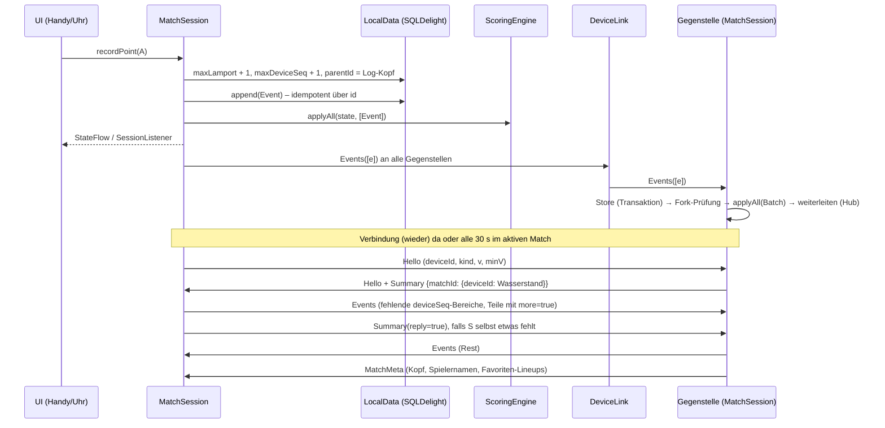
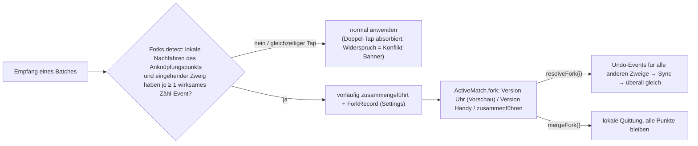

# `shared/match-session` – Match-Session (Engine + Store + Geräte-Sync)

Orchestriert ein Match auf **einem** Gerät, gleichwertig auf Handy und Uhr (01 §4, PLAN K1). Ohne Compose, Ktor, Koin –
läuft auf allen Targets inkl. watchOS. Abhängigkeiten: `core-scoring`, `sync-protocol`, `data`, `device-link`,
`kotlinx-coroutines` (nur `StateFlow`).

| Baustein | Aufgabe |
|---|---|
| `MatchSession` | API für UI/Facades, Event-Erzeugung, Empfang, Anti-Entropie-Takt, Fork-Auflösung |
| `SessionState` | Zustand für die UI: `ActiveMatch` (Engine-Zustand, Undo/Redo, Konflikte, Fork) + `SyncStatus` |
| `MatchSessions` | DI-freie Fabrik + stabile Geräte-ID (`session.deviceId` in den Settings) |
| `AndroidMatchSessions` / `AppleMatchSessions` | prozessweite Session mit fertigem Link (Wear Data Layer / WatchConnectivity), DB und Scheduler |

## Ablauf



Fork nach Offline-Zählen auf zwei Geräten (01 §4.4):



## API-Beispiel

```kotlin
// Android (Main-Thread); Apple: AppleMatchSessions.shared(PeerKind.WATCH)
val session = AndroidMatchSessions.get(context, PeerKind.PHONE)

val matchId = session.create(
    format = Presets.TENNIS_SINGLES_BO3.format(),
    lineup = Lineup(a = listOf(me), b = listOf(bea), firstServer = me),
    meta = MatchMeta(surface = Surface.CLAY, environment = Environment.OUTDOOR),
)
session.recordPoint(Side.A)
session.undo()
session.redo()

// Satzende-Dialog (OPEN): state.pending == ASK_ANOTHER_SET
session.continueDecision(anotherSet = true, matchTiebreak = false)
session.correct(Correction.server(bea))
session.endMatch()                  // im Dialog: ContinueDecision(false), sonst MatchEnded(ABANDONED)
session.createFollowUp()            // nach Best-of: verknüpftes Folge-Match (OPEN, previousMatchId)

// Zustand: StateFlow (Compose/ViewModel) …
session.state.collect { s -> render(s.match?.state, s.sync.indicator, s.match?.fork) }
// … oder Callbacks (Swift-Facade ohne Flows)
session.addListener { s -> render(s) }

// Fork-Dialog
session.state.value.match?.fork?.let { fork ->
    val watchVersion = fork.branches.indexOfFirst { PeerKind.WATCH in it.kinds }
    session.resolveFork(watchVersion)   // oder session.mergeFork()
}

session.resume(matchId)             // nach App-Neustart (Resume-Karte)
```

Tests/Desktop ohne Plattform-Link: `MatchSessions.create(createInMemoryJvmLocalData(), link = null, scheduler, PeerKind.PHONE)`.

## Regeln und Garantien

- **Ein Thread:** alle Aufrufe und Callbacks auf dem Thread des `LinkScheduler` (Main-Looper / Main-Queue).
- **Idempotent:** Empfang über Event-ID (`EventStore.appendAll`, eine Transaktion je Nachricht); Doppelzustellungen,
  Wiederholungen und Hub-Echos sind No-ops.
- **Batches:** Nachlieferungen werden gemeinsam angewendet (`ScoringEngine.applyAll`); mehrteilige Lieferungen
  (`Events.more`) erst mit dem letzten Teil – eine Fork-Prüfung über den ganzen Zweig.
- **Konvergenz:** Anti-Entropie bei jedem `Hello` und alle 30 s im aktiven Match; Versionsvektor = lückenloser
  Wasserstand je Gerät (`sync-protocol`). Belegt durch `MultiDeviceSyncTest` und `RandomizedConvergenceTest`
  (3 Geräte, Verlust, Duplikate, Offline-Phasen).
- **Auto-Follow:** Ohne offenes bzw. mit beendetem Match öffnet eine Session ein neues, laufendes Match einer
  Gegenstelle automatisch (Satzende-Dialog „auf allen Geräten“, Folge-Match).
- **Folge-Match:** gleiche Besetzung und gleiches Satzformat, Modus `OPEN`, `decidingSet = null`,
  Erstaufschläger aus `state.continuation`, `previousMatchId` gesetzt (02 §5.2).

## Abweichungen von 01 §4

| Thema | 01 | Umsetzung | Grund |
|---|---|---|---|
| Fork-Erkennung | aus `parentId` im Log | **beim Empfang** (lokal vs. eingehend), Ergebnis als `ForkRecord` in den Settings | Aus dem fertigen Log ist nicht unterscheidbar, ob ein späteres Event den anderen Zweig schon kannte (nur ein `parentId`); beim Empfang ist es eindeutig |
| „Beide zusammenführen“ | Auflösung im Dialog | gerätelokale Quittung ohne Event | kein Event-Typ ohne Score-Wirkung vorhanden; `core-scoring`/Testvektoren bleiben unverändert |
| `Summary` „maxDeviceSeq“ | höchste Sequenz | **lückenloser Wasserstand** | außer der Reihe angekommene Events dürfen keine Lücke verdecken |
| Konflikt-Banner bei Fork | – | Widersprüche zwischen Fork-Zweigen erscheinen nur im Fork-Dialog | keine doppelte UI für denselben Sachverhalt |
